# hash-design

[English](README.md) | [简体中文](README.zh-CN.md) | [日本語](README.ja.md) | [한국어](README.ko.md) | **Español**

<p align="center"><a href="https://qybaihe.github.io/hash-design/causeway-festival/compare.html"><picture><source media="(prefers-reduced-motion: reduce)" srcset="docs/assets/hero.png">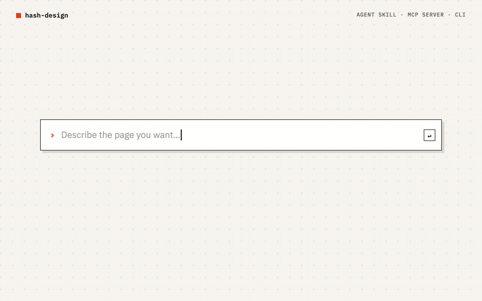</picture></a></p>

<p align="center"><sub>Resultado real, no una maqueta: <a href="examples/causeway-festival">examples/causeway-festival</a>; cada vista previa la hizo un subagente distinto a partir de un único brief congelado.<br><a href="https://qybaihe.github.io/hash-design/"><b>Ver los 4 ejemplos en vivo →</b></a> · 20 de las 40 ramas · <a href="docs/assets/hero.png">imagen fija</a> · <a href="docs/assets/hero.mp4">MP4</a></sub></p>

<p align="center"><b>Que tu agente de programación deje de entregar siempre la misma página con Inter y degradado morado.</b><br>
Un solo prompt se convierte en cinco direcciones de diseño, elegidas por hashes SHA-256 verdaderamente aleatorios y no por el modelo. Tú eliges una; cualquier dirección se puede reconstruir a partir de su ref.</p>

<p align="center">
<a href="https://github.com/qybaihe/hash-design/actions/workflows/ci.yml"></a>
<a href="https://qybaihe.github.io/hash-design/"></a>
<a href="LICENSE"></a>
<a href="#instalar-la-skill"></a>
</p>

### Inicio rápido

Aún no está en npm. Compila desde el código fuente (Node ≥ 20), instala la Skill en tu proyecto y registra el servidor MCP:

```bash
git clone https://github.com/qybaihe/hash-design.git && cd hash-design && npm install && npm run build
node packages/core/dist/bin.js skill install --target both --dir /path/to/your/project   # Skill → .claude/skills + .cursor/skills
claude mcp add hash-design -- node "$PWD/packages/mcp/dist/bin.js"                       # MCP server (Claude Code)
```

Después, pídele a tu agente:

> Usa hash-design para crear una web de una sola página para Causeway, un festival de música de un día en la isla de Skerrow. Datos: sábado 19 de junio de 2027; se llega a pie por una calzada de 1,2 km que solo se puede cruzar con marea baja; …

Cursor y Claude Desktop: [Configurar MCP](#configurar-mcp).

### Cómo funciona, en cuatro líneas

1. **Tirada**: cinco hashes SHA-256 a partir de la aleatoriedad del sistema.
2. **Mapeo**: un árbol de decisión fijo convierte cada hash en un brief: género, maquetación, fuentes, paleta en hex, densidad, movimiento, giro. Mismo ref, mismo brief.
3. **Render**: cinco vistas previas HTML, un subagente por brief congelado, y una página comparativa que las pone lado a lado.
4. **Elección**: respondes con un número; el agente construye la página final con ese brief y la revisa con `critique_page`.

<details><summary>Más insignias</summary>

[](https://github.com/qybaihe/hash-design/actions/workflows/pages.yml)
[](.nvmrc)
[](#instalación)

</details>

---

## Contenido

- [Demo](#demo) · [Más ejemplos](#más-ejemplos) · [Por qué](#por-qué) · [Cómo funciona](#cómo-funciona) · [Qué contiene un brief](#qué-contiene-un-brief)
- [Instalación](#instalación) · [Configurar MCP](#configurar-mcp) · [Instalar la Skill](#instalar-la-skill) · [Uso](#uso)
- [Herramientas MCP](#herramientas-mcp) · [CLI](#cli) · [Biblioteca](#biblioteca) · [Biblioteca de ramas](#biblioteca-de-ramas-40) · [Prohibiciones globales](#prohibiciones-globales)
- [Desarrollo](#desarrollo) · [Documentación](#documentación) · [Limitaciones conocidas](#limitaciones-conocidas) · [Contribuir](#contribuir)

## Demo

[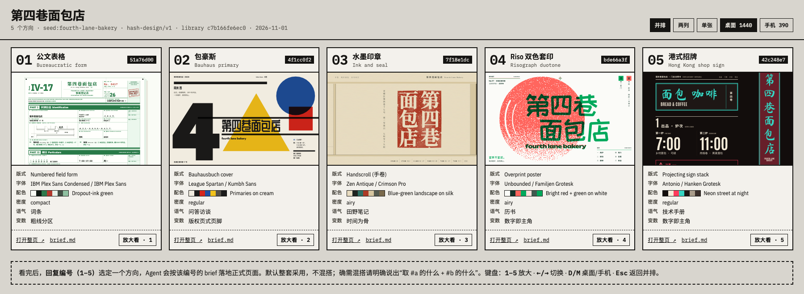](https://qybaihe.github.io/hash-design/fourth-lane-bakery/compare.html)

[`examples/fourth-lane-bakery/`](examples/fourth-lane-bakery) es una ejecución completa, de principio a fin, para una panadería ficticia: una [ficha de datos](examples/fourth-lane-bakery/facts.md) → una tirada → cinco briefs congelados → cinco vistas previas, cada una renderizada por un subagente distinto que solo podía ver su propio brief → una página comparativa lado a lado. Todo se sirve en GitHub Pages:

| #   | Dirección (rama)                                                                                                 | Escritorio                                                                                                                           | Brief                                                               |
| --- | ---------------------------------------------------------------------------------------------------------------- | ------------------------------------------------------------------------------------------------------------------------------------ | ------------------------------------------------------------------- |
| 01  | [Bureaucratic form](https://qybaihe.github.io/hash-design/fourth-lane-bakery/previews/01-bureaucratic-form.html) | 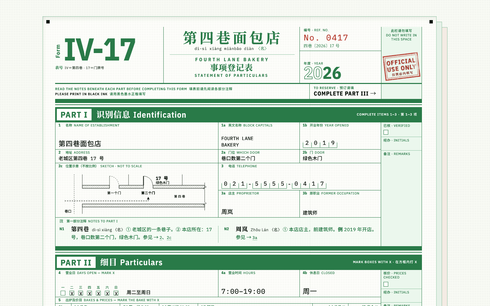 | [brief](examples/fourth-lane-bakery/briefs/01-bureaucratic-form.md) |
| 02  | [Bauhaus primary](https://qybaihe.github.io/hash-design/fourth-lane-bakery/previews/02-bauhaus-primary.html)     | 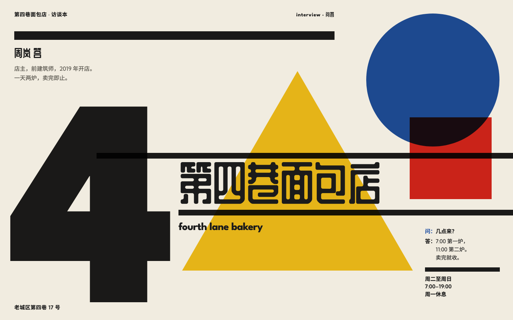     | [brief](examples/fourth-lane-bakery/briefs/02-bauhaus-primary.md)   |
| 03  | [Ink and seal](https://qybaihe.github.io/hash-design/fourth-lane-bakery/previews/03-ink-and-seal.html)           | 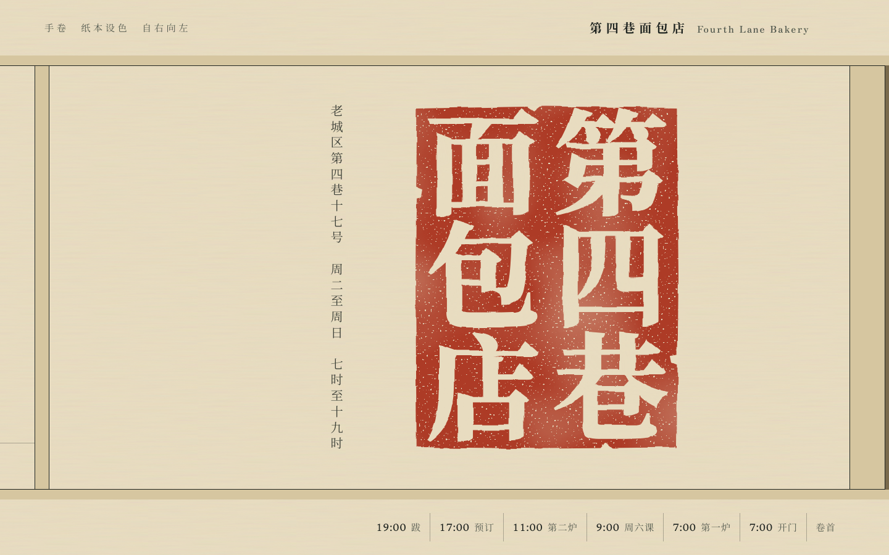           | [brief](examples/fourth-lane-bakery/briefs/03-ink-and-seal.md)      |
| 04  | [Risograph duotone](https://qybaihe.github.io/hash-design/fourth-lane-bakery/previews/04-risograph-duotone.html) | 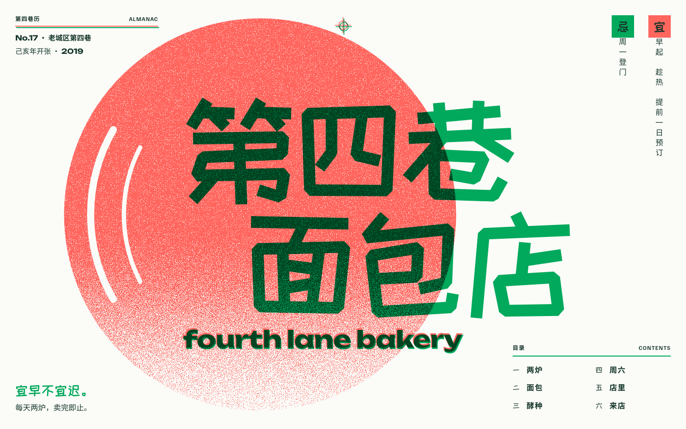 | [brief](examples/fourth-lane-bakery/briefs/04-risograph-duotone.md) |
| 05  | [Hong Kong shop sign](https://qybaihe.github.io/hash-design/fourth-lane-bakery/previews/05-hk-shop-sign.html)    | 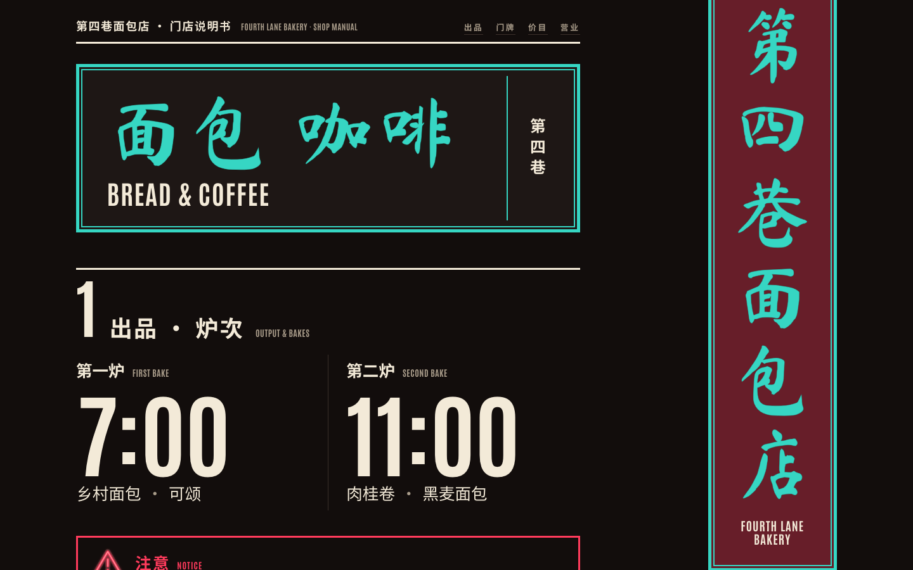    | [brief](examples/fourth-lane-bakery/briefs/05-hk-shop-sign.md)      |

- **Página comparativa en vivo:** <https://qybaihe.github.io/hash-design/fourth-lane-bakery/compare.html> (pulsa 1–5 para ampliar y D/M para alternar entre escritorio y móvil)
- **En local:** `open examples/fourth-lane-bakery/compare.html`
- Todas las vistas previas obtuvieron entre 96 y 100/100 en `critique_page` y 100/100 en adherencia al brief. El [README](examples/fourth-lane-bakery/README.md) del ejemplo (en chino) documenta el proceso. La tienda, sus datos y sus textos están en chino porque la página está escrita para un público chino.

<details><summary>Capturas en móvil y la página comparativa con ancho de teléfono</summary>

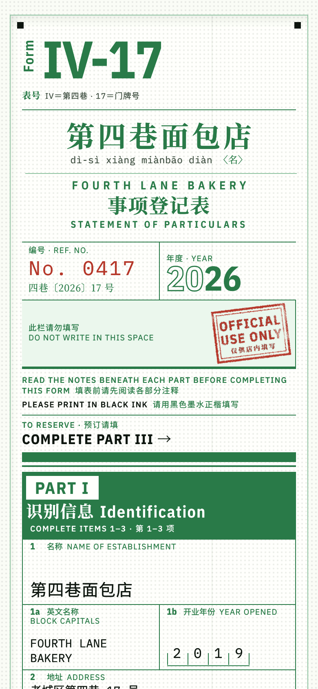 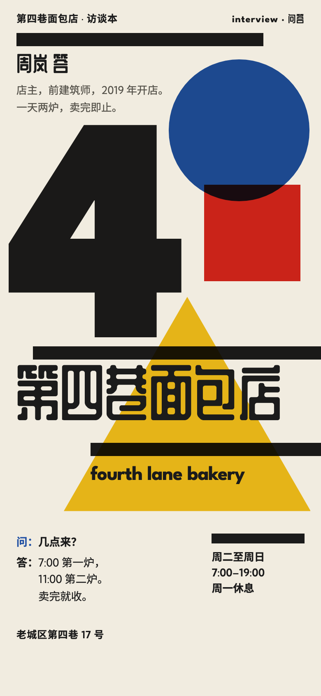 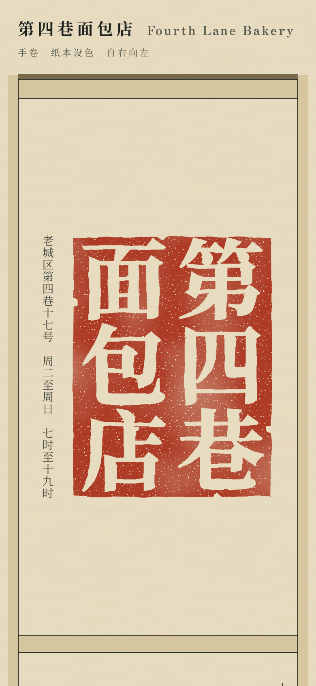 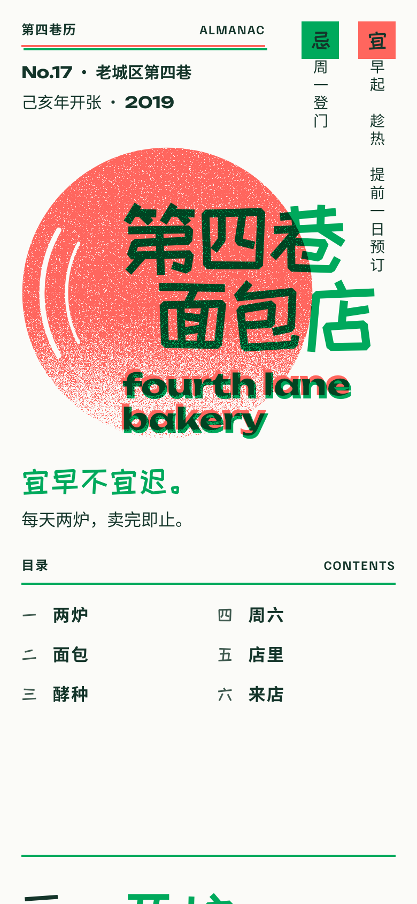 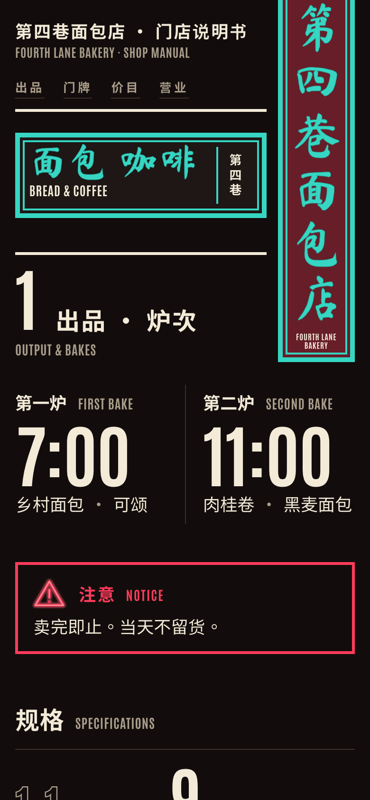

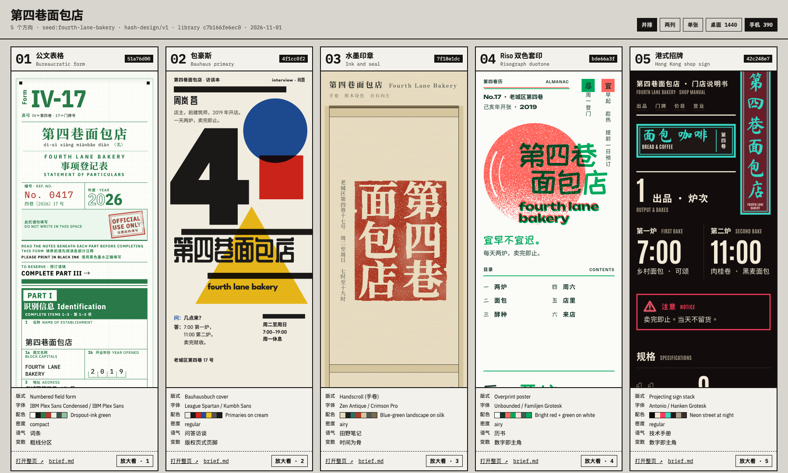

</details>

Para reproducir exactamente esta tirada:

```bash
npm run build
node packages/core/dist/bin.js roll --subject "第四巷面包店" \
  --facts-file examples/fourth-lane-bakery/facts.md --seed fourth-lane-bakery --out /tmp/fourth-lane
# Equivalente MCP: roll_designs { subject, facts, seed: "fourth-lane-bakery" } devuelve las mismas cinco refs
```

<!-- MORE-EXAMPLES:START -->

### Más ejemplos

Hay tres ejecuciones más, cada una con su propia ficha de datos y su seed fija. Ningún par de ejemplos comparte rama, así que entre los cuatro aparecen 20 de las 40 ramas y las seis familias. Cada vista previa la renderizó un subagente que solo veía su propio brief, y todas sacan al menos 90/100 en `critique_page`. Están todas en el [índice de ejemplos](https://qybaihe.github.io/hash-design/).

#### Sluice — una bandeja de entrada autoalojada para webhooks · página en inglés

[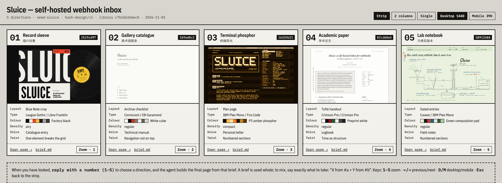](https://qybaihe.github.io/hash-design/sluice/compare.html)

<table>
<tr>
<td align="center"><a href="https://qybaihe.github.io/hash-design/sluice/previews/01-record-sleeve.html">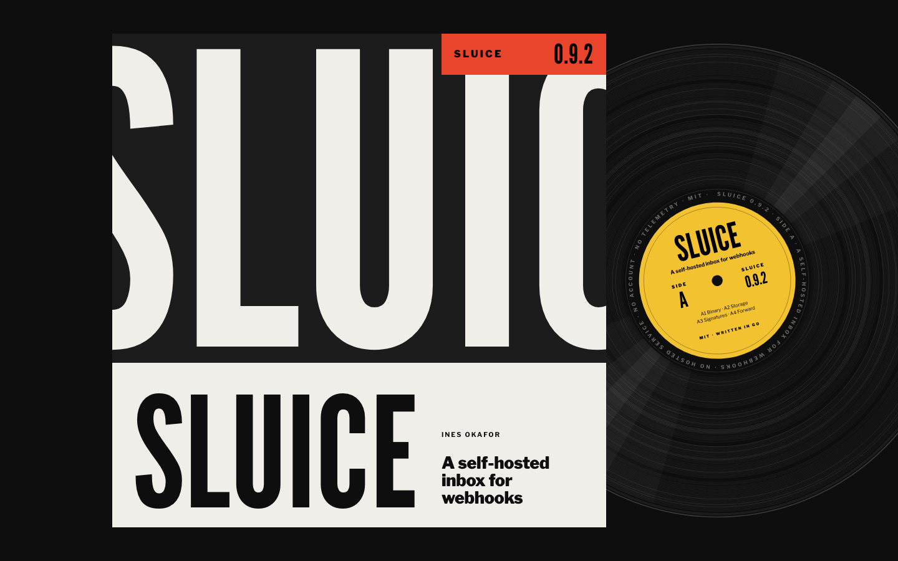</a><br><a href="https://qybaihe.github.io/hash-design/sluice/previews/01-record-sleeve.html">01 · Record sleeve</a></td>
<td align="center"><a href="https://qybaihe.github.io/hash-design/sluice/previews/02-gallery-catalogue.html">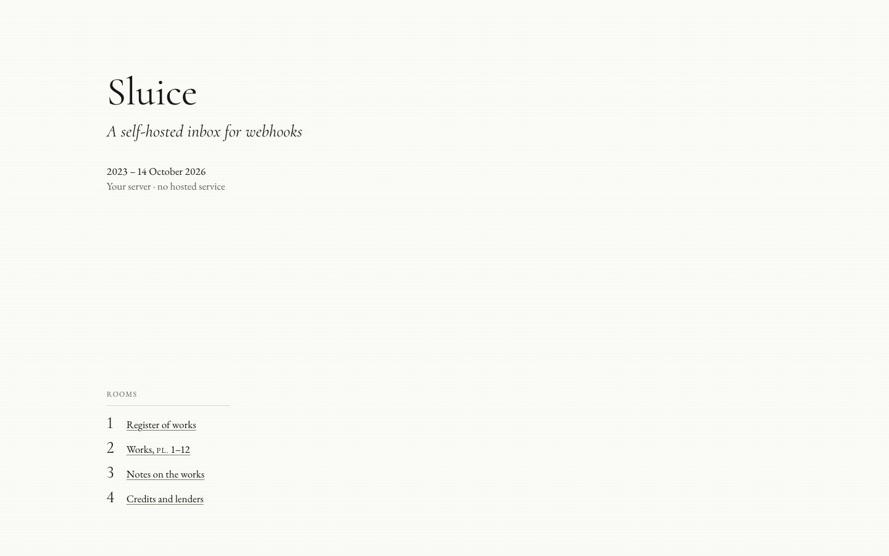</a><br><a href="https://qybaihe.github.io/hash-design/sluice/previews/02-gallery-catalogue.html">02 · Gallery catalogue</a></td>
<td align="center"><a href="https://qybaihe.github.io/hash-design/sluice/previews/03-terminal-phosphor.html">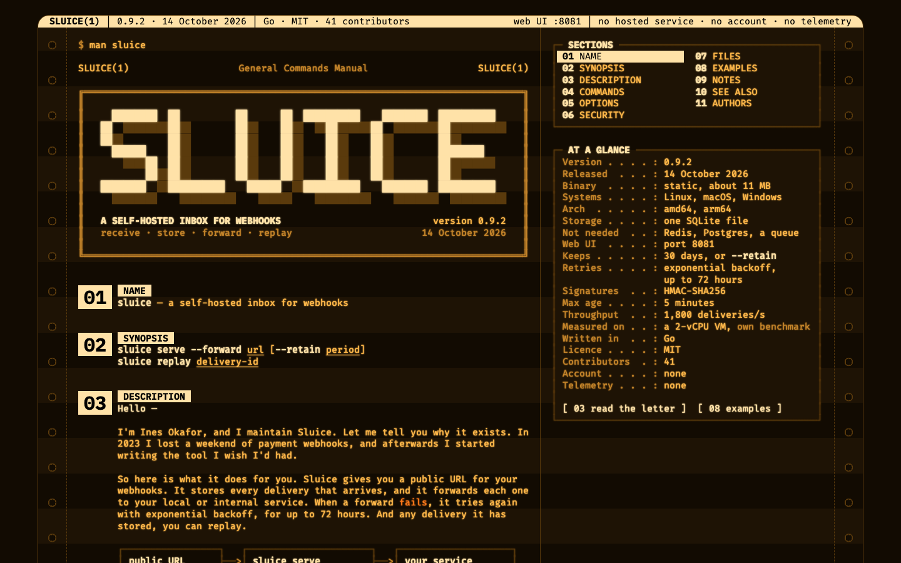</a><br><a href="https://qybaihe.github.io/hash-design/sluice/previews/03-terminal-phosphor.html">03 · Terminal phosphor</a></td>
<td align="center"><a href="https://qybaihe.github.io/hash-design/sluice/previews/04-academic-paper.html">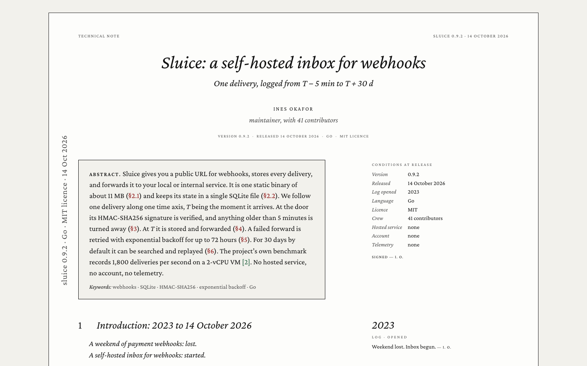</a><br><a href="https://qybaihe.github.io/hash-design/sluice/previews/04-academic-paper.html">04 · Academic paper</a></td>
<td align="center"><a href="https://qybaihe.github.io/hash-design/sluice/previews/05-lab-notebook.html">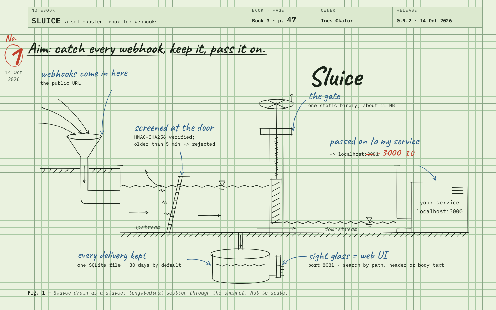</a><br><a href="https://qybaihe.github.io/hash-design/sluice/previews/05-lab-notebook.html">05 · Lab notebook</a></td>
</tr>
</table>

**[Página comparativa en vivo →](https://qybaihe.github.io/hash-design/sluice/compare.html)** · [carpeta del ejemplo](examples/sluice) (datos, briefs y proceso) · seed `sluice` · critique 92–96 · adherencia al brief 90–100

#### Bridge No.2 Cycle Works (二号桥单车铺) — un taller de bicicletas bajo un puente · página en chino

[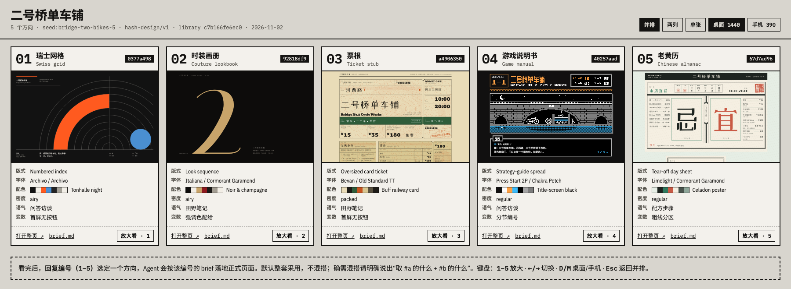](https://qybaihe.github.io/hash-design/bridge-two-bikes/compare.html)

<table>
<tr>
<td align="center"><a href="https://qybaihe.github.io/hash-design/bridge-two-bikes/previews/01-swiss-grid.html">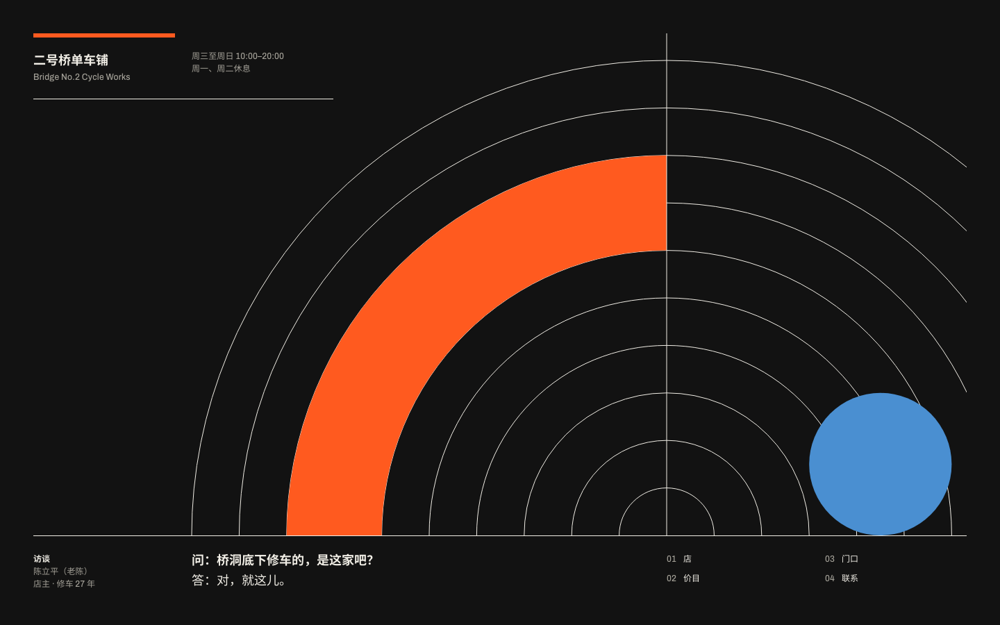</a><br><a href="https://qybaihe.github.io/hash-design/bridge-two-bikes/previews/01-swiss-grid.html">01 · Swiss grid</a></td>
<td align="center"><a href="https://qybaihe.github.io/hash-design/bridge-two-bikes/previews/02-couture-lookbook.html">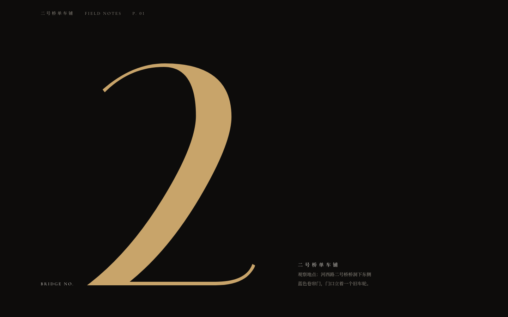</a><br><a href="https://qybaihe.github.io/hash-design/bridge-two-bikes/previews/02-couture-lookbook.html">02 · Couture lookbook</a></td>
<td align="center"><a href="https://qybaihe.github.io/hash-design/bridge-two-bikes/previews/03-ticket-stub.html">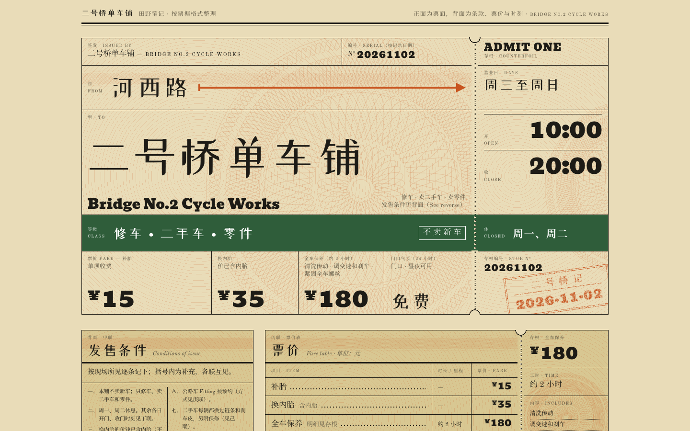</a><br><a href="https://qybaihe.github.io/hash-design/bridge-two-bikes/previews/03-ticket-stub.html">03 · Ticket stub</a></td>
<td align="center"><a href="https://qybaihe.github.io/hash-design/bridge-two-bikes/previews/04-game-manual.html">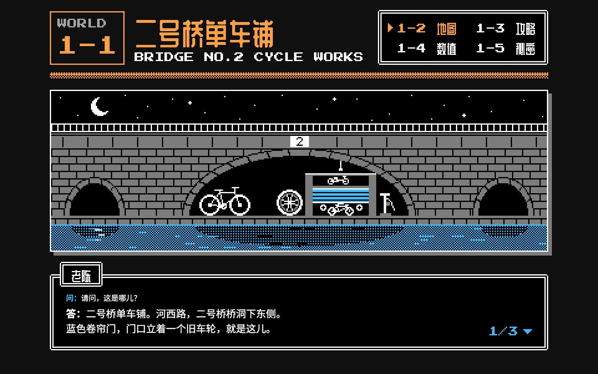</a><br><a href="https://qybaihe.github.io/hash-design/bridge-two-bikes/previews/04-game-manual.html">04 · Game manual</a></td>
<td align="center"><a href="https://qybaihe.github.io/hash-design/bridge-two-bikes/previews/05-chinese-almanac.html">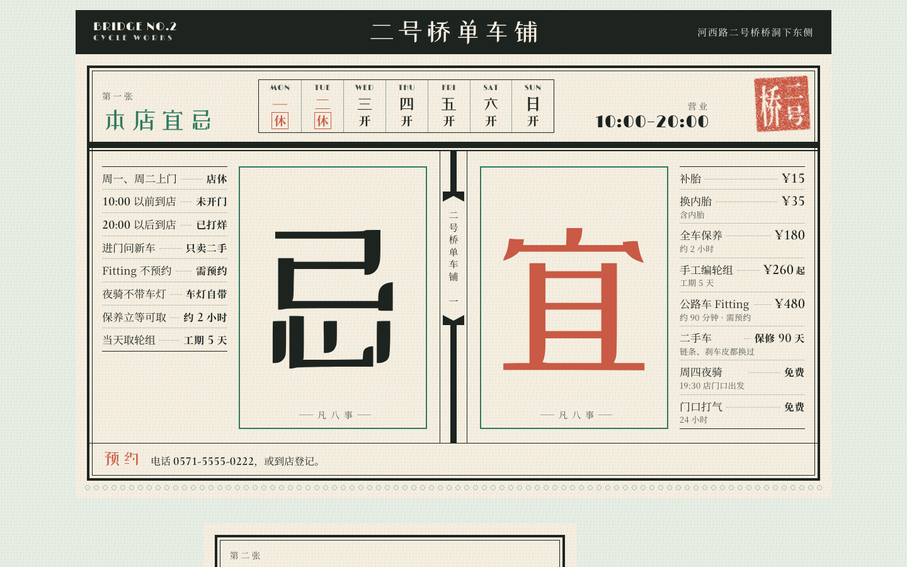</a><br><a href="https://qybaihe.github.io/hash-design/bridge-two-bikes/previews/05-chinese-almanac.html">05 · Chinese almanac</a></td>
</tr>
</table>

**[Página comparativa en vivo →](https://qybaihe.github.io/hash-design/bridge-two-bikes/compare.html)** · [carpeta del ejemplo](examples/bridge-two-bikes) (datos, briefs y proceso) · seed `bridge-two-bikes-5` · critique 96–100 · adherencia al brief 100

#### Causeway — un festival de música de un día en una isla a la que se llega con marea baja · página en inglés

[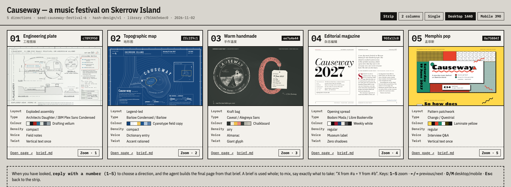](https://qybaihe.github.io/hash-design/causeway-festival/compare.html)

<table>
<tr>
<td align="center"><a href="https://qybaihe.github.io/hash-design/causeway-festival/previews/01-engineering-plate.html">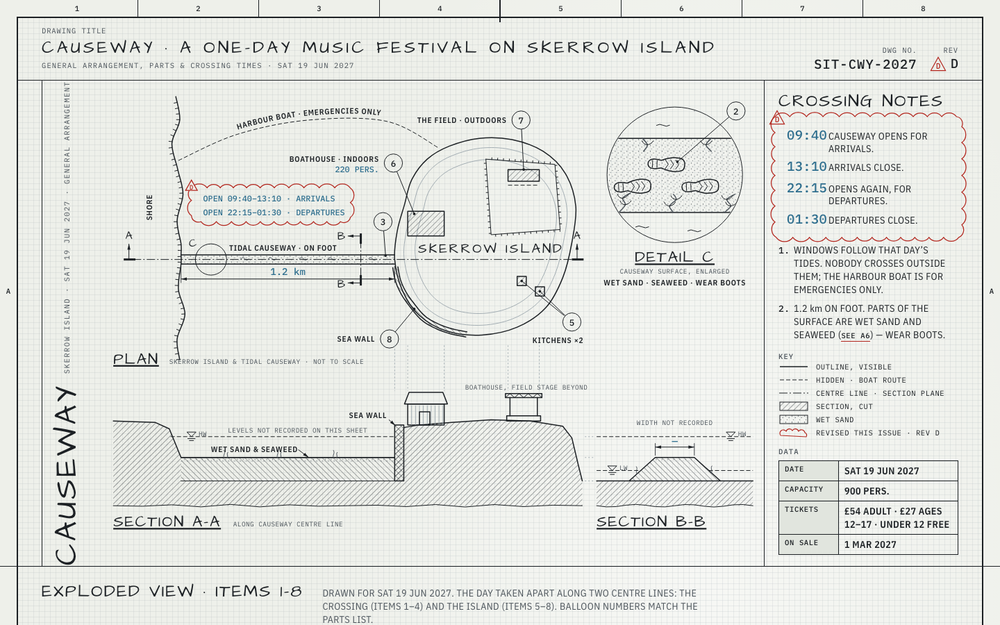</a><br><a href="https://qybaihe.github.io/hash-design/causeway-festival/previews/01-engineering-plate.html">01 · Engineering plate</a></td>
<td align="center"><a href="https://qybaihe.github.io/hash-design/causeway-festival/previews/02-topographic-map.html">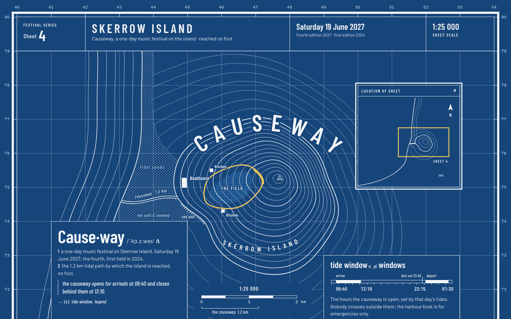</a><br><a href="https://qybaihe.github.io/hash-design/causeway-festival/previews/02-topographic-map.html">02 · Topographic map</a></td>
<td align="center"><a href="https://qybaihe.github.io/hash-design/causeway-festival/previews/03-warm-handmade.html">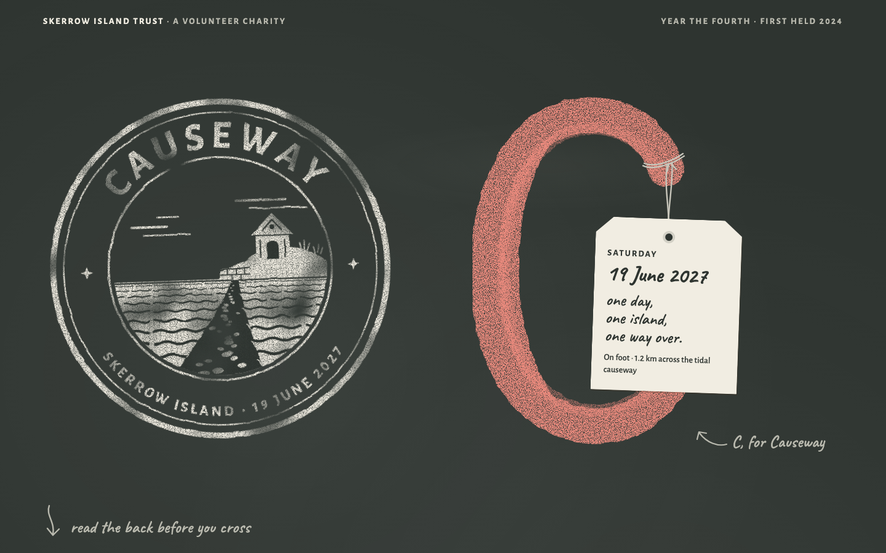</a><br><a href="https://qybaihe.github.io/hash-design/causeway-festival/previews/03-warm-handmade.html">03 · Warm handmade</a></td>
<td align="center"><a href="https://qybaihe.github.io/hash-design/causeway-festival/previews/04-editorial-magazine.html">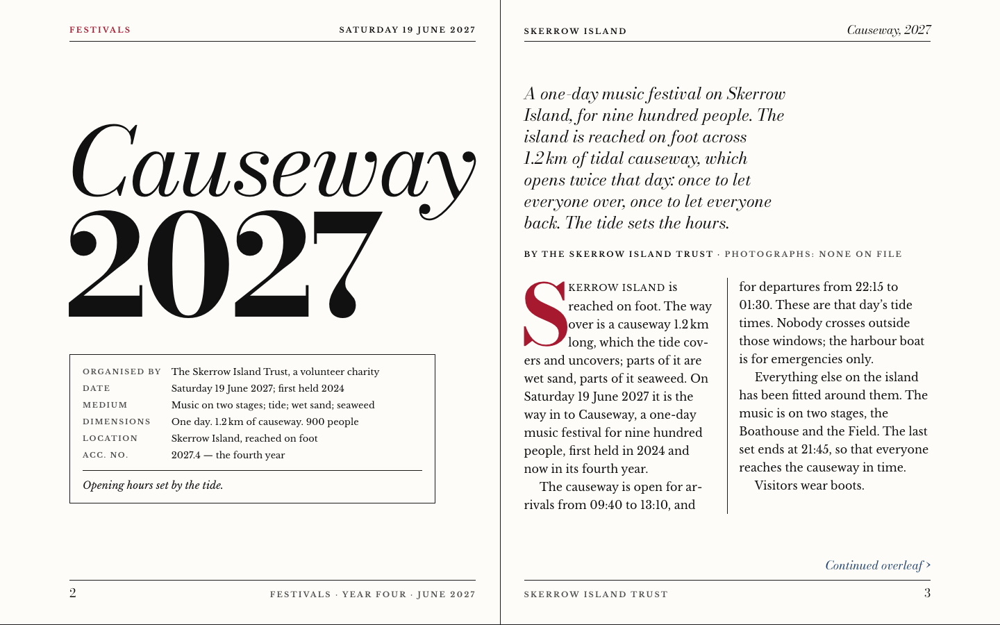</a><br><a href="https://qybaihe.github.io/hash-design/causeway-festival/previews/04-editorial-magazine.html">04 · Editorial magazine</a></td>
<td align="center"><a href="https://qybaihe.github.io/hash-design/causeway-festival/previews/05-memphis-pop.html">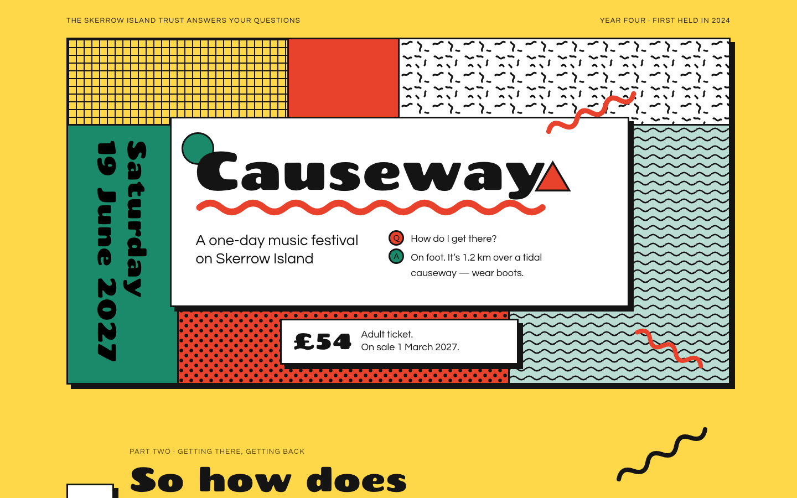</a><br><a href="https://qybaihe.github.io/hash-design/causeway-festival/previews/05-memphis-pop.html">05 · Memphis pop</a></td>
</tr>
</table>

**[Página comparativa en vivo →](https://qybaihe.github.io/hash-design/causeway-festival/compare.html)** · [carpeta del ejemplo](examples/causeway-festival) (datos, briefs y proceso) · seed `causeway-festival-6` · critique 96–100 · adherencia al brief 100

<!-- MORE-EXAMPLES:END -->

## Por qué

Pídele a un LLM "una página bonita" y casi siempre acabará en la misma estética predominante: Inter, un degradado de morado a azul, un titular centrado con dos botones, tres tarjetas de características idénticas, glassmorphism, iconos emoji y textos como _Unlock_, _Seamless_, _Supercharge_. La razón es sencilla: siempre que el modelo puede elegir, escoge lo más común de sus datos de entrenamiento.

hash-design no le pide al modelo que tenga mejor gusto. **Le quita la decisión**:

1. Genera cinco hashes a partir de la aleatoriedad del sistema (`crypto.randomBytes(32)` → SHA-256).
2. Asigna cada hash, mediante un **árbol de decisión fijo y reproducible**, a una dirección concreta: género de diseño, maquetación, combinación de fuentes, paleta hex, densidad, movimiento, motivo, ancla de la primera pantalla, escala tipográfica, superficie, voz de redacción y un "giro" (twist).
3. Congela cada dirección como un **brief** con tokens listos para pegar (enlaces de fuentes, valores hex, `tokens.css`, medidas de la retícula, política de radio/sombra), más las prohibiciones globales.
4. La única tarea del agente es **ejecutar** cada brief con fidelidad: cinco vistas previas HTML independientes y una página comparativa lado a lado. Después **se detiene y espera a que elijas un número**.
5. Cuando eliges, el agente construye la página final a partir de ese brief y la revisa con `critique_page`.

Se trata de una restricción aleatoria externa que rompe la estética por defecto del modelo. No tiene nada que ver con cachés KV ni con la temperatura de muestreo. El gusto del modelo se invierte en la calidad de ejecución (alineación, ritmo, detalle, legibilidad), no en elegir un estilo.

## Cómo funciona

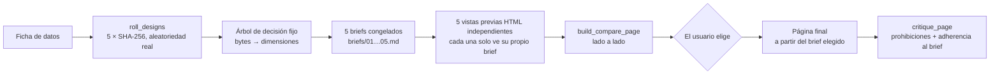

### Bytes → dimensiones (`hash-design/v1`)

| Bytes | Dimensión | Regla                                                                                                             |
| ----- | --------- | ----------------------------------------------------------------------------------------------------------------- |
| 0–1   | branch    | `uint16(b0, b1) mod N` (N = 40). Las colisiones avanzan hacia delante, ver más abajo                              |
| 2     | voice     | 14 voces de redacción: pizarra del tendero, notas de campo, manual técnico, carta personal, horario, almanaque…   |
| 3     | layout    | 1 de las 3 maquetaciones de la rama, con medidas de la retícula y un esquema de las secciones de arriba abajo     |
| 4     | type      | 1 de 3 combinaciones: display / body (/ mono) + fuentes CJK + notas de composición tipográfica                    |
| 5     | palette   | 1 de 3 paletas: siete valores hex (paper / ink / muted / accent / accent2 / rule / panel)                         |
| 6     | density   | El subconjunto de airy / regular / compact / packed que permite la rama                                           |
| 7     | motion    | 1 de 3: duración, easing y una política de movimiento reducido                                                    |
| 8     | motif     | 1 de los 3 motivos de la rama                                                                                     |
| 9     | anchor    | 1 de las 3 anclas de primera pantalla de la rama                                                                  |
| 10    | scale     | Las escalas modulares que permite la rama (1.125–1.618)                                                           |
| 11    | surface   | 1 de 3 superficies (con indicaciones de CSS)                                                                      |
| 12    | twist     | 16 giros, p. ej. "numerales como display", "un elemento rompe la retícula", "ningún botón en la primera pantalla" |
| 13–31 | sin uso   | Se registran en el brief, reservados para dimensiones futuras                                                     |

- **Colisiones y dispersión por familias.** Dentro de una misma tirada, un hash que cae en una rama ya usada avanza (+1, +2, …) hasta la siguiente rama libre. Mientras quede alguna **familia** sin usar (print / document / signage / screen / craft / modernist), caer en una familia ya usada también cuenta como colisión, así que una tirada de 5 siempre abarca 5 familias distintas. El número de pasos es el `probe`; una ref se escribe `<hash>+<probe>` y se reproduce por sí sola.
- **Orden de las ramas.** El orden de la biblioteca es el orden del mapeo. Los miembros de cada familia se reparten de forma uniforme alrededor del anillo, de modo que avanzar no concentra la probabilidad en una sola rama: en tiradas de 5, cada rama aparece en el 9–17% de los casos (con una distribución uniforme sería el 12.5%).
- **Las restricciones filtran los conjuntos de opciones antes de aplicar los bytes**, así que forman parte de la identidad de un diseño: `light_only`, `dark_only`, `reduced_motion`, `brand_colors` (el color de marca sustituye al acento; se elige la paleta cuyo acento tiene el tono más cercano y se informa del contraste), `families`, `include_branches`, `exclude_branches`.
- **Reproducible.** La misma `ref`, las mismas restricciones y la misma huella de la biblioteca producen siempre el mismo brief. Cada brief registra el algoritmo (`hash-design/v1`) y la huella de la biblioteca (los primeros 12 dígitos hex de un SHA-256 calculado sobre los datos).
- **`seed` solo sirve para reproducir ejemplos y tests.** El uso real siempre parte de la aleatoriedad del sistema.

La especificación completa, con un ejemplo resuelto, está en [docs/mapping.md](docs/mapping.md) (en inglés).

## Qué contiene un brief

Toma el brief [#3 Ink and seal](examples/fourth-lane-bakery/briefs/03-ink-and-seal.md) del ejemplo. Un brief contiene:

- la traza del mapeo, byte a byte, con la fórmula y el resultado
- el contenido: los únicos datos que la página puede afirmar
- la voz de redacción y sus recursos, la maquetación (medidas de la retícula y orden de las secciones) y el ancla de la primera pantalla
- tipografía: un `<link>` de Google Fonts (con fuentes CJK cuando la página está en chino) y una escala tipográfica calculada a partir de la razón modular
- siete valores hex, proporciones de color y una tabla de contraste WCAG (qué colores son solo para texto grande o decoración)
- densidad, política de radio / borde / sombra, superficie (con un fragmento de CSS), motivo y especificación de movimiento
- el giro, las listas must / must-not de la rama y las 14 prohibiciones globales
- un `tokens.css` listo para pegar y una lista de comprobación previa a la entrega

Los briefs están escritos para agentes y son bilingües: los encabezados llevan etiquetas en chino y en inglés, y `language` (`zh` o `en`, detectado automáticamente a partir del tema y los datos) cambia el texto del concepto, las instrucciones y si se cargan webfonts CJK. Algunas descripciones de los conjuntos de opciones (voces, giros) por ahora solo están escritas en chino.

## Instalación

> **Todavía no está publicado en npm.** Los archivos `package.json` están listos para publicarse (`npm pack --dry-run` se ejecuta en CI), pero por ahora hay que instalar desde el código fuente. Cuando se publique, funcionarán `npx -y hash-design-mcp` y `npx -y hash-design`.

Requiere Node.js ≥ 20 (`.nvmrc` fija la versión 22 para desarrollo).

```bash
git clone https://github.com/qybaihe/hash-design.git
cd hash-design
npm install
npm run build
# Entrada del servidor MCP: packages/mcp/dist/bin.js
# Entrada de la CLI:        packages/core/dist/bin.js
```

## Configurar MCP

Sustituye `/ABS/PATH/hash-design` por la ruta absoluta de tu clon.

### Claude Code

```bash
claude mcp add hash-design -- node /ABS/PATH/hash-design/packages/mcp/dist/bin.js
```

O versiona un `.mcp.json` a nivel de proyecto:

```json
{
  "mcpServers": {
    "hash-design": {
      "command": "node",
      "args": ["/ABS/PATH/hash-design/packages/mcp/dist/bin.js"]
    }
  }
}
```

### Cursor

`.cursor/mcp.json` (proyecto) o `~/.cursor/mcp.json` (global), con la misma estructura:

```json
{
  "mcpServers": {
    "hash-design": {
      "command": "node",
      "args": ["/ABS/PATH/hash-design/packages/mcp/dist/bin.js"]
    }
  }
}
```

### Claude Desktop

`~/Library/Application Support/Claude/claude_desktop_config.json` (macOS) o `%APPDATA%\Claude\claude_desktop_config.json` (Windows), con la misma estructura que arriba. Claude Desktop no inicia el servidor en el directorio de tu proyecto, así que pasa una **ruta absoluta** como `out_dir` al llamar a `roll_designs`.

## Instalar la Skill

La Skill le indica al agente cuándo usar hash-design, en qué orden llamar a las herramientas MCP, cómo renderizar las vistas previas de forma independiente y cuándo debe detenerse.

```bash
# En un proyecto (escribe tanto en .claude/skills como en .cursor/skills)
node packages/core/dist/bin.js skill install --target both --dir /path/to/your/project
# En tu directorio personal (disponible en todos los proyectos)
node packages/core/dist/bin.js skill install --target claude --global
```

O copia a mano [`skills/hash-design/SKILL.md`](skills/hash-design/SKILL.md) en `.claude/skills/hash-design/SKILL.md` (Claude Code) o en `.cursor/skills/hash-design/SKILL.md` (Cursor). Este repositorio incluye ambas copias, y un test las mantiene idénticas a la fuente. El cuerpo de la Skill está escrito en chino; su descripción incluye frases de activación en inglés.

## Uso

Con el servidor MCP y la Skill instalados, basta con pedírselo a tu agente:

> Usa hash-design para crear una web de una sola página para "Fourth Lane Bakery". Datos: abierto mar–dom 7:00–19:00, cerrado los lunes; pan de campo ¥38; …

El agente hace la tirada, congela los briefs, renderiza cinco vistas previas, escribe `design/hash-design/compare.html` y luego se detiene a esperar que respondas con un número. Los clientes compatibles con prompts MCP también pueden iniciar el mismo flujo con el prompt `hash-design` (argumentos: `subject`, `facts`, `count`).

## Herramientas MCP

| Herramienta          | Qué hace                                                                                                                                                                                                                               |
| -------------------- | -------------------------------------------------------------------------------------------------------------------------------------------------------------------------------------------------------------------------------------- |
| `roll_designs`       | Recibe `subject`, `facts`, `count` (5 por defecto) y, opcionalmente, `seed`, `language` y restricciones. Devuelve los hashes, el mapeo y un brief por dirección. Con `out_dir` congela `roll.json`, `ROLL.md` y `briefs/*.md` en disco |
| `get_brief`          | Reproduce un brief a partir de una `ref` (`<hash>` o `<hash>+<probe>`) más las mismas restricciones, en Markdown o JSON                                                                                                                |
| `list_branches`      | Lista las 40 ramas de diseño, con filtro opcional por familia                                                                                                                                                                          |
| `get_branch`         | Muestra todas las opciones y tokens de una rama                                                                                                                                                                                        |
| `critique_page`      | Puntúa una cadena o un archivo HTML según las prohibiciones y la lista de comprobación de plantillas típicas de IA; con `brief_ref` o `roll_path` + `pick` también puntúa la adherencia al brief                                       |
| `build_compare_page` | Genera el `compare.html` lado a lado a partir de un `roll.json`                                                                                                                                                                        |

Recursos: `hash-design://bans`, `hash-design://workflow` (la Skill), `hash-design://branches`, `hash-design://branch/{id}`. Prompt: `hash-design` (`subject`, `facts`, `count`).

Todos los parámetros, formas de retorno y equivalentes en la CLI están documentados en [docs/mcp-tools.md](docs/mcp-tools.md) (en inglés).

## CLI

```bash
hash-design roll --subject "Fourth Lane Bakery" --facts-file facts.md --out design/hash-design   # 5 direcciones verdaderamente aleatorias
hash-design roll --subject "…" --light-only --brand "#c8102e" --format json                     # con restricciones
hash-design brief <ref> [constraints]                                                            # reproduce un brief
hash-design branches [--family craft]                                                            # la biblioteca de ramas
hash-design branch ink-and-seal                                                                  # una rama en detalle
hash-design critique page.html --roll design/hash-design/roll.json --pick 3 --fail-under 80
hash-design compare --roll design/hash-design/roll.json                                          # escribe compare.html
hash-design skill install --target both                                                          # instala la Skill
```

Desde una copia del código fuente, ejecútalo como `node packages/core/dist/bin.js …` (o con `alias hash-design="node $PWD/packages/core/dist/bin.js"` desde la raíz del repositorio). `hash-design --help` lista todos los comandos y `hash-design <command> --help` (por ejemplo, `hash-design roll --help`) muestra las opciones de un comando, incluidos los flags de restricción `--light-only`, `--dark-only`, `--reduced-motion`, `--brand`, `--family`, `--include` y `--exclude`.

## Biblioteca

```ts
import { roll, renderBrief, critiquePage, reproduce, parseRef } from 'hash-design';

const r = roll({ content: { subject: 'Fourth Lane Bakery', facts: ['Closed Mondays', 'Country loaf ¥38'] } });
for (const [i, d] of r.designs.entries()) console.log(renderBrief(d, r.content, { number: i + 1 }));

const design = reproduce(parseRef(r.designs[0].ref), r.constraints);
const report = critiquePage({ html: '<!doctype html>…', design });
console.log(report.score, report.adherence, report.findings);
```

Hasta que el paquete esté en npm, impórtalo desde una copia del código fuente (`packages/core/dist/index.js`) o añade esa copia como dependencia local (`npm install /ABS/PATH/hash-design/packages/core`).

## Biblioteca de ramas (40)

Cada rama es un género de diseño del mundo real, no un "estilo SaaS". Cada dimensión tiene tres opciones concretas: combinaciones de fuentes (Google Fonts + CJK), siete valores hex, medidas de la retícula, política de radio / borde / sombra, especificación de movimiento, motivos y superficies. El catálogo completo está en [docs/branches.md](docs/branches.md) (en inglés); `list_branches` / `get_branch` lo consultan en vivo.

| Familia   | Ramas                                                                                                                                                                                       |
| --------- | ------------------------------------------------------------------------------------------------------------------------------------------------------------------------------------------- |
| print     | Supermarket circular · Letterpress wood type · Photocopy zine · Risograph duotone · Record sleeve · Varsity sports programme · Couture lookbook · Broadsheet newspaper · Editorial magazine |
| document  | Engineering plate · Ledger · Ticket stub · Academic paper · Apothecary label · Bureaucratic form · Thermal receipt · Herbarium specimen · Field guide plate                                 |
| signage   | Transit wayfinding · Hong Kong shop sign · Diner menu board · Gallery catalogue · Topographic map                                                                                           |
| screen    | Terminal phosphor · Web 1.0 homepage · Game manual · Instrument panel · Raw brutalist                                                                                                       |
| craft     | Recipe card · Warm handmade · Ink and seal · Chinese almanac · Ma whitespace · Lab notebook                                                                                                 |
| modernist | Swiss grid · Bauhaus primary · Constructivist poster · Art Deco · 70s supergraphic · Memphis pop                                                                                            |

Los datos se validan con tests y scripts:

- ninguna fuente prohibida, ni siquiera entre las fuentes de respaldo
- contraste ink/paper ≥ 7:1, muted/paper ≥ 4.5:1
- cada rama tiene al menos una paleta clara
- ningún valor hex por defecto de un framework
- una misma fuente display puede encabezar como máximo 3 ramas
- dos ramas nunca comparten la misma paleta principal (paper + accent)
- todas las URL de fuentes resuelven en Google Fonts: `node scripts/verify-fonts.mjs` (235/235 correctas)

## Prohibiciones globales

Cada brief incluye estas 14 prohibiciones, y `critique_page` detecta cada una de ellas automáticamente:

| id                          | Prohibido                                                                                                            |
| --------------------------- | -------------------------------------------------------------------------------------------------------------------- |
| `generic-sans`              | Inter, Roboto, Poppins, Montserrat, DM Sans, Space Grotesk y otras 17 sans por defecto; `system-ui` como "el diseño" |
| `purple-blue-gradient`      | Degradados morados / índigo / azules, texto con degradado, manchas de color                                          |
| `centered-hero-two-buttons` | Titular centrado + subtítulo + pareja de botones primario / fantasma                                                 |
| `identical-cards`           | 3 / 4 / 6 tarjetas idénticas de "icono + título + dos líneas"                                                        |
| `glassmorphism`             | Vidrio esmerilado con `backdrop-filter`                                                                              |
| `emoji-icons`               | Emojis como iconos; un set de iconos genérico como decoración                                                        |
| `buzzword-copy`             | Unlock / Seamless / Supercharge / 赋能 / 一站式 / 极致体验 …                                                         |
| `soft-shadow-rounded`       | Radio de 12–24px + sombra suave y amplia en todo                                                                     |
| `invented-facts`            | "10K+ users", "Trusted by", testimonios falsos con avatares                                                          |
| `tailwind-default-palette`  | Valores por defecto de frameworks como `#6366f1`, `#8b5cf6`, `#0f172a`                                               |
| `scroll-fade-everything`    | Todas las secciones apareciendo con un fundido hacia arriba al hacer scroll                                          |
| `pill-badge-sparkle`        | Una píldora "New ✨" encima del titular                                                                              |
| `placeholder-content`       | Lorem ipsum, retratos de stock, Unsplash aleatorio                                                                   |
| `template-sections`         | La fórmula Hero → Features → Testimonials → Pricing → FAQ                                                            |

`critique_page` también comprueba el contraste del texto (< 3:1), `viewport`, `lang`, `img alt`, la ausencia de `prefers-reduced-motion` cuando hay movimiento, y la adherencia al brief: fuentes, valores hex, política de radio y de sombra. Es análisis estático. No puede saber si la primera pantalla es realmente el ancla del brief ni si la voz es la adecuada; para eso sigue haciendo falta una persona, o un agente que vuelva a leer el brief.

## Desarrollo

```bash
npm install
npm run build        # tsc -b, ambos paquetes
npm test             # vitest: core, CLI, MCP (transporte en memoria), coherencia entre Skill y docs
npm run check        # typecheck + lint + prettier + test
npm run sync         # tras cambiar los datos: regenera el bloque de prohibiciones de SKILL.md, las copias .claude/.cursor y docs/branches.md
node scripts/smoke.mjs        # smoke test de MCP sobre stdio real + CLI (se ejecuta en CI)
node scripts/verify-fonts.mjs # comprueba en línea todas las URL de fuentes (no en CI)
npm run example:critique      # critique de todas las vistas previas de los ejemplos frente a su brief (falla por debajo de 90)
npm run screenshots           # capturas de todos los ejemplos con Playwright (requiere `npx playwright install chromium`)
npm run hero                  # regenera docs/assets/hero.png y social-preview.png a partir de las capturas de un ejemplo
npm run hero:gif              # regenera docs/assets/hero.gif y hero.mp4 (requiere ffmpeg; usa gifski si está instalado)
```

En CI se ejecutan la compilación, la comprobación de tipos, el lint, la comprobación de formato, los tests, el smoke test por stdio y `npm pack --dry-run` en Node 20, 22 y 24.

Estructura del repositorio:

```
packages/core/           # npm: hash-design — data, mapping, briefs, critique, compare page, CLI
  src/data/bans.ts       #   global bans, banned fonts, buzzword lists
  src/data/pools.ts      #   densities, scales, 14 copy voices, 16 twists
  src/data/branches/     #   40 branches (index.ts defines the mapping order)
  src/mapping.ts         #   hash → design (decision tree, collisions, constraints)
  src/brief.ts           #   brief rendering (Markdown / JSON)
  src/critique.ts        #   static AI-template checks
  src/compare.ts         #   side-by-side compare page
  src/cli.ts             #   CLI
packages/mcp/            # npm: hash-design-mcp — stdio MCP server
skills/hash-design/      # Skill source (.claude/ and .cursor/ hold synced copies)
examples/                # 4 full runs: facts → roll → 5 briefs → 5 previews → compare page → screenshots
docs/                    # architecture, mapping spec, MCP reference, branch catalogue (generated)
scripts/                 # sync / smoke / verify-fonts / screenshot / prepack
```

## Documentación

- [docs/architecture.md](docs/architecture.md) (en inglés): paquetes, flujo de datos, decisiones de diseño, testing
- [docs/mapping.md](docs/mapping.md) (en inglés): el mapeo `hash-design/v1`, colisiones, restricciones, reproducibilidad
- [docs/mcp-tools.md](docs/mcp-tools.md) (en inglés): cada herramienta, recurso y prompt de MCP, con sus equivalentes en la CLI
- [docs/branches.md](docs/branches.md) (en inglés): el catálogo de 40 ramas (generado)
- Versiones en chino: [架构](docs/architecture.zh-CN.md) · [映射规范](docs/mapping.zh-CN.md) · [MCP 工具](docs/mcp-tools.zh-CN.md)

## Limitaciones conocidas

- Todavía no está publicado en npm (los archivos `package.json` están listos y `npm pack --dry-run` se verifica en CI).
- `critique_page` es un análisis estático heurístico. Lee el `<style>` inline, `style=""` y cualquier CSS adicional que le pases; no renderiza la página ni descarga las hojas de estilo enlazadas.
- La biblioteca tiene 40 ramas. Añadir o quitar una rama cambia el mapeo; la huella de la biblioteca lo detecta, pero las refs antiguas necesitan la versión correspondiente para reproducirse.
- Las fuentes CJK se cargan desde Google Fonts. Sin conexión o en redes restringidas, hacen falta fuentes autoalojadas o las fuentes de respaldo que indica cada brief.
- Parte del texto de los briefs y de la Skill solo está en chino (ver [Qué contiene un brief](#qué-contiene-un-brief)).
- Que el resultado sea _bueno_ sigue dependiendo del modelo y de las personas que ejecutan el brief. La herramienta resuelve el problema de que "todo se ve igual"; no sustituye el criterio de diseño.

## Contribuir

Las contribuciones son bienvenidas, sobre todo nuevas ramas. Lee primero [CONTRIBUTING.md](CONTRIBUTING.md) (en inglés): explica las reglas de los datos, `npm run sync` y por qué un cambio en los datos obliga a repetir la tirada del ejemplo. Respeta el [Código de conducta](CODE_OF_CONDUCT.md) (en inglés) e informa de vulnerabilidades como se describe en [SECURITY.md](SECURITY.md) (en inglés). Las notas de versión están en [CHANGELOG.md](CHANGELOG.md) (en inglés).

## Licencia

[MIT](LICENSE) © qybaihe
