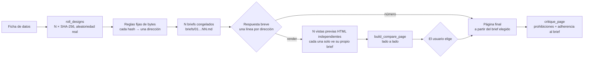

<div align="center">

[English](README.md) · [简体中文](README.zh-CN.md) · [日本語](README.ja.md) · [한국어](README.ko.md) · **Español**

# hash-design

<p align="center"><a href="https://qybaihe.github.io/hash-design/causeway-festival/compare.html"><picture><source media="(prefers-reduced-motion: reduce)" srcset="docs/assets/hero.png"></picture></a></p>

<p align="center"><sub>Resultado real, no una maqueta: <a href="examples/causeway-festival">examples/causeway-festival</a>; cada vista previa la hizo un subagente distinto a partir de un único brief congelado.<br><a href="https://qybaihe.github.io/hash-design/"><b>Ver los 4 ejemplos en vivo →</b></a> · una ejecución de hash-design/v1 (ver <a href="#galería">Galería</a>) · <a href="docs/assets/hero.png">imagen fija</a> · <a href="docs/assets/hero.mp4">MP4</a></sub></p>

### Un prompt, cinco direcciones de diseño, elegidas por hashes SHA-256 verdaderamente aleatorios y no por el modelo.

**Que tu agente de programación deje de entregar siempre la misma página con Inter y degradado morado. hash-design sortea cinco direcciones (o cualquier número de 1 a 12), congela cada una como un brief de diseño, te las muestra en una línea cada una, las renderiza lado a lado cuando lo pides y construye la que eliges. Cualquier dirección se puede reconstruir a partir de su ref.**

[](https://github.com/qybaihe/hash-design/actions/workflows/ci.yml)
[](https://qybaihe.github.io/hash-design/)
[](#inicio-rápido)
[](docs/mcp-tools.md)
[](.nvmrc)
[](https://www.npmjs.com/package/hash-design)
[](LICENSE)

**[Ejemplos en vivo](https://qybaihe.github.io/hash-design/) · [Especificación del mapeo](docs/mapping.md) · [Referencia MCP](docs/mcp-tools.md) · [Registro de cambios](CHANGELOG.md)**

[Inicio rápido](#inicio-rápido) · [Cómo funciona](#cómo-funciona) · [Galería](#galería) · [Referencia](#referencia) · [Preguntas frecuentes](#preguntas-frecuentes)

**Díselo a tu agente** (Claude Code, Cursor, Codex, Windsurf, VS Code Copilot…):

```text
Instala la skill de hash-design para este agente: ejecuta `npx -y hash-design skill install --dir .`
y registra su servidor MCP con `npx -y hash-design mcp`, siguiendo
https://github.com/qybaihe/hash-design/blob/main/README.es.md#inicio-rápido.
```

</div>

---

## Qué hace hash-design

Pídele a un LLM "una página bonita" y casi siempre acabará en la misma estética predominante: Inter, un degradado de morado a azul, un titular centrado con dos botones, tres tarjetas de características idénticas, glassmorphism, iconos emoji y textos como _Unlock_, _Seamless_, _Supercharge_. La razón es sencilla: siempre que el modelo puede elegir, escoge lo más común de sus datos de entrenamiento.

hash-design no le pide al modelo que tenga mejor gusto. **Le quita la decisión**:

| Paso             | Qué pasa                                                                                                                                                                                                                                                                                                                                                                                                                                                   |
| ---------------- | ---------------------------------------------------------------------------------------------------------------------------------------------------------------------------------------------------------------------------------------------------------------------------------------------------------------------------------------------------------------------------------------------------------------------------------------------------------- |
| **Tirada**       | Genera N hashes a partir de la aleatoriedad del sistema (`crypto.randomBytes(32)` → SHA-256): cinco por defecto, de 1 a 12 si lo pides.                                                                                                                                                                                                                                                                                                                    |
| **Mapeo**        | Cada hash **es** la dirección. Unas reglas fijas y reproducibles leen sus bytes directamente como parámetros de diseño: tono y una paleta con el contraste resuelto, fuentes display y body de un pool plano de fuentes, caja, tracking, razón de la escala tipográfica, densidad, retícula, ancla de la primera pantalla, motivo, esquinas y textura, tiempos del movimiento, voz de redacción y un "giro" (twist). No hay ninguna biblioteca de estilos. |
| **Congelación**  | Congela cada dirección como un **brief** con tokens listos para pegar (enlaces de fuentes, valores hex, `tokens.css`, medidas de la retícula, valores de radio / borde / sombra), más las prohibiciones globales.                                                                                                                                                                                                                                          |
| **Render**       | El agente te muestra **una línea por dirección y se detiene**. Si respondes `render`, su única tarea es **ejecutar** cada brief con fidelidad: vistas previas HTML independientes y una página comparativa lado a lado; después **espera a que elijas un número**.                                                                                                                                                                                         |
| **Página final** | Cuando eliges, el agente construye la página final a partir de ese brief y la revisa con `critique_page`.                                                                                                                                                                                                                                                                                                                                                  |

Se trata de una restricción aleatoria externa que rompe la estética por defecto del modelo. No tiene nada que ver con cachés KV ni con la temperatura de muestreo. El gusto del modelo se invierte en la calidad de ejecución (alineación, ritmo, detalle, legibilidad), no en elegir un estilo.

La salida por defecto es una página web. Pasa un **escenario** (`scenario`) y las mismas direcciones de la tirada se convierten en una presentación de diapositivas, pantallas de app móvil, un panel de datos, un póster o tarjeta social, o un email HTML (ver [Escenarios](#escenarios)).

Se distribuye como una **Agent Skill** (cuándo y en qué orden ejecutar el flujo), un **servidor MCP** (stdio, cuatro herramientas), una **CLI** y una **biblioteca TypeScript**, publicadas juntas en npm como [`hash-design`](https://www.npmjs.com/package/hash-design).

## Inicio rápido

### Pídeselo a tu agente

Abre tu agente de programación (Claude Code, Cursor, Codex, Windsurf, VS Code Copilot…) en el proyecto que quieres diseñar y pega:

```text
Instala la skill de hash-design para este agente: ejecuta `npx -y hash-design skill install --dir .`
y registra su servidor MCP con `npx -y hash-design mcp`, siguiendo
https://github.com/qybaihe/hash-design/blob/main/README.es.md#inicio-rápido.
```

El agente copia la Skill en `.claude/skills/` y `.agents/skills/` de tu proyecto y registra el servidor MCP (`claude mcp add` en Claude Code, `.cursor/mcp.json` en Cursor, `codex mcp add` en Codex); no hay que clonar ni compilar nada. Después abre una sesión nueva para que el agente cargue ambos y pasa a [Uso](#uso). Si prefieres ejecutar los comandos tú, sigue los pasos de abajo.

### Instalación manual

Requiere Node.js ≥ 20, con npm (para `npx`).

**Skill.** La Skill le dice al agente cuándo usar hash-design, en qué orden llamar a las herramientas MCP, cómo renderizar las vistas previas por separado y cuándo debe detenerse.

```bash
npx -y hash-design skill install --dir .                # este proyecto: .claude/skills y .agents/skills
npx -y hash-design skill install --global               # o tu directorio personal, para todos los proyectos
npx -y hash-design skill install --to /path/to/skills   # o la carpeta de skills de cualquier otro agente
```

Por defecto escribe en `.claude/skills/` (Claude Code) y `.agents/skills/` (Codex, Cursor, VS Code Copilot, Windsurf). `--target` elige las carpetas (`claude`, `agents`, `cursor`, separadas por comas, o `all`; `both` es `claude,cursor`), y al terminar el comando imprime los comandos de la CLI y del servidor MCP que funcionan desde donde se ejecutó. Una skill es una carpeta con un `SKILL.md`, así que copiar [`skills/hash-design/SKILL.md`](skills/hash-design/SKILL.md) a `<carpeta de skills>/hash-design/SKILL.md` también funciona. Dónde busca cada agente, según su documentación:

| Agente          | Skills del proyecto                                     | Skills personales                                              |
| --------------- | ------------------------------------------------------- | -------------------------------------------------------------- |
| Claude Code     | `.claude/skills/`                                       | `~/.claude/skills/`                                            |
| Codex           | `.agents/skills/`                                       | `~/.agents/skills/`                                            |
| Cursor          | `.agents/skills/`, `.cursor/skills/`, `.claude/skills/` | `~/.agents/skills/`, `~/.cursor/skills/`                       |
| VS Code Copilot | `.github/skills/`, `.claude/skills/`, `.agents/skills/` | `~/.copilot/skills/`, `~/.claude/skills/`, `~/.agents/skills/` |
| Windsurf        | `.agents/skills/`, `.windsurf/skills/`                  | `~/.agents/skills/`                                            |

Los agentes que leen tanto `.claude/skills/` como `.agents/skills/` (Cursor, VS Code Copilot) ven dos copias idénticas tras la instalación por defecto; usa `--target agents` con ellos si te molesta. El cuerpo de la Skill está escrito en chino; su descripción incluye frases de activación en inglés.

**Servidor MCP.** Registra `npx -y hash-design mcp` en tu agente; ejecuta el servidor por stdio.

#### Claude Code

```bash
claude mcp add hash-design -- npx -y hash-design mcp
```

O haz commit de un `.mcp.json` a nivel de proyecto:

```json
{
  "mcpServers": {
    "hash-design": {
      "command": "npx",
      "args": ["-y", "hash-design", "mcp"]
    }
  }
}
```

#### Cursor

`.cursor/mcp.json` (proyecto) o `~/.cursor/mcp.json` (global), con la misma estructura que el `.mcp.json` de arriba.

#### Codex

```bash
codex mcp add hash-design -- npx -y hash-design mcp
```

O añádelo a `~/.codex/config.toml` (o al `.codex/config.toml` de un proyecto de confianza):

```toml
[mcp_servers.hash-design]
command = "npx"
args = ["-y", "hash-design", "mcp"]
```

#### Otros agentes

Cualquier cliente MCP que arranque servidores stdio puede ejecutarlo: comando `npx`, argumentos `-y hash-design mcp`; ponlo en la configuración MCP de ese cliente (Windsurf, VS Code y otros tienen la suya). Sin MCP, la Skill recurre a la CLI, `npx -y hash-design roll …`, con las mismas opciones.

#### Claude Desktop

`~/Library/Application Support/Claude/claude_desktop_config.json` (macOS) o `%APPDATA%\Claude\claude_desktop_config.json` (Windows), con la misma estructura. Claude Desktop no arranca el servidor en el directorio de tu proyecto, así que pasa una **ruta absoluta** como `out_dir` al llamar a `roll_designs`. Si no encuentra `npx`, pon en `command` la ruta que imprime `which npx`.

### Desde el código fuente

Para contribuir, o para ejecutar un commit que aún no se ha publicado (ver [CONTRIBUTING.md](CONTRIBUTING.md)):

```bash
git clone https://github.com/qybaihe/hash-design.git ~/hash-design
cd ~/hash-design && npm install && npm run build
node ~/hash-design/packages/core/dist/bin.js skill install --dir /path/to/your/project
claude mcp add hash-design -- node ~/hash-design/packages/core/dist/bin.js mcp
```

En una copia del código, la CLI es `packages/core/dist/bin.js`. `packages/mcp/dist/bin.js` arranca el mismo servidor MCP, así que las configuraciones que ya apuntan ahí siguen funcionando. El repositorio incluye copias de la Skill en `.claude/` y `.cursor/`, que un test mantiene idénticas a la fuente.

### Uso

Con el servidor MCP y la Skill instalados, basta con pedírselo a tu agente:

> Usa hash-design para crear una web de una sola página para "Fourth Lane Bakery", con 3 direcciones. Datos: abierto mar–dom 7:00–19:00, cerrado los lunes; pan de campo ¥38; …

El agente sortea N direcciones (cinco salvo que digas un número de 1 a 12, como en `/hash-design 3`), congela los briefs y responde con un formato fijo y breve; después se detiene. La respuesta sale en el idioma de la tirada (chino o inglés) y el agente la traduce si escribes en otro idioma. Esta usa una semilla para poder reproducirla; una tirada real dice `true-random`:

```text
**hash-design** · 3 directions for “Fourth Lane Bakery” · Web page · seed reply-demo

1. **Caveat** / Literata — light paper, hue 330° · 5-column grid · anchor: initial · `ea849a45`
2. **Hanken Grotesk** / Crimson Pro — light paper, hue 344° · 10-column grid · anchor: number · `f458a091`
3. **Overpass** / Barlow Condensed — light paper, hue 234° · 5-column grid · anchor: grid-diagram · `a6b46334`

Reply with a number to build that direction as the final page, **render** to see all 3 as previews side by side first, or **reroll** for a new set.
```

Con un número construye esa dirección. `render` genera una vista previa independiente por dirección y `design/hash-design/compare.html`, vuelve a mostrar la lista y espera tu número. Cada campo de la respuesta se lee de los números mapeados ([protocolo de respuesta](docs/mcp-tools.md#reply-protocol), en inglés); la CLI la imprime con `--format reply`. Los clientes compatibles con prompts MCP también pueden iniciar el mismo flujo con el prompt `hash-design` (argumentos: `subject`, `facts`, `count`, `scenario`). Si pides diapositivas, pantallas de app, un panel, un póster o un email, el agente pasa el `scenario` correspondiente.

### CLI

```bash
hash-design roll --subject "Fourth Lane Bakery" --facts-file facts.md --out design/hash-design   # 5 direcciones verdaderamente aleatorias
hash-design roll --subject "…" --light-only --brand "#c8102e" --format json                     # con restricciones
hash-design roll --subject "Q3 review" --facts-file facts.md --scenario deck --out design/deck   # diapositivas en vez de una página
hash-design roll --subject "…" --count 3 --out design/hash-design --format reply                 # 3 direcciones + la respuesta breve
hash-design brief <ref> [constraints]                                                            # reproduce un brief
hash-design critique page.html --roll design/hash-design/roll.json --pick 3 --fail-under 80
hash-design compare --roll design/hash-design/roll.json                                          # escribe compare.html
hash-design skill install                                                                        # instala la Skill
```

Ejecútala con `npx -y hash-design …`, o instálala una vez con `npm install -g hash-design` y escribe `hash-design …`; en una copia del código es `node packages/core/dist/bin.js …`. `hash-design --help` lista todos los comandos y `hash-design <command> --help` (por ejemplo, `hash-design roll --help`) muestra las opciones de un comando, incluidos los flags de restricción `--light-only`, `--dark-only`, `--reduced-motion`, `--brand` y `--scenario`. `--count`/`-n` fija N (de 1 a 12, 5 por defecto); cada dirección es su propio hash, así que las restricciones no bajan ese límite.

### Biblioteca

```ts
import { roll, renderBrief, critiquePage, reproduce, parseRef } from 'hash-design';

const r = roll({ content: { subject: 'Fourth Lane Bakery', facts: ['Closed Mondays', 'Country loaf ¥38'] } });
for (const [i, d] of r.designs.entries()) console.log(renderBrief(d, r.content, { number: i + 1 }));

const design = reproduce(parseRef(r.designs[0].ref), r.constraints);
const report = critiquePage({ html: '<!doctype html>…', design });
console.log(report.score, report.adherence, report.findings);
```

Instálala con `npm install hash-design` (módulo ES, Node.js ≥ 20, con tipos).

### Actualizar

```bash
npx -y hash-design@latest skill install --dir .   # actualiza la copia de SKILL.md
```

npx puede seguir usando una copia que guardó en caché; `@latest` hace que descargue la versión más reciente (o fija una, como `hash-design@0.2.0`). El servidor MCP se arranca con npx cada vez que se inicia el agente, así que reinicia el agente tras una nueva versión y escribe `hash-design@latest` en su comando MCP si sigue corriendo una copia antigua. Las versiones anteriores instalaban por defecto en `.claude/` y `.cursor/`; actualiza una copia antigua de `.cursor/skills/` con `--target all` o bórrala. Desde un clon: `git pull && npm install && npm run build`. Si una actualización cambia el pool de fuentes, las listas de primitivas o las reglas de los bytes, los refs sorteados con la versión anterior necesitan esa versión para reproducirse (ver [Preguntas frecuentes](#preguntas-frecuentes)).

## Cómo funciona



### Bytes → parámetros (`hash-design/v2`)

El hash es la dirección. Cada byte controla un parámetro (o dos, repartiendo sus bits), como valor continuo o como índice en una lista corta de primitivas neutras que se combinan libremente. Nada nombra un género ni un estilo.

| Bytes  | Parámetros                                                                                                                                                            |
| ------ | --------------------------------------------------------------------------------------------------------------------------------------------------------------------- |
| 0–5    | Paleta: tono OKLCH, papel claro u oscuro y su luminosidad, croma del papel, croma del acento, desfase de tono del segundo acento                                      |
| 6–10   | Tipografía: fuente display (98), fuente body (62), caja y peso, tracking, razón de la escala tipográfica 1.067–1.618                                                  |
| 11     | Densidad: una posición entre aireada y apretada; de ella se derivan el tamaño base, el interlineado, la unidad de espaciado, la separación entre secciones y el ancho |
| 12–15  | Maquetación: retícula de 3–12 columnas y medianil, qué columnas ocupa el bloque de texto, altura de la primera pantalla, secciones, separador                         |
| 16–17  | Ancla de la primera pantalla: elemento (8), tamaño, posición horizontal, rotación                                                                                     |
| 18–19  | Motivo: forma (12), tamaño, colocación (4), ángulo                                                                                                                    |
| 20–21  | Superficie: radio de las esquinas, grosor y estilo del borde, sombra dura, textura y su opacidad                                                                      |
| 22–23  | Movimiento: qué se mueve, duración 0–600 ms, easing (steps o una cubic-bezier a partir de los bits)                                                                   |
| 24–25  | Voz: persona gramatical, forma del titular, longitud de las frases, registro                                                                                          |
| 26–27  | Giro: objetivo (9) × operación (10) × cantidad, p. ej. "Gira 4.5° todos los números de la página"                                                                     |
| 28     | Formato, para escenarios no web                                                                                                                                       |
| 29, 30 | Fuente display CJK (para páginas en chino), fuente mono                                                                                                               |
| 31     | Sin uso, se registra en el brief                                                                                                                                      |

- **El contraste se resuelve, no se deja al azar.** Los colores de texto se desplazan en luminosidad OKLCH hasta alcanzar ink ≥ 7.5:1, muted ≥ 4.6:1 y acentos ≥ 3:1 sobre el papel, así que cada hash da una paleta legible, clara u oscura (alrededor del 30% de los hashes son oscuros).
- **N direcciones son N hashes.** Una tirada de 5 son cinco mapeos independientes; entre ellos nada se comparte, se desplaza ni se deduplica. La `ref` de un diseño es su hash de 64 dígitos hex y se reproduce por sí sola.
- **Las restricciones se aplican antes de leer los bytes**, así que forman parte de la identidad de un diseño: `light_only` / `dark_only` (el byte 2 entonces solo fija la luminosidad), `reduced_motion` (sin movimiento), `brand_colors` (el primero sustituye al acento y fija el tono, el segundo sustituye a accent2) y `scenario`.
- **Reproducible.** La misma `ref`, las mismas restricciones y la misma huella de la biblioteca producen siempre el mismo brief. Cada brief registra el algoritmo (`hash-design/v2`) y la huella de la biblioteca (los primeros 12 dígitos hex de un SHA-256 calculado sobre el pool de fuentes, las listas de primitivas y las reglas de los bytes).
- **`seed` solo sirve para reproducir ejemplos y tests.** El uso real siempre parte de la aleatoriedad del sistema.

La fórmula exacta de cada byte, el solucionador de la paleta y un ejemplo resuelto están en [docs/mapping.md](docs/mapping.md) (en inglés).

### Escenarios

`scenario` indica qué estás diseñando. El valor por defecto, `web`, es el flujo de página de arriba, sin cambios. Los otros cinco conservan la dirección de la tirada y añaden a cada brief un formato, un lienzo y reglas de salida.

| Escenario           | Entrega                                                                                                          | Formatos (byte 28)                                                 | Lienzo                                    |
| ------------------- | ---------------------------------------------------------------------------------------------------------------- | ------------------------------------------------------------------ | ----------------------------------------- |
| `web` (por defecto) | Una página web adaptable, landing page o sitio de una página                                                     | —                                                                  | adaptable                                 |
| `deck`              | Diapositivas HTML: un lienzo fijo por diapositiva, navegación con teclado, impresión a PDF                       | a sangre, riel de índice, patrón documento                         | 1920×1080                                 |
| `app`               | Varias pantallas de móvil de un mismo recorrido, una junto a otra                                                | barra de pestañas inferior, pestañas superiores, flujo único, hoja | 390×844                                   |
| `dashboard`         | Una pantalla de escritorio: cifras clave, un gráfico principal, paneles de apoyo                                 | barra lateral, barra superior, pantalla mural                      | 1440×900                                  |
| `poster`            | Una mesa de trabajo: un póster o imagen social, lista para captura                                               | vertical 4:5, cuadrado, historia 9:16, tarjeta de enlace           | 1080×1350, 1080×1080, 1080×1920, 1200×630 |
| `email`             | Un email HTML que aguanta en clientes de correo reales: maquetación con tablas, estilos en línea, sin JavaScript | una columna, bandas a todo lo ancho, resumen                       | columna de 600 o 640 px                   |

- **La dirección se conserva.** Un hash conserva su paleta, sus fuentes, la razón de la escala, la retícula, el ancla, el motivo, la superficie y la voz en todos los escenarios.
- **Algunos rangos se estrechan.** El byte 11 se lee dentro del rango de densidad del escenario (las diapositivas nunca son del todo apretadas, los paneles nunca del todo aireados), y los objetivos u operaciones de giro que no tienen sentido se quitan antes de leer los bytes 26–27 (ningún giro de navegación en unas diapositivas), así que la densidad y el giro pueden diferir de la versión web. Los emails no tienen movimiento.
- **Los tamaños siguen al medio.** El tamaño base del texto escala o acota el de la densidad (diapositivas ×2, pósteres ×1,75, apps y emails 16–17 px, paneles 13–15 px), y `tokens.css` incluye el tamaño del lienzo.
- **Forma parte de la identidad.** Como cualquier restricción, pasa el mismo `scenario` para reproducir un ref. `web` es el valor por defecto, así que un ref web da el mismo brief con o sin él.

`critique_page` comprueba el contrato de salida de cada escenario (número de diapositivas y lienzo, marcos de móvil, cifras tabulares, tamaño de la mesa de trabajo, tablas en el email), y la página de comparación escala los lienzos fijos desde su tamaño real. La lista de escenarios y sus reglas se inspiran en las plantillas de [Open Design](https://github.com/nexu-io/open-design). Detalles: [docs/mapping.md §7](docs/mapping.md#7-scenarios) (en inglés).

### Qué contiene un brief

Ejecuta `hash-design brief 6ebe9acd06cbf4810ad2989965b22bc39bd527084bdda2964f9f0d49eb25562d` para ver uno (es el ejemplo resuelto de [docs/mapping.md](docs/mapping.md#9-worked-example), en inglés). Un brief contiene:

- la traza del mapeo, byte a byte, con el valor hex, la fórmula y el resultado
- el contenido: los únicos datos que la página puede afirmar
- la voz de redacción (persona, forma del titular, longitud de las frases, registro), la maquetación (columnas, medianil, columnas del bloque de texto, altura de la primera pantalla, secciones, separador) y el ancla de la primera pantalla (elemento, tamaño, posición, rotación)
- tipografía: fuentes display, body y mono con su caja, peso y tracking, un `<link>` de Google Fonts (con fuentes CJK cuando la página está en chino) y una escala tipográfica calculada a partir de la razón
- siete colores calculados en OKLCH y una tabla de contraste WCAG (qué colores son solo para texto grande o decoración)
- densidad, radio de las esquinas, borde, sombra, textura (con un fragmento de CSS), motivo (forma, tamaño, colocación, ángulo) y movimiento (propiedad, duración, easing)
- el giro y las 14 prohibiciones globales
- un `tokens.css` listo para pegar y una lista de comprobación previa a la entrega
- en un escenario no web, una sección Escenario: formato, lienzo, estructura de archivos, número de diapositivas o pantallas, cómo se trasladan la maquetación, el ancla y el movimiento, y las reglas y prohibiciones del escenario

Los briefs están escritos para agentes y son bilingües: los encabezados llevan etiquetas en chino y en inglés, y `language` (`zh` o `en`, detectado automáticamente a partir del tema y los datos) cambia las instrucciones, el texto del escenario y si se cargan webfonts CJK. Los textos de las prohibiciones globales por ahora solo están escritos en chino.

## Galería

Cuatro ejecuciones completas, cada una con su ficha de datos y una semilla fija que solo sirve para reproducirla. Se sortearon con **hash-design/v1**, la biblioteca de 40 ramas a la que sustituyó v2, y se conservan como registro de ejecuciones reales: sus refs no se reproducen con v2 y sus láminas llevan los nombres de las ramas de v1. Cada vista previa la hizo un subagente que solo veía su brief, y todas siguen puntuando al menos 90/100 en `critique_page`. Todas están en el [índice de ejemplos](https://qybaihe.github.io/hash-design/). Cada lámina de abajo es una tirada: sus cinco direcciones lado a lado.

### Fourth Lane Bakery (第四巷面包店) — una panadería de barrio · página en chino

[](examples/fourth-lane-bakery)

Semilla `fourth-lane-bakery` · `critique_page` 96–100 · adherencia al brief 100 · [carpeta del ejemplo](examples/fourth-lane-bakery): datos, briefs, vistas previas y proceso

### Sluice — una bandeja de entrada autoalojada para webhooks · página en inglés

[](examples/sluice)

Semilla `sluice` · `critique_page` 92–96 · adherencia al brief 90–100 · [carpeta del ejemplo](examples/sluice): datos, briefs, vistas previas y proceso

### Bridge No.2 Cycle Works (二号桥单车铺) — un taller de bicicletas bajo un puente · página en chino

[](examples/bridge-two-bikes)

Semilla `bridge-two-bikes-5` · `critique_page` 96–100 · adherencia al brief 100 · [carpeta del ejemplo](examples/bridge-two-bikes): datos, briefs, vistas previas y proceso

### Causeway — un festival de música de un día en una isla a la que se llega con marea baja · página en inglés

[](examples/causeway-festival)

Semilla `causeway-festival-6` · `critique_page` 96–100 · adherencia al brief 100 · [carpeta del ejemplo](examples/causeway-festival): datos, briefs, vistas previas y proceso

## Referencia

Las cuatro herramientas MCP, el espacio de parámetros y las 14 prohibiciones que lleva cada brief.

### Herramientas MCP

| Herramienta          | Qué hace                                                                                                                                                                                                                                                                                    |
| -------------------- | ------------------------------------------------------------------------------------------------------------------------------------------------------------------------------------------------------------------------------------------------------------------------------------------- |
| `roll_designs`       | Recibe `subject`, `facts`, `count` (de 1 a 12, 5 por defecto) y, opcionalmente, `seed`, `language`, `scenario` y restricciones. Devuelve los hashes, el mapeo, un brief por dirección y la respuesta para el usuario. Con `out_dir` congela `roll.json`, `ROLL.md` y `briefs/*.md` en disco |
| `get_brief`          | Reproduce un brief a partir de una `ref` (el hash de 64 dígitos hex) más las mismas restricciones, en Markdown o JSON                                                                                                                                                                       |
| `critique_page`      | Puntúa una cadena o un archivo HTML según las prohibiciones y la lista de comprobación de plantillas típicas de IA; con `brief_ref` o `roll_path` + `pick` también puntúa la adherencia al brief y al contrato de salida del escenario                                                      |
| `build_compare_page` | Genera el `compare.html` lado a lado a partir de un `roll.json`                                                                                                                                                                                                                             |

Recursos: `hash-design://bans`, `hash-design://workflow` (la Skill). Prompt: `hash-design` (`subject`, `facts`, `count`, `scenario`).

Todos los parámetros, formas de retorno y equivalentes en la CLI están documentados en [docs/mcp-tools.md](docs/mcp-tools.md) (en inglés).

### Espacio de parámetros

No hay ningún catálogo de estilos. Además de las reglas de los bytes, el mapeo lee:

- un pool plano de fuentes: 98 fuentes display, 62 body y 8 mono de Google Fonts, 14 fuentes display CJK y 2 fuentes body CJK, sin etiquetas de ambiente ni de género (`packages/core/src/data/fonts.ts`)
- listas cortas de primitivas neutras: 4 variantes de caja, 5 separadores, 8 elementos de ancla, 12 formas de motivo, 4 colocaciones, 4 texturas, 4 propiedades de movimiento, 4 personas, 6 formas de titular, 9 objetivos de giro, 10 operaciones de giro (`packages/core/src/data/space.ts`)

Los datos se validan con tests y scripts:

- ninguna fuente prohibida en el pool, ni siquiera entre las fuentes de respaldo; ninguna fuente duplicada
- las paletas cumplen ink ≥ 7.5:1, muted ≥ 4.6:1 y acentos ≥ 3:1 sobre el papel, comprobado con miles de hashes aleatorios
- cada byte solo mueve sus propios parámetros
- la huella de la biblioteca está fijada en un test, así que cualquier cambio en lo que produce un hash es deliberado
- todas las URL de fuentes resuelven en Google Fonts: `node scripts/verify-fonts.mjs` (174/174 correctas)

### Prohibiciones globales

Cada brief incluye estas 14 prohibiciones, y `critique_page` detecta cada una de ellas automáticamente:

| id                          | Prohibido                                                                                                            |
| --------------------------- | -------------------------------------------------------------------------------------------------------------------- |
| `generic-sans`              | Inter, Roboto, Poppins, Montserrat, DM Sans, Space Grotesk y otras 17 sans por defecto; `system-ui` como "el diseño" |
| `purple-blue-gradient`      | Degradados morados / índigo / azules, texto con degradado, manchas de color                                          |
| `centered-hero-two-buttons` | Titular centrado + subtítulo + pareja de botones primario / fantasma                                                 |
| `identical-cards`           | 3 / 4 / 6 tarjetas idénticas de "icono + título + dos líneas"                                                        |
| `glassmorphism`             | Vidrio esmerilado con `backdrop-filter`                                                                              |
| `emoji-icons`               | Emojis como iconos; un set de iconos genérico como decoración                                                        |
| `buzzword-copy`             | Unlock / Seamless / Supercharge / 赋能 / 一站式 / 极致体验 …                                                         |
| `soft-shadow-rounded`       | Radio de 12–24px + sombra suave y amplia en todo                                                                     |
| `invented-facts`            | "10K+ users", "Trusted by", testimonios falsos con avatares                                                          |
| `tailwind-default-palette`  | Valores por defecto de frameworks como `#6366f1`, `#8b5cf6`, `#0f172a`                                               |
| `scroll-fade-everything`    | Todas las secciones apareciendo con un fundido hacia arriba al hacer scroll                                          |
| `pill-badge-sparkle`        | Una píldora "New ✨" encima del titular                                                                              |
| `placeholder-content`       | Lorem ipsum, retratos de stock, Unsplash aleatorio                                                                   |
| `template-sections`         | La fórmula Hero → Features → Testimonials → Pricing → FAQ                                                            |

`critique_page` también comprueba el contraste del texto (< 3:1), `viewport`, `lang`, `img alt`, la ausencia de `prefers-reduced-motion` cuando hay movimiento, y la adherencia al brief: fuentes, valores hex, radio de las esquinas y sombra. Es análisis estático. No puede saber si la primera pantalla es realmente el ancla del brief ni si la voz es la adecuada; para eso sigue haciendo falta una persona, o un agente que vuelva a leer el brief.

## Preguntas frecuentes

<details>
<summary><strong>¿Qué agentes pueden usarlo?</strong></summary>

Cualquier agente que cargue carpetas con `SKILL.md`: `skill install` escribe en `.claude/skills/` (Claude Code) y `.agents/skills/` (Codex, Cursor, VS Code Copilot, Windsurf), y `--to` cubre cualquier otra carpeta. El servidor MCP habla stdio, así que cualquier cliente MCP puede arrancarlo; [Instalación manual](#instalación-manual) muestra Claude Code, Cursor, Codex y Claude Desktop, y la CLI cubre a los agentes sin MCP. Probado con Claude Code: carga la Skill instalada, sortea el número de direcciones que pides y envía la respuesta tal cual. Las carpetas de los demás agentes salen de su propia documentación, no de una prueba. Sin la Skill, un agente puede llamar a las herramientas, pero nada le indica que responda en pocas líneas, renderice las vistas previas por separado y se detenga hasta que elijas.

</details>

<details>
<summary><strong>¿Está en npm?</strong></summary>

Sí. [`hash-design`](https://www.npmjs.com/package/hash-design) incluye la biblioteca, la CLI, la Skill (`npx -y hash-design skill install`) y el servidor MCP (`npx -y hash-design mcp`). El paquete que se publicó antes por separado, `hash-design-mcp`, ya no recibe versiones nuevas; si lo registraste, cámbialo por `npx -y hash-design mcp`. Las versiones se publican desde GitHub Actions con npm Trusted Publishing ([docs/publishing.md](docs/publishing.md), en inglés).

</details>

<details>
<summary><strong>¿Es aleatorio de verdad? ¿Cómo recupero el mismo brief?</strong></summary>

Cada tirada usa la aleatoriedad del sistema (`crypto.randomBytes(32)` → SHA-256); `seed` solo existe para reproducir los ejemplos y las pruebas. Cada brief guarda su `ref` (el propio hash), sus restricciones y la huella de la biblioteca, y `get_brief` o `hash-design brief <ref>` reconstruyen exactamente el mismo brief.

</details>

<details>
<summary><strong>¿Los refs antiguos se reproducen tras una actualización?</strong></summary>

Dentro de `hash-design/v2`, sí, siempre que la huella de la biblioteca sea la misma: añadir una fuente o una primitiva cambia la huella y puede cambiar lo que produce un hash. Cada brief guarda el algoritmo y la huella, así que la diferencia se detecta, y un ref antiguo necesita la versión correspondiente para reproducirse. Los refs de `hash-design/v1` (la biblioteca de 40 ramas, incluidos los refs `<hash>+<probe>`) no se reproducen en v2.

</details>

<details>
<summary><strong>¿<code>critique_page</code> garantiza una buena página?</strong></summary>

No. Es análisis estático heurístico: lee el `<style>` en línea, `style=""` y el CSS adicional que le pases; no renderiza la página ni descarga hojas de estilo enlazadas. Detecta los patrones prohibidos y compara fuentes, colores hex, radios y sombras con el brief, pero que el resultado sea _bueno_ sigue dependiendo del modelo y de quien ejecute el brief. La herramienta resuelve el "todo se ve igual"; no sustituye el criterio de diseño.

</details>

<details>
<summary><strong>¿Necesita conexión a internet?</strong></summary>

La CLI y el servidor MCP se ejecutan en local y no hacen peticiones de red. Las páginas que piden cargan fuentes de Google Fonts, incluidas las CJK; sin conexión o en redes restringidas hacen falta fuentes autoalojadas o las alternativas que indica cada brief.

</details>

<details>
<summary><strong>¿Por qué parte del brief está en chino?</strong></summary>

Los briefs son bilingües: los encabezados llevan etiquetas en chino y en inglés, y `language` (`zh` o `en`) cambia las instrucciones y el texto del escenario. Los textos de las prohibiciones globales y el cuerpo de la Skill todavía están solo en chino; la descripción de la Skill incluye frases de activación en inglés.

</details>

## Documentación

- [docs/architecture.md](docs/architecture.md) (en inglés): paquetes, flujo de datos, decisiones de diseño, testing
- [docs/mapping.md](docs/mapping.md) (en inglés): el mapeo `hash-design/v2`: la regla de cada byte, el solucionador de la paleta, restricciones, escenarios, reproducibilidad
- [docs/mcp-tools.md](docs/mcp-tools.md) (en inglés): cada herramienta, recurso y prompt de MCP, con sus equivalentes en la CLI
- Versiones en chino: [架构](docs/architecture.zh-CN.md) · [映射规范](docs/mapping.zh-CN.md) · [MCP 工具](docs/mcp-tools.zh-CN.md)

## Contribuir

Las contribuciones son bienvenidas, sobre todo reglas de critique, fuentes para el pool y traducciones. Lee primero [CONTRIBUTING.md](CONTRIBUTING.md) (en inglés): explica las reglas de los datos, `npm run sync` y la huella de la biblioteca fijada. Respeta el [Código de conducta](CODE_OF_CONDUCT.md) (en inglés) e informa de vulnerabilidades como se describe en [SECURITY.md](SECURITY.md) (en inglés). Las notas de versión están en [CHANGELOG.md](CHANGELOG.md) (en inglés).

```bash
npm install
npm run build        # tsc -b, ambos paquetes
npm test             # vitest: core, CLI, MCP (transporte en memoria), coherencia entre Skill y docs
npm run check        # typecheck + lint + prettier + test
npm run sync         # tras cambiar los datos: regenera el bloque de prohibiciones de SKILL.md y las copias .claude/.cursor
node scripts/smoke.mjs        # smoke test de MCP sobre stdio real + CLI (se ejecuta en CI)
node scripts/verify-fonts.mjs # comprueba en línea todas las URL de fuentes (no en CI)
npm run example:critique      # critique de todas las vistas previas de los ejemplos (falla por debajo de 90)
npm run screenshots           # capturas de todos los ejemplos con Playwright (requiere `npx playwright install chromium`)
npm run hero                  # regenera docs/assets/hero.png y social-preview.png a partir de las capturas de un ejemplo
npm run hero:gif              # regenera docs/assets/hero.gif y hero.mp4 (requiere ffmpeg; usa gifski si está instalado)
npm run showcase              # regenera docs/assets/showcase/<ejemplo>.png, una lámina por ejemplo
```

En CI se ejecutan la compilación, la comprobación de tipos, el lint, la comprobación de formato, los tests, el smoke test por stdio y `npm pack --dry-run` en Node 20, 22 y 24.

Estructura del repositorio:

```
packages/core/           # npm: hash-design — data, mapping, briefs, critique, compare page, CLI
  src/data/bans.ts       #   global bans, banned fonts, buzzword lists
  src/data/fonts.ts      #   the flat font pool
  src/data/space.ts      #   the primitive lists (motif shapes, anchors, twists, …)
  src/mapping.ts         #   hash → design, byte by byte (BYTE_MAP, constraints, fingerprints)
  src/palette.ts         #   OKLCH palette with contrast-solved text colours
  src/brief.ts           #   brief rendering (Markdown / JSON)
  src/critique.ts        #   static AI-template checks
  src/compare.ts         #   side-by-side compare page
  src/cli.ts             #   CLI
  src/mcp.ts             #   MCP server (hash-design mcp)
packages/mcp/            # private wrapper: runs the same MCP server from a clone (not on npm)
skills/hash-design/      # Skill source (.claude/ and .cursor/ hold synced copies)
examples/                # 4 full hash-design/v1 runs: facts → roll → 5 briefs → 5 previews → compare page → screenshots
docs/                    # architecture, mapping spec, MCP reference
scripts/                 # sync / smoke / verify-fonts / examples / screenshot / hero / hero-gif / prepack
```

## Licencia

[MIT](LICENSE) © qybaihe
