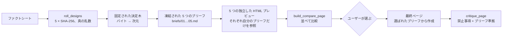

# hash-design

[English](README.md) | [简体中文](README.zh-CN.md) | **日本語** | [한국어](README.ko.md) | [Español](README.es.md)

[](https://github.com/qybaihe/hash-design/actions/workflows/ci.yml)
[](https://github.com/qybaihe/hash-design/actions/workflows/pages.yml)
[](https://qybaihe.github.io/hash-design/fourth-lane-bakery/compare.html)
[](LICENSE)
[](.nvmrc)
[](#インストール)

**デザインの方向性は、モデルではなく真の乱数ハッシュに選ばせる。**
TypeScript で書かれた、コアライブラリ + MCP サーバー（stdio）+ Agent Skill + CLI です。


<p align="center"><sub>1 枚のファクトシートから、ロールで出た 5 つの方向性：お役所の書式 · バウハウス · 墨と印章 · リソグラフの 2 色刷り · 香港の店看板。<br><a href="https://qybaihe.github.io/hash-design/fourth-lane-bakery/compare.html"><b>ライブ比較ページを開く →</b></a></sub></p>

---

## 目次

- [デモ](#デモ) · [なぜ必要なのか](#なぜ必要なのか) · [仕組み](#仕組み) · [ブリーフに含まれるもの](#ブリーフに含まれるもの)
- [インストール](#インストール) · [MCP の設定](#mcp-の設定) · [Skill のインストール](#skill-のインストール) · [使い方](#使い方)
- [MCP ツール](#mcp-ツール) · [CLI](#cli) · [ライブラリ](#ライブラリ) · [ブランチライブラリ](#ブランチライブラリ40) · [グローバル禁止事項](#グローバル禁止事項)
- [開発](#開発) · [ドキュメント](#ドキュメント) · [既知の制限](#既知の制限) · [コントリビューション](#コントリビューション)

## デモ

[`examples/fourth-lane-bakery/`](examples/fourth-lane-bakery) は、架空のベーカリーを題材にしたエンドツーエンドの完全な実行例です。[ファクトシート](examples/fourth-lane-bakery/facts.md) → 1 回のロール → 凍結された 5 つのブリーフ → 5 つのプレビュー（それぞれ、自分のブリーフしか見えない別々のサブエージェントがレンダリング）→ 並べて見比べられる比較ページ、という流れです。すべて GitHub Pages で公開しています。

| #   | 方向性（ブランチ）                                                                                               | デスクトップ                                                                                                                         | ブリーフ                                                               |
| --- | ---------------------------------------------------------------------------------------------------------------- | ------------------------------------------------------------------------------------------------------------------------------------ | ---------------------------------------------------------------------- |
| 01  | [Bureaucratic form](https://qybaihe.github.io/hash-design/fourth-lane-bakery/previews/01-bureaucratic-form.html) |  | [ブリーフ](examples/fourth-lane-bakery/briefs/01-bureaucratic-form.md) |
| 02  | [Bauhaus primary](https://qybaihe.github.io/hash-design/fourth-lane-bakery/previews/02-bauhaus-primary.html)     |      | [ブリーフ](examples/fourth-lane-bakery/briefs/02-bauhaus-primary.md)   |
| 03  | [Ink and seal](https://qybaihe.github.io/hash-design/fourth-lane-bakery/previews/03-ink-and-seal.html)           |            | [ブリーフ](examples/fourth-lane-bakery/briefs/03-ink-and-seal.md)      |
| 04  | [Risograph duotone](https://qybaihe.github.io/hash-design/fourth-lane-bakery/previews/04-risograph-duotone.html) |  | [ブリーフ](examples/fourth-lane-bakery/briefs/04-risograph-duotone.md) |
| 05  | [Hong Kong shop sign](https://qybaihe.github.io/hash-design/fourth-lane-bakery/previews/05-hk-shop-sign.html)    |     | [ブリーフ](examples/fourth-lane-bakery/briefs/05-hk-shop-sign.md)      |

- **ライブ比較ページ**：<https://qybaihe.github.io/hash-design/fourth-lane-bakery/compare.html>（1〜5 キーで拡大表示、D/M キーでデスクトップ／モバイルを切り替え）
- **ローカルで開く場合**：`open examples/fourth-lane-bakery/compare.html`
- どのプレビューも `critique_page` で 96〜100/100、ブリーフへの準拠度で 100/100 を獲得しました。制作の過程はサンプルの [README](examples/fourth-lane-bakery/README.md)（中国語）に記録しています。このページは中国語圏の読者向けに作られているため、店名・ファクト・コピーはいずれも中国語です。

<details><summary>モバイルのスクリーンショットと、スマートフォン幅での比較ページ</summary>

    


</details>

まったく同じロールを再現するには、次のように実行します。

```bash
npm run build
node packages/core/dist/bin.js roll --subject "第四巷面包店" \
  --facts-file examples/fourth-lane-bakery/facts.md --seed fourth-lane-bakery --out /tmp/fourth-lane
# MCP で同じことをする場合: roll_designs { subject, facts, seed: "fourth-lane-bakery" } でも同じ 5 つの ref が返る
```

## なぜ必要なのか

LLM に「美しいページ」を頼むと、ほぼ必ず同じ「最頻値」の美学に収束します。Inter、紫から青へのグラデーション、中央寄せの見出しと 2 つのボタン、まったく同じ 3 枚の機能紹介カード、グラスモーフィズム、絵文字アイコン、そして _Unlock_、_Seamless_、_Supercharge_ のようなコピー。理由は単純で、モデルは選択を任されると、学習データの中で最もありふれたものを選ぶからです。

hash-design は、モデルに「もっとセンスを良くしろ」とは求めません。代わりに**選択そのものを取り上げます**。

1. システムの乱数から 5 つのハッシュを生成します（`crypto.randomBytes(32)` → SHA-256）。
2. 各ハッシュを**固定された再現可能な決定木**に通し、具体的な方向性に対応付けます。対象は、デザインのジャンル、レイアウト、フォントの組み合わせ、hex のカラーパレット、密度、モーション、モチーフ、ファーストビューのアンカー、タイプスケール、サーフェス、コピーの文体、そして 1 つの「ツイスト」です。
3. 各方向性を、そのまま貼り付けられるトークン（フォントのリンク、hex 値、`tokens.css`、グリッドの数値、角丸／影のポリシー）とグローバル禁止事項をまとめた**ブリーフ**として凍結します。
4. エージェントの仕事は、各ブリーフを忠実に**実行する**ことだけです。5 つの独立した HTML プレビューと、それらを並べた比較ページを作ります。そこで**いったん止まり、あなたが番号を選ぶのを待ちます**。
5. 番号を選ぶと、エージェントはそのブリーフをもとに最終ページを作り、`critique_page` でチェックします。

これは、モデルのデフォルトの美学を打ち破るための、外部からのランダムな制約です。KV キャッシュやサンプリング温度とは関係ありません。モデルのセンスはスタイル選びではなく、実装の質（揃え、リズム、ディテール、可読性）に使われます。

## 仕組み



### バイト → 次元（`hash-design/v1`）

| バイト | 次元                  | ルール                                                                                                                    |
| ------ | --------------------- | ------------------------------------------------------------------------------------------------------------------------- |
| 0–1    | ブランチ（branch）    | `uint16(b0, b1) mod N`（N = 40）。衝突した場合は前方へ進む（後述）                                                        |
| 2      | 文体（voice）         | 14 種類のコピー文体：店先の黒板、フィールドノート、技術マニュアル、私信、時刻表、暦…                                      |
| 3      | レイアウト（layout）  | ブランチの 3 つのレイアウトから 1 つ。グリッドの数値と、上から下へのセクション構成の略図付き                              |
| 4      | 書体（type）          | 3 つの組み合わせから 1 つ：ディスプレイ / 本文（/ 等幅）+ CJK フォント + 組版メモ                                         |
| 5      | パレット（palette）   | 3 つのパレットから 1 つ：7 つの hex 値（paper / ink / muted / accent / accent2 / rule / panel）                           |
| 6      | 密度（density）       | airy / regular / compact / packed のうち、ブランチが許可するもの                                                          |
| 7      | モーション（motion）  | 3 つから 1 つ：再生時間、イージング、reduced-motion 時のポリシー                                                          |
| 8      | モチーフ（motif）     | ブランチの 3 つのモチーフから 1 つ                                                                                        |
| 9      | アンカー（anchor）    | ブランチの 3 つのファーストビュー・アンカーから 1 つ                                                                      |
| 10     | スケール（scale）     | ブランチが許可するモジュラースケール（1.125〜1.618）                                                                      |
| 11     | サーフェス（surface） | 3 つのサーフェスから 1 つ（CSS のヒント付き）                                                                             |
| 12     | ツイスト（twist）     | 16 種類。例：「数字をディスプレイ要素として使う」「1 つの要素だけがグリッドを破る」「ファーストビューにボタンを置かない」 |
| 13–31  | 未使用                | ブリーフに記録され、将来の次元のために予約されている                                                                      |

- **衝突とファミリーの分散**：1 回のロールの中で、すでに使われたブランチに当たったハッシュは、空いている次のブランチまで前方へ進みます（+1、+2、…）。まだ使われていない**ファミリー**（print / document / signage / screen / craft / modernist）が残っている間は、使用済みのファミリーに当たった場合も衝突とみなします。そのため、5 方向のロールは必ず 5 つの異なるファミリーにまたがります。進んだステップ数が `probe` です。ref は `<hash>+<probe>` と表記され、それ単体で再現できます。
- **ブランチの順序**：ライブラリ内の順序が、そのままマッピングの順序です。各ファミリーのメンバーはリング上に均等に配置されているため、前方へ進んでも確率が 1 つのブランチに集中することはありません。5 方向のロールでは、どのブランチも 9〜17% の割合で出現します（一様分布なら 12.5%）。
- **制約は、バイトを適用する前に候補プールを絞り込みます**。そのため、制約もデザインの同一性の一部になります：`light_only`、`dark_only`、`reduced_motion`、`brand_colors`（ブランドカラーがアクセントを置き換え、アクセントの色相が最も近いパレットが選ばれ、コントラストが報告されます）、`families`、`include_branches`、`exclude_branches`。
- **再現可能**：同じ `ref`、同じ制約、同じライブラリ・フィンガープリントからは、常に同じブリーフが生成されます。すべてのブリーフには、アルゴリズム（`hash-design/v1`）とライブラリ・フィンガープリント（データ全体の SHA-256 の先頭 16 進 12 桁）が記録されます。
- **`seed` はサンプルとテストを再現するためだけのものです**。実際の利用では、常にシステムの乱数を使います。

具体例付きの完全な仕様は [docs/mapping.md](docs/mapping.md)（英語）にあります。

## ブリーフに含まれるもの

サンプルの [#3 Ink and seal](examples/fourth-lane-bakery/briefs/03-ink-and-seal.md) を例にとると、ブリーフには次の内容が含まれます。

- マッピングの追跡記録（1 バイトずつ、計算式と結果付き）
- コンテンツ：ページに記載してよい事実（これ以外は書けません）
- コピーの文体とその表現技法、レイアウト（グリッドの数値とセクションの順序）、ファーストビューのアンカー
- 書体：Google Fonts の `<link>`（ページが中国語の場合は CJK フォントを含む）と、モジュラー比から計算したタイプスケール
- 7 つの hex 値、色の配分比率、WCAG コントラスト表（どの色が大きな文字や装飾にしか使えないか）
- 密度、角丸 / ボーダー / 影のポリシー、サーフェス（CSS スニペット付き）、モチーフ、モーション仕様
- ツイスト、ブランチの must / must-not リスト、14 項目すべてのグローバル禁止事項
- そのまま貼り付けられる `tokens.css` と、納品前チェックリスト

ブリーフはエージェント向けに書かれており、2 言語に対応しています。見出しには中国語と英語のラベルが併記され、`language`（`zh` または `en`。主題とファクトから自動判定）によって、コンセプトの説明文、指示文、CJK の Web フォントを読み込むかどうかが切り替わります。一部のプールの説明（文体、ツイスト）は、現時点では中国語のみです。

## インストール

> **npm にはまだ公開されていません**。各 `package.json` は公開できる状態になっています（CI で `npm pack --dry-run` を実行しています）が、現時点ではソースからインストールしてください。公開後は `npx -y hash-design-mcp` と `npx -y hash-design` が使えるようになります。

Node.js ≥ 20 が必要です（開発用には `.nvmrc` で 22 に固定しています）。

```bash
git clone https://github.com/qybaihe/hash-design.git
cd hash-design
npm install
npm run build
# MCP サーバーのエントリ: packages/mcp/dist/bin.js
# CLI のエントリ:         packages/core/dist/bin.js
```

## MCP の設定

`/ABS/PATH/hash-design` は、クローンした場所の絶対パスに置き換えてください。

### Claude Code

```bash
claude mcp add hash-design -- node /ABS/PATH/hash-design/packages/mcp/dist/bin.js
```

または、プロジェクト単位の `.mcp.json` をコミットします。

```json
{
  "mcpServers": {
    "hash-design": {
      "command": "node",
      "args": ["/ABS/PATH/hash-design/packages/mcp/dist/bin.js"]
    }
  }
}
```

### Cursor

`.cursor/mcp.json`（プロジェクト）または `~/.cursor/mcp.json`（グローバル）に、同じ構造で記述します。

```json
{
  "mcpServers": {
    "hash-design": {
      "command": "node",
      "args": ["/ABS/PATH/hash-design/packages/mcp/dist/bin.js"]
    }
  }
}
```

### Claude Desktop

`~/Library/Application Support/Claude/claude_desktop_config.json`（macOS）または `%APPDATA%\Claude\claude_desktop_config.json`（Windows）に、上と同じ構造で記述します。Claude Desktop はプロジェクトディレクトリでサーバーを起動しないため、`roll_designs` を呼び出すときは `out_dir` に**絶対パス**を渡してください。

## Skill のインストール

Skill は、いつ hash-design を使うか、どの順序で MCP ツールを呼び出すか、プレビューをどうやって互いに独立してレンダリングするか、そしてどこで必ず止まるべきかをエージェントに伝えます。

```bash
# プロジェクトにインストール（.claude/skills と .cursor/skills の両方に書き込む）
node packages/core/dist/bin.js skill install --target both --dir /path/to/your/project
# ホームディレクトリにインストール（すべてのプロジェクトで使える）
node packages/core/dist/bin.js skill install --target claude --global
```

あるいは、[`skills/hash-design/SKILL.md`](skills/hash-design/SKILL.md) を手作業で `.claude/skills/hash-design/SKILL.md`（Claude Code）または `.cursor/skills/hash-design/SKILL.md`（Cursor）にコピーしてもかまいません。このリポジトリには両方のコピーが同梱されており、テストによってソースと同一に保たれています。Skill の本文は中国語で書かれていますが、description には英語のトリガーフレーズも含まれています。

## 使い方

MCP サーバーと Skill をインストールしたら、エージェントにこう頼むだけです。

> hash-design を使って「Fourth Lane Bakery」のワンページサイトを作って。ファクト：火〜日 7:00〜19:00 営業、月曜定休。カンパーニュ ¥38。…

エージェントはロールを行い、ブリーフを凍結し、5 つのプレビューをレンダリングして `design/hash-design/compare.html` を書き出したあと、止まってあなたが番号で返答するのを待ちます。MCP プロンプトに対応したクライアントなら、`hash-design` プロンプト（引数：`subject`、`facts`、`count`）で同じワークフローを始めることもできます。

## MCP ツール

| ツール               | 機能                                                                                                                                                                                                                                            |
| -------------------- | ----------------------------------------------------------------------------------------------------------------------------------------------------------------------------------------------------------------------------------------------- |
| `roll_designs`       | `subject`、`facts`、`count`（デフォルト 5）と、任意の `seed`、`language`、制約を受け取ります。ハッシュ、マッピング、方向性ごとに 1 つのブリーフを返します。`out_dir` を指定すると、`roll.json`、`ROLL.md`、`briefs/*.md` をディスクに凍結します |
| `get_brief`          | `ref`（`<hash>` または `<hash>+<probe>`）と同じ制約からブリーフを再現し、Markdown または JSON で返します                                                                                                                                        |
| `list_branches`      | 40 のデザインブランチを一覧表示します。ファミリーで絞り込むこともできます                                                                                                                                                                       |
| `get_branch`         | 1 つのブランチのすべての選択肢とトークンを表示します                                                                                                                                                                                            |
| `critique_page`      | HTML 文字列またはファイルを、禁止事項と AI テンプレート的なパターンのチェックリストに照らして採点します。`brief_ref`、または `roll_path` + `pick` を指定すると、ブリーフへの準拠度も採点します                                                  |
| `build_compare_page` | `roll.json` から、方向性を並べて見比べる `compare.html` を生成します                                                                                                                                                                            |

リソース：`hash-design://bans`、`hash-design://workflow`（Skill）、`hash-design://branches`、`hash-design://branch/{id}`。プロンプト：`hash-design`（`subject`、`facts`、`count`）。

すべてのパラメータ、戻り値の形、対応する CLI コマンドは [docs/mcp-tools.md](docs/mcp-tools.md)（英語）にまとめています。

## CLI

```bash
hash-design roll --subject "Fourth Lane Bakery" --facts-file facts.md --out design/hash-design   # 真の乱数による 5 つの方向性
hash-design roll --subject "…" --light-only --brand "#c8102e" --format json                     # 制約付き
hash-design brief <ref> [constraints]                                                            # ブリーフを再現
hash-design branches [--family craft]                                                            # ブランチライブラリ
hash-design branch ink-and-seal                                                                  # 1 つのブランチの詳細
hash-design critique page.html --roll design/hash-design/roll.json --pick 3 --fail-under 80
hash-design compare --roll design/hash-design/roll.json                                          # compare.html を書き出す
hash-design skill install --target both                                                          # Skill をインストール
```

ソースのチェックアウトから使う場合は、`node packages/core/dist/bin.js …` として実行します（またはリポジトリのルートで `alias hash-design="node $PWD/packages/core/dist/bin.js"` を設定します）。`hash-design --help` を実行すると、制約フラグ `--light-only`、`--dark-only`、`--reduced-motion`、`--brand`、`--family`、`--include`、`--exclude` を含むすべてのオプションが表示されます。

## ライブラリ

```ts
import { roll, renderBrief, critiquePage, reproduce, parseRef } from 'hash-design';

const r = roll({ content: { subject: 'Fourth Lane Bakery', facts: ['Closed Mondays', 'Country loaf ¥38'] } });
for (const [i, d] of r.designs.entries()) console.log(renderBrief(d, r.content, { number: i + 1 }));

const design = reproduce(parseRef(r.designs[0].ref), r.constraints);
const report = critiquePage({ html: '<!doctype html>…', design });
console.log(report.score, report.adherence, report.findings);
```

パッケージが npm に公開されるまでは、ソースのチェックアウト（`packages/core/dist/index.js`）からインポートするか、チェックアウトをローカル依存として追加してください（`npm install /ABS/PATH/hash-design/packages/core`）。

## ブランチライブラリ（40）

どのブランチも「SaaS 風スタイル」ではなく、現実世界に実在するデザインジャンルです。各次元には 3 つの具体的な選択肢があります：フォントの組み合わせ（Google Fonts + CJK）、7 つの hex 値、グリッドの数値、角丸 / ボーダー / 影のポリシー、モーション仕様、モチーフ、サーフェス。全カタログは [docs/branches.md](docs/branches.md)（中国語・英語併記）にあり、`list_branches` / `get_branch` でその場で照会できます。

| ファミリー | ブランチ                                                                                                                                                                                    |
| ---------- | ------------------------------------------------------------------------------------------------------------------------------------------------------------------------------------------- |
| print      | Supermarket circular · Letterpress wood type · Photocopy zine · Risograph duotone · Record sleeve · Varsity sports programme · Couture lookbook · Broadsheet newspaper · Editorial magazine |
| document   | Engineering plate · Ledger · Ticket stub · Academic paper · Apothecary label · Bureaucratic form · Thermal receipt · Herbarium specimen · Field guide plate                                 |
| signage    | Transit wayfinding · Hong Kong shop sign · Diner menu board · Gallery catalogue · Topographic map                                                                                           |
| screen     | Terminal phosphor · Web 1.0 homepage · Game manual · Instrument panel · Raw brutalist                                                                                                       |
| craft      | Recipe card · Warm handmade · Ink and seal · Chinese almanac · Ma whitespace · Lab notebook                                                                                                 |
| modernist  | Swiss grid · Bauhaus primary · Constructivist poster · Art Deco · 70s supergraphic · Memphis pop                                                                                            |

データは、テストとスクリプトによって次のルールが強制されています。

- 禁止フォントを使わない（フォールバックでも不可）
- ink/paper のコントラスト比 ≥ 7:1、muted/paper ≥ 4.5:1
- どのブランチにも明るいパレットが少なくとも 1 つある
- フレームワークのデフォルトの hex 値を使わない
- 1 つのディスプレイフォントが主役を務めるのは最大 3 ブランチまで
- 2 つのブランチが同じ代表パレット（paper + accent）を共有しない
- すべてのフォント URL が Google Fonts で解決できる：`node scripts/verify-fonts.mjs`（235/235 合格）

## グローバル禁止事項

すべてのブリーフにはこの 14 項目の禁止事項が含まれており、`critique_page` はそれぞれを自動で検出します。

| id                          | 禁止内容                                                                                                                          |
| --------------------------- | --------------------------------------------------------------------------------------------------------------------------------- |
| `generic-sans`              | Inter、Roboto、Poppins、Montserrat、DM Sans、Space Grotesk ほか 17 種類の定番サンセリフ。`system-ui` を「デザイン」として使うこと |
| `purple-blue-gradient`      | 紫 / インディゴ / 青のグラデーション、グラデーション文字、カラフルなブロブ                                                        |
| `centered-hero-two-buttons` | 中央寄せの見出し + サブタイトル + プライマリ / ゴーストのボタンペア                                                               |
| `identical-cards`           | 「アイコン + タイトル + 2 行の説明」というまったく同じカードが 3 / 4 / 6 枚並ぶ                                                   |
| `glassmorphism`             | `backdrop-filter` によるすりガラス効果                                                                                            |
| `emoji-icons`               | 絵文字をアイコンとして使う。汎用アイコンセットを装飾として使う                                                                    |
| `buzzword-copy`             | Unlock / Seamless / Supercharge / 赋能 / 一站式 / 极致体验 …                                                                      |
| `soft-shadow-rounded`       | あらゆる要素に 12〜24px の角丸 + 大きくぼかした影                                                                                 |
| `invented-facts`            | 「10K+ users」「Trusted by」、アバター付きの偽のお客様の声                                                                        |
| `tailwind-default-palette`  | `#6366f1`、`#8b5cf6`、`#0f172a` などのフレームワークのデフォルト色                                                                |
| `scroll-fade-everything`    | スクロールに合わせてすべてのセクションがフェードアップする                                                                        |
| `pill-badge-sparkle`        | 見出しの上に置かれた「New ✨」のピル型バッジ                                                                                      |
| `placeholder-content`       | Lorem ipsum、ストックの人物写真、適当な Unsplash 画像                                                                             |
| `template-sections`         | Hero → Features → Testimonials → Pricing → FAQ というお決まりの構成                                                               |

`critique_page` はこのほかに、文字のコントラスト（3:1 未満）、`viewport`、`lang`、`img alt`、モーションがあるのに `prefers-reduced-motion` がないこと、そしてブリーフへの準拠（フォント、hex 値、角丸と影のポリシー）もチェックします。これは静的解析です。ファーストビューが本当にブリーフのアンカーになっているか、文体が合っているかまでは判断できません。そこは依然として、人間か、ブリーフを読み直すエージェントが確認する必要があります。

## 開発

```bash
npm install
npm run build        # tsc -b（両パッケージ）
npm test             # vitest: core、CLI、MCP（インメモリ transport）、Skill/docs の整合性
npm run check        # 型チェック + lint + prettier + テスト
npm run sync         # データ変更後に実行: SKILL.md の禁止事項ブロック、.claude/.cursor のコピー、docs/branches.md を再生成
node scripts/smoke.mjs        # 実際の stdio 経由の MCP + CLI のスモークテスト（CI で実行）
node scripts/verify-fonts.mjs # すべてのフォント URL をオンラインで確認（CI では実行しない）
npm run screenshots           # サンプルの Playwright スクリーンショット（`npx playwright install chromium` が必要）
```

CI では Node 20、22、24 上で、ビルド、型チェック、lint、フォーマットチェック、テスト、stdio スモークテスト、`npm pack --dry-run` を実行します。

リポジトリ構成：

```
packages/core/           # npm: hash-design — data, mapping, briefs, critique, compare page, CLI
  src/data/bans.ts       #   global bans, banned fonts, buzzword lists
  src/data/pools.ts      #   densities, scales, 14 copy voices, 16 twists
  src/data/branches/     #   40 branches (index.ts defines the mapping order)
  src/mapping.ts         #   hash → design (decision tree, collisions, constraints)
  src/brief.ts           #   brief rendering (Markdown / JSON)
  src/critique.ts        #   static AI-template checks
  src/compare.ts         #   side-by-side compare page
  src/cli.ts             #   CLI
packages/mcp/            # npm: hash-design-mcp — stdio MCP server
skills/hash-design/      # Skill source (.claude/ and .cursor/ hold synced copies)
examples/                # full example: facts → roll → 5 briefs → 5 previews → compare page → screenshots
docs/                    # architecture, mapping spec, MCP reference, branch catalogue (generated)
scripts/                 # sync / smoke / verify-fonts / screenshot / prepack
```

## ドキュメント

- [docs/architecture.md](docs/architecture.md)（英語）：パッケージ構成、データフロー、設計上の判断、テスト
- [docs/mapping.md](docs/mapping.md)（英語）：`hash-design/v1` のマッピング、衝突、制約、再現性
- [docs/mcp-tools.md](docs/mcp-tools.md)（英語）：すべての MCP ツール、リソース、プロンプトと、対応する CLI コマンド
- [docs/branches.md](docs/branches.md)（中国語・英語併記）：40 ブランチのカタログ（自動生成）
- 中国語版：[アーキテクチャ](docs/architecture.zh-CN.md) · [マッピング仕様](docs/mapping.zh-CN.md) · [MCP ツール](docs/mcp-tools.zh-CN.md)

## 既知の制限

- npm にはまだ公開されていません（各 `package.json` は準備済みで、`npm pack --dry-run` は CI で検証済みです）。
- `critique_page` はヒューリスティックな静的解析です。インラインの `<style>`、`style=""`、および渡された追加の CSS を読み取りますが、ページのレンダリングや、リンクされたスタイルシートの取得は行いません。
- ライブラリには 40 のブランチがあります。ブランチを追加・削除するとマッピングが変わります。ライブラリ・フィンガープリントでこれを検出できますが、古い ref を再現するには対応するバージョンが必要です。
- CJK フォントは Google Fonts から読み込まれます。オフライン環境や制限のあるネットワークでは、フォントをセルフホストするか、各ブリーフに記載されたフォールバックを使う必要があります。
- ブリーフと Skill のテキストの一部は中国語のみです（[ブリーフに含まれるもの](#ブリーフに含まれるもの)を参照）。
- 結果が*良い*ものになるかどうかは、依然としてブリーフを実行するモデルと人に左右されます。このツールが解決するのは「どれも同じに見える」という問題であり、デザインの判断力に取って代わるものではありません。

## コントリビューション

コントリビューションを歓迎します。特に新しいブランチは大歓迎です。まず [CONTRIBUTING.md](CONTRIBUTING.md)（英語）を読んでください。データのルール、`npm run sync`、そしてデータを変更するとなぜサンプルを振り直す必要があるのかを説明しています。[行動規範](CODE_OF_CONDUCT.md)（英語）に従い、脆弱性は [SECURITY.md](SECURITY.md)（英語）に記載された方法で報告してください。リリースノートは [CHANGELOG.md](CHANGELOG.md)（英語）にあります。

## ライセンス

[MIT](LICENSE) © qybaihe
