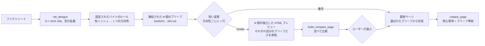

<div align="center">

[English](README.md) · [简体中文](README.zh-CN.md) · **日本語** · [한국어](README.ko.md) · [Español](README.es.md)

# hash-design

<p align="center"><a href="https://qybaihe.github.io/hash-design/causeway-festival/compare.html"><picture><source media="(prefers-reduced-motion: reduce)" srcset="docs/assets/hero.png"></picture></a></p>

<p align="center"><sub>モックアップではなく実際の出力です：<a href="examples/causeway-festival">examples/causeway-festival</a>。各プレビューは、凍結されたブリーフ 1 つだけを見た別々のサブエージェントが作りました。<br><a href="https://qybaihe.github.io/hash-design/"><b>4 つのライブサンプルをすべて見る →</b></a> · hash-design/v1 での実行例（<a href="#ショーケース">ショーケース</a>を参照） · <a href="docs/assets/hero.png">静止画</a> · <a href="docs/assets/hero.mp4">MP4</a></sub></p>

### 1 つのプロンプトから 5 つのデザインの方向性。選ぶのはモデルではなく、真の乱数による SHA-256 ハッシュです。

**コーディングエージェントが毎回同じ「Inter と紫のグラデーション」のページを出してくるのを止めます。hash-design は 5 つ（または 1〜12 の任意の数）の方向性をロールし、それぞれをデザインブリーフとして凍結し、1 行ずつ示し、求められればプレビューを並べて表示し、あなたが選んだものを作ります。どの方向性も ref から作り直せます。**

[](https://github.com/qybaihe/hash-design/actions/workflows/ci.yml)
[](https://qybaihe.github.io/hash-design/)
[](#クイックスタート)
[](docs/mcp-tools.md)
[](.nvmrc)
[](https://www.npmjs.com/package/hash-design)
[](LICENSE)

**[ライブサンプル](https://qybaihe.github.io/hash-design/) · [マッピング仕様](docs/mapping.md) · [MCP リファレンス](docs/mcp-tools.md) · [変更履歴](CHANGELOG.md)**

[ショーケース](#ショーケース) · [クイックスタート](#クイックスタート) · [仕組み](#仕組み) · [リファレンス](#リファレンス) · [よくある質問](#よくある質問)

**エージェントにこう伝える**（Claude Code、Cursor、Codex、Windsurf、VS Code Copilot など）：

```text
このエージェントに hash-design の skill を入れて：`npx -y hash-design skill install --dir .` を実行し、
`npx -y hash-design mcp` で MCP サーバーを登録して。
手順は https://github.com/qybaihe/hash-design/blob/main/README.ja.md#クイックスタート 。
```

</div>

---

## ショーケース

4 つの完全な実行例です。それぞれ独自のファクトシートと固定 seed を使っています（seed は再現のためだけのものです）。これらは、v2 に置き換えられた 40 ブランチのライブラリである **hash-design/v1** でロールしたもので、実際の実行の記録として残しています。その ref は v2 では再現できず、プレートには v1 のブランチ名が付いています。各プレビューは自分のブリーフだけを見たサブエージェントが作り、どれも今でも `critique_page` で 90/100 以上です。すべて[サンプル一覧](https://qybaihe.github.io/hash-design/)にあります。下の各プレートは 1 回のロールで、その 5 つの方向性を並べたものです。

### Fourth Lane Bakery（第四巷面包店）— 街のベーカリー · 中国語ページ

[](examples/fourth-lane-bakery)

seed `fourth-lane-bakery` · `critique_page` 96–100 · ブリーフ遵守度 100 · [サンプルのフォルダ](examples/fourth-lane-bakery)：ファクト、ブリーフ、プレビュー、制作過程

### Sluice — セルフホスト型の Webhook 受信箱 · 英語ページ

[](examples/sluice)

seed `sluice` · `critique_page` 92–96 · ブリーフ遵守度 90–100 · [サンプルのフォルダ](examples/sluice)：ファクト、ブリーフ、プレビュー、制作過程

### Bridge No.2 Cycle Works（二号桥单车铺）— 橋の下の自転車修理店 · 中国語ページ

[](examples/bridge-two-bikes)

seed `bridge-two-bikes-5` · `critique_page` 96–100 · ブリーフ遵守度 100 · [サンプルのフォルダ](examples/bridge-two-bikes)：ファクト、ブリーフ、プレビュー、制作過程

### Causeway — 潮の引いた時だけ渡れる島の 1 日限りの音楽フェス · 英語ページ

[](examples/causeway-festival)

seed `causeway-festival-6` · `critique_page` 96–100 · ブリーフ遵守度 100 · [サンプルのフォルダ](examples/causeway-festival)：ファクト、ブリーフ、プレビュー、制作過程

## hash-design でできること

LLM に「美しいページ」を頼むと、ほぼ必ず同じ「最頻値」の美学に収束します。Inter、紫から青へのグラデーション、中央寄せの見出しと 2 つのボタン、まったく同じ 3 枚の機能紹介カード、グラスモーフィズム、絵文字アイコン、そして _Unlock_、_Seamless_、_Supercharge_ のようなコピー。理由は単純で、モデルは選択を任されると、学習データの中で最もありふれたものを選ぶからです。

hash-design は、モデルに「もっとセンスを良くしろ」とは求めません。代わりに**選択そのものを取り上げます**。

| ステップ         | 何が起きるか                                                                                                                                                                                                                                                                                                                                                                                                                                                                          |
| ---------------- | ------------------------------------------------------------------------------------------------------------------------------------------------------------------------------------------------------------------------------------------------------------------------------------------------------------------------------------------------------------------------------------------------------------------------------------------------------------------------------------- |
| **ロール**       | システムの乱数から N 個のハッシュを生成します（`crypto.getRandomValues`, 32 bytes → SHA-256）。デフォルトは 5 個、指定すれば 1〜12 個です。                                                                                                                                                                                                                                                                                                                                           |
| **マッピング**   | 各ハッシュが**そのまま**方向性になります。固定された再現可能なルールが、そのバイトをデザインのパラメータへ直接読み込みます。対象は、色相とコントラストを解いて求めたパレット、フラットなフォントプールから選ぶディスプレイ書体と本文書体、ケース（大文字・小文字）、トラッキング、タイプスケールの比率、密度、グリッド、ファーストビューのアンカー、モチーフ、角とテクスチャ、モーションのタイミング、コピーの文体、そして 1 つの「ツイスト」です。スタイルのライブラリはありません。 |
| **凍結**         | 各方向性を、そのまま貼り付けられるトークン（フォントのリンク、hex 値、`tokens.css`、グリッドの数値、角丸／ボーダー／影の値）とグローバル禁止事項をまとめた**ブリーフ**として凍結します。                                                                                                                                                                                                                                                                                              |
| **レンダリング** | エージェントはまず**方向性ごとに 1 行**で示して**止まります**。`render` と返すと、各ブリーフを忠実に**実行する**ことだけが仕事になり、独立した HTML プレビューと、それらを並べた比較ページを作って、**あなたが番号を選ぶのを待ちます**。                                                                                                                                                                                                                                              |
| **仕上げ**       | 番号を選ぶと、エージェントはそのブリーフをもとに最終ページを作り、`critique_page` でチェックします。                                                                                                                                                                                                                                                                                                                                                                                  |

これは、モデルのデフォルトの美学を打ち破るための、外部からのランダムな制約です。KV キャッシュやサンプリング温度とは関係ありません。モデルのセンスはスタイル選びではなく、実装の質（揃え、リズム、ディテール、可読性）に使われます。

デフォルトの出力は Web ページです。**シナリオ**（`scenario`）を渡すと、同じロールの方向性がスライド、モバイルアプリの画面、ダッシュボード、ポスター／SNS カード、HTML メールになります（[シナリオ](#シナリオ)を参照）。

構成は **Agent Skill**（いつ、どの順でこの流れを回すか）、**MCP サーバー**（stdio、ツール 4 個）、**CLI**、**TypeScript ライブラリ** の 4 つで、まとめて npm の [`hash-design`](https://www.npmjs.com/package/hash-design) として公開しています。

## クイックスタート

### エージェントに任せる

デザインしたいプロジェクトでコーディングエージェント（Claude Code、Cursor、Codex、Windsurf、VS Code Copilot など）を開き、次を貼り付けます：

```text
このエージェントに hash-design の skill を入れて：`npx -y hash-design skill install --dir .` を実行し、
`npx -y hash-design mcp` で MCP サーバーを登録して。
手順は https://github.com/qybaihe/hash-design/blob/main/README.ja.md#クイックスタート 。
```

エージェントが Skill をプロジェクトの `.claude/skills/` と `.agents/skills/` にコピーし、MCP サーバーを登録します（Claude Code は `claude mcp add`、Cursor は `.cursor/mcp.json`、Codex は `codex mcp add`）。clone やビルドは要りません。終わったら新しいセッションを始めて両方を読み込ませ、[使い方](#使い方)へ進んでください。自分でコマンドを打つ場合は、下の手順を使います。

### 手動でインストール

Node.js ≥ 20 と npm（`npx` 用）が必要です。

**Skill。** Skill は、いつ hash-design を使うか、どの順で MCP ツールを呼ぶか、プレビューをどう独立して作るか、どこで必ず止まるかをエージェントに伝えます。

```bash
npx -y hash-design skill install --dir .                # このプロジェクト：.claude/skills と .agents/skills
npx -y hash-design skill install --global               # またはホームディレクトリ（すべてのプロジェクト）
npx -y hash-design skill install --to /path/to/skills   # またはほかのエージェントの skills フォルダ
```

デフォルトでは `.claude/skills/`（Claude Code）と `.agents/skills/`（Codex、Cursor、VS Code Copilot、Windsurf）に書き込みます。`--target` でフォルダを選ぶこともでき（`claude`、`agents`、`cursor` をカンマ区切りで、または `all`。`both` は `claude,cursor`）、最後に、その場所で使える CLI と MCP のコマンドを表示します。Skill は `SKILL.md` の入ったフォルダなので、[`skills/hash-design/SKILL.md`](skills/hash-design/SKILL.md) を `<skills フォルダ>/hash-design/SKILL.md` に手でコピーしても動きます。各エージェントが探す場所（それぞれのドキュメントによる）：

| エージェント    | プロジェクトの Skill                                    | 個人の Skill                                                   |
| --------------- | ------------------------------------------------------- | -------------------------------------------------------------- |
| Claude Code     | `.claude/skills/`                                       | `~/.claude/skills/`                                            |
| Codex           | `.agents/skills/`                                       | `~/.agents/skills/`                                            |
| Cursor          | `.agents/skills/`, `.cursor/skills/`, `.claude/skills/` | `~/.agents/skills/`, `~/.cursor/skills/`                       |
| VS Code Copilot | `.github/skills/`, `.claude/skills/`, `.agents/skills/` | `~/.copilot/skills/`, `~/.claude/skills/`, `~/.agents/skills/` |
| Windsurf        | `.agents/skills/`, `.windsurf/skills/`                  | `~/.agents/skills/`                                            |

`.claude/skills/` と `.agents/skills/` の両方を読むエージェント（Cursor、VS Code Copilot）では、デフォルトのインストール後に同じコピーが 2 つ見えます。気になる場合はそれらには `--target agents` を使ってください。Skill の本文は中国語で書かれていますが、description には英語のトリガーフレーズも含まれています。

**MCP サーバー。** エージェントに `npx -y hash-design mcp` を登録します。stdio でサーバーが動きます。

#### Claude Code

```bash
claude mcp add hash-design -- npx -y hash-design mcp
```

あるいはプロジェクト単位の `.mcp.json` をコミットします：

```json
{
  "mcpServers": {
    "hash-design": {
      "command": "npx",
      "args": ["-y", "hash-design", "mcp"]
    }
  }
}
```

#### Cursor

`.cursor/mcp.json`（プロジェクト）または `~/.cursor/mcp.json`（グローバル）に、上の `.mcp.json` と同じ構造で書きます。

#### Codex

```bash
codex mcp add hash-design -- npx -y hash-design mcp
```

あるいは `~/.codex/config.toml`（または信頼済みプロジェクトの `.codex/config.toml`）に追加します：

```toml
[mcp_servers.hash-design]
command = "npx"
args = ["-y", "hash-design", "mcp"]
```

#### その他のエージェント

stdio サーバーを起動できる MCP クライアントならどれでも動かせます。コマンドは `npx`、引数は `-y hash-design mcp` で、クライアントごとの MCP 設定に書きます（Windsurf や VS Code などはそれぞれ設定ファイルを持っています）。MCP がない場合、Skill は CLI（`npx -y hash-design roll …`）に切り替え、同じオプションで使います。

#### Claude Desktop

macOS は `~/Library/Application Support/Claude/claude_desktop_config.json`、Windows は `%APPDATA%\Claude\claude_desktop_config.json` で、構造は同じです。Claude Desktop はプロジェクトのディレクトリでサーバーを起動しないので、`roll_designs` を呼ぶときは `out_dir` に**絶対パス**を渡してください。`npx` が見つからない場合は、`which npx` が表示するパスを `command` に書きます。

### ソースから使う

開発に参加するとき、またはまだリリースされていないコミットを動かすとき（[CONTRIBUTING.md](CONTRIBUTING.md) も参照）：

```bash
git clone https://github.com/qybaihe/hash-design.git ~/hash-design
cd ~/hash-design && npm install && npm run build
node ~/hash-design/packages/core/dist/bin.js skill install --dir /path/to/your/project
claude mcp add hash-design -- node ~/hash-design/packages/core/dist/bin.js mcp
```

チェックアウトでは CLI は `packages/core/dist/bin.js` です。`packages/mcp/dist/bin.js` も同じ MCP サーバーを起動するので、そこを指している既存の設定はそのまま動きます。このリポジトリには Skill の `.claude/` と `.cursor/` のコピーが同梱されており、テストによってソースと同一に保たれています。

### 使い方

MCP サーバーと Skill をインストールしたら、エージェントにこう頼むだけです。

> hash-design を使って「Fourth Lane Bakery」のワンページサイトを作って。方向性は 3 つ。ファクト：火〜日 7:00〜19:00 営業、月曜定休。カンパーニュ ¥38。…

エージェントは N 個の方向性をロールし（デフォルトは 5。`/hash-design 3` のように 1〜12 の数を伝えればその数）、ブリーフを凍結してから、決まった短い形で返答して止まります。返答はロールの言語（中国語か英語）で書かれ、あなたが別の言語で話していればエージェントが翻訳します。次の例は再現できるよう seed を使っています（実際のロールでは `true-random` と表示されます）：

```text
**hash-design** · 3 directions for “Fourth Lane Bakery” · Web page · seed reply-demo

1. **Caveat** / Literata — light paper, hue 330° · 5-column grid · anchor: initial · `ea849a45`
2. **Hanken Grotesk** / Crimson Pro — light paper, hue 344° · 10-column grid · anchor: number · `f458a091`
3. **Overpass** / Barlow Condensed — light paper, hue 234° · 5-column grid · anchor: grid-diagram · `a6b46334`

Reply with a number to build that direction as the final page, **render** to see all 3 as previews side by side first, or **reroll** for a new set.
```

番号を返すとその方向性で作ります。`render` と返すと、方向性ごとに独立したプレビューと `design/hash-design/compare.html` を作り、同じ一覧をもう一度示して、番号を待ちます。返答の項目はすべてマッピングされた数値から読み取ったものです（[返答プロトコル](docs/mcp-tools.md#reply-protocol)、英語）。CLI では `--format reply` で出力できます。MCP プロンプトに対応したクライアントなら、`hash-design` プロンプト（引数：`subject`、`facts`、`count`、`scenario`）で同じワークフローを始めることもできます。スライド、アプリ画面、ダッシュボード、ポスター、メールを頼むと、エージェントは対応する `scenario` を渡します。

### CLI

```bash
hash-design roll --subject "Fourth Lane Bakery" --facts-file facts.md --out design/hash-design   # 真の乱数による 5 つの方向性
hash-design roll --subject "…" --light-only --brand "#c8102e" --format json                     # 制約付き
hash-design roll --subject "Q3 review" --facts-file facts.md --scenario deck --out design/deck   # ページではなくスライド
hash-design roll --subject "…" --count 3 --out design/hash-design --format reply                 # 3 つの方向性 + 短い返答
hash-design brief <ref> [constraints]                                                            # ブリーフを再現
hash-design critique page.html --roll design/hash-design/roll.json --pick 3 --fail-under 80
hash-design compare --roll design/hash-design/roll.json                                          # compare.html を書き出す
hash-design skill install                                                                        # Skill をインストール
```

`npx -y hash-design …` で実行するか、`npm install -g hash-design` で一度インストールして `hash-design …` と打ちます。チェックアウトでは `node packages/core/dist/bin.js …` です。`hash-design --help` ですべてのコマンドが、`hash-design <command> --help`（例：`hash-design roll --help`）でそのコマンドのオプションが表示されます。制約フラグ `--light-only`、`--dark-only`、`--reduced-motion`、`--brand`、`--scenario` も含まれます。`--count`/`-n` で N を指定します（1〜12、デフォルト 5。方向性はそれぞれ独立したハッシュなので、制約で上限は下がりません）。

### ライブラリ

```ts
import { roll, renderBrief, critiquePage, reproduce, parseRef } from 'hash-design';

const r = roll({ content: { subject: 'Fourth Lane Bakery', facts: ['Closed Mondays', 'Country loaf ¥38'] } });
for (const [i, d] of r.designs.entries()) console.log(renderBrief(d, r.content, { number: i + 1 }));

const design = reproduce(parseRef(r.designs[0].ref), r.constraints);
const report = critiquePage({ html: '<!doctype html>…', design });
console.log(report.score, report.adherence, report.findings);
```

`npm install hash-design` でインストールします（ES モジュール、Node.js ≥ 20、型定義付き）。

### アップデート

```bash
npx -y hash-design@latest skill install --dir .   # コピーした SKILL.md を更新
```

npx は以前にキャッシュしたコピーを使い続けることがあります。`@latest` を付けると最新のリリースを取得します（`hash-design@0.2.0` のようにバージョンを固定することもできます）。MCP サーバーはエージェントの起動時に npx で立ち上がるので、リリース後はエージェントを再起動し、古いコピーが動き続けるなら MCP のコマンドに `hash-design@latest` と書いてください。以前のバージョンはデフォルトで `.claude/` と `.cursor/` にインストールしていました。古い `.cursor/skills/` のコピーは `--target all` で更新するか、削除してください。clone から使う場合は `git pull && npm install && npm run build`。アップデートでフォントプール、プリミティブのリスト、バイトのルールのいずれかが変わった場合、古いバージョンでロールした ref の再現にはそのバージョンが必要です（[よくある質問](#よくある質問)を参照）。

## 仕組み



### バイト → パラメータ（`hash-design/v2`）

ハッシュが方向性そのものです。各バイトは 1 つのパラメータ（ビットに分けて 2 つの場合もあります）を、連続値として、または自由に組み合わせられる中立的なプリミティブの短いリストへのインデックスとして動かします。ジャンルやスタイルを名指しするものは何もありません。

| バイト | パラメータ                                                                                                                        |
| ------ | --------------------------------------------------------------------------------------------------------------------------------- |
| 0–5    | パレット：OKLCH の色相、紙色（paper）が明るいか暗いかとその明度、紙色の彩度、アクセントの彩度、2 つ目のアクセントの色相オフセット |
| 6–10   | 書体：ディスプレイ書体（98）、本文書体（62）、ケースとウェイト、トラッキング、タイプスケールの比率 1.067〜1.618                   |
| 11     | 密度：airy から packed までの間の 1 つの位置。基準サイズ、行の高さ、余白の単位、セクション間隔、幅がそれに従う                    |
| 12–15  | レイアウト：3〜12 のグリッドカラムとガター、テキストブロックがまたがるカラム、ファーストビューの高さ、セクション、区切り          |
| 16–17  | ファーストビューのアンカー：対象（8）、サイズ、水平位置、回転                                                                     |
| 18–19  | モチーフ：形（12）、サイズ、配置（4）、角度                                                                                       |
| 20–21  | サーフェス：角丸、ボーダーの幅とスタイル、ハードシャドウ、テクスチャとその不透明度                                                |
| 22–23  | モーション：何が動くか、再生時間 0〜600 ms、イージング（steps、またはビットから作る cubic-bezier）                                |
| 24–25  | 文体：人称、見出しの形、文の長さ、語調                                                                                            |
| 26–27  | ツイスト：対象（9）× 操作（10）× 量。例：「ページ上のすべての数字を 4.5° 回転させる」                                             |
| 28     | フォーマット（Web 以外のシナリオ用）                                                                                              |
| 29, 30 | CJK ディスプレイ書体（中国語ページ用）、等幅書体                                                                                  |
| 31     | 未使用。ブリーフに記録される                                                                                                      |

- **コントラストは期待するものではなく、解いて求めるものです**。文字色は、紙色に対して ink ≥ 7.5:1、muted ≥ 4.6:1、アクセント ≥ 3:1 に達するまで OKLCH の明度に沿って動かします。そのため、どのハッシュからも明るい場合も暗い場合も読みやすいパレットが得られます（ハッシュの約 30% は暗いパレットになります）。
- **N 個の方向性は N 個のハッシュです**。5 方向のロールは 5 つの独立したマッピングで、方向性の間で何かを共有することも、前方へ進むことも、重複を除くこともありません。デザインの `ref` は 16 進 64 桁のハッシュそのもので、それ単体で再現できます。
- **制約はバイトを読む前に適用されます**。そのため、制約もデザインの同一性の一部になります：`light_only` / `dark_only`（このときバイト 2 は明度だけを決めます）、`reduced_motion`（モーションなし）、`brand_colors`（1 色目がアクセントを置き換えて色相を決め、2 色目が accent2 を置き換えます）、`scenario`。
- **再現可能**：同じ `ref`、同じ制約、同じライブラリ・フィンガープリントからは、常に同じブリーフが生成されます。すべてのブリーフには、アルゴリズム（`hash-design/v2`）とライブラリ・フィンガープリント（フォントプール、プリミティブのリスト、バイトのルールに対する SHA-256 の先頭 16 進 12 桁）が記録されます。
- **`seed` はサンプルとテストを再現するためだけのものです**。実際の利用では、常にシステムの乱数を使います。

各バイトの正確な計算式、パレットのソルバー、具体例は [docs/mapping.md](docs/mapping.md)（英語）にあります。

### シナリオ

`scenario` は何をデザインするかを指定します。デフォルトの `web` は上の Web ページのワークフローそのままで、何も変わりません。残りの 5 つはロールした方向性を保ったまま、各ブリーフにフォーマット、キャンバス、出力ルールを加えます。

| シナリオ            | 成果物                                                                                                  | フォーマット（バイト 28）                     | キャンバス                                |
| ------------------- | ------------------------------------------------------------------------------------------------------- | --------------------------------------------- | ----------------------------------------- |
| `web`（デフォルト） | レスポンシブな Web ページ、ランディングページ、1 ページサイト                                           | —                                             | レスポンシブ                              |
| `deck`              | HTML のスライド：1 枚ごとに固定キャンバス、キーボード操作、PDF に印刷可能                               | 全面、インデックスレール、文書マスター        | 1920×1080                                 |
| `app`               | 1 つのユーザー動線のスマホ画面を数枚、横に並べて表示                                                    | 下部タブバー、上部タブ、単一フロー、シート    | 390×844                                   |
| `dashboard`         | デスクトップ 1 画面：主要な数値、メインのグラフ 1 つ、補助パネル                                        | サイドバー、トップバー、ウォールディスプレイ  | 1440×900                                  |
| `poster`            | アートボード 1 枚：ポスターまたは SNS 画像、スクリーンショットで完成                                    | 縦 4:5、正方形、ストーリー 9:16、リンクカード | 1080×1350、1080×1080、1080×1920、1200×630 |
| `email`             | 実際のメールクライアントで崩れない HTML メール：テーブルレイアウト、インラインスタイル、JavaScript なし | 1 カラム、全幅バンド、ダイジェスト            | 600 または 640 px のカラム                |

- **方向性はそのまま引き継がれます。** ハッシュは、どのシナリオでもパレット、書体、スケールの比率、グリッド、アンカー、モチーフ、サーフェス、文体を保ちます。
- **一部の範囲は狭くなります。** バイト 11 はそのシナリオの密度の範囲に当てはめて読まれ（スライドが完全に packed になることはなく、ダッシュボードが完全に airy になることもありません）、意味をなさないツイストの対象や操作はバイト 26–27 を読む前に取り除かれます（スライドにナビゲーションのツイストは使いません）。そのため密度とツイストは Web 版と異なることがあります。メールにはモーションがありません。
- **サイズは媒体に合わせます。** 基準の文字サイズは密度の値を拡大または範囲内に収めたものです（スライド ×2、ポスター ×1.75、アプリとメール 16〜17 px、ダッシュボード 13〜15 px）。`tokens.css` にはキャンバスのサイズが入ります。
- **デザインの同一性の一部です。** ほかの制約と同じく、ref を再現するときは同じ `scenario` を渡します。`web` はデフォルトなので、Web の ref は `scenario` を渡しても渡さなくても同じブリーフになります。

`critique_page` は各シナリオの出力の約束（スライド枚数とキャンバス、スマホの枠、等幅数字、アートボードのサイズ、メールのテーブル）を確認し、比較ページは固定キャンバスを実寸から縮小して表示します。シナリオの一覧とルールは [Open Design](https://github.com/nexu-io/open-design) のテンプレートを参考にしました。詳細は [docs/mapping.md §7](docs/mapping.md#7-scenarios)（英語）にあります。

### ブリーフに含まれるもの

`hash-design brief 6ebe9acd06cbf4810ad2989965b22bc39bd527084bdda2964f9f0d49eb25562d` を実行すると、ブリーフの実例を見られます（[docs/mapping.md](docs/mapping.md#9-worked-example)（英語）の具体例と同じものです）。ブリーフには次の内容が含まれます。

- マッピングの追跡記録（1 バイトずつ、16 進値、計算式、結果付き）
- コンテンツ：ページに記載してよい事実（これ以外は書けません）
- コピーの文体（人称、見出しの形、文の長さ、語調）、レイアウト（カラム、ガター、テキストブロックのカラム、ファーストビューの高さ、セクション、区切り）、ファーストビューのアンカー（対象、サイズ、位置、回転）
- 書体：ケース、ウェイト、トラッキングを指定したディスプレイ書体・本文書体・等幅書体、Google Fonts の `<link>`（ページが中国語の場合は CJK フォントを含む）、比率から計算したタイプスケール
- OKLCH で計算した 7 つの色と、WCAG コントラスト表（どの色が大きな文字や装飾にしか使えないか）
- 密度、角丸、ボーダー、影、テクスチャ（CSS スニペット付き）、モチーフ（形、サイズ、配置、角度）、モーション（プロパティ、再生時間、イージング）
- ツイストと、14 項目すべてのグローバル禁止事項
- そのまま貼り付けられる `tokens.css` と、納品前チェックリスト
- Web 以外のシナリオでは「シナリオ」の節：フォーマット、キャンバス、ファイル構成、スライド／画面の枚数、レイアウト・アンカー・モーションの落とし込み方、シナリオのルールと禁止事項

ブリーフはエージェント向けに書かれており、2 言語に対応しています。見出しには中国語と英語のラベルが併記され、`language`（`zh` または `en`。主題とファクトから自動判定）によって、指示文、シナリオの説明文、CJK の Web フォントを読み込むかどうかが切り替わります。グローバル禁止事項の文面は、現時点では中国語のみです。

## リファレンス

4 つの MCP ツール、パラメータ空間、そしてすべてのブリーフに入る 14 の禁止事項。

### MCP ツール

| ツール               | 機能                                                                                                                                                                                                                                                                                   |
| -------------------- | -------------------------------------------------------------------------------------------------------------------------------------------------------------------------------------------------------------------------------------------------------------------------------------- |
| `roll_designs`       | `subject`、`facts`、`count`（1〜12、デフォルト 5）と、任意の `seed`、`language`、`scenario`、制約を受け取ります。ハッシュ、マッピング、方向性ごとに 1 つのブリーフ、ユーザーに送る返答を返します。`out_dir` を指定すると、`roll.json`、`ROLL.md`、`briefs/*.md` をディスクに凍結します |
| `get_brief`          | `ref`（16 進 64 桁のハッシュ）と同じ制約からブリーフを再現し、Markdown または JSON で返します                                                                                                                                                                                          |
| `critique_page`      | HTML 文字列またはファイルを、禁止事項と AI テンプレート的なパターンのチェックリストに照らして採点します。`brief_ref`、または `roll_path` + `pick` を指定すると、ブリーフとシナリオの出力の約束への準拠度も採点します                                                                   |
| `build_compare_page` | `roll.json` から、方向性を並べて見比べる `compare.html` を生成します                                                                                                                                                                                                                   |

リソース：`hash-design://bans`、`hash-design://workflow`（Skill）。プロンプト：`hash-design`（`subject`、`facts`、`count`、`scenario`）。

すべてのパラメータ、戻り値の形、対応する CLI コマンドは [docs/mcp-tools.md](docs/mcp-tools.md)（英語）にまとめています。

### パラメータ空間

スタイルのカタログはありません。バイトのルールのほかに、マッピングは次のものを読み込みます。

- フラットなフォントプール：Google Fonts のディスプレイ書体 98、本文書体 62、等幅書体 8、CJK ディスプレイ書体 14、CJK 本文書体 2。雰囲気やジャンルのタグはありません（`packages/core/src/data/fonts.ts`）
- 中立的なプリミティブの短いリスト：ケース 4、区切り 5、アンカーの対象 8、モチーフの形 12、配置 4、テクスチャ 4、モーションのプロパティ 4、人称 4、見出しの形 6、ツイストの対象 9、ツイストの操作 10（`packages/core/src/data/space.ts`）

データは、テストとスクリプトによって次のルールが強制されています。

- プールに禁止フォントを含めない（フォールバックでも不可）。同じ書体を重複させない
- パレットは紙色に対して ink ≥ 7.5:1、muted ≥ 4.6:1、アクセント ≥ 3:1 を満たす。数千個のランダムなハッシュで確認する
- 各バイトは自分のパラメータだけを動かす
- ライブラリ・フィンガープリントはテストで固定されているので、ハッシュの対応先が変わるのは意図した変更のときだけ
- すべてのフォント URL が Google Fonts で解決できる：`node scripts/verify-fonts.mjs`（174/174 合格）

### グローバル禁止事項

すべてのブリーフにはこの 14 項目の禁止事項が含まれており、`critique_page` はそれぞれを自動で検出します。

| id                          | 禁止内容                                                                                                                          |
| --------------------------- | --------------------------------------------------------------------------------------------------------------------------------- |
| `generic-sans`              | Inter、Roboto、Poppins、Montserrat、DM Sans、Space Grotesk ほか 17 種類の定番サンセリフ。`system-ui` を「デザイン」として使うこと |
| `purple-blue-gradient`      | 紫 / インディゴ / 青のグラデーション、グラデーション文字、カラフルなブロブ                                                        |
| `centered-hero-two-buttons` | 中央寄せの見出し + サブタイトル + プライマリ / ゴーストのボタンペア                                                               |
| `identical-cards`           | 「アイコン + タイトル + 2 行の説明」というまったく同じカードが 3 / 4 / 6 枚並ぶ                                                   |
| `glassmorphism`             | `backdrop-filter` によるすりガラス効果                                                                                            |
| `emoji-icons`               | 絵文字をアイコンとして使う。汎用アイコンセットを装飾として使う                                                                    |
| `buzzword-copy`             | Unlock / Seamless / Supercharge / 赋能 / 一站式 / 极致体验 …                                                                      |
| `soft-shadow-rounded`       | あらゆる要素に 12〜24px の角丸 + 大きくぼかした影                                                                                 |
| `invented-facts`            | 「10K+ users」「Trusted by」、アバター付きの偽のお客様の声                                                                        |
| `tailwind-default-palette`  | `#6366f1`、`#8b5cf6`、`#0f172a` などのフレームワークのデフォルト色                                                                |
| `scroll-fade-everything`    | スクロールに合わせてすべてのセクションがフェードアップする                                                                        |
| `pill-badge-sparkle`        | 見出しの上に置かれた「New ✨」のピル型バッジ                                                                                      |
| `placeholder-content`       | Lorem ipsum、ストックの人物写真、適当な Unsplash 画像                                                                             |
| `template-sections`         | Hero → Features → Testimonials → Pricing → FAQ というお決まりの構成                                                               |

`critique_page` はこのほかに、文字のコントラスト（3:1 未満）、`viewport`、`lang`、`img alt`、モーションがあるのに `prefers-reduced-motion` がないこと、そしてブリーフへの準拠（フォント、hex 値、角丸と影）もチェックします。これは静的解析です。ファーストビューが本当にブリーフのアンカーになっているか、文体が合っているかまでは判断できません。そこは依然として、人間か、ブリーフを読み直すエージェントが確認する必要があります。

## よくある質問

<details>
<summary><strong>どのエージェントで使えますか？</strong></summary>

`SKILL.md` のフォルダを読み込むエージェントなら使えます。`skill install` は `.claude/skills/`（Claude Code）と `.agents/skills/`（Codex、Cursor、VS Code Copilot、Windsurf）に書き込み、`--to` でそれ以外のフォルダにも入れられます。MCP サーバーは stdio で動くので、どの MCP クライアントからでも起動できます。[手動でインストール](#手動でインストール)に Claude Code、Cursor、Codex、Claude Desktop の設定があり、MCP のないエージェントは CLI を使えます。Claude Code では実際に確認しました。インストールした Skill を読み込み、指定した数の方向性をロールし、返答をそのまま送ります。ほかのエージェントのフォルダはそれぞれのドキュメントに基づくもので、実際には試していません。Skill がなくてもツールは呼べますが、短く返答すること、プレビューを独立して作ること、選ぶまで止まることをエージェントに伝えるものがありません。

</details>

<details>
<summary><strong>npm で公開されていますか？</strong></summary>

はい。[`hash-design`](https://www.npmjs.com/package/hash-design) にはライブラリ、CLI、Skill（`npx -y hash-design skill install`）、MCP サーバー（`npx -y hash-design mcp`）が入っています。以前に別パッケージとして公開した `hash-design-mcp` は今後更新されません。登録している場合は `npx -y hash-design mcp` に切り替えてください。リリースは GitHub Actions から npm Trusted Publishing で公開します（[docs/publishing.md](docs/publishing.md)、英語）。

</details>

<details>
<summary><strong>本当にランダムですか？同じブリーフをもう一度得るには？</strong></summary>

ロールのたびにシステムの乱数（`crypto.getRandomValues`, 32 bytes → SHA-256）を使います。`seed` はサンプルとテストの再現専用です。各ブリーフには `ref`（ハッシュそのもの）、制約、ライブラリのフィンガープリントが記録されていて、`get_brief` か `hash-design brief <ref>` でまったく同じブリーフを作り直せます。

</details>

<details>
<summary><strong>アップデート後も古い ref は再現できますか？</strong></summary>

`hash-design/v2` の中では、ライブラリのフィンガープリントが同じであれば再現できます。フォントやプリミティブを追加するとフィンガープリントが変わり、ハッシュの対応先が変わることがあります。すべてのブリーフにアルゴリズムとフィンガープリントが記録されるので不一致は検出でき、古い ref の再現には対応するバージョンが必要です。`hash-design/v1`（40 ブランチのライブラリ。`<hash>+<probe>` 形式の ref を含む）の ref は v2 では再現できません。

</details>

<details>
<summary><strong><code>critique_page</code> は良いページを保証しますか？</strong></summary>

いいえ。ヒューリスティックな静的解析です。インラインの `<style>`、`style=""`、追加で渡した CSS を読みますが、ページのレンダリングやリンクされたスタイルシートの取得はしません。禁止パターンを検出し、フォント、16 進カラー、角丸、影をブリーフと照合しますが、結果が*良い*かどうかは、モデルとブリーフを実行する人次第です。このツールが解決するのは「どれも同じに見える」問題で、デザインの判断を置き換えるものではありません。

</details>

<details>
<summary><strong>ネットワーク接続は必要ですか？</strong></summary>

CLI と MCP サーバーはローカルで動き、ネットワークリクエストはしません。作られるページは Google Fonts（CJK フォントを含む）からフォントを読み込むので、オフラインや制限のあるネットワークでは、フォントをセルフホストするか、各ブリーフに書かれたフォールバックを使ってください。

</details>

<details>
<summary><strong>ブリーフの一部が中国語なのはなぜですか？</strong></summary>

ブリーフはバイリンガルです。見出しには中国語と英語のラベルがあり、`language`（`zh` または `en`）で指示とシナリオの説明文が切り替わります。グローバル禁止事項の文面と Skill の本文は今のところ中国語のみで、Skill の description には英語のトリガーフレーズが入っています。

</details>

## ドキュメント

- [docs/architecture.md](docs/architecture.md)（英語）：パッケージ構成、データフロー、設計上の判断、テスト
- [docs/mapping.md](docs/mapping.md)（英語）：`hash-design/v2` のマッピング：各バイトのルール、パレットのソルバー、制約、シナリオ、再現性
- [docs/mcp-tools.md](docs/mcp-tools.md)（英語）：すべての MCP ツール、リソース、プロンプトと、対応する CLI コマンド
- 中国語版：[アーキテクチャ](docs/architecture.zh-CN.md) · [マッピング仕様](docs/mapping.zh-CN.md) · [MCP ツール](docs/mcp-tools.zh-CN.md)

## コントリビューション

コントリビューションを歓迎します。特に critique のルール、フォントプールに加えるフォント、翻訳は大歓迎です。まず [CONTRIBUTING.md](CONTRIBUTING.md)（英語）を読んでください。データのルール、`npm run sync`、固定されたライブラリ・フィンガープリントについて説明しています。[行動規範](CODE_OF_CONDUCT.md)（英語）に従い、脆弱性は [SECURITY.md](SECURITY.md)（英語）に記載された方法で報告してください。リリースノートは [CHANGELOG.md](CHANGELOG.md)（英語）にあります。

```bash
npm install
npm run build        # tsc -b（両パッケージ）
npm test             # vitest: core、CLI、MCP（インメモリ transport）、Skill/docs の整合性
npm run check        # 型チェック + lint + prettier + テスト
npm run sync         # データ変更後に実行: SKILL.md の禁止事項ブロックと .claude/.cursor のコピーを再生成
node scripts/smoke.mjs        # 実際の stdio 経由の MCP + CLI のスモークテスト（CI で実行）
node scripts/verify-fonts.mjs # すべてのフォント URL をオンラインで確認（CI では実行しない）
npm run example:critique      # すべてのサンプルのプレビューを critique（90 未満で失敗）
npm run screenshots           # すべてのサンプルの Playwright スクリーンショット（`npx playwright install chromium` が必要）
npm run hero                  # サンプルのスクリーンショットから docs/assets/hero.png と social-preview.png を作り直す
npm run hero:gif              # docs/assets/hero.gif と hero.mp4 を作り直す（ffmpeg が必要。gifski があればそちらを使う）
npm run showcase              # docs/assets/showcase/<サンプル>.png を作り直す（サンプルごとに 1 枚）
```

CI では Node 20、22、24 上で、ビルド、型チェック、lint、フォーマットチェック、テスト、stdio スモークテスト、`npm pack --dry-run` を実行します。

リポジトリ構成：

```
packages/core/           # npm: hash-design — data, mapping, briefs, critique, compare page, CLI
  src/data/bans.ts       #   global bans, banned fonts, buzzword lists
  src/data/fonts.ts      #   the flat font pool
  src/data/space.ts      #   the primitive lists (motif shapes, anchors, twists, …)
  src/mapping.ts         #   hash → design, byte by byte (BYTE_MAP, constraints, fingerprints)
  src/palette.ts         #   OKLCH palette with contrast-solved text colours
  src/brief.ts           #   brief rendering (Markdown / JSON)
  src/critique.ts        #   static AI-template checks
  src/compare.ts         #   side-by-side compare page
  src/cli.ts             #   CLI
  src/mcp.ts             #   MCP server (hash-design mcp)
packages/mcp/            # private wrapper: runs the same MCP server from a clone (not on npm)
skills/hash-design/      # Skill source (.claude/ and .cursor/ hold synced copies)
examples/                # 4 full hash-design/v1 runs: facts → roll → 5 briefs → 5 previews → compare page → screenshots
docs/                    # architecture, mapping spec, MCP reference
scripts/                 # sync / smoke / verify-fonts / examples / screenshot / hero / hero-gif / prepack
```

## ライセンス

[MIT](LICENSE) © qybaihe
