# hash-design

[English](README.md) | [简体中文](README.zh-CN.md) | [日本語](README.ja.md) | **한국어** | [Español](README.es.md)

<p align="center"><b>코딩 에이전트가 매번 똑같은 'Inter + 보라색 그라데이션' 페이지를 내놓는 일을 끝내세요.</b><br>
프롬프트 하나에서 디자인 방향 다섯 가지가 나옵니다. 고르는 건 모델이 아니라 진짜 난수로 만든 SHA-256 해시입니다. 그중 하나를 고르면 되고, 어떤 방향이든 ref로 똑같이 다시 만들 수 있습니다.</p>

<p align="center">
<a href="https://github.com/qybaihe/hash-design/actions/workflows/ci.yml"></a>
<a href="https://qybaihe.github.io/hash-design/"></a>
<a href="LICENSE"></a>
<a href="#skill-설치"></a>
</p>

[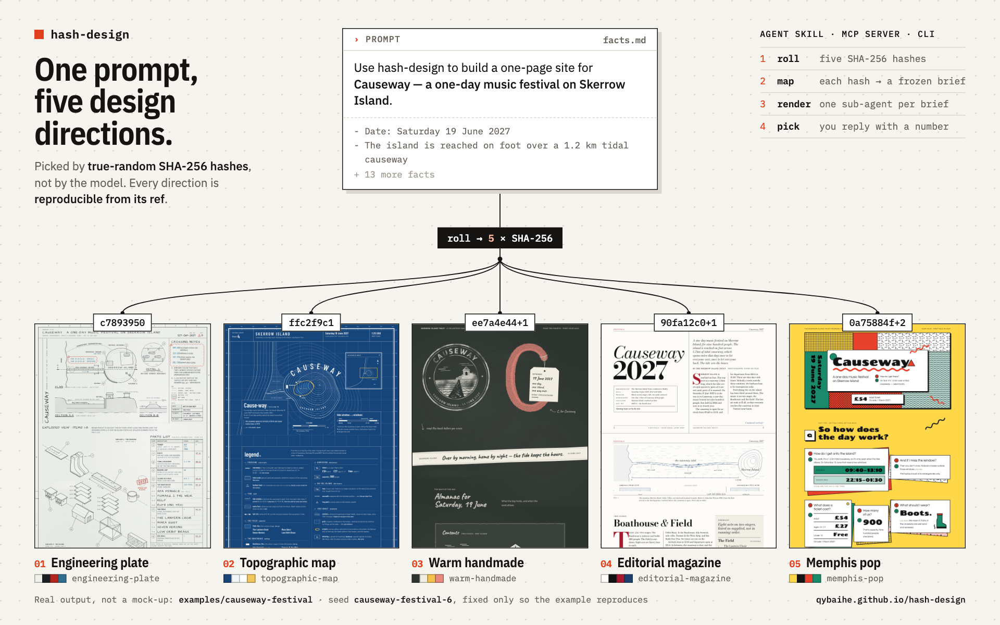](https://qybaihe.github.io/hash-design/causeway-festival/compare.html)

<p align="center"><sub>목업이 아니라 실제 결과물입니다: <a href="examples/causeway-festival">examples/causeway-festival</a>. 각 프리뷰는 고정된 브리프 하나만 본 별도의 서브 에이전트가 만들었습니다.<br><a href="https://qybaihe.github.io/hash-design/"><b>라이브 예시 4개 모두 보기 →</b></a> · 브랜치 40개 중 20개</sub></p>

### 빠른 시작

아직 npm에 배포하지 않았습니다. 소스에서 빌드하고(Node ≥ 20), 프로젝트에 Skill을 설치한 뒤 MCP 서버를 등록하세요:

```bash
git clone https://github.com/qybaihe/hash-design.git && cd hash-design && npm install && npm run build
node packages/core/dist/bin.js skill install --target both --dir /path/to/your/project   # Skill → .claude/skills + .cursor/skills
claude mcp add hash-design -- node "$PWD/packages/mcp/dist/bin.js"                       # MCP server (Claude Code)
```

그다음 에이전트에게 이렇게 요청하면 됩니다:

> hash-design으로 Skerrow 섬에서 열리는 하루짜리 음악 페스티벌 Causeway의 원페이지 사이트를 만들어 줘. 팩트: 2027년 6월 19일 토요일, 썰물 때 드러나는 1.2km 길을 걸어서 섬에 들어감, …

Cursor와 Claude Desktop 설정: [MCP 설정](#mcp-설정).

### 네 줄 요약

1. **롤**: 시스템 난수로 SHA-256 해시 다섯 개를 만듭니다.
2. **매핑**: 고정된 결정 트리가 각 해시를 브리프로 바꿉니다. 장르, 레이아웃, 폰트, 16진수 팔레트, 밀도, 모션, 트위스트. 같은 ref면 같은 브리프입니다.
3. **렌더링**: 고정된 브리프 하나당 서브 에이전트 하나가 HTML 프리뷰를 만들고, 비교 페이지가 나란히 보여 줍니다.
4. **선택**: 번호로 답하면 에이전트가 그 브리프로 최종 페이지를 만들고 `critique_page`로 점검합니다.

<details><summary>배지 더 보기</summary>

[](https://github.com/qybaihe/hash-design/actions/workflows/pages.yml)
[](.nvmrc)
[](#설치)

</details>

---

## 목차

- [데모](#데모) · [더 많은 예시](#더-많은-예시) · [왜 필요한가](#왜-필요한가) · [작동 방식](#작동-방식) · [브리프에 담기는 내용](#브리프에-담기는-내용)
- [설치](#설치) · [MCP 설정](#mcp-설정) · [Skill 설치](#skill-설치) · [사용법](#사용법)
- [MCP 도구](#mcp-도구) · [CLI](#cli) · [라이브러리](#라이브러리) · [브랜치 라이브러리](#브랜치-라이브러리-40) · [전역 금지 규칙](#전역-금지-규칙)
- [개발](#개발) · [문서](#문서) · [알려진 한계](#알려진-한계) · [기여하기](#기여하기)

## 데모

[](https://qybaihe.github.io/hash-design/fourth-lane-bakery/compare.html)

[`examples/fourth-lane-bakery/`](examples/fourth-lane-bakery)는 가상의 빵집을 대상으로 전 과정을 처음부터 끝까지 실행한 예시입니다. [팩트 시트](examples/fourth-lane-bakery/facts.md) → 한 번의 롤 → 고정된 브리프 다섯 개 → 프리뷰 다섯 개(각각 자기 브리프만 볼 수 있는 별도의 서브 에이전트가 렌더링) → 나란히 보는 비교 페이지로 이어집니다. 모든 결과물은 GitHub Pages에서 볼 수 있습니다.

| #   | 방향 (브랜치)                                                                                                    | 데스크톱                                                                                                                             | 브리프                                                               |
| --- | ---------------------------------------------------------------------------------------------------------------- | ------------------------------------------------------------------------------------------------------------------------------------ | -------------------------------------------------------------------- |
| 01  | [Bureaucratic form](https://qybaihe.github.io/hash-design/fourth-lane-bakery/previews/01-bureaucratic-form.html) |  | [브리프](examples/fourth-lane-bakery/briefs/01-bureaucratic-form.md) |
| 02  | [Bauhaus primary](https://qybaihe.github.io/hash-design/fourth-lane-bakery/previews/02-bauhaus-primary.html)     |      | [브리프](examples/fourth-lane-bakery/briefs/02-bauhaus-primary.md)   |
| 03  | [Ink and seal](https://qybaihe.github.io/hash-design/fourth-lane-bakery/previews/03-ink-and-seal.html)           |            | [브리프](examples/fourth-lane-bakery/briefs/03-ink-and-seal.md)      |
| 04  | [Risograph duotone](https://qybaihe.github.io/hash-design/fourth-lane-bakery/previews/04-risograph-duotone.html) |  | [브리프](examples/fourth-lane-bakery/briefs/04-risograph-duotone.md) |
| 05  | [Hong Kong shop sign](https://qybaihe.github.io/hash-design/fourth-lane-bakery/previews/05-hk-shop-sign.html)    |     | [브리프](examples/fourth-lane-bakery/briefs/05-hk-shop-sign.md)      |

- **라이브 비교 페이지:** <https://qybaihe.github.io/hash-design/fourth-lane-bakery/compare.html> (1–5 키로 확대, D/M 키로 데스크톱/모바일 전환)
- **로컬:** `open examples/fourth-lane-bakery/compare.html`
- 모든 프리뷰가 `critique_page`에서 96–100/100점, 브리프 준수도에서 100/100점을 받았습니다. 진행 과정은 예시의 [README](examples/fourth-lane-bakery/README.md)(중국어)에 기록되어 있습니다. 가게와 팩트, 문구가 중국어인 것은 이 페이지가 중국어 사용자를 위해 작성되었기 때문입니다.

<details><summary>모바일 스크린샷과 휴대폰 너비에서 본 비교 페이지</summary>

    


</details>

예시와 똑같은 롤을 재현하는 방법:

```bash
npm run build
node packages/core/dist/bin.js roll --subject "第四巷面包店" \
  --facts-file examples/fourth-lane-bakery/facts.md --seed fourth-lane-bakery --out /tmp/fourth-lane
# MCP로 하려면: roll_designs { subject, facts, seed: "fourth-lane-bakery" } 가 같은 ref 다섯 개를 반환합니다
```

<!-- MORE-EXAMPLES:START -->

### 더 많은 예시

팩트 시트와 고정 seed를 각각 따로 쓴 실행 예시가 세 개 더 있습니다. 어떤 두 예시도 같은 브랜치를 쓰지 않으므로, 네 예시를 합치면 40개 브랜치 중 20개가 나오고 여섯 패밀리가 모두 등장합니다. 각 미리보기는 자기 브리프만 본 서브 에이전트가 따로 렌더링했고, `critique_page` 점수는 모두 90/100 이상입니다. 전체 목록은 [예시 인덱스](https://qybaihe.github.io/hash-design/)에서 볼 수 있습니다.

#### Sluice — 셀프 호스팅 웹훅 수신함 · 영어 페이지

[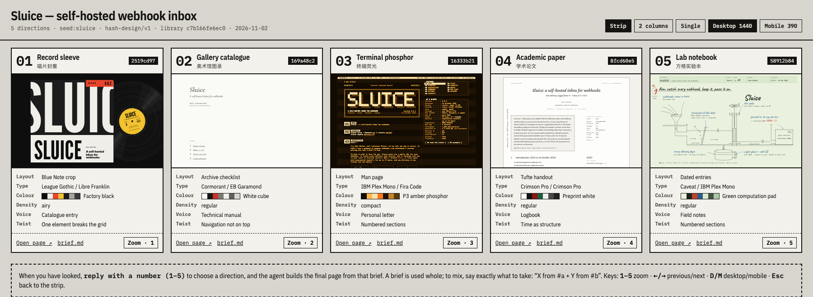](https://qybaihe.github.io/hash-design/sluice/compare.html)

<table>
<tr>
<td align="center"><a href="https://qybaihe.github.io/hash-design/sluice/previews/01-record-sleeve.html">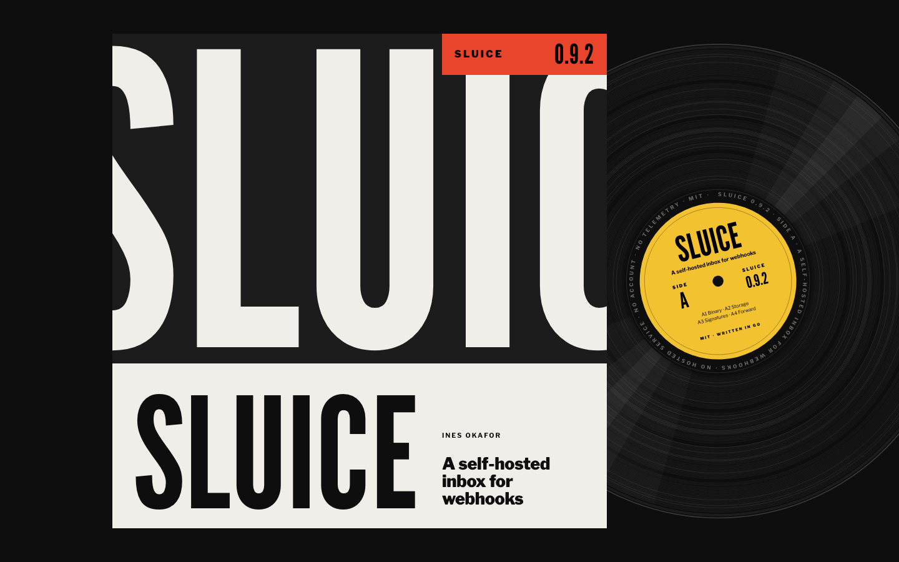</a><br><a href="https://qybaihe.github.io/hash-design/sluice/previews/01-record-sleeve.html">01 · Record sleeve</a></td>
<td align="center"><a href="https://qybaihe.github.io/hash-design/sluice/previews/02-gallery-catalogue.html">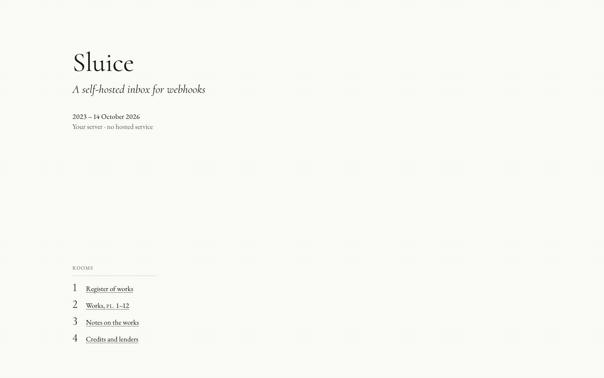</a><br><a href="https://qybaihe.github.io/hash-design/sluice/previews/02-gallery-catalogue.html">02 · Gallery catalogue</a></td>
<td align="center"><a href="https://qybaihe.github.io/hash-design/sluice/previews/03-terminal-phosphor.html">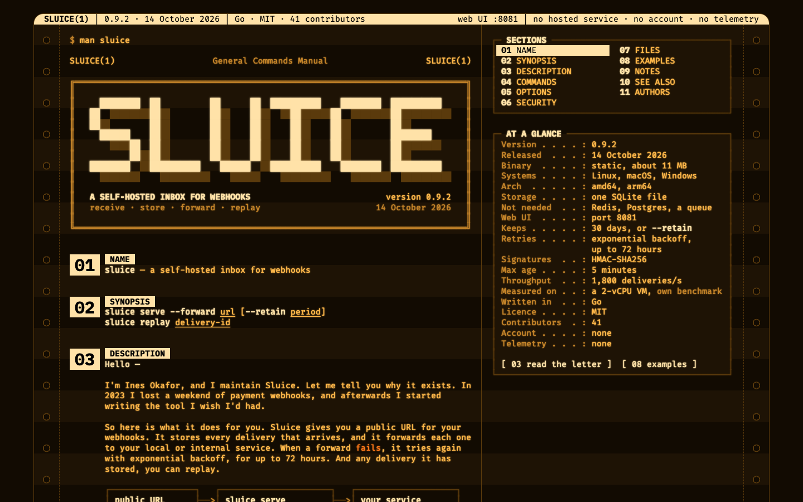</a><br><a href="https://qybaihe.github.io/hash-design/sluice/previews/03-terminal-phosphor.html">03 · Terminal phosphor</a></td>
<td align="center"><a href="https://qybaihe.github.io/hash-design/sluice/previews/04-academic-paper.html">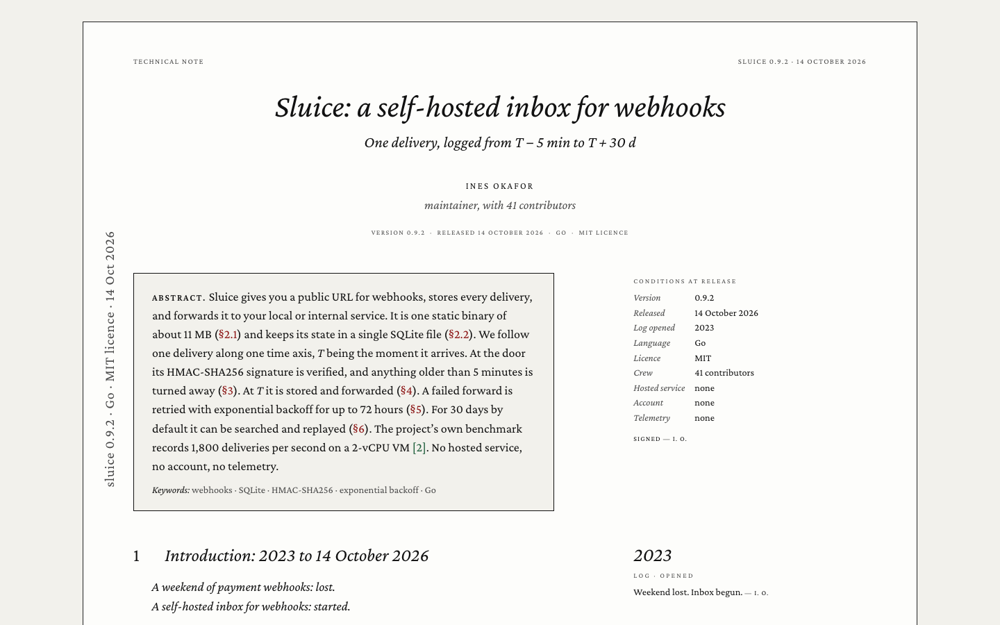</a><br><a href="https://qybaihe.github.io/hash-design/sluice/previews/04-academic-paper.html">04 · Academic paper</a></td>
<td align="center"><a href="https://qybaihe.github.io/hash-design/sluice/previews/05-lab-notebook.html">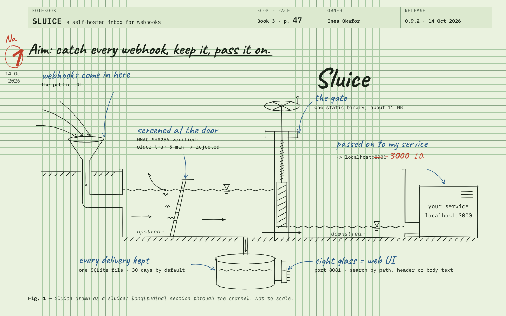</a><br><a href="https://qybaihe.github.io/hash-design/sluice/previews/05-lab-notebook.html">05 · Lab notebook</a></td>
</tr>
</table>

**[라이브 비교 페이지 열기 →](https://qybaihe.github.io/hash-design/sluice/compare.html)** · [예시 폴더](examples/sluice) (팩트, 브리프, 작업 과정) · seed `sluice` · critique 92–96 · 브리프 준수도 90–100

#### Bridge No.2 Cycle Works (二号桥单车铺) — 다리 밑 자전거 수리점 · 중국어 페이지

[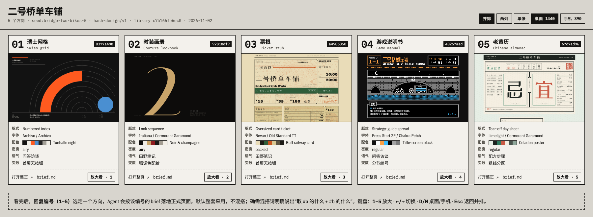](https://qybaihe.github.io/hash-design/bridge-two-bikes/compare.html)

<table>
<tr>
<td align="center"><a href="https://qybaihe.github.io/hash-design/bridge-two-bikes/previews/01-swiss-grid.html">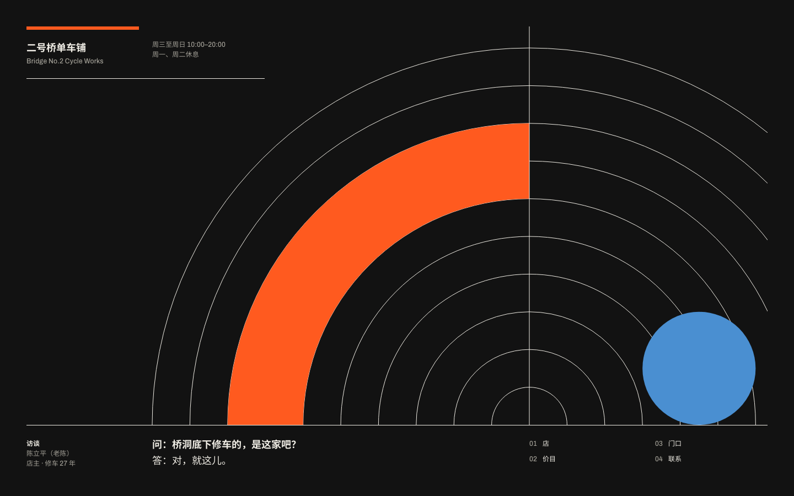</a><br><a href="https://qybaihe.github.io/hash-design/bridge-two-bikes/previews/01-swiss-grid.html">01 · Swiss grid</a></td>
<td align="center"><a href="https://qybaihe.github.io/hash-design/bridge-two-bikes/previews/02-couture-lookbook.html">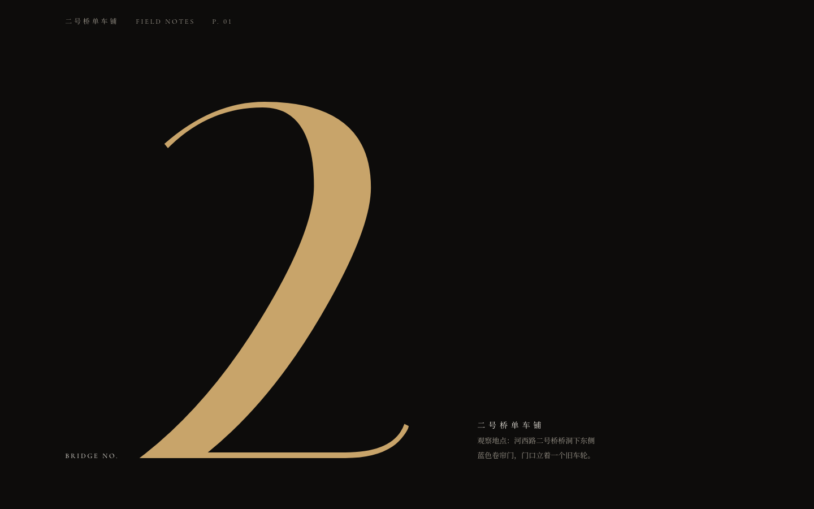</a><br><a href="https://qybaihe.github.io/hash-design/bridge-two-bikes/previews/02-couture-lookbook.html">02 · Couture lookbook</a></td>
<td align="center"><a href="https://qybaihe.github.io/hash-design/bridge-two-bikes/previews/03-ticket-stub.html">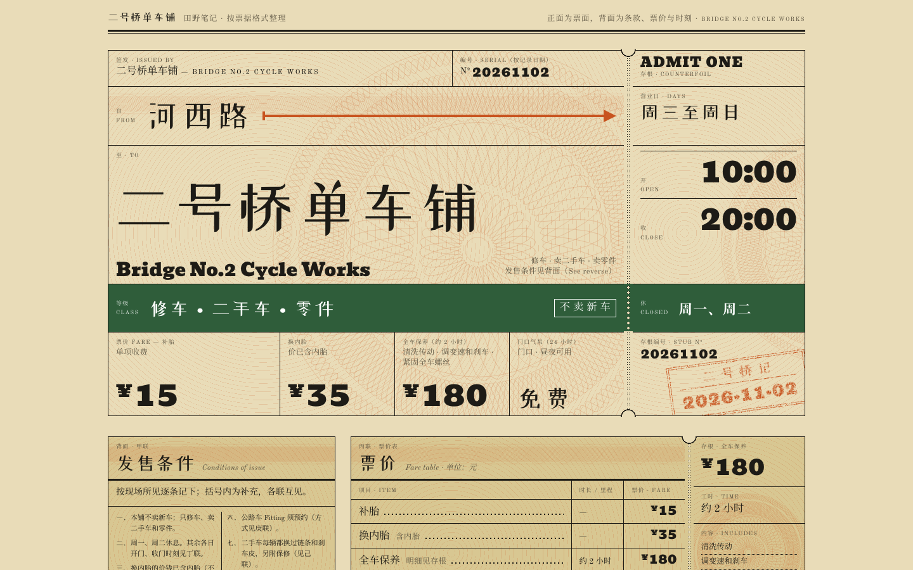</a><br><a href="https://qybaihe.github.io/hash-design/bridge-two-bikes/previews/03-ticket-stub.html">03 · Ticket stub</a></td>
<td align="center"><a href="https://qybaihe.github.io/hash-design/bridge-two-bikes/previews/04-game-manual.html">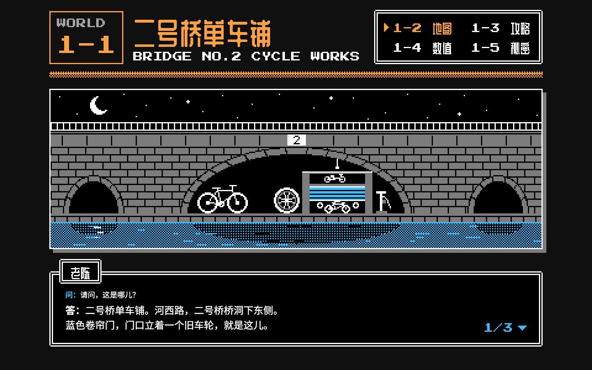</a><br><a href="https://qybaihe.github.io/hash-design/bridge-two-bikes/previews/04-game-manual.html">04 · Game manual</a></td>
<td align="center"><a href="https://qybaihe.github.io/hash-design/bridge-two-bikes/previews/05-chinese-almanac.html">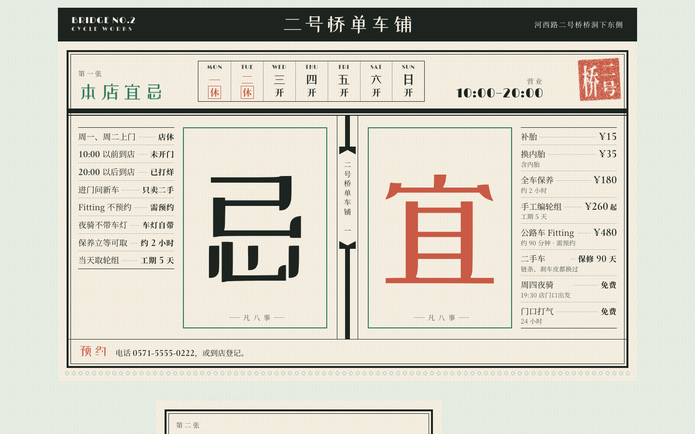</a><br><a href="https://qybaihe.github.io/hash-design/bridge-two-bikes/previews/05-chinese-almanac.html">05 · Chinese almanac</a></td>
</tr>
</table>

**[라이브 비교 페이지 열기 →](https://qybaihe.github.io/hash-design/bridge-two-bikes/compare.html)** · [예시 폴더](examples/bridge-two-bikes) (팩트, 브리프, 작업 과정) · seed `bridge-two-bikes-5` · critique 96–100 · 브리프 준수도 100

#### Causeway — 썰물 때만 건너가는 섬의 하루짜리 음악 축제 · 영어 페이지

[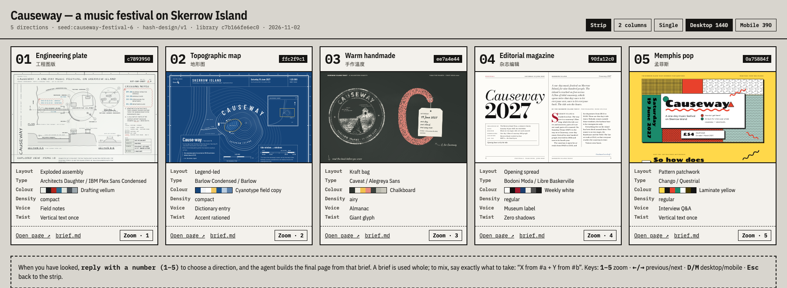](https://qybaihe.github.io/hash-design/causeway-festival/compare.html)

<table>
<tr>
<td align="center"><a href="https://qybaihe.github.io/hash-design/causeway-festival/previews/01-engineering-plate.html">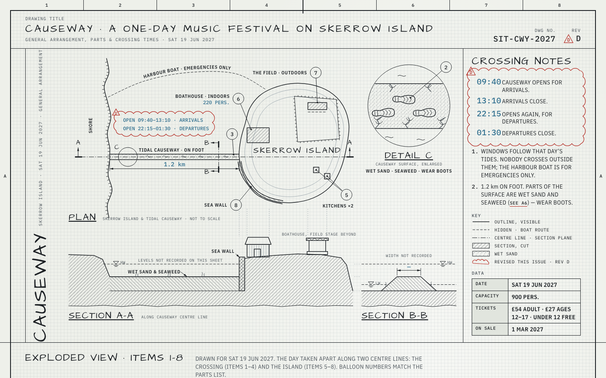</a><br><a href="https://qybaihe.github.io/hash-design/causeway-festival/previews/01-engineering-plate.html">01 · Engineering plate</a></td>
<td align="center"><a href="https://qybaihe.github.io/hash-design/causeway-festival/previews/02-topographic-map.html">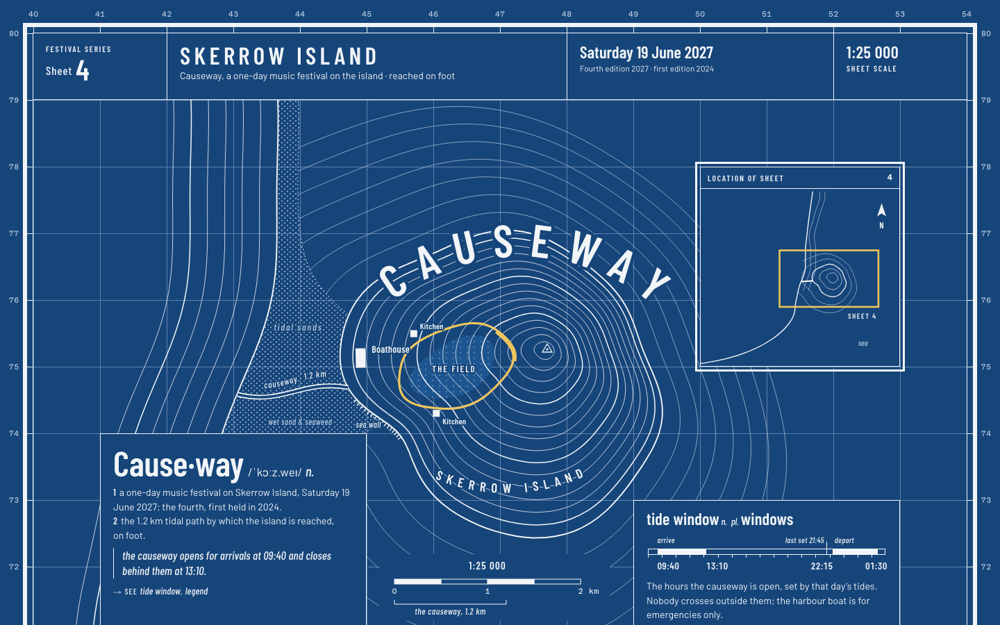</a><br><a href="https://qybaihe.github.io/hash-design/causeway-festival/previews/02-topographic-map.html">02 · Topographic map</a></td>
<td align="center"><a href="https://qybaihe.github.io/hash-design/causeway-festival/previews/03-warm-handmade.html">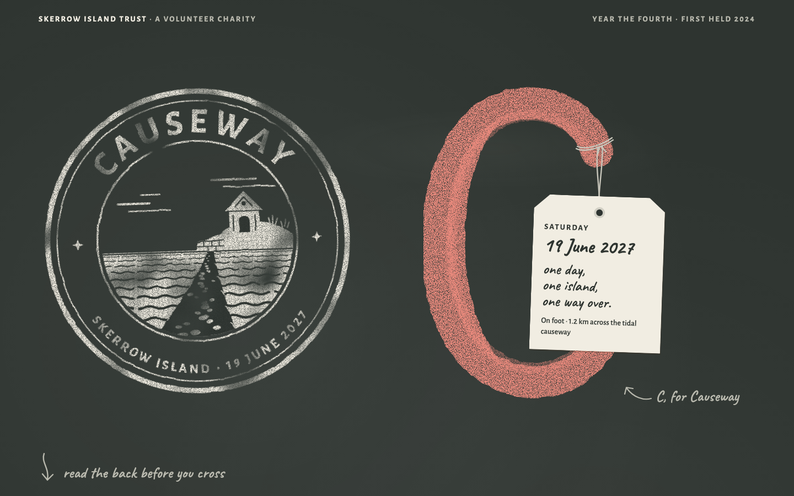</a><br><a href="https://qybaihe.github.io/hash-design/causeway-festival/previews/03-warm-handmade.html">03 · Warm handmade</a></td>
<td align="center"><a href="https://qybaihe.github.io/hash-design/causeway-festival/previews/04-editorial-magazine.html">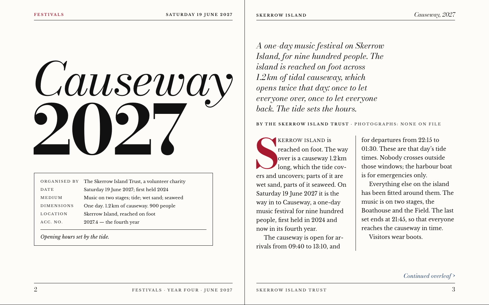</a><br><a href="https://qybaihe.github.io/hash-design/causeway-festival/previews/04-editorial-magazine.html">04 · Editorial magazine</a></td>
<td align="center"><a href="https://qybaihe.github.io/hash-design/causeway-festival/previews/05-memphis-pop.html">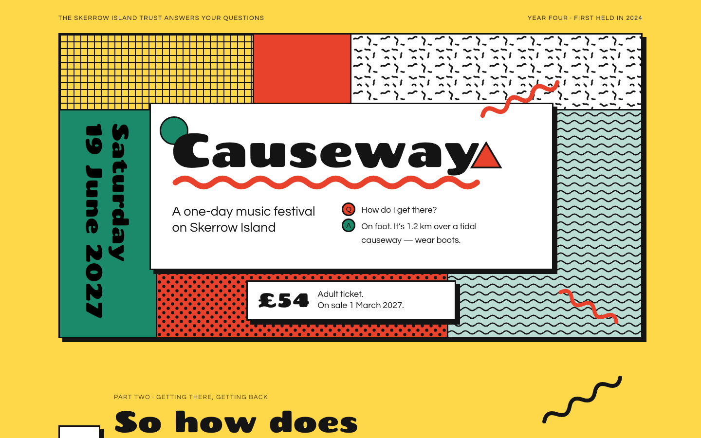</a><br><a href="https://qybaihe.github.io/hash-design/causeway-festival/previews/05-memphis-pop.html">05 · Memphis pop</a></td>
</tr>
</table>

**[라이브 비교 페이지 열기 →](https://qybaihe.github.io/hash-design/causeway-festival/compare.html)** · [예시 폴더](examples/causeway-festival) (팩트, 브리프, 작업 과정) · seed `causeway-festival-6` · critique 96–100 · 브리프 준수도 100

<!-- MORE-EXAMPLES:END -->

## 왜 필요한가

LLM에게 "멋진 페이지"를 만들어 달라고 하면 거의 언제나 똑같은 최빈값 미학으로 수렴합니다. Inter 폰트, 보라에서 파랑으로 넘어가는 그라데이션, 가운데 정렬된 헤드라인과 버튼 두 개, 똑같이 생긴 기능 카드 세 장, 글래스모피즘, 이모지 아이콘, 그리고 _Unlock_, _Seamless_, _Supercharge_ 같은 문구까지. 이유는 간단합니다. 모델은 선택권이 주어질 때마다 학습 데이터에서 가장 흔한 것을 고르기 때문입니다.

hash-design은 모델에게 더 나은 안목을 요구하지 않습니다. 대신 **선택권을 빼앗습니다**:

1. 시스템 난수로 해시 다섯 개를 뽑습니다(`crypto.randomBytes(32)` → SHA-256).
2. 각 해시를 **고정되고 재현 가능한 결정 트리**에 통과시켜 구체적인 방향으로 매핑합니다. 디자인 장르, 레이아웃, 폰트 조합, hex 팔레트, 밀도, 모션, 모티프, 첫 화면 앵커, 타입 스케일, 표면, 카피 보이스, 그리고 "트위스트" 하나가 정해집니다.
3. 각 방향을 **브리프**로 고정합니다. 브리프에는 바로 붙여 넣을 수 있는 토큰(폰트 링크, hex 값, `tokens.css`, 그리드 수치, 모서리 반경/그림자 정책)과 전역 금지 규칙이 담깁니다.
4. 에이전트가 할 일은 각 브리프를 충실히 **실행하는 것**뿐입니다. 독립된 HTML 프리뷰 다섯 개와 나란히 비교하는 페이지를 만든 다음, **멈추고 사용자가 번호를 고를 때까지 기다립니다**.
5. 번호를 고르면 에이전트는 그 브리프로 최종 페이지를 만들고 `critique_page`로 검사합니다.

이것은 모델의 기본 미학을 깨뜨리는 외부의 무작위 제약입니다. KV 캐시나 샘플링 temperature와는 아무 관련이 없습니다. 모델의 안목은 스타일을 고르는 데가 아니라 실행 품질(정렬, 리듬, 디테일, 가독성)에 쓰입니다.

## 작동 방식

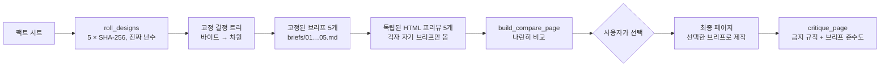

### 바이트 → 차원 (`hash-design/v1`)

| 바이트 | 차원             | 규칙                                                                                                |
| ------ | ---------------- | --------------------------------------------------------------------------------------------------- |
| 0–1    | 브랜치(branch)   | `uint16(b0, b1) mod N` (N = 40). 충돌하면 앞으로 이동합니다. 아래 참고                              |
| 2      | 보이스(voice)    | 카피 보이스 14종: 가게 주인의 칠판, 현장 노트, 기술 매뉴얼, 개인 편지, 시간표, 연감…                |
| 3      | 레이아웃(layout) | 브랜치의 레이아웃 3개 중 1개. 그리드 수치와 위에서 아래로 내려가는 섹션 스케치 포함                 |
| 4      | 타입(type)       | 조합 3개 중 1개: display / body (/ mono) + CJK 폰트 + 조판 메모                                     |
| 5      | 팔레트(palette)  | 팔레트 3개 중 1개: hex 값 7개 (paper / ink / muted / accent / accent2 / rule / panel)               |
| 6      | 밀도(density)    | airy / regular / compact / packed 중 브랜치가 허용하는 부분집합                                     |
| 7      | 모션(motion)     | 3개 중 1개: 지속 시간, 이징, reduced-motion 정책                                                    |
| 8      | 모티프(motif)    | 브랜치의 모티프 3개 중 1개                                                                          |
| 9      | 앵커(anchor)     | 브랜치의 첫 화면 앵커 3개 중 1개                                                                    |
| 10     | 스케일(scale)    | 브랜치가 허용하는 모듈러 스케일 (1.125–1.618)                                                       |
| 11     | 표면(surface)    | 표면 3개 중 1개 (CSS 힌트 포함)                                                                     |
| 12     | 트위스트(twist)  | 트위스트 16종. 예: "숫자를 디스플레이 요소로", "요소 하나가 그리드를 깨뜨림", "첫 화면에 버튼 없음" |
| 13–31  | 미사용           | 브리프에 기록되며, 향후 차원을 위해 예약되어 있음                                                   |

- **충돌과 계열 분산.** 한 번의 롤 안에서 이미 쓰인 브랜치에 떨어진 해시는 다음 빈 브랜치가 나올 때까지 앞으로(+1, +2, …) 이동합니다. 아직 쓰이지 않은 **계열**(print / document / signage / screen / craft / modernist)이 남아 있는 동안에는 이미 쓰인 계열에 떨어지는 것도 충돌로 칩니다. 그래서 5개짜리 롤은 항상 서로 다른 5개 계열에 걸칩니다. 이동한 칸 수가 `probe`이며, ref는 `<hash>+<probe>` 형태로 적고 그것만으로도 재현됩니다.
- **브랜치 순서.** 라이브러리 순서가 곧 매핑 순서입니다. 각 계열의 구성원은 링 위에 고르게 퍼져 있어서, 앞으로 이동하더라도 확률이 한 브랜치로 쏠리지 않습니다. 5개짜리 롤에서 모든 브랜치는 9–17% 확률로 등장합니다(균등 분포라면 12.5%).
- **제약 조건은 바이트를 적용하기 전에 후보 풀을 걸러내므로**, 제약 조건도 디자인 정체성의 일부입니다: `light_only`, `dark_only`, `reduced_motion`, `brand_colors`(브랜드 색이 accent를 대체하고, accent 색상(hue)이 가장 가까운 팔레트가 선택되며 대비가 보고됩니다), `families`, `include_branches`, `exclude_branches`.
- **재현 가능.** 같은 `ref`, 같은 제약 조건, 같은 라이브러리 핑거프린트라면 언제나 같은 브리프가 나옵니다. 모든 브리프에는 알고리즘(`hash-design/v1`)과 라이브러리 핑거프린트(데이터에 대한 SHA-256의 앞 12자리 hex)가 기록됩니다.
- **`seed`는 예시와 테스트를 재현할 때만 씁니다.** 실제 사용에서는 항상 시스템 난수에서 뽑습니다.

계산 예시를 포함한 전체 명세는 [docs/mapping.md](docs/mapping.md)(영어)에 있습니다.

## 브리프에 담기는 내용

예시의 [#3 Ink and seal](examples/fourth-lane-bakery/briefs/03-ink-and-seal.md)을 예로 들면, 브리프에는 다음이 들어 있습니다.

- 바이트별 매핑 과정과 공식, 그 결과
- 콘텐츠: 페이지에 적을 수 있는 유일한 사실들
- 카피 보이스와 그 표현 장치, 레이아웃(그리드 수치와 섹션 순서), 첫 화면 앵커
- 타입: Google Fonts `<link>`(페이지가 중국어일 때는 CJK 폰트 포함)와 모듈러 비율로 계산한 타입 스케일
- hex 값 7개, 색 사용 비율, WCAG 대비 표(어떤 색을 큰 글자나 장식에만 써야 하는지)
- 밀도, 모서리 반경 / 테두리 / 그림자 정책, 표면(CSS 스니펫 포함), 모티프, 모션 사양
- 트위스트, 브랜치의 반드시 할 것 / 하지 말 것 목록, 전역 금지 규칙 14개 전체
- 바로 붙여 넣을 수 있는 `tokens.css`와 납품 전 체크리스트

브리프는 에이전트가 읽도록 작성되며 2개 국어로 되어 있습니다. 제목에는 중국어와 영어 레이블이 함께 붙고, `language`(`zh` 또는 `en`, 주제와 팩트에서 자동 감지)에 따라 콘셉트 설명, 지시문, CJK 웹폰트 로드 여부가 바뀝니다. 일부 풀 설명(보이스, 트위스트)은 현재 중국어로만 작성되어 있습니다.

## 설치

> **아직 npm에 배포되지 않았습니다.** `package.json` 파일은 배포할 준비가 되어 있지만(CI에서 `npm pack --dry-run`을 실행합니다), 지금은 소스에서 설치해야 합니다. 배포되고 나면 `npx -y hash-design-mcp`와 `npx -y hash-design`을 쓸 수 있습니다.

Node.js ≥ 20이 필요합니다(개발용으로는 `.nvmrc`에 22가 고정되어 있습니다).

```bash
git clone https://github.com/qybaihe/hash-design.git
cd hash-design
npm install
npm run build
# MCP 서버 진입점: packages/mcp/dist/bin.js
# CLI 진입점:      packages/core/dist/bin.js
```

## MCP 설정

`/ABS/PATH/hash-design`을 클론한 저장소의 절대 경로로 바꾸세요.

### Claude Code

```bash
claude mcp add hash-design -- node /ABS/PATH/hash-design/packages/mcp/dist/bin.js
```

또는 프로젝트 수준의 `.mcp.json`을 커밋하세요.

```json
{
  "mcpServers": {
    "hash-design": {
      "command": "node",
      "args": ["/ABS/PATH/hash-design/packages/mcp/dist/bin.js"]
    }
  }
}
```

### Cursor

`.cursor/mcp.json`(프로젝트) 또는 `~/.cursor/mcp.json`(전역)에 같은 구조로 작성합니다.

```json
{
  "mcpServers": {
    "hash-design": {
      "command": "node",
      "args": ["/ABS/PATH/hash-design/packages/mcp/dist/bin.js"]
    }
  }
}
```

### Claude Desktop

`~/Library/Application Support/Claude/claude_desktop_config.json`(macOS) 또는 `%APPDATA%\Claude\claude_desktop_config.json`(Windows)에 위와 같은 구조로 작성합니다. Claude Desktop은 프로젝트 디렉터리에서 서버를 시작하지 않으므로, `roll_designs`를 호출할 때 `out_dir`에 **절대 경로**를 넘겨야 합니다.

## Skill 설치

Skill은 에이전트에게 언제 hash-design을 써야 하는지, MCP 도구를 어떤 순서로 호출할지, 프리뷰를 어떻게 서로 독립적으로 렌더링할지, 언제 반드시 멈춰야 하는지를 알려 줍니다.

```bash
# 프로젝트에 설치 (.claude/skills와 .cursor/skills 양쪽에 기록)
node packages/core/dist/bin.js skill install --target both --dir /path/to/your/project
# 홈 디렉터리에 설치 (모든 프로젝트에서 사용 가능)
node packages/core/dist/bin.js skill install --target claude --global
```

또는 [`skills/hash-design/SKILL.md`](skills/hash-design/SKILL.md)를 `.claude/skills/hash-design/SKILL.md`(Claude Code)나 `.cursor/skills/hash-design/SKILL.md`(Cursor)에 직접 복사하세요. 이 저장소에는 두 사본이 모두 들어 있으며, 테스트가 두 사본이 원본과 똑같이 유지되도록 확인합니다. Skill 본문은 중국어로 작성되어 있고, description에는 영어 트리거 문구가 들어 있습니다.

## 사용법

MCP 서버와 Skill을 설치했다면 에이전트에게 이렇게 요청하기만 하면 됩니다.

> hash-design으로 "Fourth Lane Bakery"의 원페이지 사이트를 만들어 줘. 팩트: 화–일 7:00–19:00 영업, 월요일 휴무; 컨트리 브레드 ¥38; …

에이전트는 롤을 실행하고, 브리프를 고정하고, 프리뷰 다섯 개를 렌더링하고, `design/hash-design/compare.html`을 작성한 다음, 멈추고 사용자가 번호로 답할 때까지 기다립니다. MCP 프롬프트를 지원하는 클라이언트에서는 `hash-design` 프롬프트(인수: `subject`, `facts`, `count`)로 같은 워크플로를 시작할 수도 있습니다.

## MCP 도구

| 도구                 | 하는 일                                                                                                                                                                                                                            |
| -------------------- | ---------------------------------------------------------------------------------------------------------------------------------------------------------------------------------------------------------------------------------- |
| `roll_designs`       | `subject`, `facts`, `count`(기본값 5)와 선택 항목인 `seed`, `language`, 제약 조건을 받습니다. 해시, 매핑, 방향마다 브리프 하나씩을 반환합니다. `out_dir`을 주면 `roll.json`, `ROLL.md`, `briefs/*.md`를 디스크에 고정해 저장합니다 |
| `get_brief`          | `ref`(`<hash>` 또는 `<hash>+<probe>`)와 같은 제약 조건으로 브리프를 Markdown 또는 JSON으로 재현합니다                                                                                                                              |
| `list_branches`      | 디자인 브랜치 40개를 나열합니다. 계열로 필터링할 수도 있습니다                                                                                                                                                                     |
| `get_branch`         | 브랜치 하나의 모든 옵션과 토큰을 보여 줍니다                                                                                                                                                                                       |
| `critique_page`      | HTML 문자열이나 파일을 금지 규칙과 AI 템플릿 체크리스트에 비추어 채점합니다. `brief_ref` 또는 `roll_path` + `pick`을 주면 브리프 준수도도 채점합니다                                                                               |
| `build_compare_page` | `roll.json`으로 나란히 비교하는 `compare.html`을 만듭니다                                                                                                                                                                          |

리소스: `hash-design://bans`, `hash-design://workflow`(Skill), `hash-design://branches`, `hash-design://branch/{id}`. 프롬프트: `hash-design`(`subject`, `facts`, `count`).

모든 파라미터, 반환 형태, 대응하는 CLI 명령은 [docs/mcp-tools.md](docs/mcp-tools.md)(영어)에 정리되어 있습니다.

## CLI

```bash
hash-design roll --subject "Fourth Lane Bakery" --facts-file facts.md --out design/hash-design   # 진짜 난수 방향 5개
hash-design roll --subject "…" --light-only --brand "#c8102e" --format json                     # 제약 조건 지정
hash-design brief <ref> [constraints]                                                            # 브리프 재현
hash-design branches [--family craft]                                                            # 브랜치 라이브러리
hash-design branch ink-and-seal                                                                  # 브랜치 하나 상세 보기
hash-design critique page.html --roll design/hash-design/roll.json --pick 3 --fail-under 80
hash-design compare --roll design/hash-design/roll.json                                          # compare.html 작성
hash-design skill install --target both                                                          # Skill 설치
```

소스 체크아웃에서는 `node packages/core/dist/bin.js …`로 실행합니다(또는 저장소 루트에서 `alias hash-design="node $PWD/packages/core/dist/bin.js"`를 설정하세요). `hash-design --help`는 모든 명령을 보여 주고, `hash-design <command> --help`(예: `hash-design roll --help`)는 해당 명령의 옵션을 출력합니다. 여기에는 제약 조건 플래그 `--light-only`, `--dark-only`, `--reduced-motion`, `--brand`, `--family`, `--include`, `--exclude`도 포함됩니다.

## 라이브러리

```ts
import { roll, renderBrief, critiquePage, reproduce, parseRef } from 'hash-design';

const r = roll({ content: { subject: 'Fourth Lane Bakery', facts: ['Closed Mondays', 'Country loaf ¥38'] } });
for (const [i, d] of r.designs.entries()) console.log(renderBrief(d, r.content, { number: i + 1 }));

const design = reproduce(parseRef(r.designs[0].ref), r.constraints);
const report = critiquePage({ html: '<!doctype html>…', design });
console.log(report.score, report.adherence, report.findings);
```

패키지가 npm에 올라가기 전까지는 소스 체크아웃에서 가져오거나(`packages/core/dist/index.js`), 체크아웃을 로컬 의존성으로 추가하세요(`npm install /ABS/PATH/hash-design/packages/core`).

## 브랜치 라이브러리 (40)

모든 브랜치는 "SaaS 스타일"이 아니라 현실에 존재하는 디자인 장르입니다. 차원마다 구체적인 옵션이 세 개씩 있습니다. 폰트 조합(Google Fonts + CJK), hex 값 7개, 그리드 수치, 모서리 반경 / 테두리 / 그림자 정책, 모션 사양, 모티프, 표면이 그것입니다. 전체 카탈로그는 [docs/branches.md](docs/branches.md)(영어)에 있으며, `list_branches` / `get_branch`로 실시간 조회할 수 있습니다.

| 계열      | 브랜치                                                                                                                                                                                      |
| --------- | ------------------------------------------------------------------------------------------------------------------------------------------------------------------------------------------- |
| print     | Supermarket circular · Letterpress wood type · Photocopy zine · Risograph duotone · Record sleeve · Varsity sports programme · Couture lookbook · Broadsheet newspaper · Editorial magazine |
| document  | Engineering plate · Ledger · Ticket stub · Academic paper · Apothecary label · Bureaucratic form · Thermal receipt · Herbarium specimen · Field guide plate                                 |
| signage   | Transit wayfinding · Hong Kong shop sign · Diner menu board · Gallery catalogue · Topographic map                                                                                           |
| screen    | Terminal phosphor · Web 1.0 homepage · Game manual · Instrument panel · Raw brutalist                                                                                                       |
| craft     | Recipe card · Warm handmade · Ink and seal · Chinese almanac · Ma whitespace · Lab notebook                                                                                                 |
| modernist | Swiss grid · Bauhaus primary · Constructivist poster · Art Deco · 70s supergraphic · Memphis pop                                                                                            |

데이터 규칙은 테스트와 스크립트로 강제됩니다.

- 금지된 폰트는 폴백에도 쓰지 않음
- ink/paper 대비 ≥ 7:1, muted/paper ≥ 4.5:1
- 모든 브랜치에 밝은 팔레트가 최소 하나 있음
- 프레임워크 기본 hex 값 없음
- 디스플레이 폰트 하나가 대표 폰트로 쓰이는 브랜치는 최대 3개
- 서로 다른 두 브랜치가 같은 대표 팔레트(paper + accent)를 공유하지 않음
- 모든 폰트 URL이 Google Fonts에서 정상적으로 열림: `node scripts/verify-fonts.mjs` (235/235 통과)

## 전역 금지 규칙

모든 브리프에는 다음 금지 규칙 14개가 들어 있으며, `critique_page`가 각각을 자동으로 감지합니다.

| id                          | 금지 내용                                                                                                                |
| --------------------------- | ------------------------------------------------------------------------------------------------------------------------ |
| `generic-sans`              | Inter, Roboto, Poppins, Montserrat, DM Sans, Space Grotesk 외 기본 산세리프 17종; `system-ui`를 "디자인"으로 내세우는 것 |
| `purple-blue-gradient`      | 보라 / 인디고 / 파랑 그라데이션, 그라데이션 텍스트, 색깔 블롭                                                            |
| `centered-hero-two-buttons` | 가운데 정렬 헤드라인 + 부제 + primary / ghost 버튼 한 쌍                                                                 |
| `identical-cards`           | 똑같이 생긴 "아이콘 + 제목 + 두 줄 설명" 카드 3 / 4 / 6장                                                                |
| `glassmorphism`             | `backdrop-filter` 젖빛 유리 효과                                                                                         |
| `emoji-icons`               | 이모지를 아이콘으로 쓰는 것; 범용 아이콘 세트를 장식으로 쓰는 것                                                         |
| `buzzword-copy`             | Unlock / Seamless / Supercharge / 赋能 / 一站式 / 极致体验 …                                                             |
| `soft-shadow-rounded`       | 모든 요소에 12–24px 모서리 반경 + 크고 부드러운 그림자                                                                   |
| `invented-facts`            | "10K+ users", "Trusted by", 아바타가 붙은 가짜 후기                                                                      |
| `tailwind-default-palette`  | `#6366f1`, `#8b5cf6`, `#0f172a` 같은 프레임워크 기본값                                                                   |
| `scroll-fade-everything`    | 스크롤할 때 모든 섹션이 아래에서 위로 페이드인되는 것                                                                    |
| `pill-badge-sparkle`        | 헤드라인 위의 "New ✨" 알약형 배지                                                                                       |
| `placeholder-content`       | Lorem ipsum, 스톡 인물 사진, 무작위 Unsplash 이미지                                                                      |
| `template-sections`         | Hero → Features → Testimonials → Pricing → FAQ 공식                                                                      |

`critique_page`는 텍스트 대비(< 3:1), `viewport`, `lang`, `img alt`, 모션이 있는데 `prefers-reduced-motion`이 빠진 경우, 그리고 브리프 준수도(폰트, hex 값, 모서리 반경과 그림자 정책)도 검사합니다. 정적 분석이기 때문에 첫 화면이 정말 브리프의 앵커대로인지, 보이스가 맞는지는 판단하지 못합니다. 그 부분은 여전히 사람이, 또는 브리프를 다시 읽는 에이전트가 확인해야 합니다.

## 개발

```bash
npm install
npm run build        # tsc -b, 두 패키지 모두
npm test             # vitest: core, CLI, MCP(인메모리 transport), Skill/문서 일관성
npm run check        # 타입 검사 + lint + prettier + 테스트
npm run sync         # 데이터 변경 후: SKILL.md 금지 규칙 블록, .claude/.cursor 사본, docs/branches.md 재생성
node scripts/smoke.mjs        # 실제 stdio 기반 MCP + CLI 스모크 테스트 (CI에서 실행)
node scripts/verify-fonts.mjs # 모든 폰트 URL을 온라인으로 확인 (CI에서는 실행 안 함)
npm run example:critique      # 모든 예시 미리보기를 브리프 기준으로 critique (90 미만이면 실패)
npm run screenshots           # 모든 예시의 Playwright 스크린샷 (`npx playwright install chromium` 필요)
npm run hero                  # 예시 스크린샷으로 docs/assets/hero.png와 social-preview.png를 다시 생성
```

CI는 Node 20, 22, 24에서 빌드, 타입 검사, lint, 포맷 검사, 테스트, stdio 스모크 테스트, `npm pack --dry-run`을 실행합니다.

저장소 구조:

```
packages/core/           # npm: hash-design — data, mapping, briefs, critique, compare page, CLI
  src/data/bans.ts       #   global bans, banned fonts, buzzword lists
  src/data/pools.ts      #   densities, scales, 14 copy voices, 16 twists
  src/data/branches/     #   40 branches (index.ts defines the mapping order)
  src/mapping.ts         #   hash → design (decision tree, collisions, constraints)
  src/brief.ts           #   brief rendering (Markdown / JSON)
  src/critique.ts        #   static AI-template checks
  src/compare.ts         #   side-by-side compare page
  src/cli.ts             #   CLI
packages/mcp/            # npm: hash-design-mcp — stdio MCP server
skills/hash-design/      # Skill source (.claude/ and .cursor/ hold synced copies)
examples/                # 4 full runs: facts → roll → 5 briefs → 5 previews → compare page → screenshots
docs/                    # architecture, mapping spec, MCP reference, branch catalogue (generated)
scripts/                 # sync / smoke / verify-fonts / screenshot / prepack
```

## 문서

- [docs/architecture.md](docs/architecture.md)(영어): 패키지, 데이터 흐름, 설계 결정, 테스트
- [docs/mapping.md](docs/mapping.md)(영어): `hash-design/v1` 매핑, 충돌, 제약 조건, 재현성
- [docs/mcp-tools.md](docs/mcp-tools.md)(영어): 모든 MCP 도구, 리소스, 프롬프트와 대응하는 CLI 명령
- [docs/branches.md](docs/branches.md)(영어): 브랜치 40개 카탈로그(자동 생성)
- 중국어판: [아키텍처](docs/architecture.zh-CN.md) · [매핑 명세](docs/mapping.zh-CN.md) · [MCP 도구](docs/mcp-tools.zh-CN.md)

## 알려진 한계

- 아직 npm에 배포되지 않았습니다(`package.json` 파일은 준비되어 있고, CI에서 `npm pack --dry-run`으로 검증합니다).
- `critique_page`는 휴리스틱 정적 분석입니다. 인라인 `<style>`, `style=""`, 그리고 따로 넘긴 CSS만 읽으며, 페이지를 렌더링하거나 링크된 스타일시트를 가져오지는 않습니다.
- 라이브러리에는 브랜치가 40개 있습니다. 브랜치를 추가하거나 제거하면 매핑이 바뀝니다. 라이브러리 핑거프린트가 이를 감지하지만, 이전 ref를 재현하려면 그에 맞는 버전이 필요합니다.
- CJK 폰트는 Google Fonts에서 불러옵니다. 오프라인이거나 네트워크가 제한된 환경에서는 폰트를 직접 호스팅하거나 각 브리프에 나열된 폴백을 써야 합니다.
- 브리프와 Skill 텍스트의 일부는 중국어로만 되어 있습니다([브리프에 담기는 내용](#브리프에-담기는-내용) 참고).
- 결과물이 _좋은지_ 여부는 여전히 브리프를 실행하는 모델과 사람에게 달려 있습니다. 이 도구는 "전부 똑같아 보이는" 문제를 해결할 뿐, 디자인 판단을 대신하지는 않습니다.

## 기여하기

기여를 환영하며, 특히 새 브랜치를 환영합니다. 먼저 [CONTRIBUTING.md](CONTRIBUTING.md)(영어)를 읽어 주세요. 데이터 규칙과 `npm run sync`, 그리고 데이터를 바꾸면 왜 예시를 다시 롤해야 하는지가 설명되어 있습니다. [행동 강령](CODE_OF_CONDUCT.md)(영어)을 지켜 주시고, 취약점은 [SECURITY.md](SECURITY.md)(영어)에 설명된 절차에 따라 제보해 주세요. 릴리스 노트는 [CHANGELOG.md](CHANGELOG.md)(영어)에서 볼 수 있습니다.

## 라이선스

[MIT](LICENSE) © qybaihe
