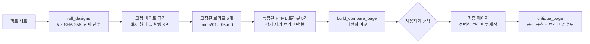

<div align="center">

[English](README.md) · [简体中文](README.zh-CN.md) · [日本語](README.ja.md) · **한국어** · [Español](README.es.md)

# hash-design

<p align="center"><a href="https://qybaihe.github.io/hash-design/causeway-festival/compare.html"><picture><source media="(prefers-reduced-motion: reduce)" srcset="docs/assets/hero.png"></picture></a></p>

<p align="center"><sub>목업이 아니라 실제 결과물입니다: <a href="examples/causeway-festival">examples/causeway-festival</a>. 각 프리뷰는 고정된 브리프 하나만 본 별도의 서브 에이전트가 만들었습니다.<br><a href="https://qybaihe.github.io/hash-design/"><b>라이브 예시 4개 모두 보기 →</b></a> · hash-design/v1로 돌린 실행 결과(<a href="#쇼케이스">쇼케이스</a> 참고) · <a href="docs/assets/hero.png">정지 이미지</a> · <a href="docs/assets/hero.mp4">MP4</a></sub></p>

### 프롬프트 하나, 디자인 방향 다섯 가지. 고르는 건 모델이 아니라 진짜 난수로 만든 SHA-256 해시입니다.

**코딩 에이전트가 매번 똑같은 'Inter + 보라색 그라데이션' 페이지를 내놓는 일을 끝내세요. hash-design은 방향 다섯 가지를 롤로 뽑아 각각을 디자인 브리프로 고정하고, 프리뷰 다섯 개를 나란히 렌더링한 뒤 여러분이 하나를 고를 때까지 기다립니다. 어떤 방향이든 ref로 다시 만들 수 있습니다.**

[](https://github.com/qybaihe/hash-design/actions/workflows/ci.yml)
[](https://qybaihe.github.io/hash-design/)
[](#빠른-시작)
[](docs/mcp-tools.md)
[](.nvmrc)
[](https://www.npmjs.com/package/hash-design)
[](LICENSE)

**[라이브 예시](https://qybaihe.github.io/hash-design/) · [매핑 명세](docs/mapping.md) · [MCP 레퍼런스](docs/mcp-tools.md) · [변경 기록](CHANGELOG.md)**

[빠른 시작](#빠른-시작) · [작동 방식](#작동-방식) · [쇼케이스](#쇼케이스) · [레퍼런스](#레퍼런스) · [자주 묻는 질문](#자주-묻는-질문)

**에이전트에게 이렇게 말하세요** (Claude Code, Cursor):

```text
이 에이전트에 hash-design skill을 설치해 줘: `npx -y hash-design skill install --dir .`를 실행하고
`npx -y hash-design mcp`로 MCP 서버를 등록해 줘(hash-design 0.1.0이면
`npx -y hash-design-mcp@0.1.0` 사용). 절차는 https://github.com/qybaihe/hash-design/blob/main/README.ko.md#빠른-시작 참고.
```

</div>

---

## hash-design가 하는 일

LLM에게 "멋진 페이지"를 만들어 달라고 하면 거의 언제나 똑같은 최빈값 미학으로 수렴합니다. Inter 폰트, 보라에서 파랑으로 넘어가는 그라데이션, 가운데 정렬된 헤드라인과 버튼 두 개, 똑같이 생긴 기능 카드 세 장, 글래스모피즘, 이모지 아이콘, 그리고 _Unlock_, _Seamless_, _Supercharge_ 같은 문구까지. 이유는 간단합니다. 모델은 선택권이 주어질 때마다 학습 데이터에서 가장 흔한 것을 고르기 때문입니다.

hash-design은 모델에게 더 나은 안목을 요구하지 않습니다. 대신 **선택권을 빼앗습니다**:

| 단계            | 하는 일                                                                                                                                                                                                                                                                                                                                                                                                  |
| --------------- | -------------------------------------------------------------------------------------------------------------------------------------------------------------------------------------------------------------------------------------------------------------------------------------------------------------------------------------------------------------------------------------------------------- |
| **롤**          | 시스템 난수로 해시 다섯 개를 뽑습니다(`crypto.randomBytes(32)` → SHA-256).                                                                                                                                                                                                                                                                                                                               |
| **매핑**        | 각 해시가 **곧** 방향입니다. 고정되고 재현 가능한 규칙이 해시의 바이트를 디자인 파라미터로 곧바로 읽어 들입니다. 색상(hue)과 대비를 계산해 맞춘 팔레트, 분류 없는 단일 폰트 풀에서 고른 디스플레이 서체와 본문 서체, 대소문자, 자간, 타입 스케일 비율, 밀도, 그리드, 첫 화면 앵커, 모티프, 모서리와 텍스처, 모션 타이밍, 카피 보이스, 그리고 "트위스트" 하나가 정해집니다. 스타일 라이브러리는 없습니다. |
| **고정**        | 각 방향을 **브리프**로 고정합니다. 브리프에는 바로 붙여 넣을 수 있는 토큰(폰트 링크, hex 값, `tokens.css`, 그리드 수치, 모서리 반경 / 테두리 / 그림자 값)과 전역 금지 규칙이 담깁니다.                                                                                                                                                                                                                   |
| **렌더링**      | 에이전트가 할 일은 각 브리프를 충실히 **실행하는 것**뿐입니다. 독립된 HTML 프리뷰 다섯 개와 나란히 비교하는 페이지를 만든 다음, **멈추고 사용자가 번호를 고를 때까지 기다립니다**.                                                                                                                                                                                                                       |
| **최종 페이지** | 번호를 고르면 에이전트는 그 브리프로 최종 페이지를 만들고 `critique_page`로 검사합니다.                                                                                                                                                                                                                                                                                                                  |

이것은 모델의 기본 미학을 깨뜨리는 외부의 무작위 제약입니다. KV 캐시나 샘플링 temperature와는 아무 관련이 없습니다. 모델의 안목은 스타일을 고르는 데가 아니라 실행 품질(정렬, 리듬, 디테일, 가독성)에 쓰입니다.

기본 결과물은 웹 페이지입니다. **시나리오**(`scenario`)를 넘기면 같은 롤의 방향이 슬라이드, 모바일 앱 화면, 대시보드, 포스터/소셜 카드, HTML 이메일이 됩니다([시나리오](#시나리오) 참고).

구성은 **Agent Skill**(언제, 어떤 순서로 이 흐름을 돌릴지), **MCP 서버**(stdio, 도구 4개), **CLI**, **TypeScript 라이브러리** 네 가지이며, 함께 npm의 [`hash-design`](https://www.npmjs.com/package/hash-design)으로 배포됩니다(MCP 서버는 0.2.0부터 이 패키지에 들어갑니다).

## 빠른 시작

### 에이전트에게 맡기기

페이지를 만들 프로젝트에서 Claude Code나 Cursor를 열고 다음을 붙여 넣으세요:

```text
이 에이전트에 hash-design skill을 설치해 줘: `npx -y hash-design skill install --dir .`를 실행하고
`npx -y hash-design mcp`로 MCP 서버를 등록해 줘(hash-design 0.1.0이면
`npx -y hash-design-mcp@0.1.0` 사용). 절차는 https://github.com/qybaihe/hash-design/blob/main/README.ko.md#빠른-시작 참고.
```

에이전트가 Skill을 프로젝트의 `.claude/skills/`와 `.cursor/skills/`에 복사하고 MCP 서버를 등록합니다(Claude Code는 `claude mcp add`, Cursor는 `.cursor/mcp.json`). clone이나 빌드는 필요 없습니다. 끝나면 새 세션을 시작해 둘 다 불러오게 한 다음 [사용법](#사용법)으로 넘어가세요. 명령을 직접 실행하려면 아래 절차를 따르세요.

### 직접 설치

Node.js ≥ 20과 npm(`npx`용)이 필요합니다.

**Skill.** Skill은 언제 hash-design을 쓰는지, 어떤 순서로 MCP 도구를 부르는지, 프리뷰를 어떻게 독립적으로 렌더링하는지, 언제 반드시 멈춰야 하는지를 에이전트에게 알려 줍니다.

```bash
npx -y hash-design skill install --target both --dir .      # 이 프로젝트: .claude/skills와 .cursor/skills
npx -y hash-design skill install --target claude --global   # 또는 홈 디렉터리(모든 프로젝트)
```

`--target`은 `claude`, `cursor`, `both`(기본값) 중 하나입니다. [`skills/hash-design/SKILL.md`](skills/hash-design/SKILL.md)를 `.claude/skills/hash-design/SKILL.md`(Claude Code)나 `.cursor/skills/hash-design/SKILL.md`(Cursor)에 직접 복사해도 됩니다. Skill 본문은 중국어로 작성되어 있고, description에는 영어 트리거 문구가 들어 있습니다.

**MCP 서버.** 에이전트에 `npx -y hash-design mcp`를 등록하세요. stdio로 서버가 실행됩니다.

> [!NOTE]
> `hash-design mcp`는 다음 릴리스인 hash-design 0.2.0부터 제공됩니다. 지금 npm에 있는 0.1.0에서는 대신 `npx -y hash-design-mcp@0.1.0`을 등록하세요. 예전에 별도 패키지로 배포한 hash-design/v1 서버(브랜치 40개 라이브러리와 도구 6개)이며, 더 이상 업데이트되지 않습니다.

#### Claude Code

```bash
claude mcp add hash-design -- npx -y hash-design mcp
# hash-design 0.1.0인 경우:
claude mcp add hash-design -- npx -y hash-design-mcp@0.1.0
```

또는 프로젝트 단위 `.mcp.json`을 커밋합니다:

```json
{
  "mcpServers": {
    "hash-design": {
      "command": "npx",
      "args": ["-y", "hash-design", "mcp"]
    }
  }
}
```

0.1.0에서는 `args`를 `["-y", "hash-design-mcp@0.1.0"]`로 씁니다.

#### Cursor

`.cursor/mcp.json`(프로젝트) 또는 `~/.cursor/mcp.json`(전역)에 위의 `.mcp.json`과 같은 구조로 씁니다.

#### Claude Desktop

macOS는 `~/Library/Application Support/Claude/claude_desktop_config.json`, Windows는 `%APPDATA%\Claude\claude_desktop_config.json`이며 구조는 같습니다. Claude Desktop은 프로젝트 디렉터리에서 서버를 시작하지 않으므로 `roll_designs`를 호출할 때 `out_dir`에 **절대 경로**를 넘기세요. `npx`를 찾지 못하면 `which npx`가 출력하는 경로를 `command`에 쓰세요.

### 소스에서 실행

개발에 참여하거나 아직 릴리스되지 않은 커밋을 실행할 때([CONTRIBUTING.md](CONTRIBUTING.md) 참고):

```bash
git clone https://github.com/qybaihe/hash-design.git ~/hash-design
cd ~/hash-design && npm install && npm run build
node ~/hash-design/packages/core/dist/bin.js skill install --target both --dir /path/to/your/project
claude mcp add hash-design -- node ~/hash-design/packages/core/dist/bin.js mcp
```

체크아웃에서 CLI는 `packages/core/dist/bin.js`입니다. `packages/mcp/dist/bin.js`도 같은 MCP 서버를 시작하므로, 그쪽을 가리키는 기존 설정은 그대로 동작합니다. 이 저장소에는 Skill의 `.claude/`와 `.cursor/` 사본이 들어 있고, 테스트가 원본과 똑같이 유지되도록 확인합니다.

### 사용법

MCP 서버와 Skill을 설치했다면 에이전트에게 이렇게 요청하기만 하면 됩니다.

> hash-design으로 "Fourth Lane Bakery"의 원페이지 사이트를 만들어 줘. 팩트: 화–일 7:00–19:00 영업, 월요일 휴무; 컨트리 브레드 ¥38; …

에이전트는 롤을 실행하고, 브리프를 고정하고, 프리뷰 다섯 개를 렌더링하고, `design/hash-design/compare.html`을 작성한 다음, 멈추고 사용자가 번호로 답할 때까지 기다립니다. MCP 프롬프트를 지원하는 클라이언트에서는 `hash-design` 프롬프트(인수: `subject`, `facts`, `count`, `scenario`)로 같은 워크플로를 시작할 수도 있습니다. 슬라이드, 앱 화면, 대시보드, 포스터, 이메일을 요청하면 에이전트가 맞는 `scenario`를 넘깁니다.

### CLI

```bash
hash-design roll --subject "Fourth Lane Bakery" --facts-file facts.md --out design/hash-design   # 진짜 난수 방향 5개
hash-design roll --subject "…" --light-only --brand "#c8102e" --format json                     # 제약 조건 지정
hash-design roll --subject "Q3 review" --facts-file facts.md --scenario deck --out design/deck   # 페이지 대신 슬라이드
hash-design brief <ref> [constraints]                                                            # 브리프 재현
hash-design critique page.html --roll design/hash-design/roll.json --pick 3 --fail-under 80
hash-design compare --roll design/hash-design/roll.json                                          # compare.html 작성
hash-design skill install --target both                                                          # Skill 설치
```

`npx -y hash-design …`로 실행하거나, `npm install -g hash-design`으로 한 번 설치한 뒤 `hash-design …`을 입력하세요. 체크아웃에서는 `node packages/core/dist/bin.js …`입니다. `hash-design --help`는 모든 명령을 보여 주고, `hash-design <command> --help`(예: `hash-design roll --help`)는 해당 명령의 옵션을 출력합니다. 여기에는 제약 조건 플래그 `--light-only`, `--dark-only`, `--reduced-motion`, `--brand`, `--scenario`도 포함됩니다.

### 라이브러리

```ts
import { roll, renderBrief, critiquePage, reproduce, parseRef } from 'hash-design';

const r = roll({ content: { subject: 'Fourth Lane Bakery', facts: ['Closed Mondays', 'Country loaf ¥38'] } });
for (const [i, d] of r.designs.entries()) console.log(renderBrief(d, r.content, { number: i + 1 }));

const design = reproduce(parseRef(r.designs[0].ref), r.constraints);
const report = critiquePage({ html: '<!doctype html>…', design });
console.log(report.score, report.adherence, report.findings);
```

`npm install hash-design`으로 설치합니다(ES 모듈, Node.js ≥ 20, 타입 포함).

### 업데이트

```bash
npx -y hash-design@latest skill install --target both --dir .   # 복사한 SKILL.md 갱신
```

npx는 예전에 캐시한 사본을 계속 쓸 수 있습니다. `@latest`를 붙이면 최신 릴리스를 가져옵니다(`hash-design@0.2.0`처럼 버전을 고정할 수도 있습니다). MCP 서버는 에이전트가 시작될 때마다 npx로 실행되므로 릴리스 뒤에는 에이전트를 재시작하고, 오래된 사본이 계속 실행되면 MCP 명령에 `hash-design@latest`라고 쓰세요. clone에서 쓰는 경우: `git pull && npm install && npm run build`. 업데이트로 폰트 풀, 프리미티브 목록, 바이트 규칙이 바뀌면 이전 버전으로 롤한 ref는 그 버전이 있어야 재현됩니다([자주 묻는 질문](#자주-묻는-질문) 참고).

## 작동 방식



### 바이트 → 파라미터 (`hash-design/v2`)

해시가 곧 방향입니다. 바이트 하나가 파라미터 하나(또는 비트로 나눠 두 개)를 정하며, 연속값으로 쓰이거나, 자유롭게 조합되는 중립적인 프리미티브의 짧은 목록에서 인덱스로 쓰입니다. 어떤 것도 장르나 스타일을 지칭하지 않습니다.

| 바이트 | 파라미터                                                                                                         |
| ------ | ---------------------------------------------------------------------------------------------------------------- |
| 0–5    | 팔레트: OKLCH 색상(hue), 밝은 또는 어두운 paper와 그 명도, paper 채도, accent 채도, 두 번째 accent의 색상 오프셋 |
| 6–10   | 타입: 디스플레이 서체(98), 본문 서체(62), 대소문자와 굵기, 자간, 타입 스케일 비율 1.067–1.618                    |
| 11     | 밀도: airy에서 packed까지 이어지는 범위의 한 지점. 기준 크기, 행간, 간격 단위, 섹션 간격, 너비가 이를 따름       |
| 12–15  | 레이아웃: 그리드 칼럼 3–12개와 거터, 텍스트 블록이 걸치는 칼럼, 첫 화면 높이, 섹션, 구분선                       |
| 16–17  | 첫 화면 앵커: 소재(8), 크기, 가로 위치, 회전                                                                     |
| 18–19  | 모티프: 모양(12), 크기, 배치(4), 각도                                                                            |
| 20–21  | 표면: 모서리 반경, 테두리 두께와 스타일, 하드 섀도, 텍스처와 그 불투명도                                         |
| 22–23  | 모션: 움직이는 대상, 지속 시간 0–600 ms, 이징(steps 또는 비트로 만든 cubic-bezier)                               |
| 24–25  | 보이스: 문법적 인칭, 헤드라인 형식, 문장 길이, 어조                                                              |
| 26–27  | 트위스트: 대상(9) × 연산(10) × 정도. 예: "페이지의 모든 숫자를 4.5° 회전"                                        |
| 28     | 포맷(웹이 아닌 시나리오용)                                                                                       |
| 29, 30 | CJK 디스플레이 서체(중국어 페이지용), 모노 서체                                                                  |
| 31     | 미사용, 브리프에 기록됨                                                                                          |

- **대비는 운에 맡기지 않고 계산합니다.** 텍스트 색은 paper 위에서 ink ≥ 7.5:1, muted ≥ 4.6:1, accent ≥ 3:1에 도달할 때까지 OKLCH 명도를 따라 이동합니다. 그래서 밝든 어둡든 어떤 해시에서나 읽기 쉬운 팔레트가 나옵니다(해시의 약 30%는 어두운 팔레트입니다).
- **방향 N개는 해시 N개입니다.** 5개짜리 롤은 서로 독립된 매핑 다섯 개이며, 그 사이에서 공유하거나 이동하거나 중복을 제거하는 것은 없습니다. 디자인의 `ref`는 64자리 hex 해시이며 그것만으로 재현됩니다.
- **제약 조건은 바이트를 읽기 전에 적용되므로**, 제약 조건도 디자인 정체성의 일부입니다: `light_only` / `dark_only`(이때 바이트 2는 명도만 정합니다), `reduced_motion`(모션 없음), `brand_colors`(첫 번째 색이 accent를 대체하고 색상(hue)을 정하며, 두 번째 색은 accent2를 대체합니다), `scenario`.
- **재현 가능.** 같은 `ref`, 같은 제약 조건, 같은 라이브러리 핑거프린트라면 언제나 같은 브리프가 나옵니다. 모든 브리프에는 알고리즘(`hash-design/v2`)과 라이브러리 핑거프린트(폰트 풀, 프리미티브 목록, 바이트 규칙에 대한 SHA-256의 앞 12자리 hex)가 기록됩니다.
- **`seed`는 예시와 테스트를 재현할 때만 씁니다.** 실제 사용에서는 항상 시스템 난수에서 뽑습니다.

각 바이트의 정확한 공식, 팔레트 솔버, 계산 예시는 [docs/mapping.md](docs/mapping.md)(영어)에 있습니다.

### 시나리오

`scenario`는 무엇을 디자인하는지 정합니다. 기본값 `web`은 위의 웹 페이지 워크플로 그대로이며 아무것도 바뀌지 않습니다. 나머지 다섯 가지는 롤로 뽑은 방향을 유지한 채 브리프마다 포맷, 캔버스, 출력 규칙을 더합니다.

| 시나리오      | 결과물                                                                                       | 포맷(바이트 28)                            | 캔버스                                    |
| ------------- | -------------------------------------------------------------------------------------------- | ------------------------------------------ | ----------------------------------------- |
| `web`(기본값) | 반응형 웹 페이지, 랜딩 페이지, 원페이지 사이트                                               | —                                          | 반응형                                    |
| `deck`        | HTML 슬라이드: 장마다 고정 캔버스, 키보드 탐색, PDF로 인쇄                                   | 풀블리드, 인덱스 레일, 문서 마스터         | 1920×1080                                 |
| `app`         | 한 사용자 여정의 휴대폰 화면 몇 장을 나란히                                                  | 하단 탭 바, 상단 탭, 단일 흐름, 시트       | 390×844                                   |
| `dashboard`   | 데스크톱 한 화면: 핵심 수치, 주 차트 하나, 보조 패널                                         | 사이드바, 상단 바, 월 디스플레이           | 1440×900                                  |
| `poster`      | 아트보드 한 장: 포스터나 소셜 이미지, 스크린숏이 곧 완성본                                   | 세로 4:5, 정사각형, 스토리 9:16, 링크 카드 | 1080×1350, 1080×1080, 1080×1920, 1200×630 |
| `email`       | 실제 메일 클라이언트에서 버티는 HTML 이메일: 테이블 레이아웃, 인라인 스타일, JavaScript 없음 | 단일 칼럼, 전폭 밴드, 다이제스트           | 600 또는 640 px 칼럼                      |

- **방향은 그대로 이어집니다.** 같은 해시는 어떤 시나리오에서도 팔레트, 서체, 스케일 비율, 그리드, 앵커, 모티프, 표면, 보이스를 유지합니다.
- **일부 범위는 좁아집니다.** 바이트 11은 시나리오의 밀도 범위 안에서 읽히고(슬라이드는 완전히 packed가 되는 일이 없고, 대시보드는 완전히 airy가 되는 일이 없음), 바이트 26–27을 읽기 전에 그 시나리오에 맞지 않는 트위스트 대상이나 연산을 뺍니다(슬라이드에는 내비게이션 트위스트 없음). 그래서 밀도와 트위스트는 웹 버전과 다를 수 있습니다. 이메일에는 모션이 없습니다.
- **크기는 매체를 따릅니다.** 기준 글자 크기는 밀도의 값을 키우거나 범위 안으로 맞춘 것입니다(슬라이드 ×2, 포스터 ×1.75, 앱과 이메일 16–17 px, 대시보드 13–15 px). `tokens.css`에는 캔버스 크기가 들어갑니다.
- **디자인 정체성의 일부입니다.** 다른 제약 조건처럼 ref를 재현할 때 같은 `scenario`를 넘깁니다. `web`이 기본값이므로, 웹 ref는 `scenario`를 넘기든 넘기지 않든 같은 브리프를 냅니다.

`critique_page`는 시나리오마다 출력 약속(슬라이드 수와 캔버스, 휴대폰 프레임, 고정폭 숫자, 아트보드 크기, 이메일 테이블)을 검사하고, 비교 페이지는 고정 캔버스를 실제 크기에서 축소해 보여 줍니다. 시나리오 목록과 규칙은 [Open Design](https://github.com/nexu-io/open-design)의 템플릿을 참고했습니다. 자세한 내용은 [docs/mapping.md §7](docs/mapping.md#7-scenarios)(영어)에 있습니다.

### 브리프에 담기는 내용

`hash-design brief 6ebe9acd06cbf4810ad2989965b22bc39bd527084bdda2964f9f0d49eb25562d`를 실행하면 브리프 하나를 볼 수 있습니다([docs/mapping.md](docs/mapping.md#9-worked-example)(영어)의 계산 예시입니다). 브리프에는 다음이 들어 있습니다.

- 바이트별 매핑 과정: hex 값, 공식, 그 결과
- 콘텐츠: 페이지에 적을 수 있는 유일한 사실들
- 카피 보이스(인칭, 헤드라인 형식, 문장 길이, 어조), 레이아웃(칼럼, 거터, 텍스트 블록 칼럼, 첫 화면 높이, 섹션, 구분선), 첫 화면 앵커(소재, 크기, 위치, 회전)
- 타입: 대소문자, 굵기, 자간이 정해진 디스플레이 / 본문 / 모노 서체, Google Fonts `<link>`(페이지가 중국어일 때는 CJK 폰트 포함), 비율로 계산한 타입 스케일
- OKLCH로 계산한 색 7개와 WCAG 대비 표(어떤 색을 큰 글자나 장식에만 써야 하는지)
- 밀도, 모서리 반경, 테두리, 그림자, 텍스처(CSS 스니펫 포함), 모티프(모양, 크기, 배치, 각도), 모션(속성, 지속 시간, 이징)
- 트위스트와 전역 금지 규칙 14개 전체
- 바로 붙여 넣을 수 있는 `tokens.css`와 납품 전 체크리스트
- 웹이 아닌 시나리오라면 "시나리오" 절: 포맷, 캔버스, 파일 구조, 슬라이드/화면 수, 레이아웃·앵커·모션을 옮기는 방법, 시나리오 규칙과 금지 사항

브리프는 에이전트가 읽도록 작성되며 2개 국어로 되어 있습니다. 제목에는 중국어와 영어 레이블이 함께 붙고, `language`(`zh` 또는 `en`, 주제와 팩트에서 자동 감지)에 따라 지시문, 시나리오 설명, CJK 웹폰트 로드 여부가 바뀝니다. 전역 금지 규칙 문구는 현재 중국어로만 작성되어 있습니다.

## 쇼케이스

전체 과정을 실행한 예시 네 개입니다. 각각 자기 팩트 시트와 고정 seed를 씁니다(seed는 재현용일 뿐입니다). 이 예시들은 v2가 대체한 브랜치 40개짜리 라이브러리인 **hash-design/v1**로 롤했으며, 실제 실행 기록으로 남겨 두었습니다. 그래서 ref는 v2에서 재현되지 않고, 이미지에는 v1 브랜치 이름이 붙어 있습니다. 각 프리뷰는 자기 브리프만 본 서브 에이전트가 만들었고, 모두 지금도 `critique_page`에서 90/100 이상입니다. 전부 [예시 목록](https://qybaihe.github.io/hash-design/)에 있습니다. 아래 각 이미지는 한 번의 롤이며, 다섯 방향을 나란히 보여 줍니다.

### Fourth Lane Bakery (第四巷面包店) — 동네 빵집 · 중국어 페이지

[](examples/fourth-lane-bakery)

seed `fourth-lane-bakery` · `critique_page` 96–100 · 브리프 준수도 100 · [예시 폴더](examples/fourth-lane-bakery): 팩트, 브리프, 프리뷰, 작업 과정

### Sluice — 셀프 호스팅 웹훅 수신함 · 영어 페이지

[](examples/sluice)

seed `sluice` · `critique_page` 92–96 · 브리프 준수도 90–100 · [예시 폴더](examples/sluice): 팩트, 브리프, 프리뷰, 작업 과정

### Bridge No.2 Cycle Works (二号桥单车铺) — 다리 밑 자전거 수리점 · 중국어 페이지

[](examples/bridge-two-bikes)

seed `bridge-two-bikes-5` · `critique_page` 96–100 · 브리프 준수도 100 · [예시 폴더](examples/bridge-two-bikes): 팩트, 브리프, 프리뷰, 작업 과정

### Causeway — 썰물 때만 건너가는 섬의 하루짜리 음악 축제 · 영어 페이지

[](examples/causeway-festival)

seed `causeway-festival-6` · `critique_page` 96–100 · 브리프 준수도 100 · [예시 폴더](examples/causeway-festival): 팩트, 브리프, 프리뷰, 작업 과정

## 레퍼런스

MCP 도구 4개, 파라미터 공간, 그리고 모든 브리프에 들어가는 금지 규칙 14개.

### MCP 도구

| 도구                 | 하는 일                                                                                                                                                                                                                                        |
| -------------------- | ---------------------------------------------------------------------------------------------------------------------------------------------------------------------------------------------------------------------------------------------- |
| `roll_designs`       | `subject`, `facts`, `count`(기본값 5)와 선택 항목인 `seed`, `language`, `scenario`, 제약 조건을 받습니다. 해시, 매핑, 방향마다 브리프 하나씩을 반환합니다. `out_dir`을 주면 `roll.json`, `ROLL.md`, `briefs/*.md`를 디스크에 고정해 저장합니다 |
| `get_brief`          | `ref`(64자리 hex 해시)와 같은 제약 조건으로 브리프를 Markdown 또는 JSON으로 재현합니다                                                                                                                                                         |
| `critique_page`      | HTML 문자열이나 파일을 금지 규칙과 AI 템플릿 체크리스트에 비추어 채점합니다. `brief_ref` 또는 `roll_path` + `pick`을 주면 브리프와 시나리오 출력 약속의 준수도도 채점합니다                                                                    |
| `build_compare_page` | `roll.json`으로 나란히 비교하는 `compare.html`을 만듭니다                                                                                                                                                                                      |

리소스: `hash-design://bans`, `hash-design://workflow`(Skill). 프롬프트: `hash-design`(`subject`, `facts`, `count`, `scenario`).

모든 파라미터, 반환 형태, 대응하는 CLI 명령은 [docs/mcp-tools.md](docs/mcp-tools.md)(영어)에 정리되어 있습니다.

### 파라미터 공간

스타일 카탈로그는 없습니다. 바이트 규칙 외에 매핑이 읽는 것은 다음과 같습니다.

- 분류 없는 단일 폰트 풀: Google Fonts의 디스플레이 서체 98개, 본문 서체 62개, 모노 서체 8개, CJK 디스플레이 서체 14개, CJK 본문 서체 2개. 분위기나 장르 태그는 없습니다(`packages/core/src/data/fonts.ts`)
- 중립적인 프리미티브의 짧은 목록: 대소문자 처리 4개, 구분선 5개, 앵커 소재 8개, 모티프 모양 12개, 배치 4개, 텍스처 4개, 모션 속성 4개, 인칭 4개, 헤드라인 형식 6개, 트위스트 대상 9개, 트위스트 연산 10개(`packages/core/src/data/space.ts`)

데이터 규칙은 테스트와 스크립트로 강제됩니다.

- 풀에 금지된 폰트 없음(폴백 포함), 중복 서체 없음
- 팔레트는 paper 위에서 ink ≥ 7.5:1, muted ≥ 4.6:1, accent ≥ 3:1을 충족하며, 무작위 해시 수천 개로 검사함
- 각 바이트는 자기 파라미터만 움직임
- 라이브러리 핑거프린트가 테스트에 고정되어 있어, 해시가 매핑되는 결과가 바뀌는 일은 모두 의도된 변경임
- 모든 폰트 URL이 Google Fonts에서 정상적으로 열림: `node scripts/verify-fonts.mjs` (174/174 통과)

### 전역 금지 규칙

모든 브리프에는 다음 금지 규칙 14개가 들어 있으며, `critique_page`가 각각을 자동으로 감지합니다.

| id                          | 금지 내용                                                                                                                |
| --------------------------- | ------------------------------------------------------------------------------------------------------------------------ |
| `generic-sans`              | Inter, Roboto, Poppins, Montserrat, DM Sans, Space Grotesk 외 기본 산세리프 17종; `system-ui`를 "디자인"으로 내세우는 것 |
| `purple-blue-gradient`      | 보라 / 인디고 / 파랑 그라데이션, 그라데이션 텍스트, 색깔 블롭                                                            |
| `centered-hero-two-buttons` | 가운데 정렬 헤드라인 + 부제 + primary / ghost 버튼 한 쌍                                                                 |
| `identical-cards`           | 똑같이 생긴 "아이콘 + 제목 + 두 줄 설명" 카드 3 / 4 / 6장                                                                |
| `glassmorphism`             | `backdrop-filter` 젖빛 유리 효과                                                                                         |
| `emoji-icons`               | 이모지를 아이콘으로 쓰는 것; 범용 아이콘 세트를 장식으로 쓰는 것                                                         |
| `buzzword-copy`             | Unlock / Seamless / Supercharge / 赋能 / 一站式 / 极致体验 …                                                             |
| `soft-shadow-rounded`       | 모든 요소에 12–24px 모서리 반경 + 크고 부드러운 그림자                                                                   |
| `invented-facts`            | "10K+ users", "Trusted by", 아바타가 붙은 가짜 후기                                                                      |
| `tailwind-default-palette`  | `#6366f1`, `#8b5cf6`, `#0f172a` 같은 프레임워크 기본값                                                                   |
| `scroll-fade-everything`    | 스크롤할 때 모든 섹션이 아래에서 위로 페이드인되는 것                                                                    |
| `pill-badge-sparkle`        | 헤드라인 위의 "New ✨" 알약형 배지                                                                                       |
| `placeholder-content`       | Lorem ipsum, 스톡 인물 사진, 무작위 Unsplash 이미지                                                                      |
| `template-sections`         | Hero → Features → Testimonials → Pricing → FAQ 공식                                                                      |

`critique_page`는 텍스트 대비(< 3:1), `viewport`, `lang`, `img alt`, 모션이 있는데 `prefers-reduced-motion`이 빠진 경우, 그리고 브리프 준수도(폰트, hex 값, 모서리 반경, 그림자)도 검사합니다. 정적 분석이기 때문에 첫 화면이 정말 브리프의 앵커대로인지, 보이스가 맞는지는 판단하지 못합니다. 그 부분은 여전히 사람이, 또는 브리프를 다시 읽는 에이전트가 확인해야 합니다.

## 자주 묻는 질문

<details>
<summary><strong>어떤 에이전트에서 쓸 수 있나요?</strong></summary>

Skill은 Claude Code(`.claude/skills/`)와 Cursor(`.cursor/skills/`)에 설치할 수 있습니다. MCP 서버는 stdio로 동작하므로 어떤 MCP 클라이언트에서든 실행할 수 있고, [직접 설치](#직접-설치)에 Claude Code, Cursor, Claude Desktop 설정이 있습니다. Skill이 없어도 도구는 호출할 수 있지만, 프리뷰를 독립적으로 만들고 여러분이 고를 때까지 멈추라고 알려 주는 것이 없습니다.

</details>

<details>
<summary><strong>npm에 배포되어 있나요?</strong></summary>

네. [`hash-design`](https://www.npmjs.com/package/hash-design) 0.1.0에는 라이브러리, CLI, Skill(`npx -y hash-design skill install`)이 들어 있습니다. MCP 서버는 0.2.0에서 `hash-design mcp`로 이 패키지에 합류합니다. 그전까지는 예전 별도 서버 패키지이며 더 이상 새 버전이 나오지 않는 `npx -y hash-design-mcp@0.1.0`을 쓰세요. 릴리스는 GitHub Actions에서 npm Trusted Publishing으로 배포됩니다([docs/publishing.md](docs/publishing.md), 영어).

</details>

<details>
<summary><strong>정말 무작위인가요? 같은 브리프를 다시 얻으려면?</strong></summary>

롤할 때마다 시스템 난수(`crypto.randomBytes(32)` → SHA-256)를 씁니다. `seed`는 예시와 테스트를 재현할 때만 씁니다. 각 브리프에는 `ref`(해시 그 자체), 제약 조건, 라이브러리 지문이 기록되어 있어서, `get_brief`나 `hash-design brief <ref>`로 똑같은 브리프를 다시 만들 수 있습니다.

</details>

<details>
<summary><strong>업데이트 후에도 예전 ref가 재현되나요?</strong></summary>

`hash-design/v2` 안에서는 라이브러리 지문이 같다면 그렇습니다. 폰트나 프리미티브를 추가하면 지문이 바뀌고, 해시가 매핑되는 결과도 바뀔 수 있습니다. 모든 브리프에 알고리즘과 지문이 기록되므로 불일치는 알아챌 수 있으며, 예전 ref를 재현하려면 해당 버전이 필요합니다. `hash-design/v1`의 ref(브랜치 40개짜리 라이브러리, `<hash>+<probe>` 형태의 ref 포함)는 v2에서 재현되지 않습니다.

</details>

<details>
<summary><strong><code>critique_page</code>가 좋은 페이지를 보장하나요?</strong></summary>

아니요. 휴리스틱 정적 분석입니다. 인라인 `<style>`, `style=""`, 추가로 넘긴 CSS를 읽지만, 페이지를 렌더링하거나 링크된 스타일시트를 가져오지는 않습니다. 금지 패턴을 잡아내고 폰트, 16진수 색, 모서리, 그림자를 브리프와 대조하지만, 결과가 *좋은지*는 여전히 모델과 브리프를 실행하는 사람에게 달려 있습니다. 이 도구가 해결하는 건 "다 똑같아 보이는" 문제이고, 디자인 판단을 대신하지는 않습니다.

</details>

<details>
<summary><strong>네트워크 연결이 필요한가요?</strong></summary>

CLI와 MCP 서버는 로컬에서 실행되며 네트워크 요청을 보내지 않습니다. 만들어지는 페이지는 Google Fonts(CJK 폰트 포함)에서 폰트를 불러오므로, 오프라인이나 제한된 네트워크에서는 폰트를 직접 호스팅하거나 각 브리프에 적힌 대체 폰트를 쓰세요.

</details>

<details>
<summary><strong>브리프 일부가 중국어인 이유는?</strong></summary>

브리프는 두 언어로 되어 있습니다. 제목에 중국어와 영어 라벨이 함께 있고, `language`(`zh` 또는 `en`)에 따라 지시문과 시나리오 설명이 바뀝니다. 전역 금지 규칙 문구와 Skill 본문은 아직 중국어로만 되어 있고, Skill의 description에는 영어 트리거 문구가 들어 있습니다.

</details>

## 문서

- [docs/architecture.md](docs/architecture.md)(영어): 패키지, 데이터 흐름, 설계 결정, 테스트
- [docs/mapping.md](docs/mapping.md)(영어): `hash-design/v2` 매핑: 각 바이트의 규칙, 팔레트 솔버, 제약 조건, 시나리오, 재현성
- [docs/mcp-tools.md](docs/mcp-tools.md)(영어): 모든 MCP 도구, 리소스, 프롬프트와 대응하는 CLI 명령
- 중국어판: [아키텍처](docs/architecture.zh-CN.md) · [매핑 명세](docs/mapping.zh-CN.md) · [MCP 도구](docs/mcp-tools.zh-CN.md)

## 기여하기

기여를 환영하며, 특히 critique 규칙, 폰트 풀에 넣을 폰트, 번역을 환영합니다. 먼저 [CONTRIBUTING.md](CONTRIBUTING.md)(영어)를 읽어 주세요. 데이터 규칙과 `npm run sync`, 그리고 고정된 라이브러리 핑거프린트가 설명되어 있습니다. [행동 강령](CODE_OF_CONDUCT.md)(영어)을 지켜 주시고, 취약점은 [SECURITY.md](SECURITY.md)(영어)에 설명된 절차에 따라 제보해 주세요. 릴리스 노트는 [CHANGELOG.md](CHANGELOG.md)(영어)에서 볼 수 있습니다.

```bash
npm install
npm run build        # tsc -b, 두 패키지 모두
npm test             # vitest: core, CLI, MCP(인메모리 transport), Skill/문서 일관성
npm run check        # 타입 검사 + lint + prettier + 테스트
npm run sync         # 데이터 변경 후: SKILL.md 금지 규칙 블록과 .claude/.cursor 사본 재생성
node scripts/smoke.mjs        # 실제 stdio 기반 MCP + CLI 스모크 테스트 (CI에서 실행)
node scripts/verify-fonts.mjs # 모든 폰트 URL을 온라인으로 확인 (CI에서는 실행 안 함)
npm run example:critique      # 모든 예시 미리보기를 critique (90 미만이면 실패)
npm run screenshots           # 모든 예시의 Playwright 스크린샷 (`npx playwright install chromium` 필요)
npm run hero                  # 예시 스크린샷으로 docs/assets/hero.png와 social-preview.png를 다시 생성
npm run hero:gif              # docs/assets/hero.gif와 hero.mp4를 다시 생성 (ffmpeg 필요, gifski가 있으면 gifski 사용)
npm run showcase              # docs/assets/showcase/<예시>.png를 다시 생성 (예시마다 한 장)
```

CI는 Node 20, 22, 24에서 빌드, 타입 검사, lint, 포맷 검사, 테스트, stdio 스모크 테스트, `npm pack --dry-run`을 실행합니다.

저장소 구조:

```
packages/core/           # npm: hash-design — data, mapping, briefs, critique, compare page, CLI
  src/data/bans.ts       #   global bans, banned fonts, buzzword lists
  src/data/fonts.ts      #   the flat font pool
  src/data/space.ts      #   the primitive lists (motif shapes, anchors, twists, …)
  src/mapping.ts         #   hash → design, byte by byte (BYTE_MAP, constraints, fingerprints)
  src/palette.ts         #   OKLCH palette with contrast-solved text colours
  src/brief.ts           #   brief rendering (Markdown / JSON)
  src/critique.ts        #   static AI-template checks
  src/compare.ts         #   side-by-side compare page
  src/cli.ts             #   CLI
packages/mcp/            # npm: hash-design-mcp — stdio MCP server
skills/hash-design/      # Skill source (.claude/ and .cursor/ hold synced copies)
examples/                # 4 full hash-design/v1 runs: facts → roll → 5 briefs → 5 previews → compare page → screenshots
docs/                    # architecture, mapping spec, MCP reference
scripts/                 # sync / smoke / verify-fonts / examples / screenshot / hero / hero-gif / prepack
```

## 라이선스

[MIT](LICENSE) © qybaihe
