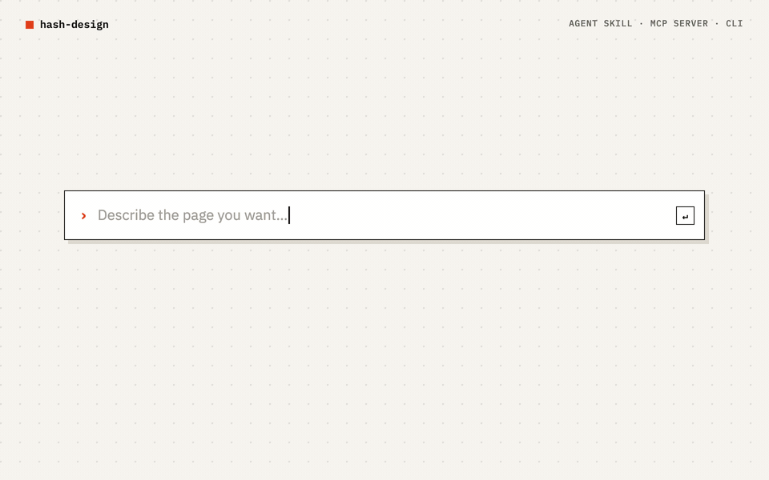
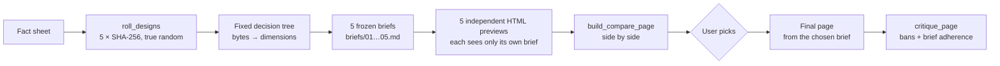
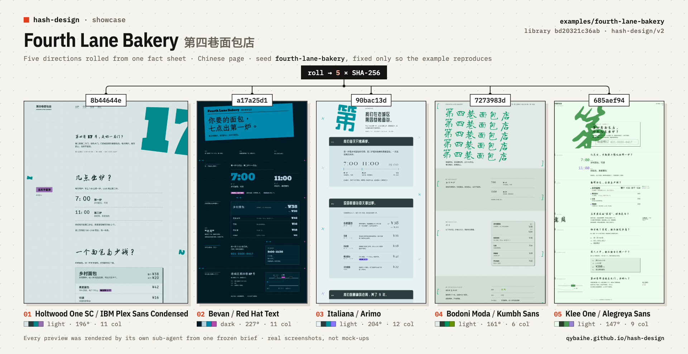
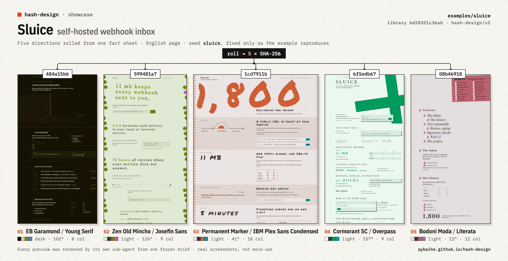
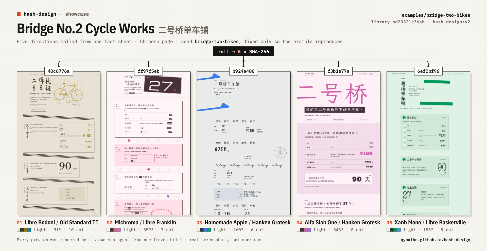
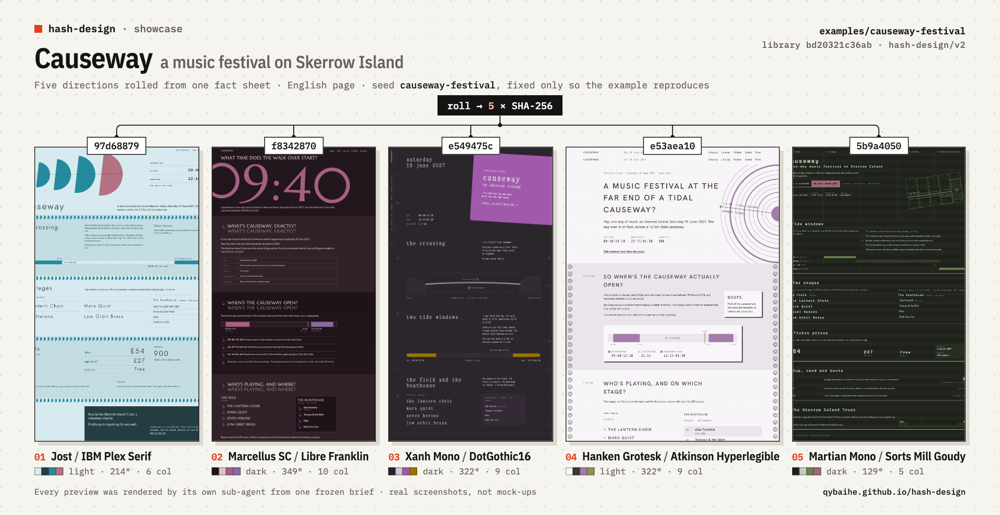

<div align="center">

**English** · [简体中文](README.zh-CN.md) · [日本語](README.ja.md) · [한국어](README.ko.md) · [Español](README.es.md)

# hash-design

<p align="center"><a href="https://qybaihe.github.io/hash-design/causeway-festival/compare.html"><picture><source media="(prefers-reduced-motion: reduce)" srcset="docs/assets/hero.png"></picture></a></p>

<p align="center"><sub>Real output, not a mock-up: <a href="examples/causeway-festival">examples/causeway-festival</a>, each preview built by its own sub-agent from one frozen brief.<br><a href="https://qybaihe.github.io/hash-design/"><b>Browse all 4 live examples →</b></a> · 20 of the 40 branches · <a href="docs/assets/hero.png">still image</a> · <a href="docs/assets/hero.mp4">MP4</a></sub></p>

### One prompt, five design directions, picked by true-random SHA-256 hashes instead of the model.

**Stop your coding agent from shipping the same Inter-and-purple-gradient page every time. hash-design rolls five directions, freezes each one as a design brief, renders five previews side by side and waits for you to pick one. Any direction can be rebuilt from its ref.**

[](https://github.com/qybaihe/hash-design/actions/workflows/ci.yml)
[](https://qybaihe.github.io/hash-design/)
[](#quick-start)
[](docs/mcp-tools.md)
[](.nvmrc)
[](#install-by-hand)
[](LICENSE)

**[Live examples](https://qybaihe.github.io/hash-design/) · [Branch catalogue](docs/branches.md) · [MCP reference](docs/mcp-tools.md) · [Changelog](CHANGELOG.md)**

[Quick start](#quick-start) · [How it works](#how-it-works) · [Showcase](#showcase) · [Reference](#reference) · [FAQ](#faq)

**Tell your agent** (Claude Code, Cursor):

```text
Install hash-design from https://github.com/qybaihe/hash-design (it is not on npm):
clone it to ~/hash-design, build it, then install its skill into this project and
register its MCP server for this agent, following the "Install by hand" steps in its README.
```

</div>

> [!IMPORTANT]
> hash-design is **not on npm yet**. Install it from source, from [qybaihe/hash-design](https://github.com/qybaihe/hash-design). The `package.json` files are publish-ready and `npm pack --dry-run` runs in CI, but `npx hash-design` and `npx hash-design-mcp` will not work until a release.

---

## What hash-design does

Ask an LLM for "a beautiful page" and it almost always collapses into the same modal aesthetic: Inter, a purple-to-blue gradient, a centered headline with two buttons, three identical feature cards, glassmorphism, emoji icons, and copy like _Unlock_, _Seamless_, _Supercharge_. The reason is simple: whenever the model gets to choose, it picks the most common thing in its training data.

hash-design does not ask the model to have better taste. It **takes the choice away**:

| Step       | What happens                                                                                                                                                                                                                      |
| ---------- | --------------------------------------------------------------------------------------------------------------------------------------------------------------------------------------------------------------------------------- |
| **Roll**   | Five hashes from system randomness (`crypto.randomBytes(32)` → SHA-256).                                                                                                                                                          |
| **Map**    | A **fixed, reproducible decision tree** turns each hash into a concrete direction: design genre, layout, font pairing, hex palette, density, motion, motif, first-screen anchor, type scale, surface, copy voice and one "twist". |
| **Freeze** | Each direction becomes a **brief** with paste-ready tokens (font links, hex values, `tokens.css`, grid numbers, radius/shadow policy) plus the global bans.                                                                       |
| **Render** | The agent's only job is to **execute** each brief faithfully: five independent HTML previews and a side-by-side compare page. Then it **stops and waits for you to pick a number**.                                               |
| **Build**  | Once you pick, the agent builds the final page from that brief and checks it with `critique_page`.                                                                                                                                |

This is an external random constraint that breaks the model's default aesthetic. It has nothing to do with KV caches or sampling temperature. The model's taste is spent on execution quality (alignment, rhythm, detail, legibility), not on choosing a style.

It ships as an **Agent Skill** (when and in what order to run the workflow), an **MCP server** (stdio, six tools), a **CLI** and a **TypeScript library**, all in this repository.

## Quick start

### Tell your agent

Open Claude Code or Cursor in the project you want to design and paste:

```text
Install hash-design from https://github.com/qybaihe/hash-design (it is not on npm):
clone it to ~/hash-design, build it, then install its skill into this project and
register its MCP server for this agent, following the "Install by hand" steps in its README.
```

The agent clones and builds this repository, copies the Skill into your project's `.claude/skills/` or `.cursor/skills/`, and registers the MCP server (`claude mcp add` in Claude Code, `.cursor/mcp.json` in Cursor). Start a new session afterwards so the agent loads both, then [use it](#use-it). To run the commands yourself, follow the steps below.

### Install by hand

Requires Node.js ≥ 20 (`.nvmrc` pins 22 for development).

```bash
git clone https://github.com/qybaihe/hash-design.git ~/hash-design
cd ~/hash-design && npm install && npm run build
# CLI entry:        ~/hash-design/packages/core/dist/bin.js
# MCP server entry: ~/hash-design/packages/mcp/dist/bin.js
```

**Skill.** The Skill tells the agent when to use hash-design, in what order to call the MCP tools, how to render previews independently and when it must stop.

```bash
# Into a project (writes both .claude/skills and .cursor/skills)
node ~/hash-design/packages/core/dist/bin.js skill install --target both --dir /path/to/your/project
# Into your home directory (available in every project)
node ~/hash-design/packages/core/dist/bin.js skill install --target claude --global
```

Or copy [`skills/hash-design/SKILL.md`](skills/hash-design/SKILL.md) by hand to `.claude/skills/hash-design/SKILL.md` (Claude Code) or `.cursor/skills/hash-design/SKILL.md` (Cursor). This repo ships both copies, and a test keeps them identical to the source. The Skill body is written in Chinese; its description includes English trigger phrases.

**MCP server.** Register `packages/mcp/dist/bin.js` with your agent. In a shell, `~/hash-design` expands to the absolute path; in JSON files write the absolute path out (shown below as `/ABS/PATH/hash-design`).

#### Claude Code

```bash
claude mcp add hash-design -- node ~/hash-design/packages/mcp/dist/bin.js
```

Or commit a project-level `.mcp.json`:

```json
{
  "mcpServers": {
    "hash-design": {
      "command": "node",
      "args": ["/ABS/PATH/hash-design/packages/mcp/dist/bin.js"]
    }
  }
}
```

#### Cursor

`.cursor/mcp.json` (project) or `~/.cursor/mcp.json` (global), same structure:

```json
{
  "mcpServers": {
    "hash-design": {
      "command": "node",
      "args": ["/ABS/PATH/hash-design/packages/mcp/dist/bin.js"]
    }
  }
}
```

#### Claude Desktop

`~/Library/Application Support/Claude/claude_desktop_config.json` (macOS) or `%APPDATA%\Claude\claude_desktop_config.json` (Windows), same structure as above. Claude Desktop does not start the server in your project directory, so pass an **absolute path** as `out_dir` when calling `roll_designs`.

### Use it

With the MCP server and the Skill installed, just ask your agent:

> Use hash-design to build a one-page site for "Fourth Lane Bakery". Facts: open Tue–Sun 7:00–19:00, closed Mondays; country loaf ¥38; …

The agent rolls, freezes the briefs, renders five previews, writes `design/hash-design/compare.html`, then stops and waits for you to reply with a number. Clients that support MCP prompts can also start the same workflow with the `hash-design` prompt (arguments: `subject`, `facts`, `count`).

### CLI

```bash
hash-design roll --subject "Fourth Lane Bakery" --facts-file facts.md --out design/hash-design   # 5 true-random directions
hash-design roll --subject "…" --light-only --brand "#c8102e" --format json                     # with constraints
hash-design brief <ref> [constraints]                                                            # reproduce a brief
hash-design branches [--family craft]                                                            # the branch library
hash-design branch ink-and-seal                                                                  # one branch in detail
hash-design critique page.html --roll design/hash-design/roll.json --pick 3 --fail-under 80
hash-design compare --roll design/hash-design/roll.json                                          # write compare.html
hash-design skill install --target both                                                          # install the Skill
```

From a source checkout, run it as `node packages/core/dist/bin.js …` (or `alias hash-design="node $PWD/packages/core/dist/bin.js"` from the repo root). `hash-design --help` lists every command, and `hash-design <command> --help` (for example `hash-design roll --help`) prints one command's options, including the constraint flags `--light-only`, `--dark-only`, `--reduced-motion`, `--brand`, `--family`, `--include` and `--exclude`.

### Library

```ts
import { roll, renderBrief, critiquePage, reproduce, parseRef } from 'hash-design';

const r = roll({ content: { subject: 'Fourth Lane Bakery', facts: ['Closed Mondays', 'Country loaf ¥38'] } });
for (const [i, d] of r.designs.entries()) console.log(renderBrief(d, r.content, { number: i + 1 }));

const design = reproduce(parseRef(r.designs[0].ref), r.constraints);
const report = critiquePage({ html: '<!doctype html>…', design });
console.log(report.score, report.adherence, report.findings);
```

Until the package is on npm, import it from a source checkout (`packages/core/dist/index.js`) or add the checkout as a local dependency (`npm install /ABS/PATH/hash-design/packages/core`).

### Update

```bash
cd ~/hash-design && git pull && npm install && npm run build
node ~/hash-design/packages/core/dist/bin.js skill install --target both --dir /path/to/your/project   # refresh the copied SKILL.md
```

The MCP configuration points at `packages/mcp/dist/bin.js`, so rebuilding updates the server; restart the agent to load it. `skill install` overwrites the copy in your project. If an update changes the branch data, refs rolled with the old version need that version to reproduce (see the [FAQ](#faq)).

## How it works



### Bytes → dimensions (`hash-design/v1`)

| Bytes | Dimension | Rule                                                                                                       |
| ----- | --------- | ---------------------------------------------------------------------------------------------------------- |
| 0–1   | branch    | `uint16(b0, b1) mod N` (N = 40). Collisions walk forward, see below                                        |
| 2     | voice     | 14 copy voices: shopkeeper chalkboard, field notes, technical manual, personal letter, timetable, almanac… |
| 3     | layout    | 1 of the branch's 3 layouts, with grid numbers and a top-to-bottom section sketch                          |
| 4     | type      | 1 of 3 pairings: display / body (/ mono) + CJK fonts + typesetting notes                                   |
| 5     | palette   | 1 of 3 palettes: seven hex values (paper / ink / muted / accent / accent2 / rule / panel)                  |
| 6     | density   | The branch's allowed subset of airy / regular / compact / packed                                           |
| 7     | motion    | 1 of 3: duration, easing and a reduced-motion policy                                                       |
| 8     | motif     | 1 of the branch's 3 motifs                                                                                 |
| 9     | anchor    | 1 of the branch's 3 first-screen anchors                                                                   |
| 10    | scale     | The branch's allowed modular scales (1.125–1.618)                                                          |
| 11    | surface   | 1 of 3 surfaces (with CSS hints)                                                                           |
| 12    | twist     | 16 twists, e.g. "numerals as display", "one element breaks the grid", "no button above the fold"           |
| 13–31 | unused    | Recorded in the brief, reserved for future dimensions                                                      |

- **Collisions and family spread.** Inside one roll, a hash that lands on a branch already used walks forward (+1, +2, …) to the next free branch. While some **family** (print / document / signage / screen / craft / modernist) is still unused, landing in an already-used family also counts as a collision, so a 5-roll always spans 5 different families. The number of steps is the `probe`; a ref is written `<hash>+<probe>` and reproduces on its own.
- **Branch order.** Library order is mapping order. Each family's members are spread evenly around the ring, so walking forward does not funnel probability into one branch: in 5-rolls every branch appears 9–17% of the time (uniform would be 12.5%).
- **Constraints filter the pools before the bytes are applied**, so constraints are part of a design's identity: `light_only`, `dark_only`, `reduced_motion`, `brand_colors` (the brand colour replaces the accent; the palette with the nearest accent hue is chosen and contrast is reported), `families`, `include_branches`, `exclude_branches`.
- **Reproducible.** The same `ref`, the same constraints and the same library fingerprint always produce the same brief. Every brief records the algorithm (`hash-design/v1`) and the library fingerprint (the first 12 hex digits of a SHA-256 over the data).
- **`seed` is only for reproducing examples and tests.** Real use always draws from system randomness.

The full specification, with a worked example, is in [docs/mapping.md](docs/mapping.md).

### What a brief contains

Take [#3 Ink and seal](examples/fourth-lane-bakery/briefs/03-ink-and-seal.md) from the example. A brief has:

- the mapping trace, byte by byte, with the formula and the result
- the content: the only facts the page may state
- the copy voice and its devices, the layout (grid numbers and section order), the first-screen anchor
- type: a Google Fonts `<link>` (including CJK fonts when the page is Chinese) and a type scale computed from the modular ratio
- seven hex values, colour proportions and a WCAG contrast table (which colours are only for large text or decoration)
- density, radius / border / shadow policy, surface (with a CSS snippet), motif and motion spec
- the twist, the branch's must / must-not lists and all 14 global bans
- a paste-ready `tokens.css` and a pre-delivery checklist

Briefs are written for agents and are bilingual: headings carry Chinese and English labels, and `language` (`zh` or `en`, auto-detected from the subject and facts) switches the concept text, the instructions and whether CJK webfonts are loaded. Some pool descriptions (voices, twists) are currently written in Chinese only.

## Showcase

Four full runs, each from its own fact sheet and a fixed seed that only makes it reproducible. No two examples share a branch, so together they show 20 of the 40 branches, from all six families. Every preview was rendered by its own sub-agent that saw only its brief, and every one scores at least 90/100 on `critique_page`. All of them are on the [examples index](https://qybaihe.github.io/hash-design/). Each plate below is one roll: its five directions side by side, labelled with branch and ref.

### Fourth Lane Bakery (第四巷面包店) — a neighbourhood bakery · Chinese page

[](examples/fourth-lane-bakery)

Seed `fourth-lane-bakery` · `critique_page` 96–100 · brief adherence 100 · [example folder](examples/fourth-lane-bakery): facts, briefs, previews and the process

### Sluice — a self-hosted webhook inbox · English page

[](examples/sluice)

Seed `sluice` · `critique_page` 92–96 · brief adherence 90–100 · [example folder](examples/sluice): facts, briefs, previews and the process

### Bridge No.2 Cycle Works (二号桥单车铺) — a bicycle repair shop · Chinese page

[](examples/bridge-two-bikes)

Seed `bridge-two-bikes-5` · `critique_page` 96–100 · brief adherence 100 · [example folder](examples/bridge-two-bikes): facts, briefs, previews and the process

### Causeway — a one-day music festival on a tidal island · English page

[](examples/causeway-festival)

Seed `causeway-festival-6` · `critique_page` 96–100 · brief adherence 100 · [example folder](examples/causeway-festival): facts, briefs, previews and the process

## Reference

The six MCP tools, the 40 branches and the 14 bans every brief carries.

### MCP tools

| Tool                 | What it does                                                                                                                                                                                                                        |
| -------------------- | ----------------------------------------------------------------------------------------------------------------------------------------------------------------------------------------------------------------------------------- |
| `roll_designs`       | Takes `subject`, `facts`, `count` (default 5), optional `seed`, `language` and constraints. Returns the hashes, the mapping and one brief per direction. With `out_dir` it freezes `roll.json`, `ROLL.md` and `briefs/*.md` to disk |
| `get_brief`          | Reproduces a brief from a `ref` (`<hash>` or `<hash>+<probe>`) plus the same constraints, as Markdown or JSON                                                                                                                       |
| `list_branches`      | Lists the 40 design branches, optionally filtered by family                                                                                                                                                                         |
| `get_branch`         | Shows every option and token of one branch                                                                                                                                                                                          |
| `critique_page`      | Scores an HTML string or file against the bans and the AI-template checklist; with `brief_ref` or `roll_path` + `pick` it also scores adherence to the brief                                                                        |
| `build_compare_page` | Builds the side-by-side `compare.html` from a `roll.json`                                                                                                                                                                           |

Resources: `hash-design://bans`, `hash-design://workflow` (the Skill), `hash-design://branches`, `hash-design://branch/{id}`. Prompt: `hash-design` (`subject`, `facts`, `count`).

Every parameter, return shape and CLI equivalent is documented in [docs/mcp-tools.md](docs/mcp-tools.md).

### Branch library (40)

Every branch is a real-world design genre, not a "SaaS style". Each dimension has three concrete options: font pairings (Google Fonts + CJK), seven hex values, grid numbers, radius / border / shadow policy, motion spec, motifs and surfaces. The full catalogue is in [docs/branches.md](docs/branches.md); `list_branches` / `get_branch` query it live.

| Family    | Branches                                                                                                                                                                                    |
| --------- | ------------------------------------------------------------------------------------------------------------------------------------------------------------------------------------------- |
| print     | Supermarket circular · Letterpress wood type · Photocopy zine · Risograph duotone · Record sleeve · Varsity sports programme · Couture lookbook · Broadsheet newspaper · Editorial magazine |
| document  | Engineering plate · Ledger · Ticket stub · Academic paper · Apothecary label · Bureaucratic form · Thermal receipt · Herbarium specimen · Field guide plate                                 |
| signage   | Transit wayfinding · Hong Kong shop sign · Diner menu board · Gallery catalogue · Topographic map                                                                                           |
| screen    | Terminal phosphor · Web 1.0 homepage · Game manual · Instrument panel · Raw brutalist                                                                                                       |
| craft     | Recipe card · Warm handmade · Ink and seal · Chinese almanac · Ma whitespace · Lab notebook                                                                                                 |
| modernist | Swiss grid · Bauhaus primary · Constructivist poster · Art Deco · 70s supergraphic · Memphis pop                                                                                            |

The data is enforced by tests and scripts:

- no banned fonts, not even in fallbacks
- ink/paper contrast ≥ 7:1, muted/paper ≥ 4.5:1
- every branch has at least one light palette
- no framework default hex values
- a display font may lead at most 3 branches
- no two branches share the same lead palette (paper + accent)
- every font URL resolves on Google Fonts: `node scripts/verify-fonts.mjs` (235/235 pass)

### Global bans

Every brief carries these 14 bans, and `critique_page` detects each one automatically:

| id                          | Banned                                                                                                           |
| --------------------------- | ---------------------------------------------------------------------------------------------------------------- |
| `generic-sans`              | Inter, Roboto, Poppins, Montserrat, DM Sans, Space Grotesk and 17 more default sans; `system-ui` as "the design" |
| `purple-blue-gradient`      | Purple / indigo / blue gradients, gradient text, coloured blobs                                                  |
| `centered-hero-two-buttons` | Centered headline + subtitle + primary / ghost button pair                                                       |
| `identical-cards`           | 3 / 4 / 6 identical "icon + title + two lines" cards                                                             |
| `glassmorphism`             | `backdrop-filter` frosted glass                                                                                  |
| `emoji-icons`               | Emoji as icons; a generic icon set as decoration                                                                 |
| `buzzword-copy`             | Unlock / Seamless / Supercharge / 赋能 / 一站式 / 极致体验 …                                                     |
| `soft-shadow-rounded`       | 12–24px radius + large soft shadow on everything                                                                 |
| `invented-facts`            | "10K+ users", "Trusted by", fake testimonials with avatars                                                       |
| `tailwind-default-palette`  | Framework defaults such as `#6366f1`, `#8b5cf6`, `#0f172a`                                                       |
| `scroll-fade-everything`    | Every section fading up on scroll                                                                                |
| `pill-badge-sparkle`        | A "New ✨" pill above the headline                                                                               |
| `placeholder-content`       | Lorem ipsum, stock portraits, random Unsplash                                                                    |
| `template-sections`         | The Hero → Features → Testimonials → Pricing → FAQ formula                                                       |

`critique_page` also checks text contrast (< 3:1), `viewport`, `lang`, `img alt`, missing `prefers-reduced-motion` when there is motion, and adherence to the brief: fonts, hex values, radius and shadow policy. It is static analysis. It cannot tell whether the first screen really is the brief's anchor or whether the voice is right; that still needs a human, or an agent re-reading the brief.

## FAQ

<details>
<summary><strong>Which agents can use it?</strong></summary>

The Skill installs into Claude Code (`.claude/skills/`) and Cursor (`.cursor/skills/`). The MCP server speaks stdio, so any MCP client can start it; [Install by hand](#install-by-hand) shows Claude Code, Cursor and Claude Desktop. Without the Skill an agent can still call the tools, but nothing tells it to render the previews independently and stop for your pick.

</details>

<details>
<summary><strong>Is it on npm?</strong></summary>

Not yet. The `package.json` files are publish-ready and `npm pack --dry-run` runs in CI, but for now install from source. Once published, `npx -y hash-design-mcp` and `npx -y hash-design` will work.

</details>

<details>
<summary><strong>Is it really random? How do I get the same brief again?</strong></summary>

Every roll draws from system randomness (`crypto.randomBytes(32)` → SHA-256); `seed` exists only to reproduce the examples and tests. Each brief records its `ref` (`<hash>` or `<hash>+<probe>`), its constraints and the library fingerprint, and `get_brief` or `hash-design brief <ref>` rebuilds exactly the same brief from them.

</details>

<details>
<summary><strong>Will old refs still reproduce after an update?</strong></summary>

Only if the branch data is unchanged. The library has 40 branches; adding or removing a branch changes the mapping. Every brief records the library fingerprint, so a mismatch is detectable, but an old ref needs the matching version to reproduce.

</details>

<details>
<summary><strong>Does <code>critique_page</code> guarantee a good page?</strong></summary>

No. It is heuristic static analysis: it reads inline `<style>`, `style=""` and any extra CSS you pass; it does not render the page or fetch linked stylesheets. It catches the banned patterns and checks fonts, hex values, radius and shadow against the brief, but whether the result is _good_ still depends on the model and the people executing the brief. The tool solves "everything looks the same"; it does not replace design judgement.

</details>

<details>
<summary><strong>Does it need a network connection?</strong></summary>

The CLI and the MCP server run locally and make no network requests. The pages they ask for load fonts from Google Fonts, including CJK fonts; offline or restricted networks need self-hosted fonts or the fallbacks listed in each brief.

</details>

<details>
<summary><strong>Why is part of the brief in Chinese?</strong></summary>

Briefs are bilingual: headings carry Chinese and English labels, and `language` (`zh` or `en`) switches the concept text and the instructions. Some pool descriptions (voices, twists) and the Skill body are still Chinese-only; the Skill's description includes English trigger phrases.

</details>

## Documentation

- [docs/architecture.md](docs/architecture.md): packages, data flow, design decisions, testing
- [docs/mapping.md](docs/mapping.md): the `hash-design/v1` mapping, collisions, constraints, reproducibility
- [docs/mcp-tools.md](docs/mcp-tools.md): every MCP tool, resource and prompt, with CLI equivalents
- [docs/branches.md](docs/branches.md): the 40-branch catalogue (generated)
- 中文：[架构](docs/architecture.zh-CN.md) · [映射规范](docs/mapping.zh-CN.md) · [MCP 工具](docs/mcp-tools.zh-CN.md)

## Contributing

Contributions are welcome, especially new branches. Read [CONTRIBUTING.md](CONTRIBUTING.md) first: it covers the data rules, `npm run sync` and why a data change means re-rolling the example. Please follow the [Code of Conduct](CODE_OF_CONDUCT.md) and report vulnerabilities as described in [SECURITY.md](SECURITY.md). Release notes live in [CHANGELOG.md](CHANGELOG.md).

```bash
npm install
npm run build        # tsc -b, both packages
npm test             # vitest: core, CLI, MCP (in-memory transport), Skill/docs consistency
npm run check        # typecheck + lint + prettier + test
npm run sync         # after data changes: regenerate the SKILL.md bans block, the .claude/.cursor copies, docs/branches.md
node scripts/smoke.mjs        # MCP over real stdio + CLI smoke test (runs in CI)
node scripts/verify-fonts.mjs # check every font URL online (not in CI)
npm run example:critique      # critique every example preview against its brief (fails below 90)
npm run screenshots           # Playwright screenshots of every example (needs `npx playwright install chromium`)
npm run hero                  # rebuild docs/assets/hero.png and social-preview.png from an example's screenshots
npm run hero:gif              # rebuild docs/assets/hero.gif and hero.mp4 (needs ffmpeg; uses gifski if installed)
npm run showcase              # rebuild docs/assets/showcase/<example>.png, one plate per example
```

CI runs build, typecheck, lint, format check, tests, the stdio smoke test and `npm pack --dry-run` on Node 20, 22 and 24.

Repository layout:

```
packages/core/           # npm: hash-design — data, mapping, briefs, critique, compare page, CLI
  src/data/bans.ts       #   global bans, banned fonts, buzzword lists
  src/data/pools.ts      #   densities, scales, 14 copy voices, 16 twists
  src/data/branches/     #   40 branches (index.ts defines the mapping order)
  src/mapping.ts         #   hash → design (decision tree, collisions, constraints)
  src/brief.ts           #   brief rendering (Markdown / JSON)
  src/critique.ts        #   static AI-template checks
  src/compare.ts         #   side-by-side compare page
  src/cli.ts             #   CLI
packages/mcp/            # npm: hash-design-mcp — stdio MCP server
skills/hash-design/      # Skill source (.claude/ and .cursor/ hold synced copies)
examples/                # 4 full runs: facts → roll → 5 briefs → 5 previews → compare page → screenshots
docs/                    # architecture, mapping spec, MCP reference, branch catalogue (generated)
scripts/                 # sync / smoke / verify-fonts / examples / screenshot / hero / hero-gif / prepack
```

## License

[MIT](LICENSE) © qybaihe
