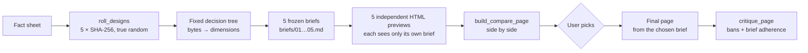

# hash-design

**English** | [简体中文](README.zh-CN.md) | [日本語](README.ja.md) | [한국어](README.ko.md) | [Español](README.es.md)

<p align="center"><a href="https://qybaihe.github.io/hash-design/causeway-festival/compare.html"><picture><source media="(prefers-reduced-motion: reduce)" srcset="docs/assets/hero.png"></picture></a></p>

<p align="center"><sub>Real output, not a mock-up: <a href="examples/causeway-festival">examples/causeway-festival</a>, each preview built by its own sub-agent from one frozen brief.<br><a href="https://qybaihe.github.io/hash-design/"><b>Browse all 4 live examples →</b></a> · 20 of the 40 branches · <a href="docs/assets/hero.png">still image</a> · <a href="docs/assets/hero.mp4">MP4</a></sub></p>

<p align="center"><b>Stop your coding agent from shipping the same Inter-and-purple-gradient page every time.</b><br>
One prompt becomes five design directions, picked by true-random SHA-256 hashes instead of the model. You pick one; any direction can be rebuilt from its ref.</p>

<p align="center">
<a href="https://github.com/qybaihe/hash-design/actions/workflows/ci.yml"></a>
<a href="https://qybaihe.github.io/hash-design/"></a>
<a href="LICENSE"></a>
<a href="#install-the-skill"></a>
</p>

### Quick start

Not on npm yet. Build from source (Node ≥ 20), install the Skill into your project and register the MCP server:

```bash
git clone https://github.com/qybaihe/hash-design.git && cd hash-design && npm install && npm run build
node packages/core/dist/bin.js skill install --target both --dir /path/to/your/project   # Skill → .claude/skills + .cursor/skills
claude mcp add hash-design -- node "$PWD/packages/mcp/dist/bin.js"                       # MCP server (Claude Code)
```

Then ask your agent:

> Use hash-design to build a one-page site for Causeway, a one-day music festival on Skerrow Island. Facts: Saturday 19 June 2027; reached on foot over a 1.2 km tidal causeway; …

Cursor and Claude Desktop: [Configure MCP](#configure-mcp).

### How it works, in four lines

1. **Roll** five SHA-256 hashes from system randomness.
2. **Map** each hash through a fixed decision tree to a brief: genre, layout, fonts, hex palette, density, motion, twist. Same ref, same brief.
3. **Render** five HTML previews, one sub-agent per frozen brief, plus a compare page that puts them side by side.
4. **Pick** a number. The agent builds the final page from that brief and checks it with `critique_page`.

<details><summary>More badges</summary>

[](https://github.com/qybaihe/hash-design/actions/workflows/pages.yml)
[](.nvmrc)
[](#install)

</details>

---

## Contents

- [Demo](#demo) · [More examples](#more-examples) · [Why](#why) · [How it works](#how-it-works) · [What a brief contains](#what-a-brief-contains)
- [Install](#install) · [Configure MCP](#configure-mcp) · [Install the Skill](#install-the-skill) · [Use it](#use-it)
- [MCP tools](#mcp-tools) · [CLI](#cli) · [Library](#library) · [Branch library](#branch-library-40) · [Global bans](#global-bans)
- [Development](#development) · [Documentation](#documentation) · [Known limitations](#known-limitations) · [Contributing](#contributing)

## Demo

[](https://qybaihe.github.io/hash-design/fourth-lane-bakery/compare.html)

[`examples/fourth-lane-bakery/`](examples/fourth-lane-bakery) is a full end-to-end run for a fictional bakery: a [fact sheet](examples/fourth-lane-bakery/facts.md) → one roll → five frozen briefs → five previews, each rendered by a separate sub-agent that could only see its own brief → a side-by-side compare page. All of it is served on GitHub Pages:

| #   | Direction (branch)                                                                                               | Desktop                                                                                                                              | Brief                                                               |
| --- | ---------------------------------------------------------------------------------------------------------------- | ------------------------------------------------------------------------------------------------------------------------------------ | ------------------------------------------------------------------- |
| 01  | [Bureaucratic form](https://qybaihe.github.io/hash-design/fourth-lane-bakery/previews/01-bureaucratic-form.html) |  | [brief](examples/fourth-lane-bakery/briefs/01-bureaucratic-form.md) |
| 02  | [Bauhaus primary](https://qybaihe.github.io/hash-design/fourth-lane-bakery/previews/02-bauhaus-primary.html)     |      | [brief](examples/fourth-lane-bakery/briefs/02-bauhaus-primary.md)   |
| 03  | [Ink and seal](https://qybaihe.github.io/hash-design/fourth-lane-bakery/previews/03-ink-and-seal.html)           |            | [brief](examples/fourth-lane-bakery/briefs/03-ink-and-seal.md)      |
| 04  | [Risograph duotone](https://qybaihe.github.io/hash-design/fourth-lane-bakery/previews/04-risograph-duotone.html) |  | [brief](examples/fourth-lane-bakery/briefs/04-risograph-duotone.md) |
| 05  | [Hong Kong shop sign](https://qybaihe.github.io/hash-design/fourth-lane-bakery/previews/05-hk-shop-sign.html)    |     | [brief](examples/fourth-lane-bakery/briefs/05-hk-shop-sign.md)      |

- **Live compare page:** <https://qybaihe.github.io/hash-design/fourth-lane-bakery/compare.html> (press 1–5 to zoom, D/M to switch desktop/mobile)
- **Locally:** `open examples/fourth-lane-bakery/compare.html`
- Every preview scored 96–100/100 on `critique_page` and 100/100 on brief adherence. The example's [README](examples/fourth-lane-bakery/README.md) (in Chinese) records the process. The shop, its facts and its copy are Chinese because the page is written for a Chinese audience.

<details><summary>Mobile screenshots and the compare page at phone width</summary>

    


</details>

Reproduce the exact roll:

```bash
npm run build
node packages/core/dist/bin.js roll --subject "第四巷面包店" \
  --facts-file examples/fourth-lane-bakery/facts.md --seed fourth-lane-bakery --out /tmp/fourth-lane
# MCP equivalent: roll_designs { subject, facts, seed: "fourth-lane-bakery" } returns the same five refs
```

<!-- MORE-EXAMPLES:START -->

### More examples

Three more runs, each from its own fact sheet and fixed seed. No two examples share a branch, so the four examples together show 20 of the 40 branches, from all six families. Every preview was rendered by its own sub-agent that saw only its brief, and every one scores at least 90/100 on `critique_page`. All of them are on the [examples index](https://qybaihe.github.io/hash-design/).

#### Sluice — a self-hosted webhook inbox · English page

[](https://qybaihe.github.io/hash-design/sluice/compare.html)

<table>
<tr>
<td align="center"><a href="https://qybaihe.github.io/hash-design/sluice/previews/01-record-sleeve.html"></a><br><a href="https://qybaihe.github.io/hash-design/sluice/previews/01-record-sleeve.html">01 · Record sleeve</a></td>
<td align="center"><a href="https://qybaihe.github.io/hash-design/sluice/previews/02-gallery-catalogue.html"></a><br><a href="https://qybaihe.github.io/hash-design/sluice/previews/02-gallery-catalogue.html">02 · Gallery catalogue</a></td>
<td align="center"><a href="https://qybaihe.github.io/hash-design/sluice/previews/03-terminal-phosphor.html"></a><br><a href="https://qybaihe.github.io/hash-design/sluice/previews/03-terminal-phosphor.html">03 · Terminal phosphor</a></td>
<td align="center"><a href="https://qybaihe.github.io/hash-design/sluice/previews/04-academic-paper.html"></a><br><a href="https://qybaihe.github.io/hash-design/sluice/previews/04-academic-paper.html">04 · Academic paper</a></td>
<td align="center"><a href="https://qybaihe.github.io/hash-design/sluice/previews/05-lab-notebook.html"></a><br><a href="https://qybaihe.github.io/hash-design/sluice/previews/05-lab-notebook.html">05 · Lab notebook</a></td>
</tr>
</table>

**[Live compare page →](https://qybaihe.github.io/hash-design/sluice/compare.html)** · [example folder](examples/sluice) with the facts, briefs and process · seed `sluice` · critique 92–96 · brief adherence 90–100

#### Bridge No.2 Cycle Works (二号桥单车铺) — a bicycle repair shop · Chinese page

[](https://qybaihe.github.io/hash-design/bridge-two-bikes/compare.html)

<table>
<tr>
<td align="center"><a href="https://qybaihe.github.io/hash-design/bridge-two-bikes/previews/01-swiss-grid.html"></a><br><a href="https://qybaihe.github.io/hash-design/bridge-two-bikes/previews/01-swiss-grid.html">01 · Swiss grid</a></td>
<td align="center"><a href="https://qybaihe.github.io/hash-design/bridge-two-bikes/previews/02-couture-lookbook.html"></a><br><a href="https://qybaihe.github.io/hash-design/bridge-two-bikes/previews/02-couture-lookbook.html">02 · Couture lookbook</a></td>
<td align="center"><a href="https://qybaihe.github.io/hash-design/bridge-two-bikes/previews/03-ticket-stub.html"></a><br><a href="https://qybaihe.github.io/hash-design/bridge-two-bikes/previews/03-ticket-stub.html">03 · Ticket stub</a></td>
<td align="center"><a href="https://qybaihe.github.io/hash-design/bridge-two-bikes/previews/04-game-manual.html"></a><br><a href="https://qybaihe.github.io/hash-design/bridge-two-bikes/previews/04-game-manual.html">04 · Game manual</a></td>
<td align="center"><a href="https://qybaihe.github.io/hash-design/bridge-two-bikes/previews/05-chinese-almanac.html"></a><br><a href="https://qybaihe.github.io/hash-design/bridge-two-bikes/previews/05-chinese-almanac.html">05 · Chinese almanac</a></td>
</tr>
</table>

**[Live compare page →](https://qybaihe.github.io/hash-design/bridge-two-bikes/compare.html)** · [example folder](examples/bridge-two-bikes) with the facts, briefs and process · seed `bridge-two-bikes-5` · critique 96–100 · brief adherence 100

#### Causeway — a one-day music festival on a tidal island · English page

[](https://qybaihe.github.io/hash-design/causeway-festival/compare.html)

<table>
<tr>
<td align="center"><a href="https://qybaihe.github.io/hash-design/causeway-festival/previews/01-engineering-plate.html"></a><br><a href="https://qybaihe.github.io/hash-design/causeway-festival/previews/01-engineering-plate.html">01 · Engineering plate</a></td>
<td align="center"><a href="https://qybaihe.github.io/hash-design/causeway-festival/previews/02-topographic-map.html"></a><br><a href="https://qybaihe.github.io/hash-design/causeway-festival/previews/02-topographic-map.html">02 · Topographic map</a></td>
<td align="center"><a href="https://qybaihe.github.io/hash-design/causeway-festival/previews/03-warm-handmade.html"></a><br><a href="https://qybaihe.github.io/hash-design/causeway-festival/previews/03-warm-handmade.html">03 · Warm handmade</a></td>
<td align="center"><a href="https://qybaihe.github.io/hash-design/causeway-festival/previews/04-editorial-magazine.html"></a><br><a href="https://qybaihe.github.io/hash-design/causeway-festival/previews/04-editorial-magazine.html">04 · Editorial magazine</a></td>
<td align="center"><a href="https://qybaihe.github.io/hash-design/causeway-festival/previews/05-memphis-pop.html"></a><br><a href="https://qybaihe.github.io/hash-design/causeway-festival/previews/05-memphis-pop.html">05 · Memphis pop</a></td>
</tr>
</table>

**[Live compare page →](https://qybaihe.github.io/hash-design/causeway-festival/compare.html)** · [example folder](examples/causeway-festival) with the facts, briefs and process · seed `causeway-festival-6` · critique 96–100 · brief adherence 100

<!-- MORE-EXAMPLES:END -->

## Why

Ask an LLM for "a beautiful page" and it almost always collapses into the same modal aesthetic: Inter, a purple-to-blue gradient, a centered headline with two buttons, three identical feature cards, glassmorphism, emoji icons, and copy like _Unlock_, _Seamless_, _Supercharge_. The reason is simple: whenever the model gets to choose, it picks the most common thing in its training data.

hash-design does not ask the model to have better taste. It **takes the choice away**:

1. Roll five hashes from system randomness (`crypto.randomBytes(32)` → SHA-256).
2. Map each hash through a **fixed, reproducible decision tree** to a concrete direction: design genre, layout, font pairing, hex palette, density, motion, motif, first-screen anchor, type scale, surface, copy voice and one "twist".
3. Freeze each direction as a **brief** with paste-ready tokens (font links, hex values, `tokens.css`, grid numbers, radius/shadow policy) plus the global bans.
4. The agent's only job is to **execute** each brief faithfully: five independent HTML previews and a side-by-side compare page. Then it **stops and waits for you to pick a number**.
5. Once you pick, the agent builds the final page from that brief and checks it with `critique_page`.

This is an external random constraint that breaks the model's default aesthetic. It has nothing to do with KV caches or sampling temperature. The model's taste is spent on execution quality (alignment, rhythm, detail, legibility), not on choosing a style.

## How it works



### Bytes → dimensions (`hash-design/v1`)

| Bytes | Dimension | Rule                                                                                                       |
| ----- | --------- | ---------------------------------------------------------------------------------------------------------- |
| 0–1   | branch    | `uint16(b0, b1) mod N` (N = 40). Collisions walk forward, see below                                        |
| 2     | voice     | 14 copy voices: shopkeeper chalkboard, field notes, technical manual, personal letter, timetable, almanac… |
| 3     | layout    | 1 of the branch's 3 layouts, with grid numbers and a top-to-bottom section sketch                          |
| 4     | type      | 1 of 3 pairings: display / body (/ mono) + CJK fonts + typesetting notes                                   |
| 5     | palette   | 1 of 3 palettes: seven hex values (paper / ink / muted / accent / accent2 / rule / panel)                  |
| 6     | density   | The branch's allowed subset of airy / regular / compact / packed                                           |
| 7     | motion    | 1 of 3: duration, easing and a reduced-motion policy                                                       |
| 8     | motif     | 1 of the branch's 3 motifs                                                                                 |
| 9     | anchor    | 1 of the branch's 3 first-screen anchors                                                                   |
| 10    | scale     | The branch's allowed modular scales (1.125–1.618)                                                          |
| 11    | surface   | 1 of 3 surfaces (with CSS hints)                                                                           |
| 12    | twist     | 16 twists, e.g. "numerals as display", "one element breaks the grid", "no button above the fold"           |
| 13–31 | unused    | Recorded in the brief, reserved for future dimensions                                                      |

- **Collisions and family spread.** Inside one roll, a hash that lands on a branch already used walks forward (+1, +2, …) to the next free branch. While some **family** (print / document / signage / screen / craft / modernist) is still unused, landing in an already-used family also counts as a collision, so a 5-roll always spans 5 different families. The number of steps is the `probe`; a ref is written `<hash>+<probe>` and reproduces on its own.
- **Branch order.** Library order is mapping order. Each family's members are spread evenly around the ring, so walking forward does not funnel probability into one branch: in 5-rolls every branch appears 9–17% of the time (uniform would be 12.5%).
- **Constraints filter the pools before the bytes are applied**, so constraints are part of a design's identity: `light_only`, `dark_only`, `reduced_motion`, `brand_colors` (the brand colour replaces the accent; the palette with the nearest accent hue is chosen and contrast is reported), `families`, `include_branches`, `exclude_branches`.
- **Reproducible.** The same `ref`, the same constraints and the same library fingerprint always produce the same brief. Every brief records the algorithm (`hash-design/v1`) and the library fingerprint (the first 12 hex digits of a SHA-256 over the data).
- **`seed` is only for reproducing examples and tests.** Real use always draws from system randomness.

The full specification, with a worked example, is in [docs/mapping.md](docs/mapping.md).

## What a brief contains

Take [#3 Ink and seal](examples/fourth-lane-bakery/briefs/03-ink-and-seal.md) from the example. A brief has:

- the mapping trace, byte by byte, with the formula and the result
- the content: the only facts the page may state
- the copy voice and its devices, the layout (grid numbers and section order), the first-screen anchor
- type: a Google Fonts `<link>` (including CJK fonts when the page is Chinese) and a type scale computed from the modular ratio
- seven hex values, colour proportions and a WCAG contrast table (which colours are only for large text or decoration)
- density, radius / border / shadow policy, surface (with a CSS snippet), motif and motion spec
- the twist, the branch's must / must-not lists and all 14 global bans
- a paste-ready `tokens.css` and a pre-delivery checklist

Briefs are written for agents and are bilingual: headings carry Chinese and English labels, and `language` (`zh` or `en`, auto-detected from the subject and facts) switches the concept text, the instructions and whether CJK webfonts are loaded. Some pool descriptions (voices, twists) are currently written in Chinese only.

## Install

> **Not published on npm yet.** The `package.json` files are publish-ready (`npm pack --dry-run` runs in CI), but for now install from source. Once published, `npx -y hash-design-mcp` and `npx -y hash-design` will work.

Requires Node.js ≥ 20 (`.nvmrc` pins 22 for development).

```bash
git clone https://github.com/qybaihe/hash-design.git
cd hash-design
npm install
npm run build
# MCP server entry: packages/mcp/dist/bin.js
# CLI entry:        packages/core/dist/bin.js
```

## Configure MCP

Replace `/ABS/PATH/hash-design` with the absolute path of your clone.

### Claude Code

```bash
claude mcp add hash-design -- node /ABS/PATH/hash-design/packages/mcp/dist/bin.js
```

Or commit a project-level `.mcp.json`:

```json
{
  "mcpServers": {
    "hash-design": {
      "command": "node",
      "args": ["/ABS/PATH/hash-design/packages/mcp/dist/bin.js"]
    }
  }
}
```

### Cursor

`.cursor/mcp.json` (project) or `~/.cursor/mcp.json` (global), same structure:

```json
{
  "mcpServers": {
    "hash-design": {
      "command": "node",
      "args": ["/ABS/PATH/hash-design/packages/mcp/dist/bin.js"]
    }
  }
}
```

### Claude Desktop

`~/Library/Application Support/Claude/claude_desktop_config.json` (macOS) or `%APPDATA%\Claude\claude_desktop_config.json` (Windows), same structure as above. Claude Desktop does not start the server in your project directory, so pass an **absolute path** as `out_dir` when calling `roll_designs`.

## Install the Skill

The Skill tells the agent when to use hash-design, in what order to call the MCP tools, how to render previews independently and when it must stop.

```bash
# Into a project (writes both .claude/skills and .cursor/skills)
node packages/core/dist/bin.js skill install --target both --dir /path/to/your/project
# Into your home directory (available in every project)
node packages/core/dist/bin.js skill install --target claude --global
```

Or copy [`skills/hash-design/SKILL.md`](skills/hash-design/SKILL.md) by hand to `.claude/skills/hash-design/SKILL.md` (Claude Code) or `.cursor/skills/hash-design/SKILL.md` (Cursor). This repo ships both copies, and a test keeps them identical to the source. The Skill body is written in Chinese; its description includes English trigger phrases.

## Use it

With the MCP server and the Skill installed, just ask your agent:

> Use hash-design to build a one-page site for "Fourth Lane Bakery". Facts: open Tue–Sun 7:00–19:00, closed Mondays; country loaf ¥38; …

The agent rolls, freezes the briefs, renders five previews, writes `design/hash-design/compare.html`, then stops and waits for you to reply with a number. Clients that support MCP prompts can also start the same workflow with the `hash-design` prompt (arguments: `subject`, `facts`, `count`).

## MCP tools

| Tool                 | What it does                                                                                                                                                                                                                        |
| -------------------- | ----------------------------------------------------------------------------------------------------------------------------------------------------------------------------------------------------------------------------------- |
| `roll_designs`       | Takes `subject`, `facts`, `count` (default 5), optional `seed`, `language` and constraints. Returns the hashes, the mapping and one brief per direction. With `out_dir` it freezes `roll.json`, `ROLL.md` and `briefs/*.md` to disk |
| `get_brief`          | Reproduces a brief from a `ref` (`<hash>` or `<hash>+<probe>`) plus the same constraints, as Markdown or JSON                                                                                                                       |
| `list_branches`      | Lists the 40 design branches, optionally filtered by family                                                                                                                                                                         |
| `get_branch`         | Shows every option and token of one branch                                                                                                                                                                                          |
| `critique_page`      | Scores an HTML string or file against the bans and the AI-template checklist; with `brief_ref` or `roll_path` + `pick` it also scores adherence to the brief                                                                        |
| `build_compare_page` | Builds the side-by-side `compare.html` from a `roll.json`                                                                                                                                                                           |

Resources: `hash-design://bans`, `hash-design://workflow` (the Skill), `hash-design://branches`, `hash-design://branch/{id}`. Prompt: `hash-design` (`subject`, `facts`, `count`).

Every parameter, return shape and CLI equivalent is documented in [docs/mcp-tools.md](docs/mcp-tools.md).

## CLI

```bash
hash-design roll --subject "Fourth Lane Bakery" --facts-file facts.md --out design/hash-design   # 5 true-random directions
hash-design roll --subject "…" --light-only --brand "#c8102e" --format json                     # with constraints
hash-design brief <ref> [constraints]                                                            # reproduce a brief
hash-design branches [--family craft]                                                            # the branch library
hash-design branch ink-and-seal                                                                  # one branch in detail
hash-design critique page.html --roll design/hash-design/roll.json --pick 3 --fail-under 80
hash-design compare --roll design/hash-design/roll.json                                          # write compare.html
hash-design skill install --target both                                                          # install the Skill
```

From a source checkout, run it as `node packages/core/dist/bin.js …` (or `alias hash-design="node $PWD/packages/core/dist/bin.js"` from the repo root). `hash-design --help` lists every command, and `hash-design <command> --help` (for example `hash-design roll --help`) prints one command's options, including the constraint flags `--light-only`, `--dark-only`, `--reduced-motion`, `--brand`, `--family`, `--include` and `--exclude`.

## Library

```ts
import { roll, renderBrief, critiquePage, reproduce, parseRef } from 'hash-design';

const r = roll({ content: { subject: 'Fourth Lane Bakery', facts: ['Closed Mondays', 'Country loaf ¥38'] } });
for (const [i, d] of r.designs.entries()) console.log(renderBrief(d, r.content, { number: i + 1 }));

const design = reproduce(parseRef(r.designs[0].ref), r.constraints);
const report = critiquePage({ html: '<!doctype html>…', design });
console.log(report.score, report.adherence, report.findings);
```

Until the package is on npm, import it from a source checkout (`packages/core/dist/index.js`) or add the checkout as a local dependency (`npm install /ABS/PATH/hash-design/packages/core`).

## Branch library (40)

Every branch is a real-world design genre, not a "SaaS style". Each dimension has three concrete options: font pairings (Google Fonts + CJK), seven hex values, grid numbers, radius / border / shadow policy, motion spec, motifs and surfaces. The full catalogue is in [docs/branches.md](docs/branches.md); `list_branches` / `get_branch` query it live.

| Family    | Branches                                                                                                                                                                                    |
| --------- | ------------------------------------------------------------------------------------------------------------------------------------------------------------------------------------------- |
| print     | Supermarket circular · Letterpress wood type · Photocopy zine · Risograph duotone · Record sleeve · Varsity sports programme · Couture lookbook · Broadsheet newspaper · Editorial magazine |
| document  | Engineering plate · Ledger · Ticket stub · Academic paper · Apothecary label · Bureaucratic form · Thermal receipt · Herbarium specimen · Field guide plate                                 |
| signage   | Transit wayfinding · Hong Kong shop sign · Diner menu board · Gallery catalogue · Topographic map                                                                                           |
| screen    | Terminal phosphor · Web 1.0 homepage · Game manual · Instrument panel · Raw brutalist                                                                                                       |
| craft     | Recipe card · Warm handmade · Ink and seal · Chinese almanac · Ma whitespace · Lab notebook                                                                                                 |
| modernist | Swiss grid · Bauhaus primary · Constructivist poster · Art Deco · 70s supergraphic · Memphis pop                                                                                            |

The data is enforced by tests and scripts:

- no banned fonts, not even in fallbacks
- ink/paper contrast ≥ 7:1, muted/paper ≥ 4.5:1
- every branch has at least one light palette
- no framework default hex values
- a display font may lead at most 3 branches
- no two branches share the same lead palette (paper + accent)
- every font URL resolves on Google Fonts: `node scripts/verify-fonts.mjs` (235/235 pass)

## Global bans

Every brief carries these 14 bans, and `critique_page` detects each one automatically:

| id                          | Banned                                                                                                           |
| --------------------------- | ---------------------------------------------------------------------------------------------------------------- |
| `generic-sans`              | Inter, Roboto, Poppins, Montserrat, DM Sans, Space Grotesk and 17 more default sans; `system-ui` as "the design" |
| `purple-blue-gradient`      | Purple / indigo / blue gradients, gradient text, coloured blobs                                                  |
| `centered-hero-two-buttons` | Centered headline + subtitle + primary / ghost button pair                                                       |
| `identical-cards`           | 3 / 4 / 6 identical "icon + title + two lines" cards                                                             |
| `glassmorphism`             | `backdrop-filter` frosted glass                                                                                  |
| `emoji-icons`               | Emoji as icons; a generic icon set as decoration                                                                 |
| `buzzword-copy`             | Unlock / Seamless / Supercharge / 赋能 / 一站式 / 极致体验 …                                                     |
| `soft-shadow-rounded`       | 12–24px radius + large soft shadow on everything                                                                 |
| `invented-facts`            | "10K+ users", "Trusted by", fake testimonials with avatars                                                       |
| `tailwind-default-palette`  | Framework defaults such as `#6366f1`, `#8b5cf6`, `#0f172a`                                                       |
| `scroll-fade-everything`    | Every section fading up on scroll                                                                                |
| `pill-badge-sparkle`        | A "New ✨" pill above the headline                                                                               |
| `placeholder-content`       | Lorem ipsum, stock portraits, random Unsplash                                                                    |
| `template-sections`         | The Hero → Features → Testimonials → Pricing → FAQ formula                                                       |

`critique_page` also checks text contrast (< 3:1), `viewport`, `lang`, `img alt`, missing `prefers-reduced-motion` when there is motion, and adherence to the brief: fonts, hex values, radius and shadow policy. It is static analysis. It cannot tell whether the first screen really is the brief's anchor or whether the voice is right; that still needs a human, or an agent re-reading the brief.

## Development

```bash
npm install
npm run build        # tsc -b, both packages
npm test             # vitest: core, CLI, MCP (in-memory transport), Skill/docs consistency
npm run check        # typecheck + lint + prettier + test
npm run sync         # after data changes: regenerate the SKILL.md bans block, the .claude/.cursor copies, docs/branches.md
node scripts/smoke.mjs        # MCP over real stdio + CLI smoke test (runs in CI)
node scripts/verify-fonts.mjs # check every font URL online (not in CI)
npm run example:critique      # critique every example preview against its brief (fails below 90)
npm run screenshots           # Playwright screenshots of every example (needs `npx playwright install chromium`)
npm run hero                  # rebuild docs/assets/hero.png and social-preview.png from an example's screenshots
npm run hero:gif              # rebuild docs/assets/hero.gif and hero.mp4 (needs ffmpeg; uses gifski if installed)
```

CI runs build, typecheck, lint, format check, tests, the stdio smoke test and `npm pack --dry-run` on Node 20, 22 and 24.

Repository layout:

```
packages/core/           # npm: hash-design — data, mapping, briefs, critique, compare page, CLI
  src/data/bans.ts       #   global bans, banned fonts, buzzword lists
  src/data/pools.ts      #   densities, scales, 14 copy voices, 16 twists
  src/data/branches/     #   40 branches (index.ts defines the mapping order)
  src/mapping.ts         #   hash → design (decision tree, collisions, constraints)
  src/brief.ts           #   brief rendering (Markdown / JSON)
  src/critique.ts        #   static AI-template checks
  src/compare.ts         #   side-by-side compare page
  src/cli.ts             #   CLI
packages/mcp/            # npm: hash-design-mcp — stdio MCP server
skills/hash-design/      # Skill source (.claude/ and .cursor/ hold synced copies)
examples/                # 4 full runs: facts → roll → 5 briefs → 5 previews → compare page → screenshots
docs/                    # architecture, mapping spec, MCP reference, branch catalogue (generated)
scripts/                 # sync / smoke / verify-fonts / screenshot / prepack
```

## Documentation

- [docs/architecture.md](docs/architecture.md): packages, data flow, design decisions, testing
- [docs/mapping.md](docs/mapping.md): the `hash-design/v1` mapping, collisions, constraints, reproducibility
- [docs/mcp-tools.md](docs/mcp-tools.md): every MCP tool, resource and prompt, with CLI equivalents
- [docs/branches.md](docs/branches.md): the 40-branch catalogue (generated)
- 中文：[架构](docs/architecture.zh-CN.md) · [映射规范](docs/mapping.zh-CN.md) · [MCP 工具](docs/mcp-tools.zh-CN.md)

## Known limitations

- Not published on npm yet (the `package.json` files are ready and `npm pack --dry-run` is verified in CI).
- `critique_page` is heuristic static analysis. It reads inline `<style>`, `style=""` and any extra CSS you pass; it does not render the page or fetch linked stylesheets.
- The library has 40 branches. Adding or removing a branch changes the mapping; the library fingerprint detects this, but old refs need the matching version to reproduce.
- CJK fonts are loaded from Google Fonts. Offline or restricted networks need self-hosted fonts or the fallbacks listed in each brief.
- Part of the brief and Skill text is Chinese-only (see [What a brief contains](#what-a-brief-contains)).
- Whether the result is _good_ still depends on the model and the people executing the brief. The tool solves "everything looks the same"; it does not replace design judgement.

## Contributing

Contributions are welcome, especially new branches. Read [CONTRIBUTING.md](CONTRIBUTING.md) first: it covers the data rules, `npm run sync` and why a data change means re-rolling the example. Please follow the [Code of Conduct](CODE_OF_CONDUCT.md) and report vulnerabilities as described in [SECURITY.md](SECURITY.md). Release notes live in [CHANGELOG.md](CHANGELOG.md).

## License

[MIT](LICENSE) © qybaihe
