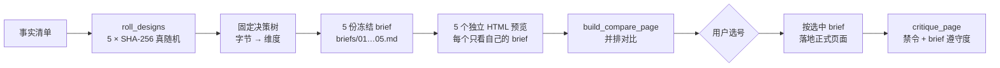

<div align="center">

[English](README.md) · **简体中文** · [日本語](README.ja.md) · [한국어](README.ko.md) · [Español](README.es.md)

# hash-design

<p align="center"><a href="https://qybaihe.github.io/hash-design/causeway-festival/compare.html"><picture><source media="(prefers-reduced-motion: reduce)" srcset="docs/assets/hero.png"></picture></a></p>

<p align="center"><sub>真实产出，不是效果图：<a href="examples/causeway-festival">examples/causeway-festival</a>，每个预览由独立子 Agent 只按一份冻结的 brief 渲染。<br><a href="https://qybaihe.github.io/hash-design/"><b>浏览全部 4 个在线示例 →</b></a> · 覆盖 40 个分支中的 20 个 · <a href="docs/assets/hero.png">静态图</a> · <a href="docs/assets/hero.mp4">MP4</a></sub></p>

### 一句需求，5 套设计方向：由真随机 SHA-256 哈希决定，而不是模型。

**别再让编码 Agent 每次都交出同一张 Inter + 紫色渐变的页面。hash-design 掷出 5 个方向，把每个方向冻结成一份设计 brief，并排渲染 5 个预览，然后等你挑一个。任何一个方向都能凭 ref 原样重建。**

[](https://github.com/qybaihe/hash-design/actions/workflows/ci.yml)
[](https://qybaihe.github.io/hash-design/)
[](#快速开始)
[](docs/mcp-tools.zh-CN.md)
[](.nvmrc)
[](#手动安装)
[](LICENSE)

**[在线示例](https://qybaihe.github.io/hash-design/) · [分支目录](docs/branches.md) · [MCP 参考](docs/mcp-tools.zh-CN.md) · [更新日志](CHANGELOG.md)**

[快速开始](#快速开始) · [它怎么工作](#它怎么工作) · [案例展示](#案例展示) · [参考](#参考) · [常见问题](#常见问题)

**直接告诉你的 Agent**（Claude Code、Cursor）：

```text
从 https://github.com/qybaihe/hash-design 安装 hash-design（它还没发布到 npm）：
克隆到 ~/hash-design 并构建，然后按它 README.zh-CN.md 里「手动安装」一节的步骤，
把 skill 装进当前项目，并为你这个 Agent 注册它的 MCP server。
```

</div>

> [!IMPORTANT]
> hash-design **尚未发布到 npm**，请从源码安装：[qybaihe/hash-design](https://github.com/qybaihe/hash-design)。`package.json` 已可发布，CI 里会跑 `npm pack --dry-run`，但在正式发布之前，`npx hash-design` 和 `npx hash-design-mcp` 都用不了。

---

## hash-design 做什么

让 LLM "做一个好看的页面"，结果几乎总会塌缩到同一种众数审美：Inter 字体、紫蓝渐变、居中大标题配两个按钮、三张一模一样的 feature 卡、毛玻璃、emoji 图标，再配上 Unlock / Seamless / Supercharge 之类的空话。原因很简单：模型只要能自己选，就会选训练数据里最常见的那一种。

hash-design 不去求模型"更有品味"，而是**把选择权拿走**：

| 步骤     | 发生什么                                                                                                                                                         |
| -------- | ---------------------------------------------------------------------------------------------------------------------------------------------------------------- |
| **掷**   | 用系统真随机掷出 5 个哈希（`crypto.randomBytes(32)` → SHA-256）                                                                                                  |
| **映射** | 每个哈希通过一棵**固定、可复现的决策树**映射到一个具体的设计方向：设计流派、版式、字体对、色值、密度、动效、母题、首屏锚点、字号比例、材质、文案语气、一个"变数" |
| **冻结** | 每个方向输出一份**冻结的 brief**，里面有可以直接粘贴的 token（字体链接、色值、`tokens.css`、栅格、圆角/阴影策略），以及全局禁令                                  |
| **渲染** | Agent 只负责**忠实执行** brief，分别做出 5 个独立的 HTML 预览，再做一个并排对比页，然后**停下来等你选号**                                                        |
| **终稿** | 你选中一个后，Agent 按那份 brief 做出正式页面，并用 `critique_page` 自检                                                                                         |

本质上，这是用**外部随机约束**打破模型的默认审美，跟 KV cache、温度采样都没有关系。模型的品味只用在执行质量上，比如对齐、节奏、细节和可读性，而不是用来挑风格。

默认产出是网页。传入**场景** `scenario`，同一批掷出的方向就能变成幻灯片、手机 App 界面、数据看板、海报 / 社交卡片或 HTML 邮件（见[场景](#场景)）。

它由四部分组成：**Agent Skill**（何时、按什么顺序跑这套流程）、**MCP server**（stdio，6 个工具）、**CLI** 和 **TypeScript 库**，都在这个仓库里。

## 快速开始

### 让 Agent 自己安装

在要做页面的项目里打开 Claude Code 或 Cursor，粘贴：

```text
从 https://github.com/qybaihe/hash-design 安装 hash-design（它还没发布到 npm）：
克隆到 ~/hash-design 并构建，然后按它 README.zh-CN.md 里「手动安装」一节的步骤，
把 skill 装进当前项目，并为你这个 Agent 注册它的 MCP server。
```

Agent 会克隆并构建这个仓库，把 Skill 复制到你项目的 `.claude/skills/` 或 `.cursor/skills/`，并注册 MCP server（Claude Code 用 `claude mcp add`，Cursor 写 `.cursor/mcp.json`）。完成后开一个新会话，让 Agent 加载两者，然后就可以[开始使用](#开始使用)。想自己敲命令，按下面的步骤来。

### 手动安装

需要 Node.js ≥ 20（开发用的 `.nvmrc` 固定为 22）。

```bash
git clone https://github.com/qybaihe/hash-design.git ~/hash-design
cd ~/hash-design && npm install && npm run build
# CLI entry:        ~/hash-design/packages/core/dist/bin.js
# MCP server entry: ~/hash-design/packages/mcp/dist/bin.js
```

**Skill。** Skill 告诉 Agent 何时使用、按什么顺序调用 MCP、怎样独立渲染、什么时候必须停下。

```bash
# 装到某个项目（同时写 .claude/skills 和 .cursor/skills）
node ~/hash-design/packages/core/dist/bin.js skill install --target both --dir /path/to/your/project
# 装到用户目录（所有项目可用）
node ~/hash-design/packages/core/dist/bin.js skill install --target claude --global
```

也可以手动复制 [`skills/hash-design/SKILL.md`](skills/hash-design/SKILL.md) 到 `.claude/skills/hash-design/SKILL.md`（Claude Code）或 `.cursor/skills/hash-design/SKILL.md`（Cursor）。本仓库自带这两份副本，测试保证它们和源文件一致。

**MCP server。** 把 `packages/mcp/dist/bin.js` 注册给你的 Agent。在 shell 里 `~/hash-design` 会展开成绝对路径；JSON 文件里要写出绝对路径（下面用 `/ABS/PATH/hash-design` 表示）。

#### Claude Code

```bash
claude mcp add hash-design -- node ~/hash-design/packages/mcp/dist/bin.js
```

或者在项目根目录提交一个 `.mcp.json`：

```json
{
  "mcpServers": {
    "hash-design": {
      "command": "node",
      "args": ["/ABS/PATH/hash-design/packages/mcp/dist/bin.js"]
    }
  }
}
```

#### Cursor

`.cursor/mcp.json`（项目级）或 `~/.cursor/mcp.json`（全局），结构相同：

```json
{
  "mcpServers": {
    "hash-design": {
      "command": "node",
      "args": ["/ABS/PATH/hash-design/packages/mcp/dist/bin.js"]
    }
  }
}
```

#### Claude Desktop

`~/Library/Application Support/Claude/claude_desktop_config.json`（macOS）或 `%APPDATA%\Claude\claude_desktop_config.json`（Windows），结构同上。Claude Desktop 启动 server 时的工作目录不是你的项目目录，所以调用 `roll_designs` 时请给 `out_dir` 传**绝对路径**。

### 开始使用

装好 MCP server 和 Skill 后，直接对 Agent 说：

> 用 hash-design 给「第四巷面包店」做一个一页站。事实：周二至周日 7:00–19:00 营业，周一休息；乡村面包 ¥38……

Agent 会依次掷骰、冻结 brief、做 5 个预览、生成 `design/hash-design/compare.html`，然后停下来等你回复编号。支持 MCP prompt 的客户端也可以直接用 `hash-design` 这个 prompt（参数 `subject`、`facts`、`count`、`scenario`）启动同样的流程。要做幻灯片、App 界面、看板、海报或邮件时直接说，Agent 会传对应的 `scenario`。

### CLI

```bash
hash-design roll --subject "第四巷面包店" --facts-file facts.md --out design/hash-design   # 真随机 5 个方向
hash-design roll --subject "…" --light-only --brand "#c8102e" --format json            # 带约束
hash-design roll --subject "季度复盘" --facts-file facts.md --scenario deck --out design/deck   # 做幻灯片而不是网页
hash-design brief <ref> [constraints]                                                 # 复现 brief
hash-design branches [--family craft]                                                 # 分支库
hash-design branch ink-and-seal                                                       # 分支详情
hash-design critique page.html --roll design/hash-design/roll.json --pick 3 --fail-under 80
hash-design compare --roll design/hash-design/roll.json                               # 生成 compare.html
hash-design skill install --target both                                               # 安装 Skill
```

源码安装时用 `node packages/core/dist/bin.js …` 运行（也可以在仓库根目录执行 `alias hash-design="node $PWD/packages/core/dist/bin.js"`）。`hash-design --help` 列出所有命令，`hash-design <command> --help`（例如 `hash-design roll --help`）列出单个命令的全部参数，包括约束参数 `--light-only`、`--dark-only`、`--reduced-motion`、`--brand`、`--family`、`--include`、`--exclude`、`--scenario`。

### 作为库使用

```ts
import { roll, renderBrief, critiquePage, reproduce, parseRef } from 'hash-design';

const r = roll({ content: { subject: '第四巷面包店', facts: ['周一休息', '乡村面包 ¥38'] } });
for (const [i, d] of r.designs.entries()) console.log(renderBrief(d, r.content, { number: i + 1 }));

const design = reproduce(parseRef(r.designs[0].ref), r.constraints);
const report = critiquePage({ html: '<!doctype html>…', design });
console.log(report.score, report.adherence, report.findings);
```

发布到 npm 之前，可以从源码目录导入（`packages/core/dist/index.js`），或者把本地目录装成依赖（`npm install /ABS/PATH/hash-design/packages/core`）。

### 更新

```bash
cd ~/hash-design && git pull && npm install && npm run build
node ~/hash-design/packages/core/dist/bin.js skill install --target both --dir /path/to/your/project   # refresh the copied SKILL.md
```

MCP 配置指向 `packages/mcp/dist/bin.js`，所以重新构建就更新了 server，重启 Agent 即可生效。`skill install` 会覆盖项目里的旧副本。如果某次更新改了分支数据，用旧版本掷出的 ref 需要旧版本才能复现（见[常见问题](#常见问题)）。

## 它怎么工作



### 字节 → 维度（`hash-design/v1`）

| 字节  | 维度            | 规则                                                                              |
| ----- | --------------- | --------------------------------------------------------------------------------- |
| 0–1   | 设计分支 branch | `uint16(b0,b1) mod N`（N = 40）。碰撞时向后走，见下文                             |
| 2     | 文案语气 voice  | 14 种：店主黑板、田野笔记、技术手册、亲笔信、展签、配方、分类广告、时刻表、历书…… |
| 3     | 版式 layout     | 分支内 3 选 1，带栅格数值和自上而下的分节草图                                     |
| 4     | 字体对 type     | 分支内 3 选 1：display / body（/ mono）+ 中文字体 + 排版细则                      |
| 5     | 配色 palette    | 分支内 3 选 1：paper / ink / muted / accent / accent2 / rule / panel 七个 hex     |
| 6     | 密度 density    | 分支允许的子集：疏朗 / 常规 / 紧凑 / 满版                                         |
| 7     | 动效 motion     | 分支内 3 选 1：时长、缓动、reduced-motion 策略                                    |
| 8     | 母题 motif      | 分支内 3 选 1                                                                     |
| 9     | 首屏锚点 anchor | 分支内 3 选 1                                                                     |
| 10    | 字号比例 scale  | 分支允许的模数比例（1.125–1.618）                                                 |
| 11    | 材质 surface    | 分支内 3 选 1（带 CSS 提示）                                                      |
| 12    | 变数 twist      | 16 种，例如"数字即主角""唯一越界""首屏无按钮""版权页式页脚"                       |
| 13    | 格式 format     | 仅限非 web 场景：从场景的 3–4 种格式里选 1 种（例如幻灯片的母版）                 |
| 13–31 | 未使用          | 记录在 brief 里，保留给以后的维度（场景用到第 13 字节时为 14–31）                 |

- **碰撞与家族分散**：同一次掷骰里，若某个哈希落到已用过的分支，就向后走（+1、+2…）到下一个空闲分支。只要还有没用到的**家族**（印刷品 / 文档票据 / 标识招牌 / 屏幕仪器 / 手作东方 / 现代主义），落到已用家族的分支也算碰撞。所以 5 个方向一定来自 5 个不同家族，不会出现 5 张纸质文档的情况。走过的步数记为 `probe`，ref 写成 `<hash>+<probe>`，单独拿出来也能复现。
- **分支顺序**：库的顺序就是映射顺序。每个家族的成员均匀分布在整圈上，所以"向后走"分走的概率不会集中到某一个分支上（5 连抽时，每个分支的出现率在 9%–17% 之间，均匀分布是 12.5%）。
- **约束**会先过滤候选池，再应用字节，所以约束也是设计身份的一部分：`light_only`、`dark_only`、`reduced_motion`、`brand_colors`（品牌色替换 accent，自动挑色相最近的调色板，并给出对比度）、`families`、`include_branches`、`exclude_branches`、`scenario`。
- **可复现**：同一个 `ref`、同样的约束、同一个库指纹，一定得到同一份 brief。每份 brief 都记录了算法版本（`hash-design/v1`）和库指纹（数据的 SHA-256 前 12 位）。
- `seed` **只用来复现示例和测试**，真实使用一律走系统随机。

完整规范和逐字节推演示例见 [docs/mapping.zh-CN.md](docs/mapping.zh-CN.md)。

### 场景

`scenario` 说明你要设计的是什么。默认的 `web` 就是上面的网页流程，完全不变。其余五个保留掷出的方向，给每份 brief 加上格式、画布和输出规则。

| 场景          | 交付物                                                                    | 格式（第 13 字节）                         | 画布                                      |
| ------------- | ------------------------------------------------------------------------- | ------------------------------------------ | ----------------------------------------- |
| `web`（默认） | 响应式网页、落地页或一页站                                                | —                                          | 响应式                                    |
| `deck`        | HTML 幻灯片：每页一个固定画布，键盘翻页，可打印成 PDF                     | 满版、索引栏、文档母版                     | 1920×1080                                 |
| `app`         | 同一条用户路径上的几屏手机界面，并排展示                                  | 底部标签栏、顶部分段、单任务流程、底部面板 | 390×844                                   |
| `dashboard`   | 一屏桌面看板：核心数字、一张主图表、若干辅助面板                          | 侧栏、顶栏、看板墙                         | 1440×900                                  |
| `poster`      | 一张画板：海报或社交图片，截图即成品                                      | 竖版 4:5、方形、竖屏 9:16、链接卡片        | 1080×1350、1080×1080、1080×1920、1200×630 |
| `email`       | 能在真实邮件客户端里显示的 HTML 邮件：表格布局、内联样式、不用 JavaScript | 单栏、通栏色带、摘要简报                   | 600 或 640 px 单栏                        |

- **方向保持不变。** 场景不过滤分支池，所以同一个哈希在任何场景下都得到同样的分支、文案语气、版式、字体对、配色、母题、首屏锚点、字号比例和材质。
- **部分池子变小。** 读第 6、12 字节之前，先去掉在该场景里没有意义的密度和变数（幻灯片不用 `packed`，也不用"首屏不放按钮"），所以密度和变数可能与 web 版不同。邮件一律取最静止的动效。
- **尺寸随媒介。** 基准字号由密度基准缩放或限定而来（幻灯片 ×2、海报 ×1.75、App 和邮件 16–17 px、看板 13–15 px），`tokens.css` 里带上画布尺寸。
- **属于设计身份。** 和其他约束一样，复现 ref 时要传同样的 `scenario`。`web` 什么都不改：已有的 ref、brief 和示例都能原样复现。

`critique_page` 会检查各场景的输出约定（页数与画布、手机机框、等宽数字、画板尺寸、邮件表格），对比页会按真实尺寸缩放固定画布。场景列表和规则参考了 [Open Design](https://github.com/nexu-io/open-design) 的模板。详见 [docs/mapping.zh-CN.md §6](docs/mapping.zh-CN.md#6-场景)。

### 一份 brief 里有什么

以示例 [#3 水墨印章](examples/fourth-lane-bakery/briefs/03-ink-and-seal.md) 为例，一份 brief 包含：

- 映射过程表，逐字节列出公式和结果
- 内容：只能用的事实清单
- 文案语气及其修辞手段、版式（栅格数值和分节顺序）、首屏锚点
- 字体：Google Fonts `<link>`（中文页面会带上中文字体），以及按模数比例算出的字号阶梯
- 7 个色值、用色比例、WCAG 对比度表（哪个颜色只能做大字或装饰）
- 密度、圆角、边框、阴影策略、材质（含 CSS 片段）、母题、动效规格
- 变数（twist）、分支的必须/不要，以及 14 条全局禁令
- 可直接粘贴的 `tokens.css`，以及交付前自检清单
- 非 web 场景还有一节「场景」：格式、画布、文件结构、页数 / 屏数、版式 / 锚点 / 动效如何落地，以及场景规则和禁忌

brief 是写给 Agent 看的，标题中英双语。`language`（`zh` 或 `en`，默认根据 subject 和 facts 自动判断）决定概念说明和执行指令用哪种语言，以及是否加载中文字体。文案语气、变数等部分描述目前只有中文。

## 案例展示

4 次完整运行，各有自己的事实清单和固定 seed（固定 seed 只是为了可复现）。任意两个示例都不共用分支，合起来覆盖 40 个分支中的 20 个，6 个家族都有。每个预览都由只看得到自己那份 brief 的子 Agent 独立完成，`critique_page` 全部不低于 90 分。所有示例都在[示例首页](https://qybaihe.github.io/hash-design/)。下面每张图是一次掷骰：5 个方向并排，标着分支名和 ref。

### 第四巷面包店：街区面包店 · 中文页面

[](examples/fourth-lane-bakery)

seed `fourth-lane-bakery` · `critique_page` 96–100 · brief 遵守度 100 · [示例目录](examples/fourth-lane-bakery)：事实清单、brief、预览和过程记录

### Sluice：自托管的 webhook 收件箱 · 英文页面

[](examples/sluice)

seed `sluice` · `critique_page` 92–96 · brief 遵守度 90–100 · [示例目录](examples/sluice)：事实清单、brief、预览和过程记录

### 二号桥单车铺：桥洞下的单车修理铺 · 中文页面

[](examples/bridge-two-bikes)

seed `bridge-two-bikes-5` · `critique_page` 96–100 · brief 遵守度 100 · [示例目录](examples/bridge-two-bikes)：事实清单、brief、预览和过程记录

### Causeway：潮汐岛上的一日音乐节 · 英文页面

[](examples/causeway-festival)

seed `causeway-festival-6` · `critique_page` 96–100 · brief 遵守度 100 · [示例目录](examples/causeway-festival)：事实清单、brief、预览和过程记录

## 参考

6 个 MCP 工具、40 个分支，以及每份 brief 都带着的 14 条禁令。

### MCP 工具

| 工具                 | 作用                                                                                                                                                                                             |
| -------------------- | ------------------------------------------------------------------------------------------------------------------------------------------------------------------------------------------------ |
| `roll_designs`       | 输入 `subject`、`facts`、`count`（默认 5），可选 `seed`、`language`、`scenario` 和约束。返回 5 个哈希、映射过程和 5 份 brief。传 `out_dir` 会把 `roll.json`、`ROLL.md`、`briefs/*.md` 冻结到磁盘 |
| `get_brief`          | 按 `ref`（`<hash>` 或 `<hash>+<probe>`）加同样的约束复现 brief，支持 Markdown 或 JSON                                                                                                            |
| `list_branches`      | 列出 40 个设计分支，可按家族过滤                                                                                                                                                                 |
| `get_branch`         | 查看一个分支的全部选项和 token                                                                                                                                                                   |
| `critique_page`      | 输入 HTML 字符串或文件路径，按禁令和 AI 味清单打分；带 `brief_ref` 或 `roll_path`+`pick` 时还会给出对 brief 和场景输出约定的遵守度                                                               |
| `build_compare_page` | 根据 `roll.json` 生成并排对比页 `compare.html`                                                                                                                                                   |

资源：`hash-design://bans`、`hash-design://workflow`（即 SKILL.md）、`hash-design://branches`、`hash-design://branch/{id}`。Prompt：`hash-design`（参数为 `subject`、`facts`、`count`、`scenario`）。

每个参数、返回格式和对应的 CLI 命令见 [docs/mcp-tools.zh-CN.md](docs/mcp-tools.zh-CN.md)。

### 分支库（40）

每个分支都是一个真实世界的设计门类，而不是"SaaS 风格"。每个维度有 3 个具体选项，写明字体对（Google Fonts + 中文）、7 个 hex、栅格数值、圆角/边框/阴影策略、动效规格、母题和材质。完整目录见 [docs/branches.md](docs/branches.md)，也可以用 `list_branches` / `get_branch` 查询。

| 家族               | 分支                                                                                                        |
| ------------------ | ----------------------------------------------------------------------------------------------------------- |
| 印刷品 print       | 超市促销单 · 凸版木活字 · 复印小志 · Riso 双色套印 · 唱片封套 · 赛事秩序册 · 时装画册 · 大报版面 · 杂志编辑 |
| 文档票据 document  | 工程图版 · 账本 · 票根 · 学术论文 · 药房标签 · 公文表格 · 热敏小票 · 植物标本 · 野外图鉴                    |
| 标识招牌 signage   | 交通导视 · 港式招牌 · 餐馆菜单板 · 美术馆图录 · 地形图                                                      |
| 屏幕仪器 screen    | 终端荧光 · 早期个人主页 · 游戏说明书 · 工业仪表 · 粗野原生                                                  |
| 手作东方 craft     | 菜谱卡 · 手作温度 · 水墨印章 · 老黄历 · 余白 · 方格实验本                                                   |
| 现代主义 modernist | 瑞士网格 · 包豪斯 · 构成主义海报 · 装饰艺术 · 七十年代超级图形 · 孟菲斯                                     |

数据由测试和脚本强制约束：

- 不得使用禁用字体，fallback 里也不行
- ink/paper 对比度 ≥ 7:1，muted/paper ≥ 4.5:1
- 每个分支至少有一套浅色调色板
- 不得使用框架默认色值
- 同一个 display 字体最多用于 3 个分支
- 任意两个分支的首选调色板（paper + accent）不得相同
- 每个字体 URL 都能在 Google Fonts 解析：`node scripts/verify-fonts.mjs`，235/235 通过

### 全局禁令

每份 brief 都会抄录这 14 条，`critique_page` 能自动检测其中每一条：

| id                          | 禁止                                                                                                   |
| --------------------------- | ------------------------------------------------------------------------------------------------------ |
| `generic-sans`              | Inter、Roboto、Poppins、Montserrat、DM Sans、Space Grotesk 等 23 个默认无衬线；只用 system-ui 当"设计" |
| `purple-blue-gradient`      | 紫/靛/蓝渐变、渐变文字、彩色光斑                                                                       |
| `centered-hero-two-buttons` | 居中大标题 + 副标题 + 主按钮/幽灵按钮                                                                  |
| `identical-cards`           | 3/4/6 张同构的"图标 + 标题 + 两行字"卡片                                                               |
| `glassmorphism`             | `backdrop-filter` 毛玻璃                                                                               |
| `emoji-icons`               | emoji 当图标；拿通用图标库当装饰                                                                       |
| `buzzword-copy`             | Unlock / Seamless / Supercharge / 赋能 / 一站式 / 极致体验……                                           |
| `soft-shadow-rounded`       | 处处 12–24px 圆角 + 柔和大投影                                                                         |
| `invented-facts`            | "10K+ 用户""Trusted by"、带头像的假评价                                                                |
| `tailwind-default-palette`  | `#6366f1` `#8b5cf6` `#0f172a` 这类框架默认色                                                           |
| `scroll-fade-everything`    | 每段都滚动淡入上浮                                                                                     |
| `pill-badge-sparkle`        | 标题上方的 "New ✨" 胶囊                                                                               |
| `placeholder-content`       | Lorem ipsum、图库人像、随机 Unsplash                                                                   |
| `template-sections`         | Hero → Features → Testimonials → Pricing → FAQ 套路                                                    |

`critique_page` 另外还会检查文字对比度（< 3:1）、`viewport`、`lang`、`img alt`、有动效时是否缺少 `prefers-reduced-motion`，以及对 brief 的遵守度：字体、色值、圆角和阴影策略。它是静态检查，抓不到"首屏是否真的是 brief 的锚点""语气对不对"这类问题，这些仍然需要人看或 Agent 对照 brief 自查。

## 常见问题

<details>
<summary><strong>哪些 Agent 能用？</strong></summary>

Skill 可以装进 Claude Code（`.claude/skills/`）和 Cursor（`.cursor/skills/`）。MCP server 走 stdio，任何 MCP 客户端都能启动它；[手动安装](#手动安装)里给了 Claude Code、Cursor 和 Claude Desktop 的配置。没有 Skill 时 Agent 也能调用这些工具，但没有东西告诉它要独立渲染预览、停下来等你挑。

</details>

<details>
<summary><strong>发布到 npm 了吗？</strong></summary>

还没有。`package.json` 已可发布，CI 里会跑 `npm pack --dry-run`，但目前请从源码安装。发布之后，`npx -y hash-design-mcp` 和 `npx -y hash-design` 就能用。

</details>

<details>
<summary><strong>真的是随机的吗？怎样拿回同一份 brief？</strong></summary>

每次掷骰都取系统随机数（`crypto.randomBytes(32)` → SHA-256）；`seed` 只用于复现示例和测试。每份 brief 都记着自己的 `ref`（`<hash>` 或 `<hash>+<probe>`）、约束和库指纹，用 `get_brief` 或 `hash-design brief <ref>` 就能原样重建同一份 brief。

</details>

<details>
<summary><strong>更新之后旧 ref 还能复现吗？</strong></summary>

只有分支数据没变时才行。分支库有 40 个分支，增删分支会改变映射。每份 brief 都记着库指纹，所以能发现不一致，但旧 ref 需要对应的版本才能复现。

</details>

<details>
<summary><strong><code>critique_page</code> 能保证页面好吗？</strong></summary>

不能。它是启发式静态检查：读取内联 `<style>`、`style=""` 和你额外传入的 CSS，不渲染页面，也不抓取外链样式表。它能抓出禁令里的模式，并对照 brief 检查字体、色值、圆角和阴影；但结果*好不好*，仍取决于模型和执行 brief 的人。这个工具解决的是"千篇一律"，不能替代设计判断。

</details>

<details>
<summary><strong>需要联网吗？</strong></summary>

CLI 和 MCP server 在本地运行，不发网络请求。生成的页面会从 Google Fonts 加载字体（包括中文字体）；离线或受限网络需要自托管字体，或使用每份 brief 里列出的后备字体。

</details>

<details>
<summary><strong>为什么 brief 有一部分是中文？</strong></summary>

brief 是双语的：标题带中英文标签，`language`（`zh` 或 `en`）切换概念文字和执行说明。部分池描述（语气、变数）和 Skill 正文目前只有中文；Skill 的 description 里有英文触发词。

</details>

## 文档

- [docs/architecture.zh-CN.md](docs/architecture.zh-CN.md)：包结构、数据流、设计取舍、测试
- [docs/mapping.zh-CN.md](docs/mapping.zh-CN.md)：`hash-design/v1` 映射、碰撞、约束、可复现性
- [docs/mcp-tools.zh-CN.md](docs/mcp-tools.zh-CN.md)：全部 MCP 工具、资源和 prompt，以及对应的 CLI 命令
- [docs/branches.md](docs/branches.md)：40 个分支的目录（自动生成，中英双语）
- English: [Architecture](docs/architecture.md) · [Mapping spec](docs/mapping.md) · [MCP tools](docs/mcp-tools.md)

## 参与贡献

欢迎贡献，尤其是新的设计分支。请先读 [CONTRIBUTING.md](CONTRIBUTING.md)，里面讲了数据规则、`npm run sync`，以及为什么改数据就要重新掷示例。请遵守[行为准则](CODE_OF_CONDUCT.md)；安全问题请按 [SECURITY.md](SECURITY.md) 私下报告。版本变更见 [CHANGELOG.md](CHANGELOG.md)。

```bash
npm install
npm run build        # tsc -b，两个包
npm test             # vitest：核心、CLI、MCP（in-memory transport）、Skill/文档一致性
npm run check        # typecheck + lint + prettier + test
npm run sync         # 改数据后重新生成 SKILL.md 的禁令块、.claude/.cursor 副本、docs/branches.md
node scripts/smoke.mjs        # 真实 stdio 上的 MCP + CLI 冒烟测试（CI 会跑）
node scripts/verify-fonts.mjs # 联网检查所有字体 URL（不在 CI 里跑）
npm run example:critique      # 对照 brief 批量 critique 所有示例预览（低于 90 分即失败）
npm run screenshots           # Playwright 截图所有示例（需 npx playwright install chromium）
npm run hero                  # 用示例截图重新生成 docs/assets/hero.png 和 social-preview.png
npm run hero:gif              # 重新生成 docs/assets/hero.gif 和 hero.mp4（需要 ffmpeg；装了 gifski 会优先用）
npm run showcase              # 重新生成 docs/assets/showcase/<示例>.png，每个示例一张拼图
```

CI 在 Node 20、22、24 上跑 build、typecheck、lint、格式检查、测试、stdio 冒烟测试和 `npm pack --dry-run`。

仓库结构：

```
packages/core/           # npm: hash-design —— 数据、映射、brief、critique、对比页、CLI
  src/data/bans.ts       #   全局禁令、禁用字体、空话词表
  src/data/pools.ts      #   密度、比例、14 种文案语气、16 个变数
  src/data/branches/     #   40 个分支（index.ts 定义映射顺序）
  src/mapping.ts         #   哈希 → 设计（决策树、碰撞、约束）
  src/brief.ts           #   brief 渲染（Markdown / JSON）
  src/critique.ts        #   AI 味静态检查
  src/compare.ts         #   并排对比页
  src/cli.ts             #   CLI
packages/mcp/            # npm: hash-design-mcp —— stdio MCP server
skills/hash-design/      # Skill 源文件（.claude/ 和 .cursor/ 下为同步副本）
examples/                # 4 个完整示例：事实 → roll → 5 brief → 5 预览 → 对比页 → 截图
docs/                    # 架构、映射规范、MCP 参考、分支库目录（生成）
scripts/                 # sync / smoke / verify-fonts / examples / screenshot / hero / hero-gif / prepack
```

添加分支、修改数据的流程见 [CONTRIBUTING.md](CONTRIBUTING.md)（英文，附中文摘要）。

## 许可证

[MIT](LICENSE) © qybaihe
