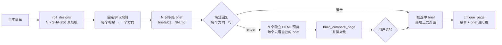

<div align="center">

[English](README.md) · **简体中文** · [日本語](README.ja.md) · [한국어](README.ko.md) · [Español](README.es.md)

# hash-design

<p align="center"><a href="https://qybaihe.github.io/hash-design/causeway-festival/compare.html"><picture><source media="(prefers-reduced-motion: reduce)" srcset="docs/assets/hero.png"></picture></a></p>

<p align="center"><sub>真实产出，不是效果图：<a href="examples/causeway-festival">examples/causeway-festival</a>，每个预览由独立子 Agent 只按一份冻结的 brief 渲染。<br><a href="https://qybaihe.github.io/hash-design/"><b>浏览全部 4 个在线示例 →</b></a> · hash-design/v1 时期的一次运行（见<a href="#案例展示">案例展示</a>） · <a href="docs/assets/hero.png">静态图</a> · <a href="docs/assets/hero.mp4">MP4</a></sub></p>

### 一句需求，5 套设计方向：由真随机 SHA-256 哈希决定，而不是模型。

**别再让编码 Agent 每次都交出同一张 Inter + 紫色渐变的页面。hash-design 掷出 5 个方向（也可以是 1–12 之间任意个），把每个方向冻结成一份设计 brief，每个方向用一行列给你，你要看时再并排渲染成预览，最后按你挑的那个落地。任何一个方向都能凭 ref 原样重建。**

[](https://github.com/qybaihe/hash-design/actions/workflows/ci.yml)
[](https://qybaihe.github.io/hash-design/)
[](#快速开始)
[](docs/mcp-tools.zh-CN.md)
[](.nvmrc)
[](https://www.npmjs.com/package/hash-design)
[](LICENSE)

**[在线示例](https://qybaihe.github.io/hash-design/) · [映射规范](docs/mapping.zh-CN.md) · [MCP 参考](docs/mcp-tools.zh-CN.md) · [更新日志](CHANGELOG.md)**

[案例展示](#案例展示) · [快速开始](#快速开始) · [它怎么工作](#它怎么工作) · [参考](#参考) · [常见问题](#常见问题)

**直接告诉你的 Agent**（Claude Code、Cursor、Codex、Windsurf、VS Code Copilot……）：

```text
为这个 Agent 安装 hash-design 的 skill：运行 `npx -y hash-design skill install --dir .`，
并用 `npx -y hash-design mcp` 注册它的 MCP server，
步骤见 https://github.com/qybaihe/hash-design/blob/main/README.zh-CN.md#快速开始 。
```

</div>

---

## 案例展示

4 次完整运行，各有自己的事实清单和固定 seed（固定 seed 只是为了可复现）。它们是用 **hash-design/v1**（已被 v2 取代的 40 分支库）掷出的，作为真实运行的记录保留：它们的 ref 在 v2 下无法复现，拼图上标的也是 v1 的分支名。每个预览都由只看得到自己那份 brief 的子 Agent 独立完成，`critique_page` 仍然全部不低于 90 分。所有示例都在[示例首页](https://qybaihe.github.io/hash-design/)。下面每张图是一次掷骰：5 个方向并排。

### 第四巷面包店：街区面包店 · 中文页面

[](examples/fourth-lane-bakery)

seed `fourth-lane-bakery` · `critique_page` 96–100 · brief 遵守度 100 · [示例目录](examples/fourth-lane-bakery)：事实清单、brief、预览和过程记录

### Sluice：自托管的 webhook 收件箱 · 英文页面

[](examples/sluice)

seed `sluice` · `critique_page` 92–96 · brief 遵守度 90–100 · [示例目录](examples/sluice)：事实清单、brief、预览和过程记录

### 二号桥单车铺：桥洞下的单车修理铺 · 中文页面

[](examples/bridge-two-bikes)

seed `bridge-two-bikes-5` · `critique_page` 96–100 · brief 遵守度 100 · [示例目录](examples/bridge-two-bikes)：事实清单、brief、预览和过程记录

### Causeway：潮汐岛上的一日音乐节 · 英文页面

[](examples/causeway-festival)

seed `causeway-festival-6` · `critique_page` 96–100 · brief 遵守度 100 · [示例目录](examples/causeway-festival)：事实清单、brief、预览和过程记录

## hash-design 做什么

让 LLM "做一个好看的页面"，结果几乎总会塌缩到同一种众数审美：Inter 字体、紫蓝渐变、居中大标题配两个按钮、三张一模一样的 feature 卡、毛玻璃、emoji 图标，再配上 Unlock / Seamless / Supercharge 之类的空话。原因很简单：模型只要能自己选，就会选训练数据里最常见的那一种。

hash-design 不去求模型"更有品味"，而是**把选择权拿走**：

| 步骤     | 发生什么                                                                                                                                                                                                                                             |
| -------- | ---------------------------------------------------------------------------------------------------------------------------------------------------------------------------------------------------------------------------------------------------- |
| **掷**   | 用系统真随机掷出 N 个哈希（`crypto.randomBytes(32)` → SHA-256）：默认 5 个，你说几个就几个（1–12）                                                                                                                                                   |
| **映射** | 每个哈希**就是**方向。固定、可复现的规则把它的字节直接读成设计参数：色相和按对比度解出的配色、从扁平字体池里选出的标题字体和正文字体、大小写、字距、字号比例、密度、栅格、首屏锚点、母题、圆角和纹理、动效时序、文案语气，以及一个"变数"。没有风格库 |
| **冻结** | 每个方向输出一份**冻结的 brief**，里面有可以直接粘贴的 token（字体链接、色值、`tokens.css`、栅格、圆角 / 边框 / 阴影数值），以及全局禁令                                                                                                             |
| **渲染** | Agent 先给你**每个方向一行**，然后**停下**。你回复 `render` 后，它只负责**忠实执行** brief：分别做出独立的 HTML 预览和一个并排对比页，再**等你选号**                                                                                                 |
| **终稿** | 你选中一个后，Agent 按那份 brief 做出正式页面，并用 `critique_page` 自检                                                                                                                                                                             |

本质上，这是用**外部随机约束**打破模型的默认审美，跟 KV cache、温度采样都没有关系。模型的品味只用在执行质量上，比如对齐、节奏、细节和可读性，而不是用来挑风格。

默认产出是网页。传入**场景** `scenario`，同一批掷出的方向就能变成幻灯片、手机 App 界面、数据看板、海报 / 社交卡片或 HTML 邮件（见[场景](#场景)）。

它由四部分组成：**Agent Skill**（何时、按什么顺序跑这套流程）、**MCP server**（stdio，4 个工具）、**CLI** 和 **TypeScript 库**，一起以 [`hash-design`](https://www.npmjs.com/package/hash-design) 发布在 npm 上。

## 快速开始

### 让 Agent 自己安装

在要做设计的项目里打开你的编码 Agent（Claude Code、Cursor、Codex、Windsurf、VS Code Copilot……），粘贴：

```text
为这个 Agent 安装 hash-design 的 skill：运行 `npx -y hash-design skill install --dir .`，
并用 `npx -y hash-design mcp` 注册它的 MCP server，
步骤见 https://github.com/qybaihe/hash-design/blob/main/README.zh-CN.md#快速开始 。
```

Agent 会把 Skill 复制到你项目的 `.claude/skills/` 和 `.agents/skills/`，并注册 MCP server（Claude Code 用 `claude mcp add`，Cursor 写 `.cursor/mcp.json`，Codex 用 `codex mcp add`），不需要克隆或构建。完成后开一个新会话，让 Agent 加载两者，然后就可以[开始使用](#开始使用)。想自己敲命令，按下面的步骤来。

### 手动安装

需要 Node.js ≥ 20 和 npm（用来运行 `npx`）。

**Skill。** Skill 告诉 Agent 何时使用、按什么顺序调用 MCP、怎样独立渲染、什么时候必须停下。

```bash
npx -y hash-design skill install --dir .                # 当前项目：.claude/skills 和 .agents/skills
npx -y hash-design skill install --global               # 或者装到用户目录，所有项目可用
npx -y hash-design skill install --to /path/to/skills   # 或者装到其他 Agent 的 skills 文件夹
```

默认写入 `.claude/skills/`（Claude Code）和 `.agents/skills/`（Codex、Cursor、VS Code Copilot、Windsurf）。`--target` 可以改选文件夹（`claude`、`agents`、`cursor`，逗号分隔，或 `all`；`both` 即 `claude,cursor`），命令结束时会打印在当前位置可用的 CLI 和 MCP 命令。skill 就是一个带 `SKILL.md` 的文件夹，所以手动把 [`skills/hash-design/SKILL.md`](skills/hash-design/SKILL.md) 复制到 `<skills 文件夹>/hash-design/SKILL.md` 也行。各 Agent 在哪里找 skill（以它们自己的文档为准）：

| Agent           | 项目级                                                  | 个人级                                                         |
| --------------- | ------------------------------------------------------- | -------------------------------------------------------------- |
| Claude Code     | `.claude/skills/`                                       | `~/.claude/skills/`                                            |
| Codex           | `.agents/skills/`                                       | `~/.agents/skills/`                                            |
| Cursor          | `.agents/skills/`, `.cursor/skills/`, `.claude/skills/` | `~/.agents/skills/`, `~/.cursor/skills/`                       |
| VS Code Copilot | `.github/skills/`, `.claude/skills/`, `.agents/skills/` | `~/.copilot/skills/`, `~/.claude/skills/`, `~/.agents/skills/` |
| Windsurf        | `.agents/skills/`, `.windsurf/skills/`                  | `~/.agents/skills/`                                            |

会同时读取 `.claude/skills/` 和 `.agents/skills/` 的 Agent（Cursor、VS Code Copilot）在默认安装后会看到两份相同的副本；介意的话对它们用 `--target agents`。

**MCP server。** 在你的 Agent 里注册 `npx -y hash-design mcp`，它会在 stdio 上运行 server。

#### Claude Code

```bash
claude mcp add hash-design -- npx -y hash-design mcp
```

或者提交一个项目级 `.mcp.json`：

```json
{
  "mcpServers": {
    "hash-design": {
      "command": "npx",
      "args": ["-y", "hash-design", "mcp"]
    }
  }
}
```

#### Cursor

`.cursor/mcp.json`（项目级）或 `~/.cursor/mcp.json`（全局），结构和上面的 `.mcp.json` 相同。

#### Codex

```bash
codex mcp add hash-design -- npx -y hash-design mcp
```

或者写进 `~/.codex/config.toml`（或受信任项目的 `.codex/config.toml`）：

```toml
[mcp_servers.hash-design]
command = "npx"
args = ["-y", "hash-design", "mcp"]
```

#### 其他 Agent

任何能启动 stdio server 的 MCP 客户端都能运行它：命令 `npx`，参数 `-y hash-design mcp`，写进该客户端自己的 MCP 配置（Windsurf、VS Code 等各有各的配置文件）。没有 MCP 时，Skill 会退回到 CLI：`npx -y hash-design roll …`，参数相同。

#### Claude Desktop

macOS 是 `~/Library/Application Support/Claude/claude_desktop_config.json`，Windows 是 `%APPDATA%\Claude\claude_desktop_config.json`，结构相同。Claude Desktop 不会在你的项目目录里启动 server，所以调用 `roll_designs` 时 `out_dir` 要传**绝对路径**。如果它找不到 `npx`，把 `which npx` 打印的路径写进 `command`。

### 从源码运行

参与开发，或者想运行还没发布的提交时（另见 [CONTRIBUTING.md](CONTRIBUTING.md)）：

```bash
git clone https://github.com/qybaihe/hash-design.git ~/hash-design
cd ~/hash-design && npm install && npm run build
node ~/hash-design/packages/core/dist/bin.js skill install --dir /path/to/your/project
claude mcp add hash-design -- node ~/hash-design/packages/core/dist/bin.js mcp
```

源码目录里的 CLI 是 `packages/core/dist/bin.js`。`packages/mcp/dist/bin.js` 启动的是同一个 MCP server，原来指向它的配置照样能用。本仓库自带 `.claude/` 和 `.cursor/` 两份 Skill 副本，测试保证它们和源文件一致。

### 开始使用

装好 MCP server 和 Skill 后，直接对 Agent 说：

> 用 hash-design 给「第四巷面包店」做一个一页站，3 个方向。事实：周二至周日 7:00–19:00 营业，周一休息；乡村面包 ¥38……

Agent 会掷出 N 个方向（默认 5 个；说一个 1–12 之间的数就按你的来，比如 `/hash-design 3`），冻结 brief，然后用固定的简短格式回复并停下。下面这个用了 seed 以便复现，真实掷骰会写「真随机」：

```text
**hash-design** · 为「第四巷面包店」掷出 3 个方向 · 网页 · seed reply-demo

1. **Caveat** / Literata — 浅色纸，色相 330° · 5 栏网格 · 首屏锚点 initial · `ea849a45`
2. **Hanken Grotesk** / Crimson Pro — 浅色纸，色相 344° · 10 栏网格 · 首屏锚点 number · `f458a091`
3. **Overpass** / Barlow Condensed — 浅色纸，色相 234° · 5 栏网格 · 首屏锚点 grid-diagram · `a6b46334`

回复编号，直接按该方向做正式页面；回复「预览」先把 3 个方向都做成预览并排对比；回复「重掷」换一批。
```

回复编号就按那个方向做；回复「预览」会为每个方向做一个独立预览和 `design/hash-design/compare.html`，再把同样的列表发一遍，停下等你选号。回复里每个字段都直接读自映射出的数字（[回复协议](docs/mcp-tools.zh-CN.md#回复协议)）；CLI 用 `--format reply` 打印它。支持 MCP prompt 的客户端也可以直接用 `hash-design` 这个 prompt（参数 `subject`、`facts`、`count`、`scenario`）启动同样的流程。要做幻灯片、App 界面、看板、海报或邮件时直接说，Agent 会传对应的 `scenario`。

### CLI

```bash
hash-design roll --subject "第四巷面包店" --facts-file facts.md --out design/hash-design   # 真随机 5 个方向
hash-design roll --subject "…" --light-only --brand "#c8102e" --format json            # 带约束
hash-design roll --subject "季度复盘" --facts-file facts.md --scenario deck --out design/deck   # 做幻灯片而不是网页
hash-design roll --subject "…" --count 3 --out design/hash-design --format reply      # 3 个方向 + 简短回复
hash-design brief <ref> [constraints]                                                 # 复现 brief
hash-design critique page.html --roll design/hash-design/roll.json --pick 3 --fail-under 80
hash-design compare --roll design/hash-design/roll.json                               # 生成 compare.html
hash-design skill install                                                             # 安装 Skill
```

用 `npx -y hash-design …` 运行，或者用 `npm install -g hash-design` 装一次后直接敲 `hash-design …`；在源码目录里是 `node packages/core/dist/bin.js …`。`hash-design --help` 列出所有命令，`hash-design <command> --help`（例如 `hash-design roll --help`）列出单个命令的全部参数，包括约束参数 `--light-only`、`--dark-only`、`--reduced-motion`、`--brand`、`--scenario`。`--count`/`-n` 设定 N（1–12，默认 5）；每个方向各是一个哈希，约束不会降低这个上限。

### 作为库使用

```ts
import { roll, renderBrief, critiquePage, reproduce, parseRef } from 'hash-design';

const r = roll({ content: { subject: '第四巷面包店', facts: ['周一休息', '乡村面包 ¥38'] } });
for (const [i, d] of r.designs.entries()) console.log(renderBrief(d, r.content, { number: i + 1 }));

const design = reproduce(parseRef(r.designs[0].ref), r.constraints);
const report = critiquePage({ html: '<!doctype html>…', design });
console.log(report.score, report.adherence, report.findings);
```

用 `npm install hash-design` 安装（ES 模块，Node.js ≥ 20，自带类型）。

### 更新

```bash
npx -y hash-design@latest skill install --dir .   # 刷新项目里的 SKILL.md 副本
```

npx 可能会继续用之前缓存的版本；加上 `@latest` 会取最新发布的版本（也可以固定版本，比如 `hash-design@0.2.0`）。MCP server 每次随 Agent 启动时通过 npx 运行，所以发布新版本后重启 Agent；如果一直跑的是旧版本，就在 MCP 命令里写 `hash-design@latest`。旧版本默认装到 `.claude/` 和 `.cursor/`；旧的 `.cursor/skills/` 副本可以用 `--target all` 刷新，或者直接删掉。从源码运行的：`git pull && npm install && npm run build`。如果某次更新改了字体池、原语列表或字节规则，用旧版本掷出的 ref 需要旧版本才能复现（见[常见问题](#常见问题)）。

## 它怎么工作



### 字节 → 参数（`hash-design/v2`）

哈希就是方向。每个字节驱动一个参数（或按位拆成两个）：要么是连续值，要么是一张短小的中性原语列表里的下标，这些原语可以自由组合。没有任何参数以流派或风格命名。

| 字节   | 参数                                                                                                         |
| ------ | ------------------------------------------------------------------------------------------------------------ |
| 0–5    | 配色：OKLCH 色相、浅色或深色纸及其明度、纸的彩度、强调色彩度、第二强调色的色相偏移                           |
| 6–10   | 字体：标题字体（98）、正文字体（62）、大小写和字重、字距、字号比例 1.067–1.618                               |
| 11     | 密度：从疏朗到紧凑之间的一个位置；基础字号、行高、间距单位、区块间距和宽度随之确定                           |
| 12–15  | 版式：3–12 列栅格和列间距、文本块跨越哪几列、首屏高度、区块数、分隔方式                                      |
| 16–17  | 首屏锚点：主体（8）、尺寸、水平位置、旋转                                                                    |
| 18–19  | 母题：形状（12）、尺寸、位置（4）、角度                                                                      |
| 20–21  | 材质：圆角、边框粗细和线型、硬阴影、纹理及其不透明度                                                         |
| 22–23  | 动效：动什么、时长 0–600 ms、缓动（steps，或由各位组成的 cubic-bezier）                                      |
| 24–25  | 文案语气：人称、标题形式、句长、语域                                                                         |
| 26–27  | 变数：对象（9）× 操作（10）× 量，例如 "Rotate every number on the page by 4.5°"（页面上每个数字都旋转 4.5°） |
| 28     | 格式，仅用于非 web 场景                                                                                      |
| 29, 30 | 中文标题字体（用于中文页面）、等宽字体                                                                       |
| 31     | 不使用，记录在 brief 里                                                                                      |

- **对比度是解出来的，不靠碰运气。** 文字颜色沿 OKLCH 明度逐步移动，直到在纸色上达到 ink ≥ 7.5:1、muted ≥ 4.6:1、强调色 ≥ 3:1，所以每个哈希都能得到可读的配色，无论浅色还是深色（大约 30% 的哈希是深色）。
- **N 个方向就是 N 个哈希。** 一次掷 5 个就是 5 次独立映射，彼此之间不共享任何东西，不向后走，也不去重。一个设计的 `ref` 就是它的 64 位十六进制哈希，单独拿出来也能复现。
- **约束在读取字节之前生效**，所以约束也是设计身份的一部分：`light_only` / `dark_only`（此时字节 2 只决定明度）、`reduced_motion`（无动效）、`brand_colors`（第一个替换 accent 并决定色相，第二个替换 accent2）和 `scenario`。
- **可复现**：同一个 `ref`、同样的约束、同一个库指纹，一定得到同一份 brief。每份 brief 都记录了算法版本（`hash-design/v2`）和库指纹（字体池、原语列表和字节规则的 SHA-256 前 12 位）。
- `seed` **只用来复现示例和测试**，真实使用一律走系统随机。

每个字节的精确公式、配色求解器和完整示例见 [docs/mapping.zh-CN.md](docs/mapping.zh-CN.md)。

### 场景

`scenario` 说明你要设计的是什么。默认的 `web` 就是上面的网页流程，完全不变。其余五个保留掷出的方向，给每份 brief 加上格式、画布和输出规则。

| 场景          | 交付物                                                                    | 格式（字节 28）                            | 画布                                      |
| ------------- | ------------------------------------------------------------------------- | ------------------------------------------ | ----------------------------------------- |
| `web`（默认） | 响应式网页、落地页或一页站                                                | —                                          | 响应式                                    |
| `deck`        | HTML 幻灯片：每页一个固定画布，键盘翻页，可打印成 PDF                     | 满版、索引栏、文档母版                     | 1920×1080                                 |
| `app`         | 同一条用户路径上的几屏手机界面，并排展示                                  | 底部标签栏、顶部分段、单任务流程、底部面板 | 390×844                                   |
| `dashboard`   | 一屏桌面看板：核心数字、一张主图表、若干辅助面板                          | 侧栏、顶栏、看板墙                         | 1440×900                                  |
| `poster`      | 一张画板：海报或社交图片，截图即成品                                      | 竖版 4:5、方形、竖屏 9:16、链接卡片        | 1080×1350、1080×1080、1080×1920、1200×630 |
| `email`       | 能在真实邮件客户端里显示的 HTML 邮件：表格布局、内联样式、不用 JavaScript | 单栏、通栏色带、摘要简报                   | 600 或 640 px 单栏                        |

- **方向保持不变。** 同一个哈希在任何场景下都保留它的配色、字体、字号比例、栅格、首屏锚点、母题、材质和文案语气。
- **部分范围收窄。** 字节 11 映射到场景的密度范围内（幻灯片不会紧凑到底，看板不会疏朗到底）；读字节 26–27 之前，先去掉在该场景里没有意义的变数对象或操作（幻灯片里没有针对导航的变数），所以密度和变数可能与 web 版不同。邮件没有动效。
- **尺寸随媒介。** 基准字号由密度基准缩放或限定而来（幻灯片 ×2、海报 ×1.75、App 和邮件 16–17 px、看板 13–15 px），`tokens.css` 里带上画布尺寸。
- **属于设计身份。** 和其他约束一样，复现 ref 时要传同样的 `scenario`。`web` 是默认值，所以 web ref 带不带它都得到同一份 brief。

`critique_page` 会检查各场景的输出约定（页数与画布、手机机框、等宽数字、画板尺寸、邮件表格），对比页会按真实尺寸缩放固定画布。场景列表和规则参考了 [Open Design](https://github.com/nexu-io/open-design) 的模板。详见 [docs/mapping.zh-CN.md §7](docs/mapping.zh-CN.md#7-场景)。

### 一份 brief 里有什么

运行 `hash-design brief 6ebe9acd06cbf4810ad2989965b22bc39bd527084bdda2964f9f0d49eb25562d` 就能看到一份（它就是 [docs/mapping.zh-CN.md](docs/mapping.zh-CN.md#9-完整示例) 里的完整示例）。一份 brief 包含：

- 映射过程表，逐字节列出十六进制值、公式和结果
- 内容：只能用的事实清单
- 文案语气（人称、标题形式、句长、语域）、版式（列数、列间距、文本块所占的列、首屏高度、区块数、分隔方式）和首屏锚点（主体、尺寸、位置、旋转）
- 字体：标题、正文和等宽字体及其大小写、字重和字距，Google Fonts `<link>`（中文页面会带上中文字体），以及按比例算出的字号阶梯
- 在 OKLCH 中算出的 7 个颜色、WCAG 对比度表（哪个颜色只能做大字或装饰）
- 密度、圆角、边框、阴影、纹理（含 CSS 片段）、母题（形状、尺寸、位置、角度）和动效（属性、时长、缓动）
- 变数（twist）和全部 14 条全局禁令
- 可直接粘贴的 `tokens.css`，以及交付前自检清单
- 非 web 场景还有一节「场景」：格式、画布、文件结构、页数 / 屏数、版式 / 锚点 / 动效如何落地，以及场景规则和禁忌

brief 是写给 Agent 看的，标题中英双语。`language`（`zh` 或 `en`，默认根据 subject 和 facts 自动判断）决定执行指令和场景说明用哪种语言，以及是否加载中文字体。全局禁令的文字目前只有中文。

## 参考

4 个 MCP 工具、参数空间，以及每份 brief 都带着的 14 条禁令。

### MCP 工具

| 工具                 | 作用                                                                                                                                                                                                                           |
| -------------------- | ------------------------------------------------------------------------------------------------------------------------------------------------------------------------------------------------------------------------------ |
| `roll_designs`       | 输入 `subject`、`facts`、`count`（1–12，默认 5），可选 `seed`、`language`、`scenario` 和约束。返回哈希、映射过程、每个方向一份 brief，以及要发给用户的回复。传 `out_dir` 会把 `roll.json`、`ROLL.md`、`briefs/*.md` 冻结到磁盘 |
| `get_brief`          | 按 `ref`（64 位十六进制哈希）加同样的约束复现 brief，支持 Markdown 或 JSON                                                                                                                                                     |
| `critique_page`      | 输入 HTML 字符串或文件路径，按禁令和 AI 味清单打分；带 `brief_ref` 或 `roll_path`+`pick` 时还会给出对 brief 和场景输出约定的遵守度                                                                                             |
| `build_compare_page` | 根据 `roll.json` 生成并排对比页 `compare.html`                                                                                                                                                                                 |

资源：`hash-design://bans`、`hash-design://workflow`（即 SKILL.md）。Prompt：`hash-design`（参数为 `subject`、`facts`、`count`、`scenario`）。

每个参数、返回格式和对应的 CLI 命令见 [docs/mcp-tools.zh-CN.md](docs/mcp-tools.zh-CN.md)。

### 参数空间

没有风格目录。除了字节规则，映射还会读取：

- 扁平字体池：98 个标题、62 个正文和 8 个等宽 Google Fonts 字体，14 个中文标题字体和 2 个中文正文字体，不带任何情绪或流派标签（`packages/core/src/data/fonts.ts`）
- 几张短小的中性原语列表：4 种大小写、5 种分隔方式、8 种锚点主体、12 种母题形状、4 种位置、4 种纹理、4 种动效属性、4 种人称、6 种标题形式、9 个变数对象、10 种变数操作（`packages/core/src/data/space.ts`）

数据由测试和脚本强制约束：

- 字体池里没有禁用字体，fallback 里也没有；没有重复的字体
- 配色在纸色上满足 ink ≥ 7.5:1、muted ≥ 4.6:1、强调色 ≥ 3:1，用数千个随机哈希检验
- 每个字节只改变它自己负责的参数
- 库指纹钉在测试里，所以哈希映射结果的任何变化都是有意为之
- 每个字体 URL 都能在 Google Fonts 解析：`node scripts/verify-fonts.mjs`，174/174 通过

### 全局禁令

每份 brief 都会抄录这 14 条，`critique_page` 能自动检测其中每一条：

| id                          | 禁止                                                                                                   |
| --------------------------- | ------------------------------------------------------------------------------------------------------ |
| `generic-sans`              | Inter、Roboto、Poppins、Montserrat、DM Sans、Space Grotesk 等 23 个默认无衬线；只用 system-ui 当"设计" |
| `purple-blue-gradient`      | 紫/靛/蓝渐变、渐变文字、彩色光斑                                                                       |
| `centered-hero-two-buttons` | 居中大标题 + 副标题 + 主按钮/幽灵按钮                                                                  |
| `identical-cards`           | 3/4/6 张同构的"图标 + 标题 + 两行字"卡片                                                               |
| `glassmorphism`             | `backdrop-filter` 毛玻璃                                                                               |
| `emoji-icons`               | emoji 当图标；拿通用图标库当装饰                                                                       |
| `buzzword-copy`             | Unlock / Seamless / Supercharge / 赋能 / 一站式 / 极致体验……                                           |
| `soft-shadow-rounded`       | 处处 12–24px 圆角 + 柔和大投影                                                                         |
| `invented-facts`            | "10K+ 用户""Trusted by"、带头像的假评价                                                                |
| `tailwind-default-palette`  | `#6366f1` `#8b5cf6` `#0f172a` 这类框架默认色                                                           |
| `scroll-fade-everything`    | 每段都滚动淡入上浮                                                                                     |
| `pill-badge-sparkle`        | 标题上方的 "New ✨" 胶囊                                                                               |
| `placeholder-content`       | Lorem ipsum、图库人像、随机 Unsplash                                                                   |
| `template-sections`         | Hero → Features → Testimonials → Pricing → FAQ 套路                                                    |

`critique_page` 另外还会检查文字对比度（< 3:1）、`viewport`、`lang`、`img alt`、有动效时是否缺少 `prefers-reduced-motion`，以及对 brief 的遵守度：字体、色值、圆角和阴影。它是静态检查，抓不到"首屏是否真的是 brief 的锚点""语气对不对"这类问题，这些仍然需要人看或 Agent 对照 brief 自查。

## 常见问题

<details>
<summary><strong>哪些 Agent 能用？</strong></summary>

任何会加载 `SKILL.md` 文件夹的 Agent 都行：`skill install` 会写 `.claude/skills/`（Claude Code）和 `.agents/skills/`（Codex、Cursor、VS Code Copilot、Windsurf），`--to` 可以装到任何别的文件夹。MCP server 走 stdio，任何 MCP 客户端都能启动它；[手动安装](#手动安装)里给了 Claude Code、Cursor、Codex 和 Claude Desktop 的配置，没有 MCP 的 Agent 可以用 CLI。已在 Claude Code 上实测：它会加载装好的 skill、按你要的数量掷骰，并原样发出回复。其他 Agent 的文件夹位置来自它们各自的文档，没有逐一实测。没有 Skill 时 Agent 也能调用这些工具，但没有东西告诉它要简短回复、独立渲染预览、停下来等你挑。

</details>

<details>
<summary><strong>发布到 npm 了吗？</strong></summary>

发布了。[`hash-design`](https://www.npmjs.com/package/hash-design) 包含库、CLI、Skill（`npx -y hash-design skill install`）和 MCP server（`npx -y hash-design mcp`）。之前单独发布的 `hash-design-mcp` 包不会再有新版本；如果你注册过它，换成 `npx -y hash-design mcp`。版本由 GitHub Actions 通过 npm Trusted Publishing 发布（见 [docs/publishing.zh-CN.md](docs/publishing.zh-CN.md)）。

</details>

<details>
<summary><strong>真的是随机的吗？怎样拿回同一份 brief？</strong></summary>

每次掷骰都取系统随机数（`crypto.randomBytes(32)` → SHA-256）；`seed` 只用于复现示例和测试。每份 brief 都记着自己的 `ref`（就是哈希本身）、约束和库指纹，用 `get_brief` 或 `hash-design brief <ref>` 就能原样重建同一份 brief。

</details>

<details>
<summary><strong>更新之后旧 ref 还能复现吗？</strong></summary>

在 `hash-design/v2` 之内可以，只要库指纹相同：增加一个字体或原语会改变指纹，也可能改变某个哈希映射到的结果。每份 brief 都记着算法版本和库指纹，所以能发现不一致，旧 ref 需要对应的版本才能复现。`hash-design/v1` 的 ref（40 分支库时期的 ref，包括 `<hash>+<probe>` 形式的）在 v2 下无法复现。

</details>

<details>
<summary><strong><code>critique_page</code> 能保证页面好吗？</strong></summary>

不能。它是启发式静态检查：读取内联 `<style>`、`style=""` 和你额外传入的 CSS，不渲染页面，也不抓取外链样式表。它能抓出禁令里的模式，并对照 brief 检查字体、色值、圆角和阴影；但结果*好不好*，仍取决于模型和执行 brief 的人。这个工具解决的是"千篇一律"，不能替代设计判断。

</details>

<details>
<summary><strong>需要联网吗？</strong></summary>

CLI 和 MCP server 在本地运行，不发网络请求。生成的页面会从 Google Fonts 加载字体（包括中文字体）；离线或受限网络需要自托管字体，或使用每份 brief 里列出的后备字体。

</details>

<details>
<summary><strong>为什么 brief 有一部分是中文？</strong></summary>

brief 是双语的：标题带中英文标签，`language`（`zh` 或 `en`）切换执行说明和场景说明。全局禁令的文字和 Skill 正文目前只有中文；Skill 的 description 里有英文触发词。

</details>

## 文档

- [docs/architecture.zh-CN.md](docs/architecture.zh-CN.md)：包结构、数据流、设计取舍、测试
- [docs/mapping.zh-CN.md](docs/mapping.zh-CN.md)：`hash-design/v2` 映射：每个字节的规则、配色求解器、约束、场景、可复现性
- [docs/mcp-tools.zh-CN.md](docs/mcp-tools.zh-CN.md)：全部 MCP 工具、资源和 prompt，以及对应的 CLI 命令
- English: [Architecture](docs/architecture.md) · [Mapping spec](docs/mapping.md) · [MCP tools](docs/mcp-tools.md)

## 参与贡献

欢迎贡献，尤其是 critique 规则、字体池里的字体和翻译。请先读 [CONTRIBUTING.md](CONTRIBUTING.md)，里面讲了数据规则、`npm run sync`，以及钉住的库指纹。请遵守[行为准则](CODE_OF_CONDUCT.md)；安全问题请按 [SECURITY.md](SECURITY.md) 私下报告。版本变更见 [CHANGELOG.md](CHANGELOG.md)。

```bash
npm install
npm run build        # tsc -b，两个包
npm test             # vitest：核心、CLI、MCP（in-memory transport）、Skill/文档一致性
npm run check        # typecheck + lint + prettier + test
npm run sync         # 改数据后重新生成 SKILL.md 的禁令块和 .claude/.cursor 副本
node scripts/smoke.mjs        # 真实 stdio 上的 MCP + CLI 冒烟测试（CI 会跑）
node scripts/verify-fonts.mjs # 联网检查所有字体 URL（不在 CI 里跑）
npm run example:critique      # 批量 critique 所有示例预览（低于 90 分即失败）
npm run screenshots           # Playwright 截图所有示例（需 npx playwright install chromium）
npm run hero                  # 用示例截图重新生成 docs/assets/hero.png 和 social-preview.png
npm run hero:gif              # 重新生成 docs/assets/hero.gif 和 hero.mp4（需要 ffmpeg；装了 gifski 会优先用）
npm run showcase              # 重新生成 docs/assets/showcase/<示例>.png，每个示例一张拼图
```

CI 在 Node 20、22、24 上跑 build、typecheck、lint、格式检查、测试、stdio 冒烟测试和 `npm pack --dry-run`。

仓库结构：

```
packages/core/           # npm: hash-design —— 数据、映射、brief、critique、对比页、CLI
  src/data/bans.ts       #   全局禁令、禁用字体、空话词表
  src/data/fonts.ts      #   扁平字体池
  src/data/space.ts      #   原语列表（母题形状、锚点、变数……）
  src/mapping.ts         #   哈希 → 设计，逐字节（BYTE_MAP、约束、指纹）
  src/palette.ts         #   OKLCH 配色，文字颜色按对比度求解
  src/brief.ts           #   brief 渲染（Markdown / JSON）
  src/critique.ts        #   AI 味静态检查
  src/compare.ts         #   并排对比页
  src/cli.ts             #   CLI
  src/mcp.ts             #   MCP server（hash-design mcp）
packages/mcp/            # private 包装：在克隆的源码里运行同一个 MCP server（不发布到 npm）
skills/hash-design/      # Skill 源文件（.claude/ 和 .cursor/ 下为同步副本）
examples/                # 4 个完整的 hash-design/v1 示例：事实 → roll → 5 brief → 5 预览 → 对比页 → 截图
docs/                    # 架构、映射规范、MCP 参考
scripts/                 # sync / smoke / verify-fonts / examples / screenshot / hero / hero-gif / prepack
```

修改数据的流程见 [CONTRIBUTING.md](CONTRIBUTING.md)（英文，附中文摘要）。

## 许可证

[MIT](LICENSE) © qybaihe
