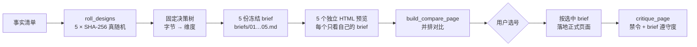
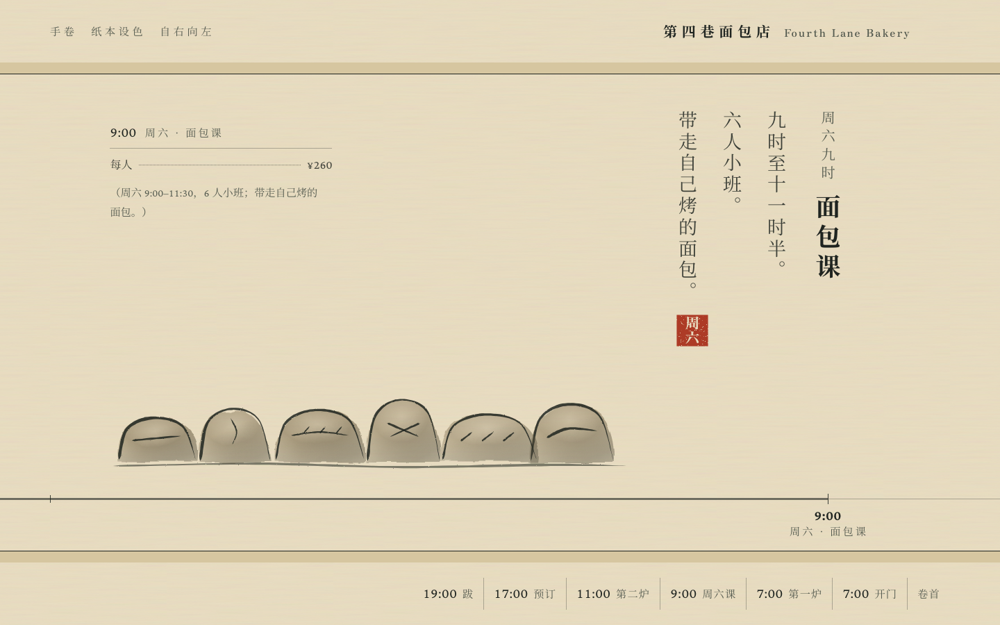
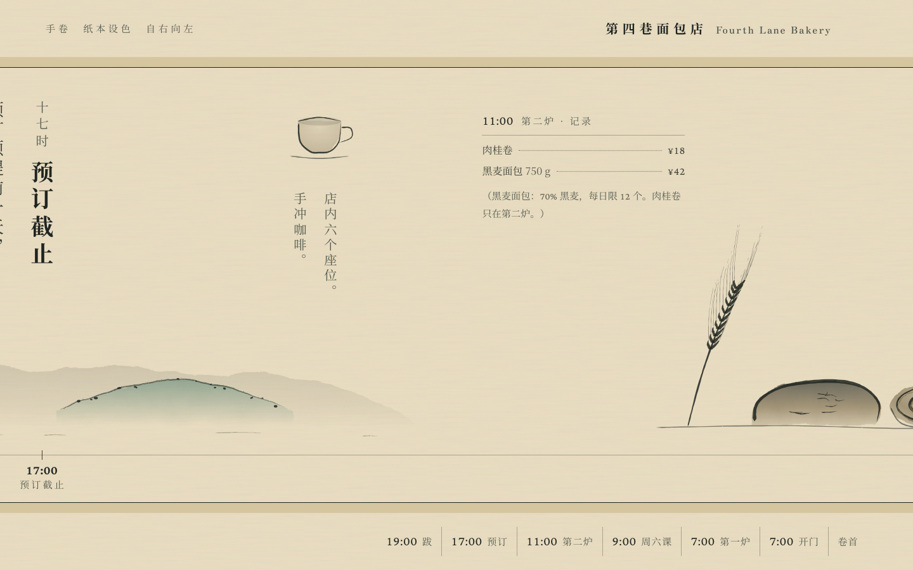
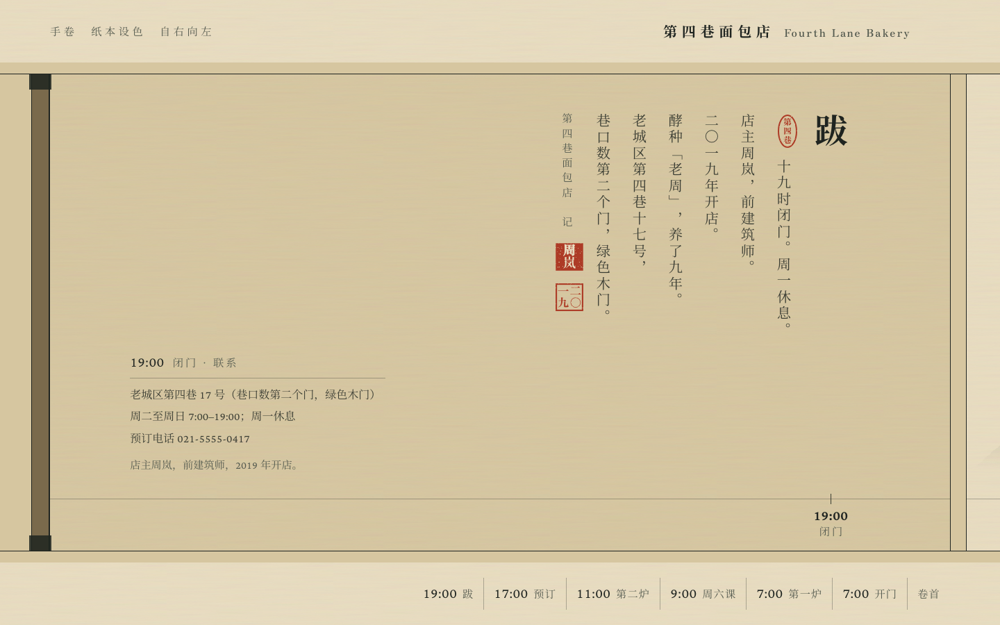

# hash-design

[English](README.md) | **简体中文** | [日本語](README.ja.md) | [한국어](README.ko.md) | [Español](README.es.md)

[](https://github.com/qybaihe/hash-design/actions/workflows/ci.yml)
[](https://github.com/qybaihe/hash-design/actions/workflows/pages.yml)
[](https://qybaihe.github.io/hash-design/fourth-lane-bakery/compare.html)
[](LICENSE)
[](.nvmrc)
[](#安装)

**用真随机哈希替 AI 定设计方向，不让模型自己挑风格。**
核心库 + MCP server（stdio）+ Agent Skill + CLI，TypeScript 实现。


<p align="center"><sub>同一份事实清单，掷出 5 个方向：公文表格 · 包豪斯 · 水墨印章 · Riso 双色套印 · 港式招牌。<br><a href="https://qybaihe.github.io/hash-design/fourth-lane-bakery/compare.html"><b>打开在线对比页 →</b></a></sub></p>

---

## 目录

- [在线演示](#在线演示) · [为什么](#为什么) · [它怎么工作](#它怎么工作) · [一份 brief 里有什么](#一份-brief-里有什么)
- [安装](#安装) · [配置 MCP](#配置-mcp) · [安装 Skill](#安装-skill) · [开始使用](#开始使用)
- [MCP 工具](#mcp-工具) · [CLI](#cli) · [作为库使用](#作为库使用) · [分支库](#分支库40) · [全局禁令](#全局禁令)
- [示例详解](#示例第四巷面包店) · [开发](#开发) · [文档](#文档) · [已知局限](#已知局限) · [参与贡献](#参与贡献)

## 在线演示

- **并排对比页**：<https://qybaihe.github.io/hash-design/fourth-lane-bakery/compare.html>（按 1–5 放大，D/M 切换桌面/手机）
- **示例首页**：<https://qybaihe.github.io/hash-design/>
- **本地打开**：`open examples/fourth-lane-bakery/compare.html`

5 个预览分别是 [公文表格](https://qybaihe.github.io/hash-design/fourth-lane-bakery/previews/01-bureaucratic-form.html) · [包豪斯](https://qybaihe.github.io/hash-design/fourth-lane-bakery/previews/02-bauhaus-primary.html) · [水墨印章](https://qybaihe.github.io/hash-design/fourth-lane-bakery/previews/03-ink-and-seal.html) · [Riso 双色套印](https://qybaihe.github.io/hash-design/fourth-lane-bakery/previews/04-risograph-duotone.html) · [港式招牌](https://qybaihe.github.io/hash-design/fourth-lane-bakery/previews/05-hk-shop-sign.html)。截图、brief 和每个方向的说明见下文[示例：第四巷面包店](#示例第四巷面包店)。

## 为什么

让 LLM "做一个好看的页面"，结果几乎总会塌缩到同一种众数审美：Inter 字体、紫蓝渐变、居中大标题配两个按钮、三张一模一样的 feature 卡、毛玻璃、emoji 图标，再配上 Unlock / Seamless / Supercharge 之类的空话。原因很简单：模型只要能自己选，就会选训练数据里最常见的那一种。

hash-design 不去求模型"更有品味"，而是**把选择权拿走**：

1. 用系统真随机掷出 5 个哈希（`crypto.randomBytes(32)` → SHA-256）；
2. 每个哈希通过一棵**固定、可复现的决策树**映射到一个具体的设计方向：设计流派、版式、字体对、色值、密度、动效、母题、首屏锚点、字号比例、材质、文案语气、一个"变数"；
3. 每个方向输出一份**冻结的 brief**，里面有可以直接粘贴的 token（字体链接、色值、`tokens.css`、栅格、圆角/阴影策略），以及全局禁令；
4. Agent 只负责**忠实执行** brief，分别做出 5 个独立的 HTML 预览，再做一个并排对比页，然后**停下来等你选号**；
5. 你选中一个后，Agent 按那份 brief 做出正式页面，并用 `critique_page` 自检。

本质上，这是用**外部随机约束**打破模型的默认审美，跟 KV cache、温度采样都没有关系。模型的品味只用在执行质量上，比如对齐、节奏、细节和可读性，而不是用来挑风格。

## 它怎么工作



### 字节 → 维度（`hash-design/v1`）

| 字节  | 维度            | 规则                                                                              |
| ----- | --------------- | --------------------------------------------------------------------------------- |
| 0–1   | 设计分支 branch | `uint16(b0,b1) mod N`（N = 40）。碰撞时向后走，见下文                             |
| 2     | 文案语气 voice  | 14 种：店主黑板、田野笔记、技术手册、亲笔信、展签、配方、分类广告、时刻表、历书…… |
| 3     | 版式 layout     | 分支内 3 选 1，带栅格数值和自上而下的分节草图                                     |
| 4     | 字体对 type     | 分支内 3 选 1：display / body（/ mono）+ 中文字体 + 排版细则                      |
| 5     | 配色 palette    | 分支内 3 选 1：paper / ink / muted / accent / accent2 / rule / panel 七个 hex     |
| 6     | 密度 density    | 分支允许的子集：疏朗 / 常规 / 紧凑 / 满版                                         |
| 7     | 动效 motion     | 分支内 3 选 1：时长、缓动、reduced-motion 策略                                    |
| 8     | 母题 motif      | 分支内 3 选 1                                                                     |
| 9     | 首屏锚点 anchor | 分支内 3 选 1                                                                     |
| 10    | 字号比例 scale  | 分支允许的模数比例（1.125–1.618）                                                 |
| 11    | 材质 surface    | 分支内 3 选 1（带 CSS 提示）                                                      |
| 12    | 变数 twist      | 16 种，例如"数字即主角""唯一越界""首屏无按钮""版权页式页脚"                       |
| 13–31 | 未使用          | 记录在 brief 里，保留给以后的维度                                                 |

- **碰撞与家族分散**：同一次掷骰里，若某个哈希落到已用过的分支，就向后走（+1、+2…）到下一个空闲分支。只要还有没用到的**家族**（印刷品 / 文档票据 / 标识招牌 / 屏幕仪器 / 手作东方 / 现代主义），落到已用家族的分支也算碰撞。所以 5 个方向一定来自 5 个不同家族，不会出现 5 张纸质文档的情况。走过的步数记为 `probe`，ref 写成 `<hash>+<probe>`，单独拿出来也能复现。
- **分支顺序**：库的顺序就是映射顺序。每个家族的成员均匀分布在整圈上，所以"向后走"分走的概率不会集中到某一个分支上（5 连抽时，每个分支的出现率在 9%–17% 之间，均匀分布是 12.5%）。
- **约束**会先过滤候选池，再应用字节，所以约束也是设计身份的一部分：`light_only`、`dark_only`、`reduced_motion`、`brand_colors`（品牌色替换 accent，自动挑色相最近的调色板，并给出对比度）、`families`、`include_branches`、`exclude_branches`。
- **可复现**：同一个 `ref`、同样的约束、同一个库指纹，一定得到同一份 brief。每份 brief 都记录了算法版本（`hash-design/v1`）和库指纹（数据的 SHA-256 前 12 位）。
- `seed` **只用来复现示例和测试**，真实使用一律走系统随机。

完整规范和逐字节推演示例见 [docs/mapping.zh-CN.md](docs/mapping.zh-CN.md)。

## 一份 brief 里有什么

以示例 [#3 水墨印章](examples/fourth-lane-bakery/briefs/03-ink-and-seal.md) 为例，一份 brief 包含：

- 映射过程表，逐字节列出公式和结果
- 内容：只能用的事实清单
- 文案语气及其修辞手段、版式（栅格数值和分节顺序）、首屏锚点
- 字体：Google Fonts `<link>`（中文页面会带上中文字体），以及按模数比例算出的字号阶梯
- 7 个色值、用色比例、WCAG 对比度表（哪个颜色只能做大字或装饰）
- 密度、圆角、边框、阴影策略、材质（含 CSS 片段）、母题、动效规格
- 变数（twist）、分支的必须/不要，以及 14 条全局禁令
- 可直接粘贴的 `tokens.css`，以及交付前自检清单

brief 是写给 Agent 看的，标题中英双语。`language`（`zh` 或 `en`，默认根据 subject 和 facts 自动判断）决定概念说明和执行指令用哪种语言，以及是否加载中文字体。文案语气、变数等部分描述目前只有中文。

## 安装

> 目前**尚未发布到 npm**，请先用源码方式安装。两个包的 `package.json` 已经可以发布（CI 中会跑 `npm pack --dry-run`），发布后可以直接用 `npx -y hash-design-mcp` 和 `npx -y hash-design`。

需要 Node.js ≥ 20（开发用的 `.nvmrc` 固定为 22）。

```bash
git clone https://github.com/qybaihe/hash-design.git
cd hash-design
npm install
npm run build
# MCP server 入口：packages/mcp/dist/bin.js
# CLI 入口：       packages/core/dist/bin.js
```

## 配置 MCP

下面的 `/ABS/PATH/hash-design` 换成你 clone 的绝对路径。

### Claude Code

```bash
claude mcp add hash-design -- node /ABS/PATH/hash-design/packages/mcp/dist/bin.js
```

或者在项目根目录提交一个 `.mcp.json`：

```json
{
  "mcpServers": {
    "hash-design": {
      "command": "node",
      "args": ["/ABS/PATH/hash-design/packages/mcp/dist/bin.js"]
    }
  }
}
```

### Cursor

`.cursor/mcp.json`（项目级）或 `~/.cursor/mcp.json`（全局），结构相同：

```json
{
  "mcpServers": {
    "hash-design": {
      "command": "node",
      "args": ["/ABS/PATH/hash-design/packages/mcp/dist/bin.js"]
    }
  }
}
```

### Claude Desktop

`~/Library/Application Support/Claude/claude_desktop_config.json`（macOS）或 `%APPDATA%\Claude\claude_desktop_config.json`（Windows），结构同上。Claude Desktop 启动 server 时的工作目录不是你的项目目录，所以调用 `roll_designs` 时请给 `out_dir` 传**绝对路径**。

## 安装 Skill

Skill 告诉 Agent 何时使用、按什么顺序调用 MCP、怎样独立渲染、什么时候必须停下。

```bash
# 装到某个项目（同时写 .claude/skills 和 .cursor/skills）
node packages/core/dist/bin.js skill install --target both --dir /path/to/your/project
# 装到用户目录（所有项目可用）
node packages/core/dist/bin.js skill install --target claude --global
```

也可以手动复制 [`skills/hash-design/SKILL.md`](skills/hash-design/SKILL.md) 到 `.claude/skills/hash-design/SKILL.md`（Claude Code）或 `.cursor/skills/hash-design/SKILL.md`（Cursor）。本仓库自带这两份副本，测试保证它们和源文件一致。

## 开始使用

装好 MCP server 和 Skill 后，直接对 Agent 说：

> 用 hash-design 给「第四巷面包店」做一个一页站。事实：周二至周日 7:00–19:00 营业，周一休息；乡村面包 ¥38……

Agent 会依次掷骰、冻结 brief、做 5 个预览、生成 `design/hash-design/compare.html`，然后停下来等你回复编号。支持 MCP prompt 的客户端也可以直接用 `hash-design` 这个 prompt（参数 `subject`、`facts`、`count`）启动同样的流程。

## MCP 工具

| 工具                 | 作用                                                                                                                                                                                 |
| -------------------- | ------------------------------------------------------------------------------------------------------------------------------------------------------------------------------------ |
| `roll_designs`       | 输入 `subject`、`facts`、`count`（默认 5），可选 `seed`、`language` 和约束。返回 5 个哈希、映射过程和 5 份 brief。传 `out_dir` 会把 `roll.json`、`ROLL.md`、`briefs/*.md` 冻结到磁盘 |
| `get_brief`          | 按 `ref`（`<hash>` 或 `<hash>+<probe>`）加同样的约束复现 brief，支持 Markdown 或 JSON                                                                                                |
| `list_branches`      | 列出 40 个设计分支，可按家族过滤                                                                                                                                                     |
| `get_branch`         | 查看一个分支的全部选项和 token                                                                                                                                                       |
| `critique_page`      | 输入 HTML 字符串或文件路径，按禁令和 AI 味清单打分；带 `brief_ref` 或 `roll_path`+`pick` 时还会给出对 brief 的遵守度                                                                 |
| `build_compare_page` | 根据 `roll.json` 生成并排对比页 `compare.html`                                                                                                                                       |

资源：`hash-design://bans`、`hash-design://workflow`（即 SKILL.md）、`hash-design://branches`、`hash-design://branch/{id}`。Prompt：`hash-design`（参数为 `subject`、`facts`、`count`）。

每个参数、返回格式和对应的 CLI 命令见 [docs/mcp-tools.zh-CN.md](docs/mcp-tools.zh-CN.md)。

## CLI

```bash
hash-design roll --subject "第四巷面包店" --facts-file facts.md --out design/hash-design   # 真随机 5 个方向
hash-design roll --subject "…" --light-only --brand "#c8102e" --format json            # 带约束
hash-design brief <ref> [constraints]                                                 # 复现 brief
hash-design branches [--family craft]                                                 # 分支库
hash-design branch ink-and-seal                                                       # 分支详情
hash-design critique page.html --roll design/hash-design/roll.json --pick 3 --fail-under 80
hash-design compare --roll design/hash-design/roll.json                               # 生成 compare.html
hash-design skill install --target both                                               # 安装 Skill
```

源码安装时用 `node packages/core/dist/bin.js …` 运行（也可以在仓库根目录执行 `alias hash-design="node $PWD/packages/core/dist/bin.js"`）。`hash-design --help` 列出所有命令，`hash-design <command> --help`（例如 `hash-design roll --help`）列出单个命令的全部参数，包括约束参数 `--light-only`、`--dark-only`、`--reduced-motion`、`--brand`、`--family`、`--include`、`--exclude`。

## 作为库使用

```ts
import { roll, renderBrief, critiquePage, reproduce, parseRef } from 'hash-design';

const r = roll({ content: { subject: '第四巷面包店', facts: ['周一休息', '乡村面包 ¥38'] } });
for (const [i, d] of r.designs.entries()) console.log(renderBrief(d, r.content, { number: i + 1 }));

const design = reproduce(parseRef(r.designs[0].ref), r.constraints);
const report = critiquePage({ html: '<!doctype html>…', design });
console.log(report.score, report.adherence, report.findings);
```

发布到 npm 之前，可以从源码目录导入（`packages/core/dist/index.js`），或者把本地目录装成依赖（`npm install /ABS/PATH/hash-design/packages/core`）。

## 分支库（40）

每个分支都是一个真实世界的设计门类，而不是"SaaS 风格"。每个维度有 3 个具体选项，写明字体对（Google Fonts + 中文）、7 个 hex、栅格数值、圆角/边框/阴影策略、动效规格、母题和材质。完整目录见 [docs/branches.md](docs/branches.md)，也可以用 `list_branches` / `get_branch` 查询。

| 家族               | 分支                                                                                                        |
| ------------------ | ----------------------------------------------------------------------------------------------------------- |
| 印刷品 print       | 超市促销单 · 凸版木活字 · 复印小志 · Riso 双色套印 · 唱片封套 · 赛事秩序册 · 时装画册 · 大报版面 · 杂志编辑 |
| 文档票据 document  | 工程图版 · 账本 · 票根 · 学术论文 · 药房标签 · 公文表格 · 热敏小票 · 植物标本 · 野外图鉴                    |
| 标识招牌 signage   | 交通导视 · 港式招牌 · 餐馆菜单板 · 美术馆图录 · 地形图                                                      |
| 屏幕仪器 screen    | 终端荧光 · 早期个人主页 · 游戏说明书 · 工业仪表 · 粗野原生                                                  |
| 手作东方 craft     | 菜谱卡 · 手作温度 · 水墨印章 · 老黄历 · 余白 · 方格实验本                                                   |
| 现代主义 modernist | 瑞士网格 · 包豪斯 · 构成主义海报 · 装饰艺术 · 七十年代超级图形 · 孟菲斯                                     |

数据由测试和脚本强制约束：

- 不得使用禁用字体，fallback 里也不行
- ink/paper 对比度 ≥ 7:1，muted/paper ≥ 4.5:1
- 每个分支至少有一套浅色调色板
- 不得使用框架默认色值
- 同一个 display 字体最多用于 3 个分支
- 任意两个分支的首选调色板（paper + accent）不得相同
- 每个字体 URL 都能在 Google Fonts 解析：`node scripts/verify-fonts.mjs`，235/235 通过

## 全局禁令

每份 brief 都会抄录这 14 条，`critique_page` 能自动检测其中每一条：

| id                          | 禁止                                                                                                   |
| --------------------------- | ------------------------------------------------------------------------------------------------------ |
| `generic-sans`              | Inter、Roboto、Poppins、Montserrat、DM Sans、Space Grotesk 等 23 个默认无衬线；只用 system-ui 当"设计" |
| `purple-blue-gradient`      | 紫/靛/蓝渐变、渐变文字、彩色光斑                                                                       |
| `centered-hero-two-buttons` | 居中大标题 + 副标题 + 主按钮/幽灵按钮                                                                  |
| `identical-cards`           | 3/4/6 张同构的"图标 + 标题 + 两行字"卡片                                                               |
| `glassmorphism`             | `backdrop-filter` 毛玻璃                                                                               |
| `emoji-icons`               | emoji 当图标；拿通用图标库当装饰                                                                       |
| `buzzword-copy`             | Unlock / Seamless / Supercharge / 赋能 / 一站式 / 极致体验……                                           |
| `soft-shadow-rounded`       | 处处 12–24px 圆角 + 柔和大投影                                                                         |
| `invented-facts`            | "10K+ 用户""Trusted by"、带头像的假评价                                                                |
| `tailwind-default-palette`  | `#6366f1` `#8b5cf6` `#0f172a` 这类框架默认色                                                           |
| `scroll-fade-everything`    | 每段都滚动淡入上浮                                                                                     |
| `pill-badge-sparkle`        | 标题上方的 "New ✨" 胶囊                                                                               |
| `placeholder-content`       | Lorem ipsum、图库人像、随机 Unsplash                                                                   |
| `template-sections`         | Hero → Features → Testimonials → Pricing → FAQ 套路                                                    |

`critique_page` 另外还会检查文字对比度（< 3:1）、`viewport`、`lang`、`img alt`、有动效时是否缺少 `prefers-reduced-motion`，以及对 brief 的遵守度：字体、色值、圆角和阴影策略。它是静态检查，抓不到"首屏是否真的是 brief 的锚点""语气对不对"这类问题，这些仍然需要人看或 Agent 对照 brief 自查。

## 示例：第四巷面包店

[`examples/fourth-lane-bakery/`](examples/fourth-lane-bakery) 是一次完整的端到端运行：先写[事实清单](examples/fourth-lane-bakery/facts.md)（虚构店铺），再掷骰得到 5 份 brief，按 Skill 流程分别由 5 个**互相看不到对方**的子 Agent 各做一个预览，最后生成并排对比页。过程记录见[示例说明](examples/fourth-lane-bakery/README.md)。

<!-- EXAMPLES:START -->

### 01 · 公文表格 Bureaucratic form

<a href="https://qybaihe.github.io/hash-design/fourth-lane-bakery/previews/01-bureaucratic-form.html"></a> 

`51a76d00` · 版式 Numbered field form · 字体 IBM Plex Sans Condensed / IBM Plex Sans · 配色 Dropout-ink green · 语气 词条 · 变数 粗线分区 · critique **96/100**，brief 遵守度 **100/100** · [brief](examples/fourth-lane-bakery/briefs/01-bureaucratic-form.md)

首屏是表头：巨大的表号 IV-17（第四巷 17 号），配上编号、年度和"仅供内部填写"的红章。所有事实都填进带编号的字段、勾选格和价目表；每一部分下面的注释写成词条。

### 02 · 包豪斯 Bauhaus primary

<a href="https://qybaihe.github.io/hash-design/fourth-lane-bakery/previews/02-bauhaus-primary.html"></a> 

`4f1cc0f2` · 版式 Bauhausbuch cover · 字体 League Spartan / Kumbh Sans · 配色 Primaries on cream · 语气 问答访谈 · 变数 版权页式页脚 · critique **96/100**，brief 遵守度 **100/100** · [brief](examples/fourth-lane-bakery/briefs/02-bauhaus-primary.md)

首屏是包豪斯丛书封面：巨大的数字"4"、黄三角、蓝圆和红方形正片叠底。价格做成黑色条形图，问答体分章，页脚是信息最密的版权页。

### 03 · 水墨印章 Ink and seal

<a href="https://qybaihe.github.io/hash-design/fourth-lane-bakery/previews/03-ink-and-seal.html"></a> 

`7f18e1dc` · 版式 Handscroll (手卷) · 字体 Zen Antique / Crimson Pro · 配色 Blue-green landscape on silk · 语气 田野笔记 · 变数 时间为骨 · critique **100/100**，brief 遵守度 **100/100** · [brief](examples/fourth-lane-bakery/briefs/03-ink-and-seal.md)

自右向左展开的手卷：首屏是白文大印"第四巷面包店"配一行竖排地址和营业时间，往后按时间顺序是 5 段水墨小景，底部是时间轴索引。手机上变成立轴。

### 04 · Riso 双色套印 Risograph duotone

<a href="https://qybaihe.github.io/hash-design/fourth-lane-bakery/previews/04-risograph-duotone.html"></a> 

`bde66a3f` · 版式 Overprint poster · 字体 Unbounded / Familjen Grotesk · 配色 Bright red + green on white · 语气 历书 · 变数 数字即主角 · critique **100/100**，brief 遵守度 **100/100** · [brief](examples/fourth-lane-bakery/briefs/04-risograph-duotone.md)

Riso 套印海报：颗粒红日与绿色大字叠印出第三种墨色，并有刻意的错版。按历书口吻写宜忌，所有数字放大成主角。

### 05 · 港式招牌 Hong Kong shop sign

<a href="https://qybaihe.github.io/hash-design/fourth-lane-bakery/previews/05-hk-shop-sign.html"></a> 

`42c248e7` · 版式 Projecting sign stack · 字体 Antonio / Hanken Grotesk · 配色 Neon street at night · 语气 技术手册 · 变数 数字即主角 · critique **96/100**，brief 遵守度 **100/100** · [brief](examples/fourth-lane-bakery/briefs/05-hk-shop-sign.md)

港式招牌：右侧一块红漆竖招牌"第四巷面包店"从视口顶端垂下，左侧是"面包 咖啡"横招牌和巨大的出炉时刻；写成技术手册口吻，霓虹灯管是线描，不发光。

<details><summary>#3 手卷的后几段（桌面横向滚动）</summary>

 
 

</details>

手机宽度下的对比页（`?device=mobile`）：


<!-- EXAMPLES:END -->

复现这次掷骰：

```bash
npm run build
node packages/core/dist/bin.js roll --subject "第四巷面包店" \
  --facts-file examples/fourth-lane-bakery/facts.md --seed fourth-lane-bakery --out /tmp/fourth-lane
# MCP 等价调用：roll_designs { subject, facts, seed: "fourth-lane-bakery" }，得到相同的 5 个 ref
```

## 开发

```bash
npm install
npm run build        # tsc -b，两个包
npm test             # vitest：核心、CLI、MCP（in-memory transport）、Skill/文档一致性
npm run check        # typecheck + lint + prettier + test
npm run sync         # 改数据后重新生成 SKILL.md 的禁令块、.claude/.cursor 副本、docs/branches.md
node scripts/smoke.mjs        # 真实 stdio 上的 MCP + CLI 冒烟测试（CI 会跑）
node scripts/verify-fonts.mjs # 联网检查所有字体 URL（不在 CI 里跑）
npm run screenshots           # Playwright 截图示例（需 npx playwright install chromium）
```

CI 在 Node 20、22、24 上跑 build、typecheck、lint、格式检查、测试、stdio 冒烟测试和 `npm pack --dry-run`。

仓库结构：

```
packages/core/           # npm: hash-design —— 数据、映射、brief、critique、对比页、CLI
  src/data/bans.ts       #   全局禁令、禁用字体、空话词表
  src/data/pools.ts      #   密度、比例、14 种文案语气、16 个变数
  src/data/branches/     #   40 个分支（index.ts 定义映射顺序）
  src/mapping.ts         #   哈希 → 设计（决策树、碰撞、约束）
  src/brief.ts           #   brief 渲染（Markdown / JSON）
  src/critique.ts        #   AI 味静态检查
  src/compare.ts         #   并排对比页
  src/cli.ts             #   CLI
packages/mcp/            # npm: hash-design-mcp —— stdio MCP server
skills/hash-design/      # Skill 源文件（.claude/ 和 .cursor/ 下为同步副本）
examples/                # 完整示例：事实 → roll → 5 brief → 5 预览 → 对比页 → 截图
docs/                    # 架构、映射规范、MCP 参考、分支库目录（生成）
scripts/                 # sync / smoke / verify-fonts / screenshot / prepack
```

添加分支、修改数据的流程见 [CONTRIBUTING.md](CONTRIBUTING.md)（英文，附中文摘要）。

## 文档

- [docs/architecture.zh-CN.md](docs/architecture.zh-CN.md)：包结构、数据流、设计取舍、测试
- [docs/mapping.zh-CN.md](docs/mapping.zh-CN.md)：`hash-design/v1` 映射、碰撞、约束、可复现性
- [docs/mcp-tools.zh-CN.md](docs/mcp-tools.zh-CN.md)：全部 MCP 工具、资源和 prompt，以及对应的 CLI 命令
- [docs/branches.md](docs/branches.md)：40 个分支的目录（自动生成，中英双语）
- English: [Architecture](docs/architecture.md) · [Mapping spec](docs/mapping.md) · [MCP tools](docs/mcp-tools.md)

## 已知局限

- 还没有发布到 npm（`package.json` 已经准备好，`npm pack --dry-run` 在 CI 中验证）。
- `critique_page` 是启发式静态分析，只读内联 `<style>`、`style=""` 和你额外传入的 CSS，不渲染页面，也不解析外链样式表。
- 分支库目前是 40 个；增删分支会改变映射，库指纹可以检测到这一点，但旧 ref 需要对应版本才能复现。
- 中文字体依赖 Google Fonts 在线加载。网络受限的环境需要自托管字体，或者改用 brief 里的 fallback。
- "好不好看"最终仍取决于执行 brief 的模型和人。这个工具解决的是"不要都长一个样"，而不是替代设计判断。

## 参与贡献

欢迎贡献，尤其是新的设计分支。请先读 [CONTRIBUTING.md](CONTRIBUTING.md)，里面讲了数据规则、`npm run sync`，以及为什么改数据就要重新掷示例。请遵守[行为准则](CODE_OF_CONDUCT.md)；安全问题请按 [SECURITY.md](SECURITY.md) 私下报告。版本变更见 [CHANGELOG.md](CHANGELOG.md)。

## 许可证

[MIT](LICENSE) © qybaihe
