# 示例：二号桥单车铺

一次完整的 hash-design 运行，对象是一家开在桥洞下的单车修理铺，页面写给中文读者。店铺、人物和数字都是虚构的，事实见 [facts.md](facts.md)。

- **在线对比页**：<https://qybaihe.github.io/hash-design/bridge-two-bikes/compare.html>（按 1–5 放大，D/M 切换桌面/手机）
- **全部示例**：<https://qybaihe.github.io/hash-design/>

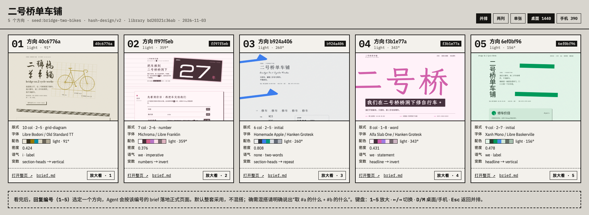

## 过程

1. **掷骰。** 用 `hash-design/v2`，库指纹 `bd20321c36ab`。seed 就是文件夹名，只掷了一次、没有重掷；它只用来让示例可复现，真实使用时不要传 `--seed`。

   ```bash
   npm run build
   node packages/core/dist/bin.js roll --subject "二号桥单车铺" \
     --facts-file examples/bridge-two-bikes/facts.md --seed bridge-two-bikes \
     --out examples/bridge-two-bikes
   ```

   MCP 的等价调用 `roll_designs { subject, facts, seed: "bridge-two-bikes", out_dir }` 得到同样的 5 个 ref；`npm run example:roll -- bridge-two-bikes` 按 [`scripts/examples.mjs`](../../scripts/examples.mjs) 里的清单运行同一条命令。

2. **冻结。** 掷骰写出 [roll.json](roll.json)、[ROLL.md](ROLL.md) 和 [briefs/](briefs)。从这一刻起 brief 是冻结的规格；`examples.test.ts` 检查每份 brief 都和它的 ref 复现出来的一字不差。

3. **渲染。** 按 [Skill](../../skills/hash-design/SKILL.md) 的第 4–5 步，每个预览由一个看不到其他预览的独立子 Agent 完成：只读自己的 brief 和 `facts.md`，写一个自包含 HTML 文件（内联 CSS 和 SVG，不用图片和框架），至少两轮用 critique 和 Playwright 截图自检。复查中 #2 在第一次 critique 后把事实里没有的区块编号 01/03/04 换成了中文小标签；#4 在 640 px 以下隐藏了桥的线描（标签会缩到约 6 px），同样的事实在上面的列表里都有。

4. **自检。** `npm run example:critique -- bridge-two-bikes`，或单页 `hash-design critique previews/NN-*.html --roll roll.json --pick N --facts-file facts.md`：

   | # | ref | 标题 / 正文字体 | critique | brief 遵守度 |
   | --- | --- | --- | --- | --- |
   | 1 | `40c6776a` | Libre Bodoni / Old Standard TT | 100 | 100 |
   | 2 | `ff97f5eb` | Michroma / Libre Franklin | 100 | 100 |
   | 3 | `b924a406` | Homemade Apple / Hanken Grotesk | 100 | 100 |
   | 4 | `f3b1e77a` | Alfa Slab One / Hanken Grotesk | 100 | 100 |
   | 5 | `6ef0bf96` | Xanh Mono / Libre Baskerville | 100 | 100 |

   5 个预览都没有 critical、major 或 minor 问题。

5. **对比。** `hash-design compare --roll examples/bridge-two-bikes/roll.json` 写出 [compare.html](compare.html)。

6. **挑选。** Skill 在这里停下，等用户回复编号。示例到此为止。

## 5 个方向

### 01 · Libre Bodoni / Old Standard TT

<a href="https://qybaihe.github.io/hash-design/bridge-two-bikes/previews/01-40c6776a.html">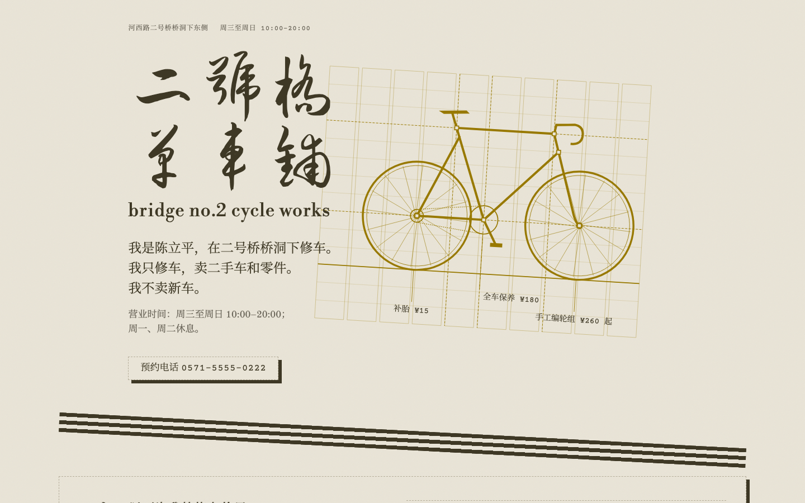</a> 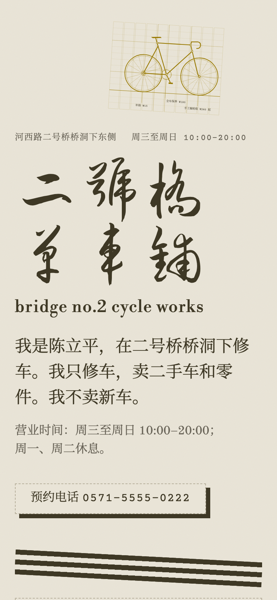

`40c6776a` · 浅色纸，色相 91° · 10 栏网格 · 首屏锚点 grid-diagram · 变数：The section headings: set vertically (writing-mode: vertical-rl). · [brief](briefs/01-40c6776a.md)

首屏 80% 视口高：第 2–5 栏是 Liu Jian Mao Cao 毛笔字的「二号桥单车铺」、小写 Bodoni 的「bridge no.2 cycle works」、三句第一人称短句、营业时间和电话。锚点是赭色的、页面自己的 10 栏网格，上面画了一辆自行车，车架节点落在网格交点上，三个标签标出补胎、全车保养和手工编轮组的价格。五个虚线框之间是三条 3° 的细条纹，每个框的标题按变数竖排。

### 02 · Michroma / Libre Franklin

<a href="https://qybaihe.github.io/hash-design/bridge-two-bikes/previews/02-ff97f5eb.html">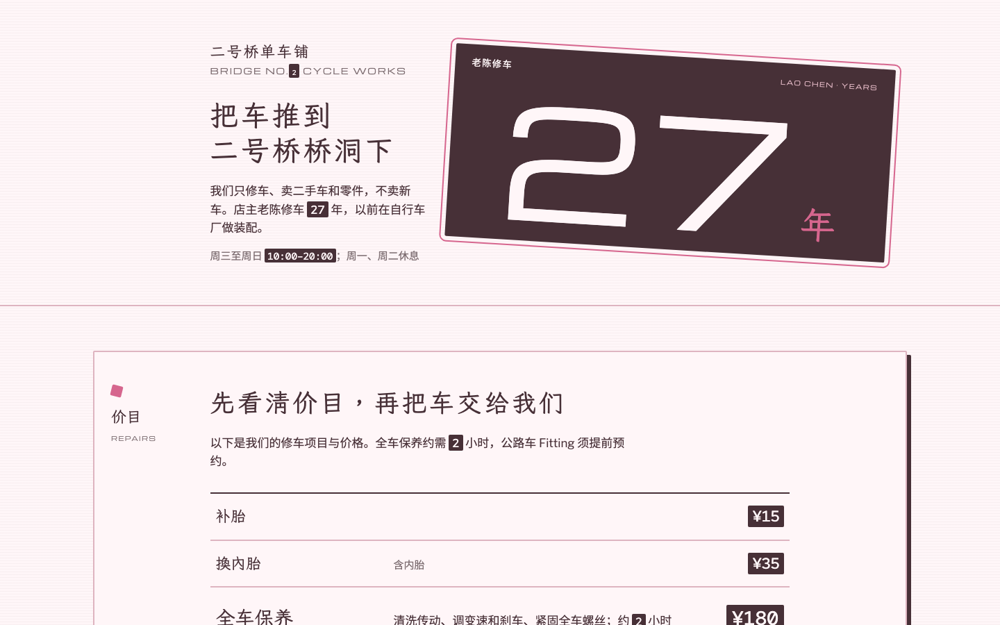</a> 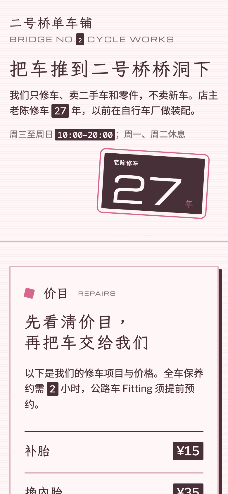

`ff97f5eb` · 浅色纸，色相 359° · 7 栏网格 · 首屏锚点 number · 变数：Every number on the page: inverted: paper-coloured on ink. · [brief](briefs/02-ff97f5eb.md)

首屏是浅粉色带，店名和「把车推到二号桥桥洞下」在第 2–3 栏；锚点是 Michroma 的「27」（老陈修车 27 年），墨底纸色、粉色描边和粉色的「年」，宽 44%、倾斜 3.5°。变数把页面上每个阿拉伯数字（价格、时间、电话、No.2 的 2）都排成墨底纸色的等宽字；14° 的小方块行隔开五个带框区块，夜骑那一节把 24 公里的环线画成 24 个方块。

### 03 · Homemade Apple / Hanken Grotesk

<a href="https://qybaihe.github.io/hash-design/bridge-two-bikes/previews/03-b924a406.html">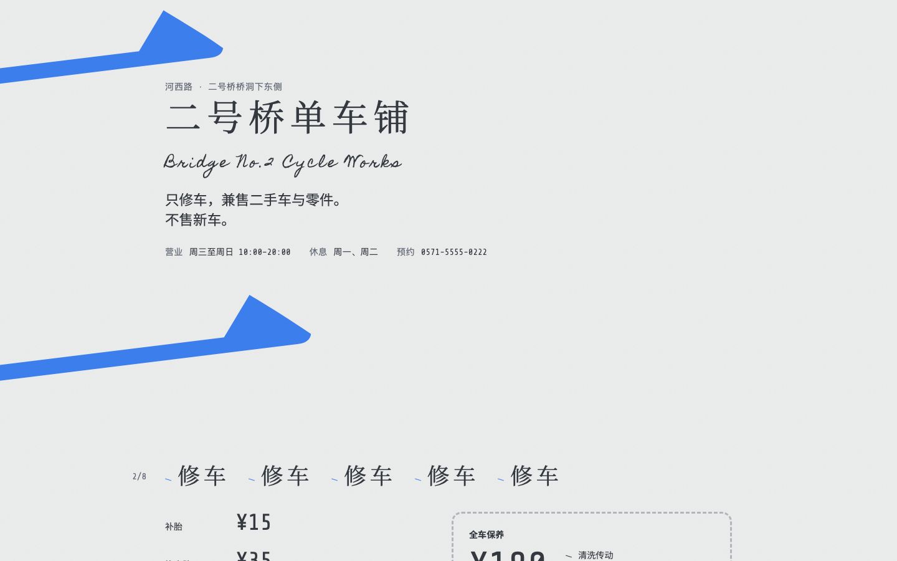</a> 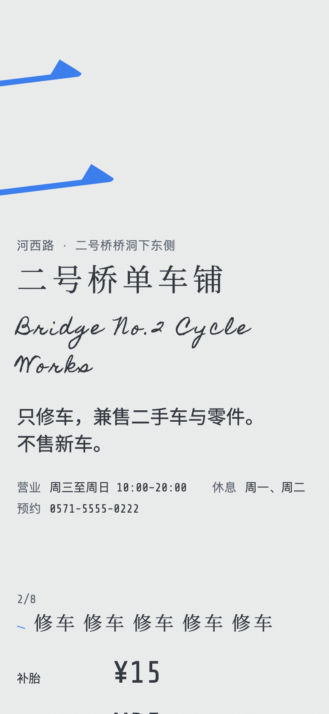

`b924a406` · 浅色纸，色相 260° · 6 栏网格 · 首屏锚点 initial · 变数：Repeat the section headings 5 times in a row. · [brief](briefs/03-b924a406.md)

首屏是一个巨大的蓝色「二」（Noto Serif SC），旋转 −7°，中心在 7%，左半边被切掉；店名、营业时间和电话放在两笔之间。变数让下面七个小标题每个都连续印五遍（顶部店名只印一次，文件里有说明），10 px、倾斜 17° 的短线标在小标题和列表项前。

### 04 · Alfa Slab One / Hanken Grotesk

<a href="https://qybaihe.github.io/hash-design/bridge-two-bikes/previews/04-f3b1e77a.html">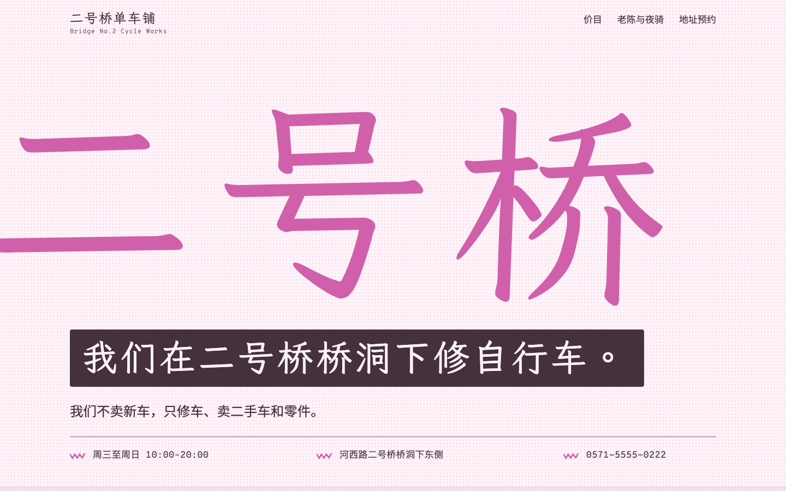</a> 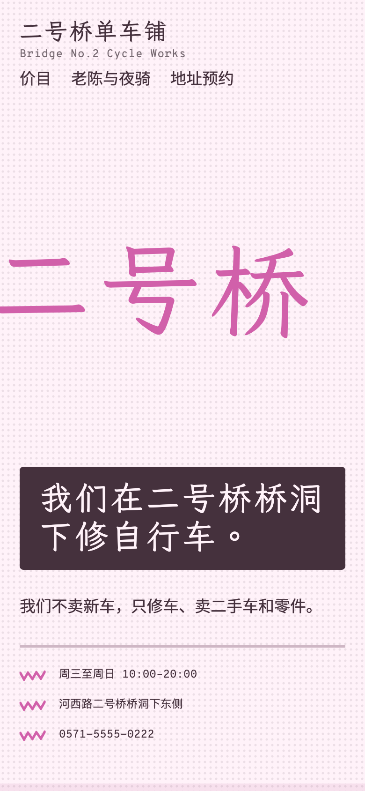

`f3b1e77a` · 浅色纸，色相 343° · 8 栏网格 · 首屏锚点 word · 变数：The main headline: inverted: paper-coloured on ink. · [brief](briefs/04-f3b1e77a.md)

首屏是粉色 LXGW WenKai 的「二号桥」，宽 90%，「二」从左边出血，倾斜 1.5°，载入时擦入一次；变数把主标题「我们在二号桥桥洞下修自行车。」排成墨底纸色的一条。下面三条色带依次是价目表、老陈和周四夜骑、地址和桥的线描，每个标题和列表项前都有转 177° 的粉色锯齿。

### 05 · Xanh Mono / Libre Baskerville

<a href="https://qybaihe.github.io/hash-design/bridge-two-bikes/previews/05-6ef0bf96.html">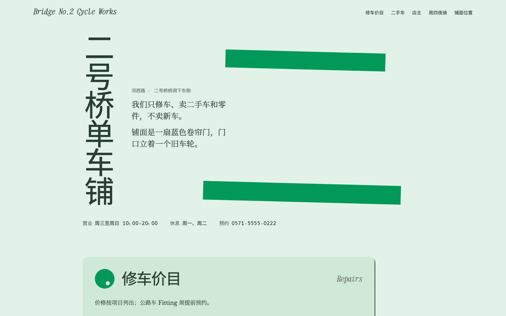</a> 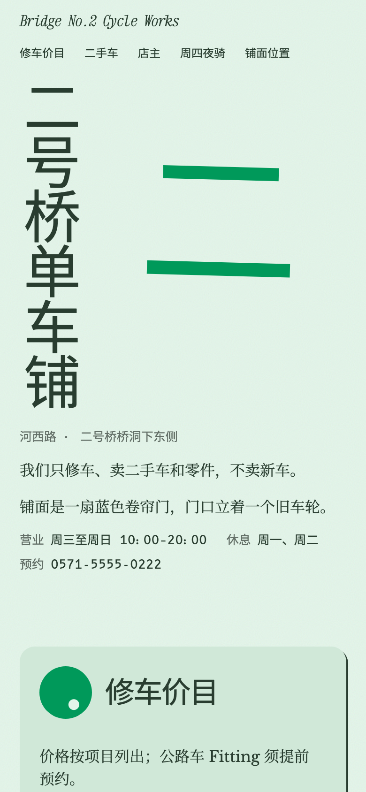

`6ef0bf96` · 浅色纸，色相 156° · 9 栏网格 · 首屏锚点 initial · 变数：The main headline: set vertically (writing-mode: vertical-rl). · [brief](briefs/05-6ef0bf96.md)

首屏 75% 视口高：绿色的「二」（Noto Sans SC），宽 44%、中心在 60%、转 1.5°，载入时用 40 ms 的 clip-path 擦入；变数把「二号桥单车铺」竖排在第 2 栏，两句开场白夹在锚点的两笔之间，营业时间和电话沿底边排开。下面五个面板盒子在第 2–7 栏，16 px 圆角加 2 px 硬阴影，标题和价目行用带气门孔的圆点标记。
