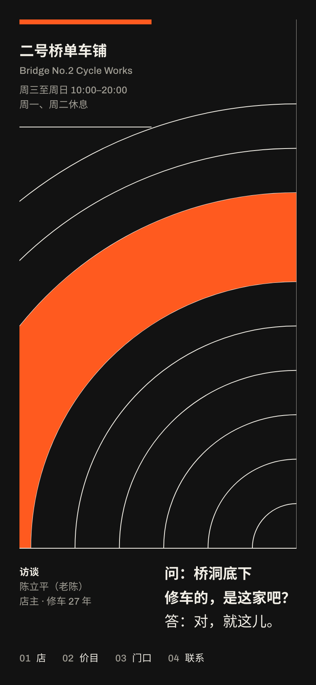
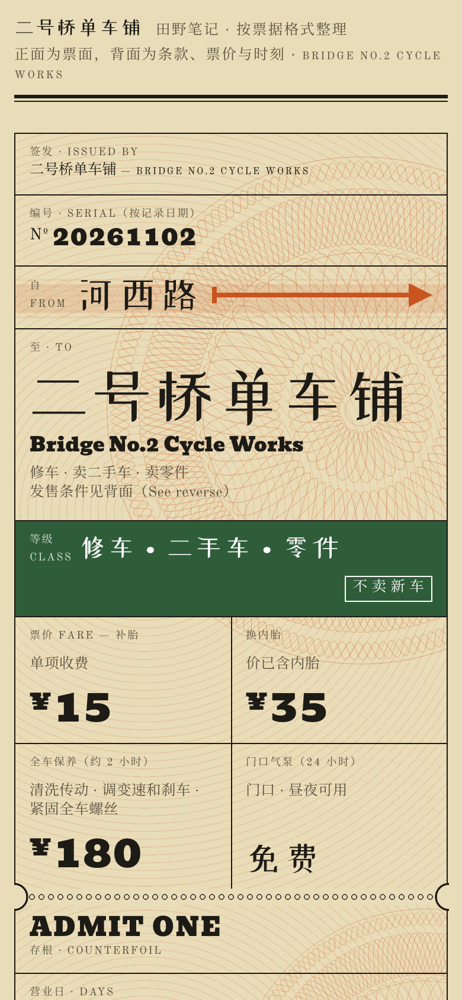
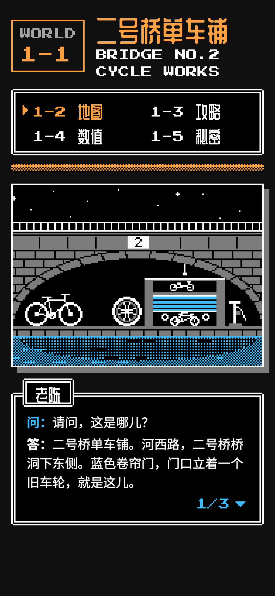
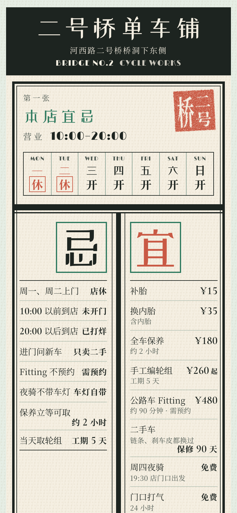

# 示例：二号桥单车铺

> [!NOTE]
> 这次运行用的是 **hash-design/v1**，即 40 个风格分支的库；hash-design/v2 已经用连续参数取代了它。这里作为一次真实运行的记录保留。它的 ref 和 brief 只能用 v1 复现：先检出一个 v1 提交（例如 `475ba16`），再在那里运行下面的命令。在 v2 下，同一个 seed 会掷出不同的方向。

一次完整的 hash-design 运行，对象是一家开在桥洞下的单车修理铺，页面写给中文读者。店铺、人物和数字都是虚构的，事实见 [facts.md](facts.md)。

- **在线对比页**：<https://qybaihe.github.io/hash-design/bridge-two-bikes/compare.html>（按 1–5 放大，D/M 切换桌面/手机）
- **全部示例**：<https://qybaihe.github.io/hash-design/>


## 过程

1. **掷骰**：固定 seed 只是为了让示例可复现，真实使用请去掉 `--seed`。

   ```bash
   npm run build
   node packages/core/dist/bin.js roll --subject "二号桥单车铺" \
     --facts-file examples/bridge-two-bikes/facts.md --seed bridge-two-bikes-5 \
     --out examples/bridge-two-bikes
   ```

   MCP 等价调用是 `roll_designs { subject, facts, seed: "bridge-two-bikes-5", out_dir }`，得到的 5 个 ref 完全相同。`npm run example:roll -- bridge-two-bikes` 会按 [`scripts/examples.mjs`](../../scripts/examples.mjs) 里的登记执行同一条命令。

   **为什么是 `-5`**：示例的 seed 规则是依次试 `<名字>`、`<名字>-2`、`<名字>-3`……取第一个与之前所有示例都不撞分支的。`bridge-two-bikes` 掷出了面包店用过的水墨印章，`-2` 撞了 Sluice 的终端荧光和美术馆图录，`-3` 撞了公文表格，`-4` 撞了 4 个，`-5` 是第一个干净的。这只是为了让 4 个示例互不重复；真实使用时**不要因为不喜欢结果而重掷**。

2. **冻结**：生成 [roll.json](roll.json)、[ROLL.md](ROLL.md) 和 [briefs/](briefs)。从这一刻起 brief 就是规格。

3. **渲染**：按 [Skill](../../skills/hash-design/SKILL.md) 第 3 步，5 个预览分别由 5 个**互相看不到对方**的子 Agent 完成。每个子 Agent 只读自己那一份 brief 加 facts.md，产出单文件 HTML（内联 CSS 和 SVG，没有图片也没有框架），并用 critique 加 Playwright 截图自检至少两轮。

4. **自检**：`npm run example:critique -- bridge-two-bikes`，或逐页 `hash-design critique previews/NN-*.html --roll roll.json --pick N`

   | #   | 分支                       | critique | brief 遵守度 | 保留的 minor                                                 |
   | --- | -------------------------- | -------- | ------------ | ------------------------------------------------------------ |
   | 1   | 瑞士网格 swiss-grid        | 96       | 100          | 章节编号 01–04、联系条目 04.1–04.5                           |
   | 2   | 时装画册 couture-lookbook  | 96       | 100          | Look 编号与页码 01–06                                        |
   | 3   | 票根 ticket-stub           | 96       | 100          | 流水号 Nº 20261102 与日期戳：brief 要求流水号取自真实日期，用的是记录当天 |
   | 4   | 游戏说明书 game-manual     | 100      | 100          | —                                                            |
   | 5   | 老黄历 chinese-almanac     | 100      | 100          | —                                                            |

   没有 critical 和 major。剩下的 minor 都是"数字不在事实里"这条检查，命中的是版式要求的编号。

5. **对比**：`hash-design compare --roll examples/bridge-two-bikes/roll.json` 生成 [compare.html](compare.html)。

6. **选号**：Skill 规定在这里停下，等用户回复编号。示例到此为止。

## 5 个方向

### 01 · 瑞士网格 Swiss grid

<a href="https://qybaihe.github.io/hash-design/bridge-two-bikes/previews/01-swiss-grid.html"></a> 

`0377a498` · 版式 Numbered index · 字体 Archivo / Archivo · 配色 Tonhalle night · 语气 问答访谈 · 变数 首屏无按钮 · [brief](briefs/01-swiss-grid.md)

首屏是几何场：一组同心细线半圆就是那座桥的拱，圆心落在网格线上，一条橙色四分之一圆带被竖向网格线切断，旁边一个蓝色圆点。4 个章节（店 / 价目 / 门口 / 联系）各由一个巨大的橙色编号领起；每节末尾是一段和老陈的问答，最后以"（访谈完）"收尾。整页没有一个按钮，电话只在第 04 节以普通文字链接出现。

### 02 · 时装画册 Couture lookbook

<a href="https://qybaihe.github.io/hash-design/bridge-two-bikes/previews/02-couture-lookbook.html"></a> 

`92818df9+1` · 版式 Look sequence · 字体 Italiana / Cormorant Garamond · 配色 Noir & champagne · 语气 田野笔记 · 变数 强调色配给 · [brief](briefs/02-couture-lookbook.md)

首屏左半边是一个约 70vh 高的香槟色 Italiana "2"，11px 的 "BRIDGE NO." 贴着它的基线，字号的极端对比本身读成"二号桥"；右半边只留三行说明。之后是 Look 序列：吊着前轮的二手车、周四夜骑的一句话、门口气泵和手编轮组的细节。强调色全页只用三次：金色的"2"、LOOK 01 的深红底、金色的电话号码。

### 03 · 票根 Ticket stub

<a href="https://qybaihe.github.io/hash-design/bridge-two-bikes/previews/03-ticket-stub.html"></a> 

`a4906350+1` · 版式 Oversized card ticket · 字体 Bevan / Old Standard TT · 配色 Buff railway card · 语气 田野笔记 · 变数 首屏无按钮 · [brief](briefs/03-ticket-stub.md)

首屏是一张巨大的硬卡火车票：自"河西路"一支红箭头指向"二号桥单车铺"，绿色等级带写着"修车 · 二手车 · 零件 / 不卖新车"，票价格里是补胎、换内胎、保养和免费打气；右侧存根是营业时间，日期章斜盖在角上。票背面拆成甲联到庚联的各种副券：发售条件、价目表、时刻表、夜骑车票和预约联，底纹是 SVG 画的防伪花纹。

### 04 · 游戏说明书 Game manual

<a href="https://qybaihe.github.io/hash-design/bridge-two-bikes/previews/04-game-manual.html"></a> 

`40257aad` · 版式 Strategy-guide spread · 字体 Press Start 2P / Chakra Petch · 配色 Title-screen black · 语气 问答访谈 · 变数 分节编号 · [brief](briefs/04-game-manual.md)

8-bit 攻略本：首屏是像素画的二号桥夜景，桥洞下是半开的蓝色卷帘门、门口的旧车轮和气泵，下方是带"老陈"名牌的对话框，按 ▼ 或 A 键逐条说出事实。后面是 WORLD 1-2 地图（河西路、江、夜骑路线）、1-3 攻略、1-4 数值（价格条以 ¥480 为满格，老陈状态栏 LV 27 = 修车 27 年）和 1-5 秘密：门口 24 小时免费气泵。

### 05 · 老黄历 Chinese almanac

<a href="https://qybaihe.github.io/hash-design/bridge-two-bikes/previews/05-chinese-almanac.html"></a> 

`67d7ad96+1` · 版式 Tear-off day sheet · 字体 Limelight / Cormorant Garamond · 配色 Celadon poster · 语气 配方步骤 · 变数 粗线分区 · [brief](briefs/05-chinese-almanac.md)

一页木刻版式的老黄历：表头是一周七天，周一、周二盖着红色"休"字；中间版心两侧是巨大的"忌"和"宜"，各领一列八条事项和价格。往后每一张撕页的大日期数字都来自事实：180 元、5 天、480 元、90 天保修、24 公里、27 年。每张下半部分按菜谱写法拆成配料、做法、火候和小贴士，章节之间用粗细双线分隔。事实里没有年份和月份，所以表头只写星期。

## 文件

```
facts.md            事实清单（唯一允许出现在页面上的内容）
roll.json / ROLL.md 5 个哈希、映射、约束、每份 brief 的 JSON
briefs/             5 份冻结 brief
previews/           5 个预览页
compare.html        并排对比页
screenshots/        每个预览的桌面首屏 / 整页 / 手机，对比页（桌面、手机宽度）
```

截图用 `npm run screenshots` 生成（需要先 `npx playwright install chromium`）。[`packages/core/test/examples.test.ts`](../../packages/core/test/examples.test.ts) 保证这里的 roll、brief 和 critique 分数与当前数据一致。
