# Example: Causeway

A full hash-design run for an English-language event page: Causeway, a one-day music festival on an island that you can only walk to at low tide. The festival, the island, the artists and the numbers are fictional; the facts are in [facts.md](facts.md).

- **Live compare page:** <https://qybaihe.github.io/hash-design/causeway-festival/compare.html> (press 1–5 to zoom, D/M to switch desktop/mobile)
- **All examples:** <https://qybaihe.github.io/hash-design/>

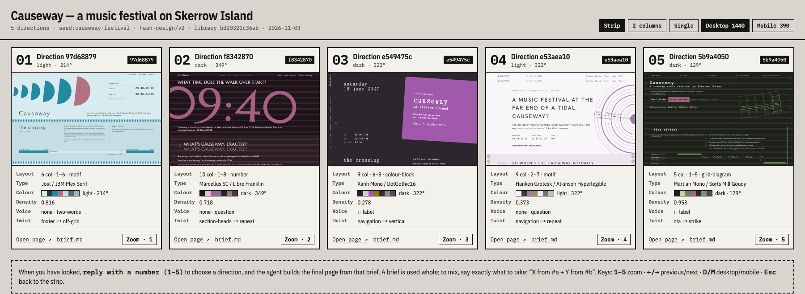

## Process

1. **Roll.** The roll uses `hash-design/v2` with library `bd20321c36ab`. The seed is the folder name and was used once, with no re-rolls; it only makes the example reproducible, so leave `--seed` out in real use.

   ```bash
   npm run build
   node packages/core/dist/bin.js roll --subject "Causeway — a music festival on Skerrow Island" \
     --facts-file examples/causeway-festival/facts.md --seed causeway-festival \
     --out examples/causeway-festival
   ```

   The MCP equivalent, `roll_designs { subject, facts, seed: "causeway-festival", out_dir }`, returns the same five refs, and `npm run example:roll -- causeway-festival` runs the same command from [`scripts/examples.mjs`](../../scripts/examples.mjs).

2. **Freeze.** The roll writes [roll.json](roll.json), [ROLL.md](ROLL.md) and [briefs/](briefs). From here on the briefs are fixed specs; `examples.test.ts` checks that each one is exactly what its ref reproduces.

3. **Render.** Following steps 4–5 of the [Skill](../../skills/hash-design/SKILL.md), each preview was built by its own sub-agent that could not see the others. Each one read only its brief and `facts.md`, wrote one self-contained HTML file (inline CSS and SVG, no images, no frameworks) and checked itself with the critique and Playwright screenshots at least twice. In review, #4 scored 92 on its first critique (clock-hour axis labels and section numbers that the facts don’t contain, and one shadow read as blurred) and replaced all three; #2 swapped its first anchor, “1.2 km”, for “09:40” because the bleed hid the “1”; #3 moves its block inwards below 640 px so the headline fits.

4. **Critique.** `npm run example:critique -- causeway-festival`, or per page `hash-design critique previews/NN-*.html --roll roll.json --pick N --facts-file facts.md`:

   | # | ref | display / body | critique | brief adherence |
   | --- | --- | --- | --- | --- |
   | 1 | `97d68879` | Jost / IBM Plex Serif | 100 | 100 |
   | 2 | `f8342870` | Marcellus SC / Libre Franklin | 100 | 100 |
   | 3 | `e549475c` | Xanh Mono / DotGothic16 | 100 | 100 |
   | 4 | `e53aea10` | Hanken Grotesk / Atkinson Hyperlegible | 100 | 100 |
   | 5 | `5b9a4050` | Martian Mono / Sorts Mill Goudy | 100 | 100 |

   No critical, major or minor findings on any of the five.

5. **Compare.** `hash-design compare --roll examples/causeway-festival/roll.json` writes [compare.html](compare.html).

6. **Pick.** The Skill stops here and waits for the user to reply with a number. The example ends here.

## The five directions

### 01 · Jost / IBM Plex Serif

<a href="https://qybaihe.github.io/hash-design/causeway-festival/previews/01-97d68879.html">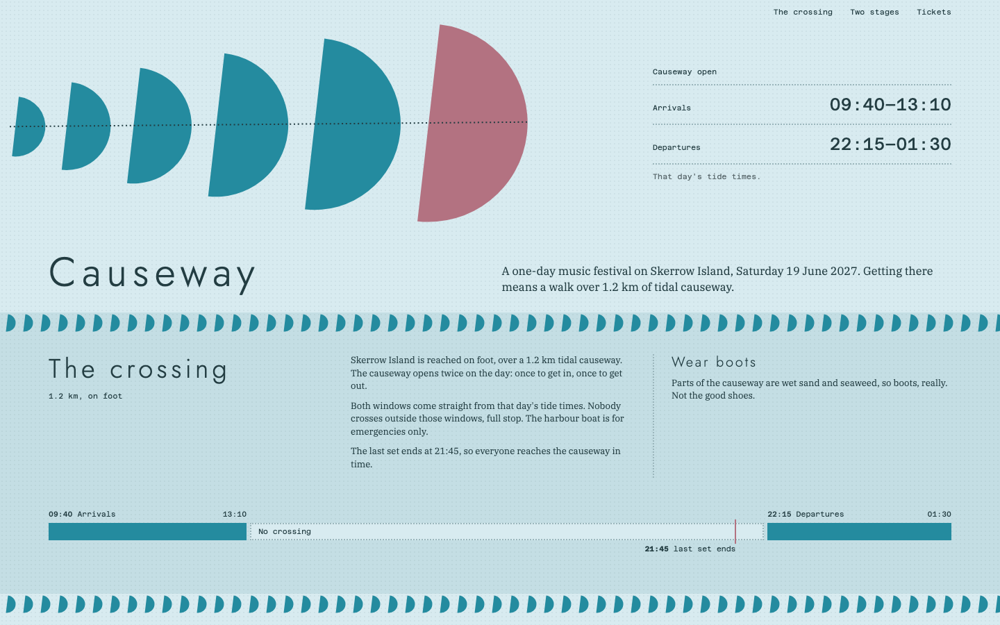</a> 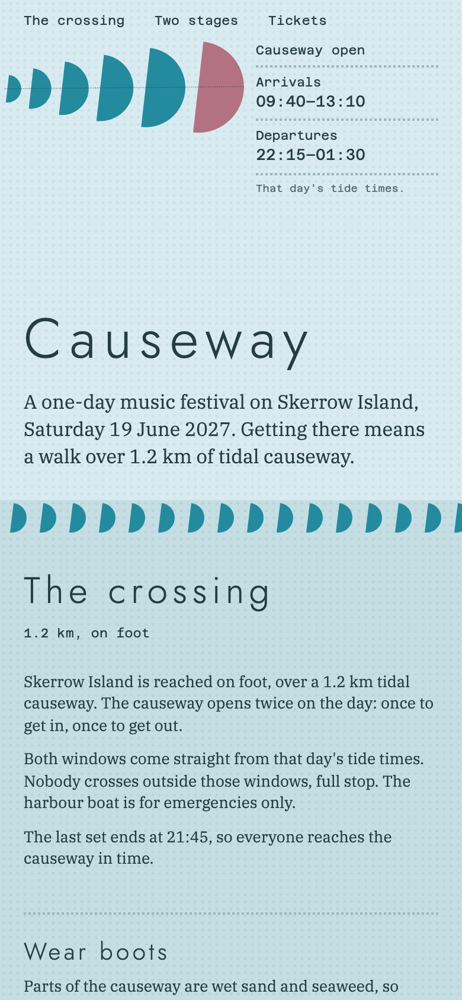

`97d68879` · light paper, hue 214° · 6-column grid · anchor: motif · twist: Push the footer 2 columns off the grid. · [brief](briefs/01-97d68879.md)

The anchor fills the left half of the first screen: six teal half circles, each turned 97°, growing along a dotted causeway line, the last and largest one rose for the island. The tide windows sit beside it in mono, with “Causeway” in light, widely spaced Jost. Rows of small half circles divide three bands (the crossing with a timeline of the open windows, the stages, tickets), and the dark footer is pushed two columns to the right, its overhang clipped.

### 02 · Marcellus SC / Libre Franklin

<a href="https://qybaihe.github.io/hash-design/causeway-festival/previews/02-f8342870.html">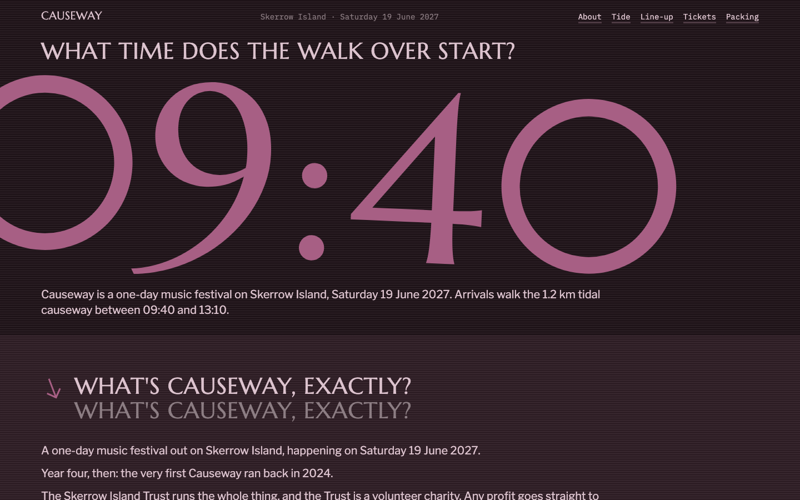</a> 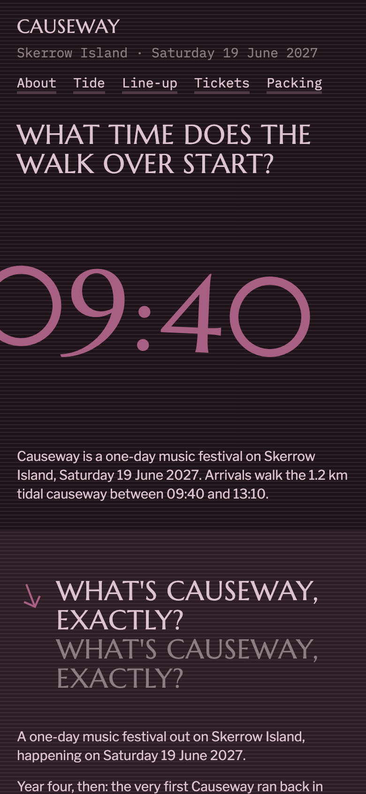

`f8342870` · dark paper, hue 349° · 10-column grid · anchor: number · twist: Repeat the section headings 2 times in a row. · [brief](briefs/02-f8342870.md)

A dark page that asks “What time does the walk over start?” over a huge mauve “09:40”, 93% of the width, so it runs off the left edge into the leading zero. Every section heading appears twice, the second copy in grey, and arrows tilted 69° mark the headings, the tide windows and the line-up.

### 03 · Xanh Mono / DotGothic16

<a href="https://qybaihe.github.io/hash-design/causeway-festival/previews/03-e549475c.html">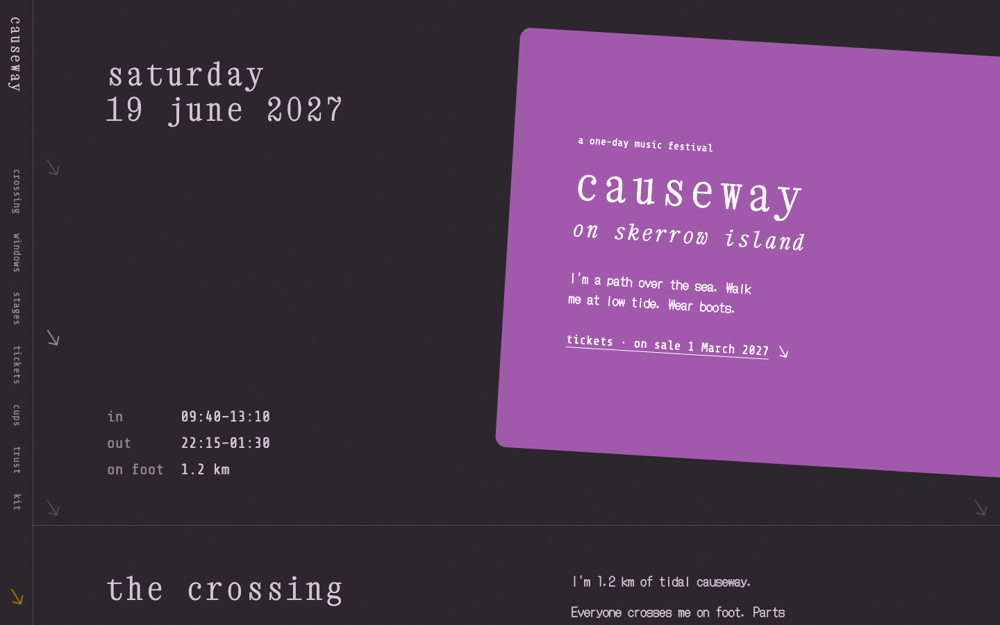</a> 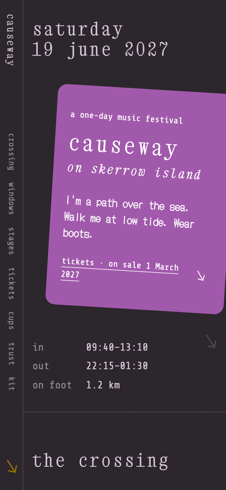

`e549475c` · dark paper, hue 322° · 9-column grid · anchor: colour-block · twist: The navigation: set vertically (writing-mode: vertical-rl). · [brief](briefs/03-e549475c.md)

Dark grain with the navigation set vertically down the left edge at every width. A rotated purple block, 88% of the width, runs off the right edge and holds the lowercase “causeway” headline, one first-person line and a single tickets link; small arrows at 57° run down both page edges. Below 640 px the block’s centre moves inwards so the headline fits, which the file notes.

### 04 · Hanken Grotesk / Atkinson Hyperlegible

<a href="https://qybaihe.github.io/hash-design/causeway-festival/previews/04-e53aea10.html">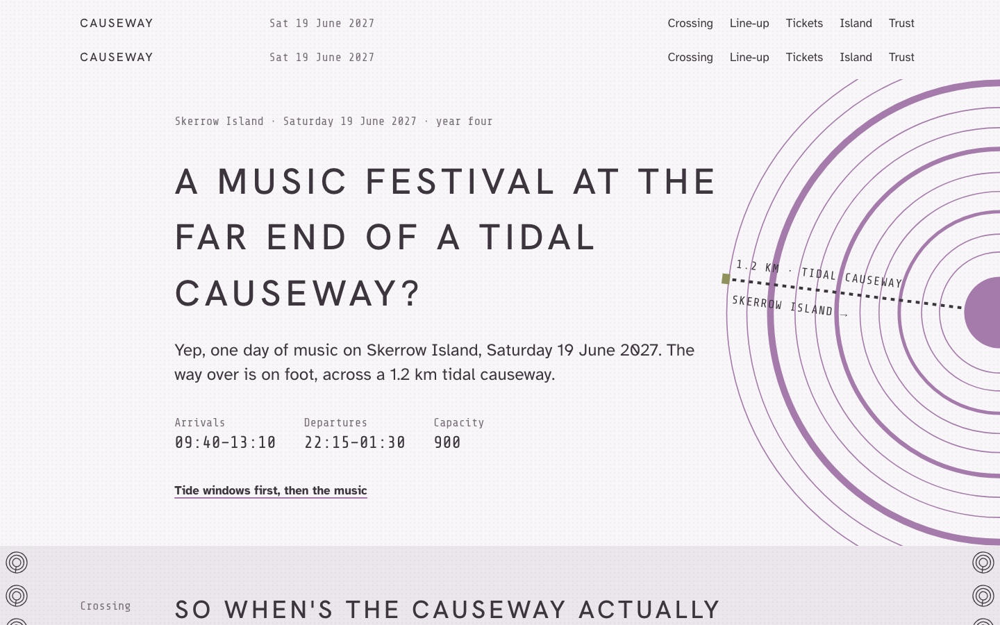</a> 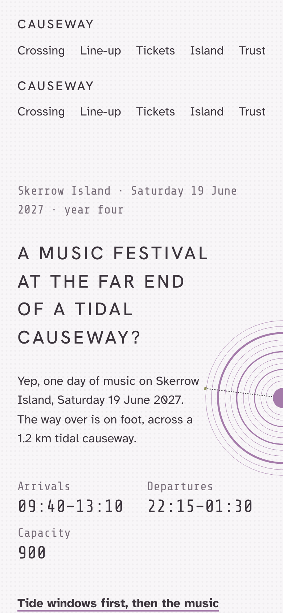

`e53aea10` · light paper, hue 322° · 9-column grid · anchor: motif · twist: Repeat the navigation 2 times in a row. · [brief](briefs/04-e53aea10.md)

Two identical navigation bars stacked at the top (the twist). The question headline “A music festival at the far end of a tidal causeway?” sits in columns 2–7 beside a large set of mauve concentric rings, centred on the right edge with a dotted causeway line across it; small ring sets with a tick at 97° run down both edges of six alternating bands.

### 05 · Martian Mono / Sorts Mill Goudy

<a href="https://qybaihe.github.io/hash-design/causeway-festival/previews/05-5b9a4050.html">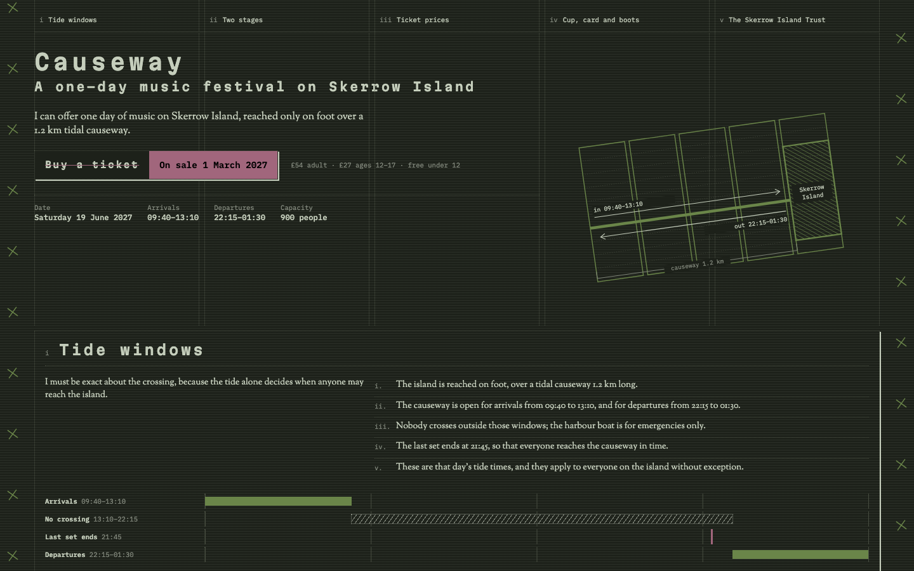</a> 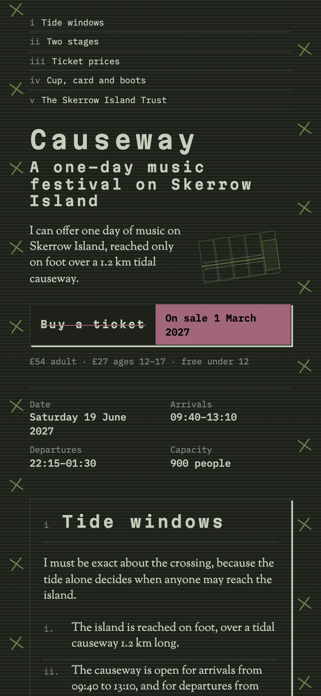

`5b9a4050` · dark paper, hue 129° · 5-column grid · anchor: grid-diagram · twist: The primary call to action: struck through, with the correction set beside it. · [brief](briefs/05-5b9a4050.md)

Five section links sit one per grid column over faint dotted column guides, above “Causeway” in tracked Martian Mono, one first-person sentence and the key facts. The anchor is the page’s own 5-column grid redrawn as a map, a green causeway line crossing to a hatched Skerrow Island with the tide windows and “1.2 km” marked. The ticket button is struck through in mauve with “On sale 1 March 2027” beside it.
