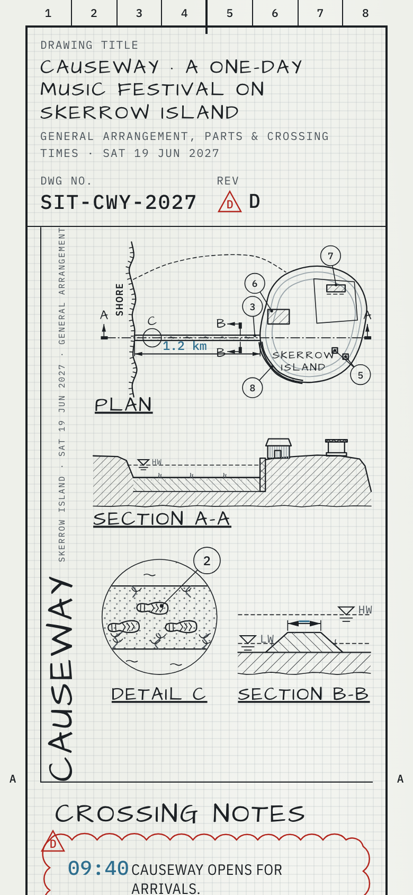
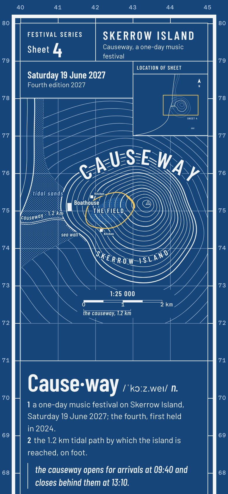
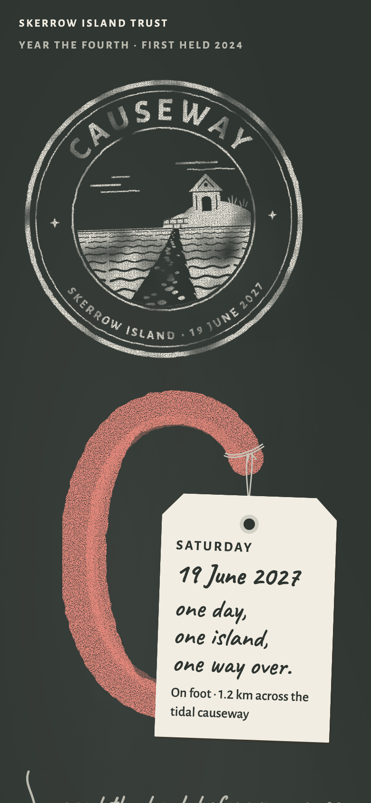
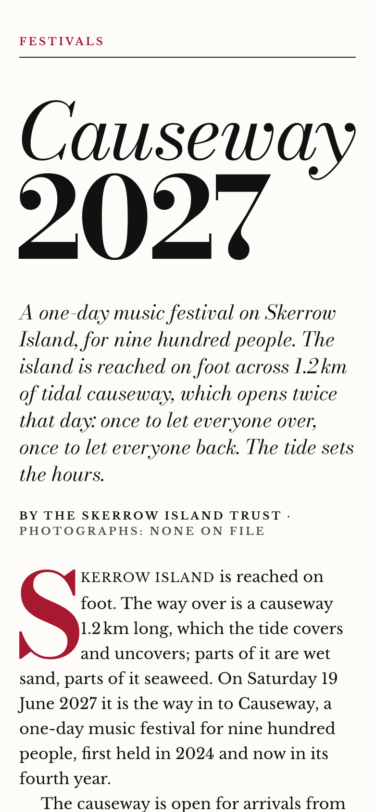
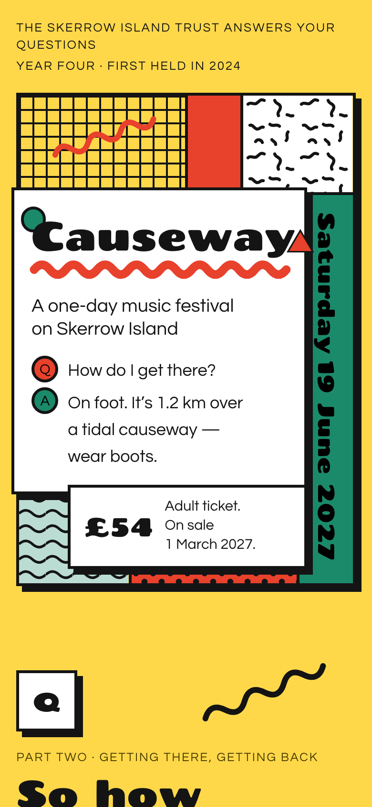

# Example: Causeway

A full hash-design run for an English-language event page: Causeway, a one-day music festival on an island that you can only walk to at low tide. The festival, the island, the artists and the numbers are fictional; the facts are in [facts.md](facts.md).

- **Live compare page:** <https://qybaihe.github.io/hash-design/causeway-festival/compare.html> (press 1–5 to zoom, D/M to switch desktop/mobile)
- **All examples:** <https://qybaihe.github.io/hash-design/>


## Process

1. **Roll.** The fixed seed only makes the example reproducible; leave `--seed` out in real use.

   ```bash
   npm run build
   node packages/core/dist/bin.js roll --subject "Causeway — a music festival on Skerrow Island" \
     --facts-file examples/causeway-festival/facts.md --seed causeway-festival-6 \
     --out examples/causeway-festival
   ```

   The MCP equivalent, `roll_designs { subject, facts, seed: "causeway-festival-6", out_dir }`, returns the same five refs. `npm run example:roll -- causeway-festival` runs the same command from the list in [`scripts/examples.mjs`](../../scripts/examples.mjs).

   **Why `-6`:** the seed rule for the examples is to try `<name>`, `<name>-2`, `<name>-3`, … and keep the first seed whose five branches appear in no earlier example. `causeway-festival` rolled risograph duotone (used by the bakery) and gallery catalogue (used by Sluice); `-2`, `-3` and `-5` also overlapped the bakery or Sluice, and `-4` was clean against those two but shared Swiss grid and Chinese almanac with Bridge No.2. `-6` was the first clean seed. This only keeps the four examples apart; in real use, **don't re-roll because you dislike a result**.

2. **Freeze.** The roll writes [roll.json](roll.json), [ROLL.md](ROLL.md) and [briefs/](briefs). From here on the briefs are fixed specs.

3. **Render.** Following step 3 of the [Skill](../../skills/hash-design/SKILL.md), each preview was built by its own sub-agent that could not see the others. Each one read only its brief and `facts.md`, wrote one self-contained HTML file (inline CSS and SVG, no images, no frameworks), and checked itself with the critique and Playwright screenshots at least twice. In review, #1 was sent back once to remove a "mainland" label and a compass direction that the facts don't give.

4. **Critique.** `npm run example:critique -- causeway-festival`, or per page `hash-design critique previews/NN-*.html --roll roll.json --pick N`:

   | #   | Branch             | critique | brief adherence | Minor findings kept                                                                  |
   | --- | ------------------ | -------- | --------------- | ------------------------------------------------------------------------------------ |
   | 1   | Engineering plate  | 96       | 100             | parts-list sub-items 6.1–6.4 and 7.1–7.4 (one per act)                               |
   | 2   | Topographic map    | 96       | 100             | margin grid figures, six-figure grid references, legend numbers, the 1:25 000 scale |
   | 3   | Warm handmade      | 100      | 100             | —                                                                                    |
   | 4   | Editorial magazine | 96       | 100             | accession number "2027.4" (the 2027 edition, the fourth year)                        |
   | 5   | Memphis pop        | 100      | 100             | —                                                                                    |

   No critical or major findings. Every minor finding is the "number not in the facts" check firing on numbering that the genre or the brief asks for.

5. **Compare.** `hash-design compare --roll examples/causeway-festival/roll.json` writes [compare.html](compare.html). For an English roll the page's labels are English.

6. **Pick.** The Skill stops here and waits for the user to reply with a number. The example ends here.

## The five directions

### 01 · Engineering plate

<a href="https://qybaihe.github.io/hash-design/causeway-festival/previews/01-engineering-plate.html"></a> 

`c7893950` · layout Exploded assembly · type Architects Daughter / IBM Plex Sans Condensed · palette Drafting vellum · voice field notes · twist vertical text once · [brief](briefs/01-engineering-plate.md)

The festival as a drawing sheet with zones 1–8 and A–F: a plan of the island and the 1.2 km causeway with the emergency boat route as a hidden line, sections A–A and B–B, and an enlarged detail of the wet sand and seaweed with boot prints. Levels and the causeway's width are drawn as empty dimensions because the facts don't give them. Revision D stands for the fourth year, and red revision clouds mark the crossing windows. "CAUSEWAY" runs up the left edge, the page's one piece of vertical text. Below come an exploded view with a parts list of stages and acts, a time dimension, the notes and a title block with empty signature boxes.

### 02 · Topographic map

<a href="https://qybaihe.github.io/hash-design/causeway-festival/previews/02-topographic-map.html"></a> 

`ffc2f9c1` · layout Legend-led · type Barlow Condensed / Barlow · palette Cyanotype field copy · voice dictionary entry · twist accent rationed · [brief](briefs/02-topographic-map.md)

A survey sheet in cyanotype blue: the island in contours that never cross, "CAUSEWAY" set along the slope, the Boathouse, the Field and both kitchens, and a 1:25 000 scale bar against which the causeway is drawn exactly 1.2 km long. The tide windows are a scale bar of hours. Every block is a dictionary entry ("Cause·way _n._"), and the yellow survey crayon is used exactly three times: the loop round the Field, the locator outline and its own legend sample. The legend says plainly that heights are not given on this sheet.

### 03 · Warm handmade

<a href="https://qybaihe.github.io/hash-design/causeway-festival/previews/03-warm-handmade.html"></a> 

`ee7a4e44+1` · layout Kraft bag · type Caveat / Alegreya Sans · palette Chalkboard · voice almanac · twist giant glyph · [brief](briefs/03-warm-handmade.md)

Paper goods pinned to a chalkboard. The first screen is a speckled rubber stamp with a linocut of the causeway leading to the island, and a giant chalk "C" with a paper tag hanging from it by twine ("one day, one island, one way over"). The back of the bag lists the contents (both line-ups, "net contents: 900 people"), hangs the crossing times as tags on a line, and gives almanac-style "Favourable / Unfavourable" lists ("Boots." / "Your good shoes. See: boots."). A seal sticker carries the Skerrow Island Trust.

### 04 · Editorial magazine

<a href="https://qybaihe.github.io/hash-design/causeway-festival/previews/04-editorial-magazine.html"></a> 

`90fa12c0+1` · layout Opening spread · type Bodoni Moda / Libre Baskerville · palette Weekly white · voice museum label · twist zero shadows · [brief](briefs/04-editorial-magazine.md)

A magazine feature opening across a spread: _Causeway_ in Bodoni italic over a heavy "2027", a framed museum label ("Medium: Music on two stages; tide; wet sand; seaweed"), a standfirst, the byline "By the Skerrow Island Trust · Photographs: none on file" and a red drop cap. "Continued overleaf" turns the page around the spine. Later spreads carry a navy line drawing of the causeway with a scale bar, a timeline of the day, the line-up as a checklist sidebar and the ticket table. Nothing on the page casts a shadow.

### 05 · Memphis pop

<a href="https://qybaihe.github.io/hash-design/causeway-festival/previews/05-memphis-pop.html"></a> 

`0a75884f+2` · layout Pattern patchwork · type Chango / Questrial · palette Laminate yellow · voice interview Q&A · twist vertical text once · [brief](briefs/05-memphis-pop.md)

A patchwork of laminate patterns (grid, squiggles, terrazzo, polka dots, waves) with hard black edges. A white title panel overlaps it: "Causeway" in Chango with a red squiggle underline, a green disc and a red triangle. The date runs down a green strip, the one piece of vertical text. Everything is a Q&A answered by the Skerrow Island Trust, from the crossing windows to the enamel cup, and a to-scale tide timeline marks the 21:45 last set. Hovering a patch steps it through other patterns.

## Files

```
facts.md            the fact sheet (the only content a page may state)
roll.json / ROLL.md the five hashes, mapping, constraints and each brief as JSON
briefs/             five frozen briefs
previews/           five preview pages
compare.html        side-by-side compare page
screenshots/        desktop first screen / full page / mobile per preview, compare page (desktop and phone width)
```

Screenshots come from `npm run screenshots` (run `npx playwright install chromium` first). [`packages/core/test/examples.test.ts`](../../packages/core/test/examples.test.ts) keeps this roll, its briefs and the critique scores in step with the library.
