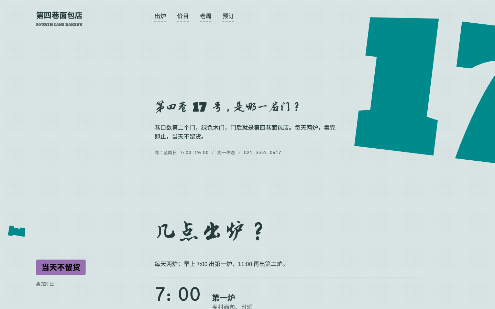
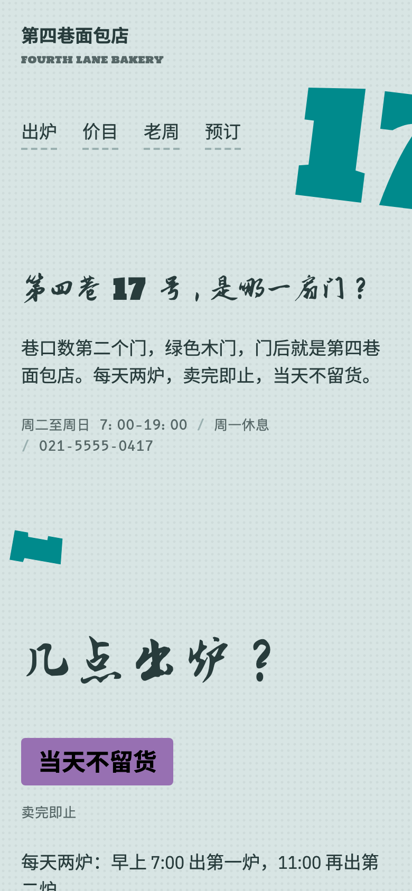
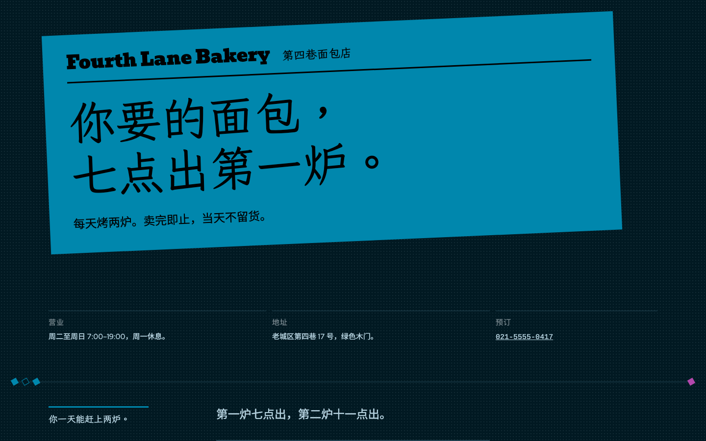
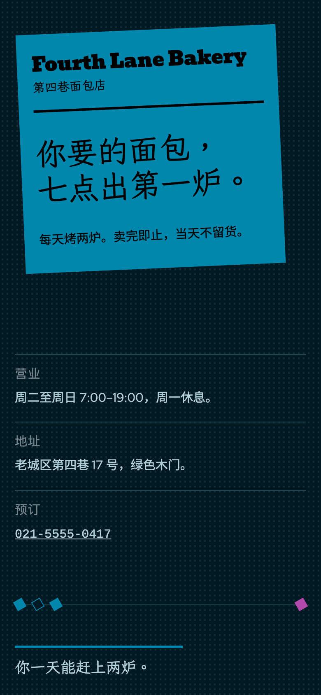
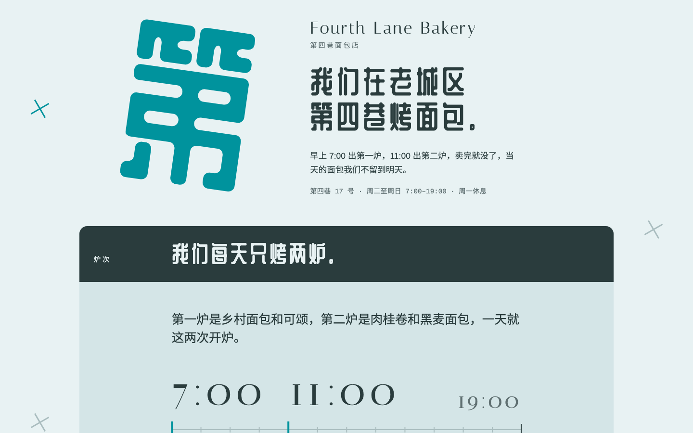
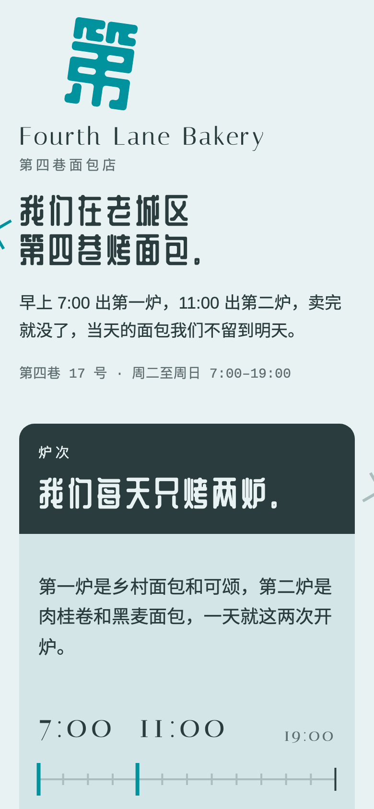
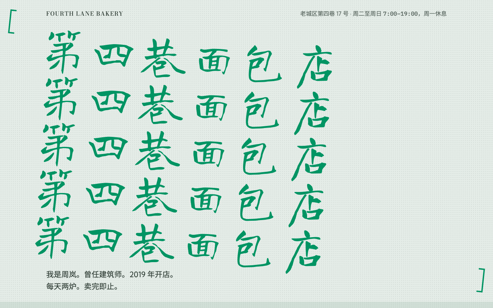
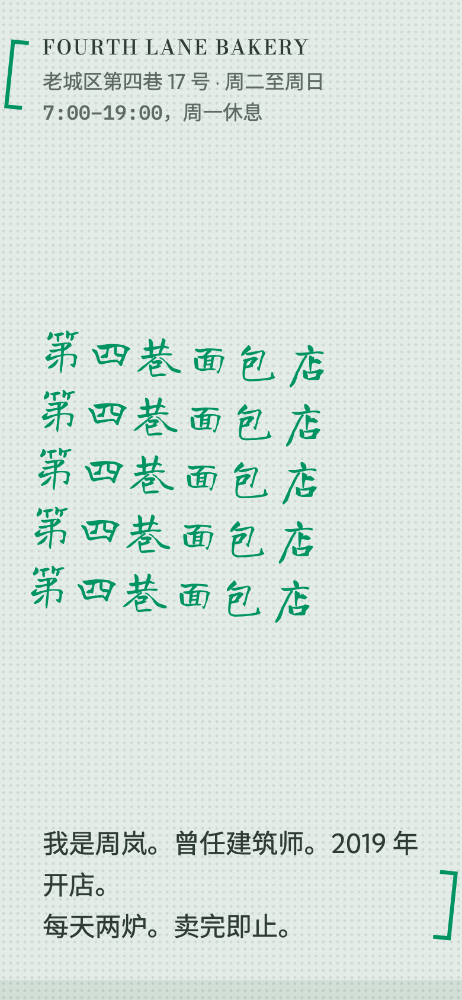
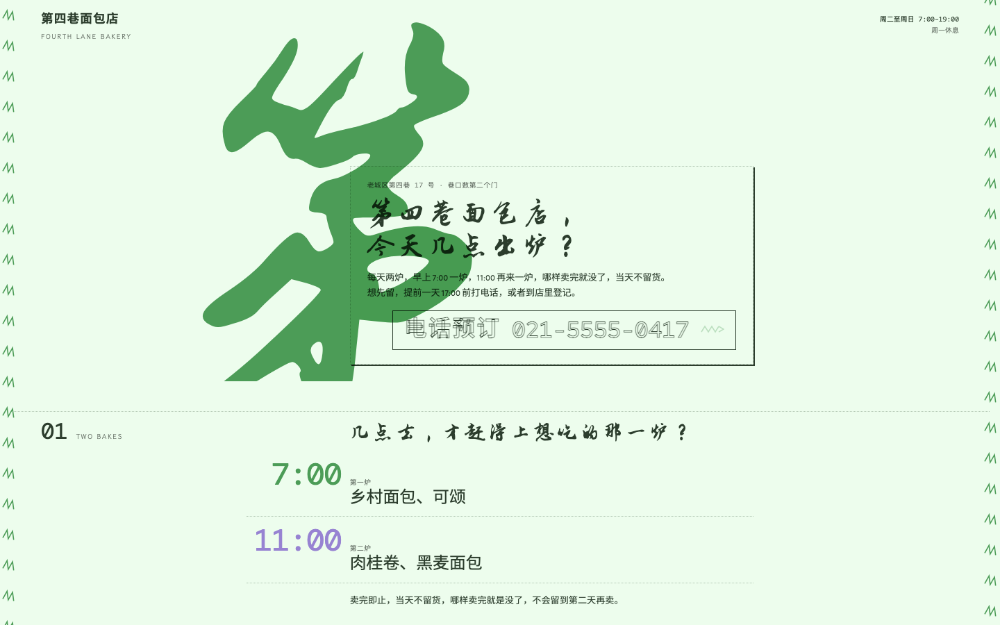
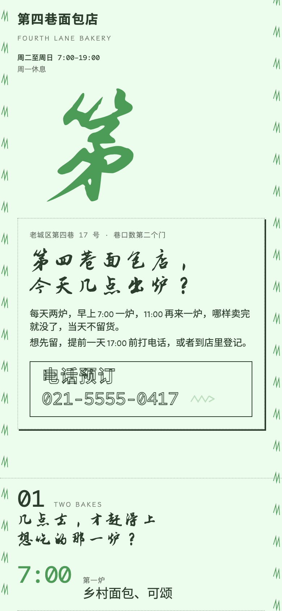

# 示例：第四巷面包店

一次完整的 hash-design 运行，对象是老城区里的一家酸面包店，页面写给中文读者。店铺是虚构的，事实见 [facts.md](facts.md)。

- **在线对比页**：<https://qybaihe.github.io/hash-design/fourth-lane-bakery/compare.html>（按 1–5 放大，D/M 切换桌面/手机）
- **全部示例**：<https://qybaihe.github.io/hash-design/>


## 过程

1. **掷骰。** 用 `hash-design/v2`，库指纹 `bd20321c36ab`。seed 就是文件夹名，只掷了一次、没有重掷；它只用来让示例可复现，真实使用时不要传 `--seed`。

   ```bash
   npm run build
   node packages/core/dist/bin.js roll --subject "第四巷面包店" \
     --facts-file examples/fourth-lane-bakery/facts.md --seed fourth-lane-bakery \
     --out examples/fourth-lane-bakery
   ```

   MCP 的等价调用 `roll_designs { subject, facts, seed: "fourth-lane-bakery", out_dir }` 得到同样的 5 个 ref；`npm run example:roll -- fourth-lane-bakery` 按 [`scripts/examples.mjs`](../../scripts/examples.mjs) 里的清单运行同一条命令。

2. **冻结。** 掷骰写出 [roll.json](roll.json)、[ROLL.md](ROLL.md) 和 [briefs/](briefs)。从这一刻起 brief 是冻结的规格；`examples.test.ts` 检查每份 brief 都和它的 ref 复现出来的一字不差。

3. **渲染。** 按 [Skill](../../skills/hash-design/SKILL.md) 的第 4–5 步，每个预览由一个看不到其他预览的独立子 Agent 完成：只读自己的 brief 和 `facts.md`，写一个自包含 HTML 文件（内联 CSS 和 SVG，不用图片和框架），至少两轮用 critique 和 Playwright 截图自检。复查中有两个 Agent 在第一次 critique 后做了修改：#1 的四个区块共用一个 class，触发了「三张同款卡片」检查（major），另有一个事实里没有的边缘数字，都已改掉；#5 的区块编号改用 CSS 绘制。#3 把两个中文标题里的数字（「9 年」「17 号」）用 CJK 标题字体而不是 Italiana 排，文件里有注释说明。

4. **自检。** `npm run example:critique -- fourth-lane-bakery`，或单页 `hash-design critique previews/NN-*.html --roll roll.json --pick N --facts-file facts.md`：

   | # | ref | 标题 / 正文字体 | critique | brief 遵守度 |
   | --- | --- | --- | --- | --- |
   | 1 | `8b44644e` | Holtwood One SC / IBM Plex Sans Condensed | 100 | 100 |
   | 2 | `a17a25d1` | Bevan / Red Hat Text | 100 | 100 |
   | 3 | `90bac13d` | Italiana / Arimo | 100 | 100 |
   | 4 | `7273983d` | Bodoni Moda / Kumbh Sans | 100 | 100 |
   | 5 | `685aef94` | Klee One / Alegreya Sans | 100 | 100 |

   5 个预览都没有 critical、major 或 minor 问题。

5. **对比。** `hash-design compare --roll examples/fourth-lane-bakery/roll.json` 写出 [compare.html](compare.html)。

6. **挑选。** Skill 在这里停下，等用户回复编号。示例到此为止。

## 5 个方向

### 01 · Holtwood One SC / IBM Plex Sans Condensed

<a href="https://qybaihe.github.io/hash-design/fourth-lane-bakery/previews/01-8b44644e.html"></a> 

`8b44644e` · 浅色纸，色相 196° · 11 栏网格 · 首屏锚点 number · 变数：Set the section headings at 3.5× the size it would normally get. · [brief](briefs/01-8b44644e.md)

首屏是 55% 视口高：青色的「17」（门牌号）用 Holtwood One SC，宽 42%，中心在 93%、旋转 7°，从右边出血；问句标题「第四巷 17 号，是哪一扇门？」放在第 4–10 栏。母题是 64 px、转 100° 的数字 1–4，左右交替排在页边。变数照字面执行：每个问句小标题都放大到常规的 3.5 倍（约 104 px），用 Zhi Mang Xing。

### 02 · Bevan / Red Hat Text

<a href="https://qybaihe.github.io/hash-design/fourth-lane-bakery/previews/02-a17a25d1.html"></a> 

`a17a25d1` · 深色纸，色相 227° · 11 栏网格 · 首屏锚点 colour-block · 变数：Set the section headings at 0.31× the size it would normally get. · [brief](briefs/02-a17a25d1.md)

首屏是一整块青色色块，宽 81%，倾斜 −2.5°，载入时滑入一次，里面是「Fourth Lane Bakery / 第四巷面包店」和黑色标题「你要的面包，七点出第一炉。」。区块之间是细线加 60° 小方块；变数把每个小标题缩到常规的 0.31 倍（19.2 px），放在用 Bevan 排的大数字旁边：7:00 和 11:00 两炉、价格和电话。

### 03 · Italiana / Arimo

<a href="https://qybaihe.github.io/hash-design/fourth-lane-bakery/previews/03-90bac13d.html"></a> 

`90bac13d` · 浅色纸，色相 204° · 12 栏网格 · 首屏锚点 initial · 变数：The section headings: inverted: paper-coloured on ink. · [brief](briefs/03-90bac13d.md)

首屏 50% 视口高：青色的「第」用 ZCOOL QingKe HuangYou，约 25% 宽，旋转 8°，载入时擦入一次；右侧第 6–10 栏是 Italiana 的「Fourth Lane Bakery」和标题「我们在老城区第四巷烤面包。」。五个区块是 16 px 圆角的面板色盒子，每个小标题按变数排成墨底纸色字；60° 的细十字沿页边排列，也用作两种面粉之间的「+」和划掉周一的记号。

### 04 · Bodoni Moda / Kumbh Sans

<a href="https://qybaihe.github.io/hash-design/fourth-lane-bakery/previews/04-7273983d.html"></a> 

`7273983d` · 浅色纸，色相 161° · 6 栏网格 · 首屏锚点 headline · 变数：Repeat the first-screen anchor 5 times in a row. · [brief](briefs/04-7273983d.md)

首屏是用 Long Cang 写的绿色「第四巷面包店」，按变数上下重复五行，约 64% 宽、倾斜 3.5°，分七步淡入。锚点中心按 brief 在 7% 会把店名切掉一块，所以改为从 7% 起排，文件里有注释。倾斜 6° 的绿色方括号排在六条交替色带的两侧；每节左边第 1–3 栏是第一人称短句，右边第 4–6 栏是细节。

### 05 · Klee One / Alegreya Sans

<a href="https://qybaihe.github.io/hash-design/fourth-lane-bakery/previews/05-685aef94.html"></a> 

`685aef94` · 浅色纸，色相 147° · 9 栏网格 · 首屏锚点 initial · 变数：The primary call to action: outlined: stroke only, no fill. · [brief](briefs/05-685aef94.md)

首屏是一个巨大的绿色毛笔「第」（Zhi Mang Xing），宽 42%、旋转 6°，尾巴在首屏底部截断，压在第 4–7 栏的点线框文字块上，里面是问句标题「第四巷面包店，今天几点出炉？」。变数作用在唯一的按钮「电话预订 021-5555-0417」上：只有墨色描边、字是空心的。11° 的锯齿母题沿页边排列，下面六节都用问句标题。
