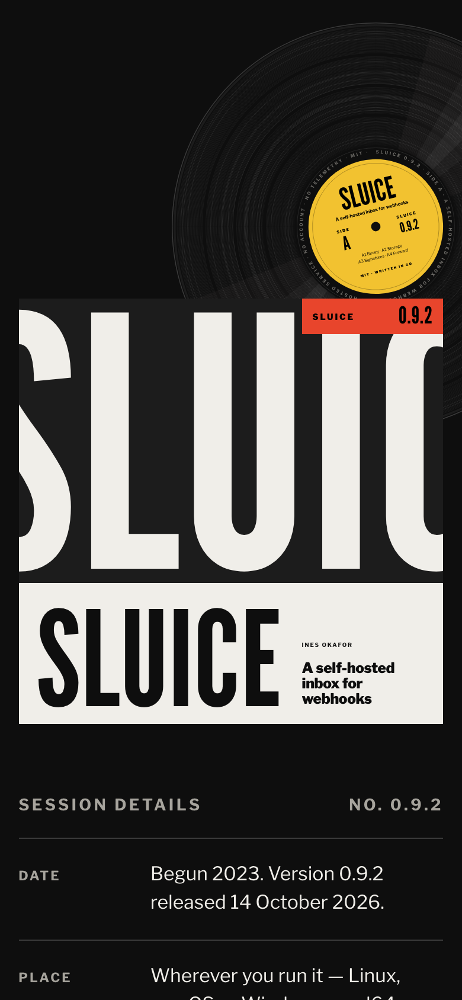
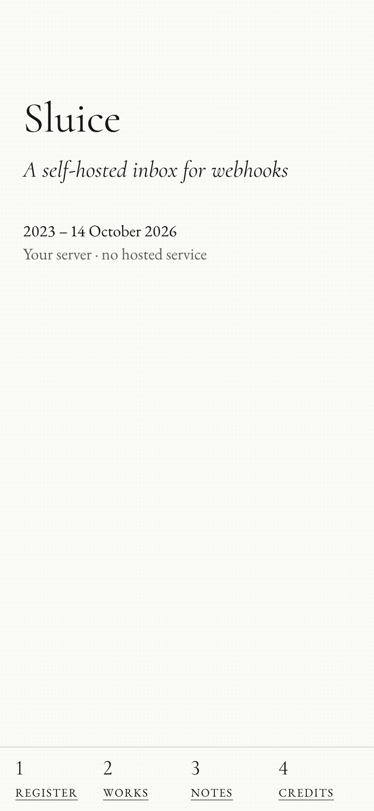
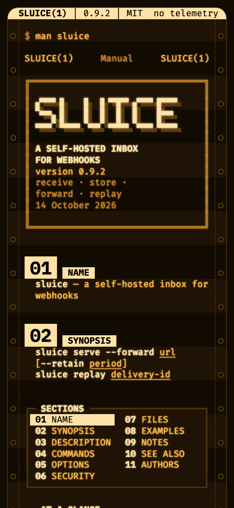
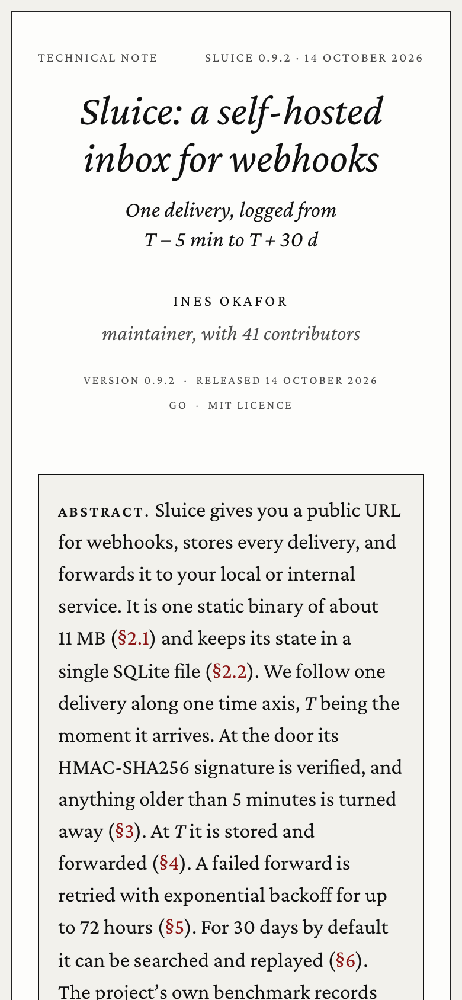
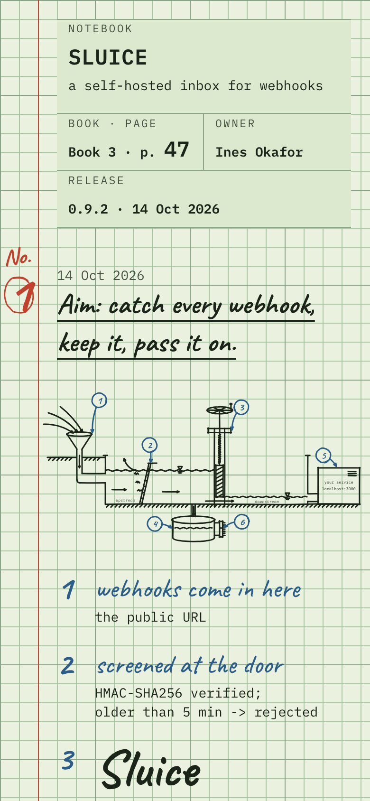

# Example: Sluice

A full hash-design run for an English-language developer tool: Sluice, a self-hosted inbox for webhooks. The product, its maintainer and its numbers are fictional; the facts are in [facts.md](facts.md).

- **Live compare page:** <https://qybaihe.github.io/hash-design/sluice/compare.html> (press 1–5 to zoom, D/M to switch desktop/mobile)
- **All examples:** <https://qybaihe.github.io/hash-design/>


## Process

1. **Roll.** The fixed seed only makes the example reproducible; leave `--seed` out in real use.

   ```bash
   npm run build
   node packages/core/dist/bin.js roll --subject "Sluice — self-hosted webhook inbox" \
     --facts-file examples/sluice/facts.md --seed sluice --out examples/sluice
   ```

   The MCP equivalent, `roll_designs { subject, facts, seed: "sluice", out_dir }`, returns the same five refs. `npm run example:roll -- sluice` runs the same command from the list in [`scripts/examples.mjs`](../../scripts/examples.mjs).

   Seed rule for the examples: try `<name>`, `<name>-2`, `<name>-3`, … and keep the first seed whose five branches appear in no earlier example. `sluice` was clean on the first try.

2. **Freeze.** The roll writes [roll.json](roll.json), [ROLL.md](ROLL.md) and [briefs/](briefs). From here on the briefs are fixed specs.

3. **Render.** Following step 3 of the [Skill](../../skills/hash-design/SKILL.md), each preview was built by its own sub-agent that could not see the others. Each one read only its brief and `facts.md`, wrote one self-contained HTML file (inline CSS and SVG, no images, no frameworks), and checked itself with the critique and Playwright screenshots at least twice. The pages are in English. Some brief text (voice, twist) is written in Chinese; the agents applied it in English.

4. **Critique.** `npm run example:critique -- sluice`, or per page `hash-design critique previews/NN-*.html --roll roll.json --pick N`:

   | #   | Branch            | critique | brief adherence | Minor findings kept                                                                         |
   | --- | ----------------- | -------- | --------------- | ------------------------------------------------------------------------------------------- |
   | 1   | Record sleeve     | 96       | 100             | `5:00` and `72:00:00` (the facts' 5 minutes and 72 hours set as track times), steps 01–03   |
   | 2   | Gallery catalogue | 96       | 100             | plate and clause numbers (Pl. 1–12, 1.1–4.8)                                                |
   | 3   | Terminal phosphor | 92       | 90              | section numbers 01–11; the 18px rounded CRT bezel, which the brief allows as the only curve |
   | 4   | Academic paper    | 96       | 100             | subsection numbers 1.1–6.3                                                                  |
   | 5   | Lab notebook      | 96       | 100             | "Book 3 · p. 47" (the brief asks for it), section numbers 1.1–2.5                           |

   No critical or major findings. Apart from the bezel, every minor finding is the "number not in the facts" check firing on numbering that the layout or twist requires.

5. **Compare.** `hash-design compare --roll examples/sluice/roll.json` writes [compare.html](compare.html). For an English roll the page's labels are English.

6. **Pick.** The Skill stops here and waits for the user to reply with a number. The example ends here.

## The five directions

### 01 · Record sleeve

<a href="https://qybaihe.github.io/hash-design/sluice/previews/01-record-sleeve.html"></a> 

`2519cd97` · layout Blue Note crop · type League Gothic / Libre Franklin · palette Factory black · voice catalogue entry · twist one element breaks the grid · [brief](briefs/01-record-sleeve.md)

The first screen is a square LP sleeve on a 12 × 12 grid: "SLUICE" in League Gothic, so large that the edges of the square crop it, with a red catalogue label reading "SLUICE 0.9.2". The record slides out of the sleeve and off the screen, the one element allowed off the grid; its label is etched with facts only. The back cover lists the facts as SIDE A / SIDE B tracks with right-aligned values, and puts "MIT" in the price slot of the catalogue entry.

### 02 · Gallery catalogue

<a href="https://qybaihe.github.io/hash-design/sluice/previews/02-gallery-catalogue.html"></a> 

`169a48c2+1` · layout Archive checklist · type Cormorant / EB Garamond · palette White cube · voice technical manual · twist navigation not on top · [brief](briefs/02-gallery-catalogue.md)

An exhibition of the software. The entrance wall is mostly empty: title, dates and the rooms index, which is the only navigation and settles into the left rail as you scroll (a strip at the bottom on phones). Each fact becomes one of 12 numbered works with a drawn plate and a tombstone label: the retries are eight lines whose gaps double, the benchmark is exactly 1,800 dots, and "no hosted service, no account, no telemetry" is a blank white sheet. One red dot marks Pl. 7, _Replay_. The text reads like a manual: numbered clauses and imperative steps.

### 03 · Terminal phosphor

<a href="https://qybaihe.github.io/hash-design/sluice/previews/03-terminal-phosphor.html"></a> 

`16333b21` · layout Man page · type IBM Plex Mono / Fira Code · palette P3 amber phosphor · voice personal letter · twist numbered sections · [brief](briefs/03-terminal-phosphor.md)

`$ man sluice` on amber phosphor over green-bar paper: a reverse-video status bar made of facts, an ASCII banner in a double-line frame, and a pinned side pane with the section menu and an "at a glance" panel with `. . . :` leaders. The 11 man-page sections carry large reverse-video numbers. DESCRIPTION is a letter from the maintainer ("Hello —", the lost weekend of payment webhooks, "I hope it saves you a weekend"), signed in AUTHORS with a P.S. The page ends on a prompt with the install command and a blinking cursor, the only thing that moves.

### 04 · Academic paper

<a href="https://qybaihe.github.io/hash-design/sluice/previews/04-academic-paper.html"></a> 

`8fcd60e5+2` · layout Tufte handout · type Crimson Pro / Crimson Pro · palette Preprint white · voice logbook · twist time as structure · [brief](briefs/04-academic-paper.md)

A technical note as PDF pages: a preprint-style side stamp, a centred italic title, the abstract in a framed panel and "Conditions at release" in the margin. The paper follows one delivery along a time axis, with _T_ the moment it arrives: §2 before _T_ (install, start), §3 _T_ − 5 min (signature and age check), §4 _T_ (store, forward), §5 _T_ + 72 h (retries), §6 _T_ + 30 d (search, replay, retention). The margin runs a signed log ("— I. O."), and the figures, tables and references are built only from the facts.

### 05 · Lab notebook

<a href="https://qybaihe.github.io/hash-design/sluice/previews/05-lab-notebook.html"></a> 

`58912b84+5` · layout Dated entries · type Caveat / IBM Plex Mono · palette Green computation pad · voice field notes · twist numbered sections · [brief](briefs/05-lab-notebook.md)

A page of a squared lab notebook. Entry 1 opens with the aim, "catch every webhook, keep it, pass it on", and a line drawing of Sluice as a canal sluice: an intake funnel for the public URL, a screen for the HMAC check, a gate for the binary, a tank for the SQLite file and a sight glass for the web UI. Data is in mono, handwriting only for labels and remarks. Corrections are struck through and initialled ("localhost:~~8081~~ 3000 I.O."), and the "Witnessed by" line is left blank because the facts name no witness.

## Files

```
facts.md            the fact sheet (the only content a page may state)
roll.json / ROLL.md the five hashes, mapping, constraints and each brief as JSON
briefs/             five frozen briefs
previews/           five preview pages
compare.html        side-by-side compare page
screenshots/        desktop first screen / full page / mobile per preview, compare page (desktop and phone width)
```

Screenshots come from `npm run screenshots` (run `npx playwright install chromium` first). [`packages/core/test/examples.test.ts`](../../packages/core/test/examples.test.ts) keeps this roll, its briefs and the critique scores in step with the library.
