# Example: Sluice

A full hash-design run for an English-language developer tool: Sluice, a self-hosted inbox for webhooks. The product, its maintainer and its numbers are fictional; the facts are in [facts.md](facts.md).

- **Live compare page:** <https://qybaihe.github.io/hash-design/sluice/compare.html> (press 1–5 to zoom, D/M to switch desktop/mobile)
- **All examples:** <https://qybaihe.github.io/hash-design/>

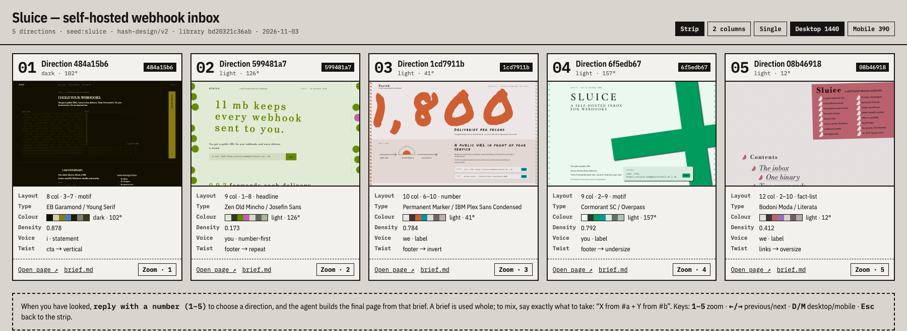

## Process

1. **Roll.** The roll uses `hash-design/v2` with library `bd20321c36ab`. The seed is the folder name and was used once, with no re-rolls; it only makes the example reproducible, so leave `--seed` out in real use.

   ```bash
   npm run build
   node packages/core/dist/bin.js roll --subject "Sluice — self-hosted webhook inbox" \
     --facts-file examples/sluice/facts.md --seed sluice \
     --out examples/sluice
   ```

   The MCP equivalent, `roll_designs { subject, facts, seed: "sluice", out_dir }`, returns the same five refs, and `npm run example:roll -- sluice` runs the same command from [`scripts/examples.mjs`](../../scripts/examples.mjs).

2. **Freeze.** The roll writes [roll.json](roll.json), [ROLL.md](ROLL.md) and [briefs/](briefs). From here on the briefs are fixed specs; `examples.test.ts` checks that each one is exactly what its ref reproduces.

3. **Render.** Following steps 4–5 of the [Skill](../../skills/hash-design/SKILL.md), each preview was built by its own sub-agent that could not see the others. Each one read only its brief and `facts.md`, wrote one self-contained HTML file (inline CSS and SVG, no images, no frameworks) and checked itself with the critique and Playwright screenshots at least twice. In review, three agents changed something after their first critique: #1 and #5 removed section numbers the facts don’t contain, and #4 removed a second Copy button that read as a centred hero with two buttons.

4. **Critique.** `npm run example:critique -- sluice`, or per page `hash-design critique previews/NN-*.html --roll roll.json --pick N --facts-file facts.md`:

   | # | ref | display / body | critique | brief adherence |
   | --- | --- | --- | --- | --- |
   | 1 | `484a15b6` | EB Garamond / Young Serif | 100 | 100 |
   | 2 | `599481a7` | Zen Old Mincho / Josefin Sans | 100 | 100 |
   | 3 | `1cd7911b` | Permanent Marker / IBM Plex Sans Condensed | 100 | 100 |
   | 4 | `6f5edb67` | Cormorant SC / Overpass | 100 | 100 |
   | 5 | `08b46918` | Bodoni Moda / Literata | 100 | 100 |

   No critical, major or minor findings on any of the five.

5. **Compare.** `hash-design compare --roll examples/sluice/roll.json` writes [compare.html](compare.html).

6. **Pick.** The Skill stops here and waits for the user to reply with a number. The example ends here.

## The five directions

### 01 · EB Garamond / Young Serif

<a href="https://qybaihe.github.io/hash-design/sluice/previews/01-484a15b6.html">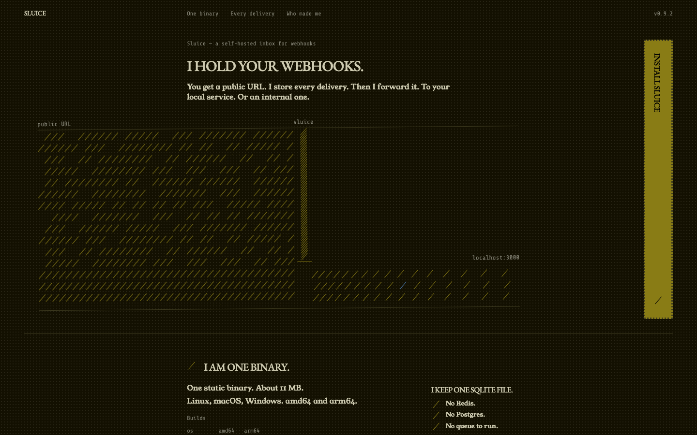</a> 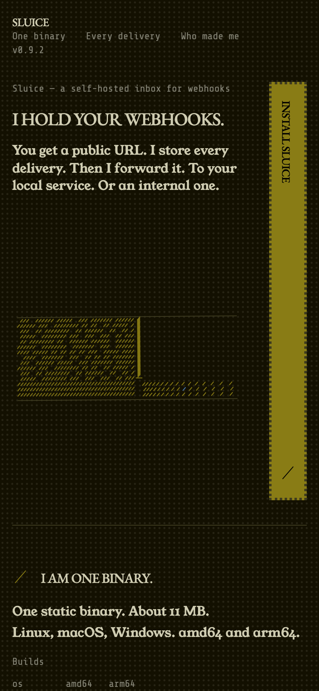

`484a15b6` · dark paper, hue 102° · 8-column grid · anchor: motif · twist: The primary call to action: set vertically (writing-mode: vertical-rl). · [brief](briefs/01-484a15b6.md)

Dark olive. “I hold your webhooks.” is set in EB Garamond small caps in columns 3–7 with a short first-person lede; the anchor below is a diagram of hairline rules at 131°, held in rows behind a gate, with three rows passing under it towards `localhost:3000`. “Install Sluice” runs vertically as a tall olive bar in column 8, also on phones.

### 02 · Zen Old Mincho / Josefin Sans

<a href="https://qybaihe.github.io/hash-design/sluice/previews/02-599481a7.html">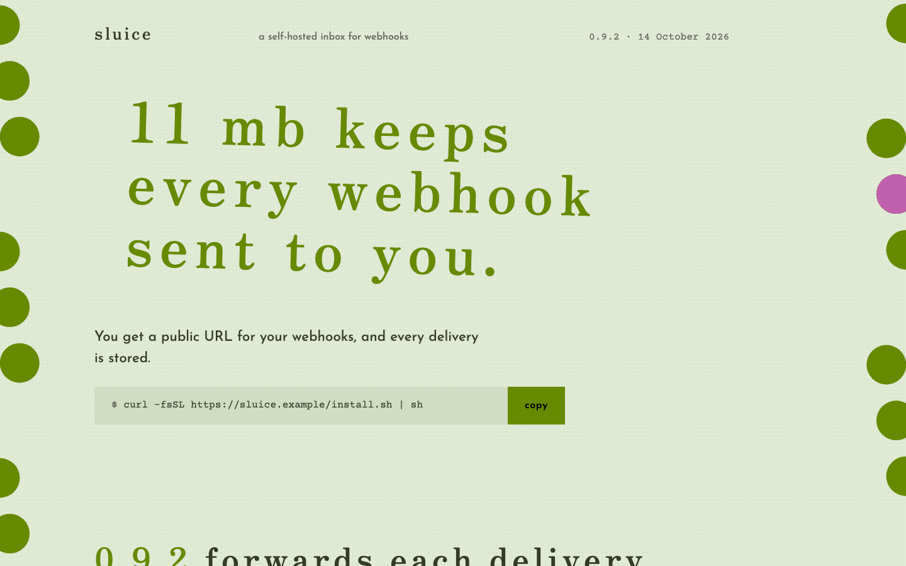</a> 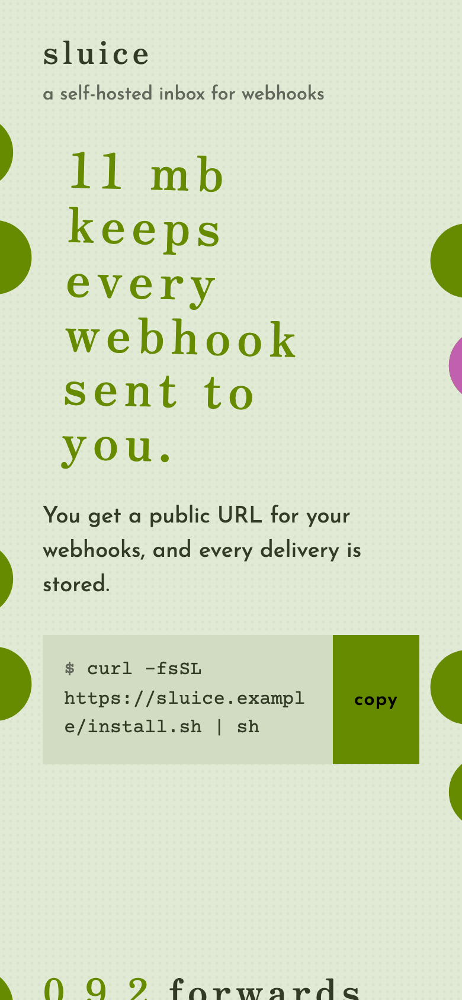

`599481a7` · light paper, hue 126° · 9-column grid · anchor: headline · twist: Repeat the footer 4 times in a row. · [brief](briefs/02-599481a7.md)

The lowercase olive Zen Old Mincho headline “11 mb keeps every webhook sent to you.” is 52% of the width and tilted 1.5°, over one lead sentence and the install command. Large dots in groups of three lean at 80° down both edges, one of them pink, and the footer is repeated four times at the bottom.

### 03 · Permanent Marker / IBM Plex Sans Condensed

<a href="https://qybaihe.github.io/hash-design/sluice/previews/03-1cd7911b.html">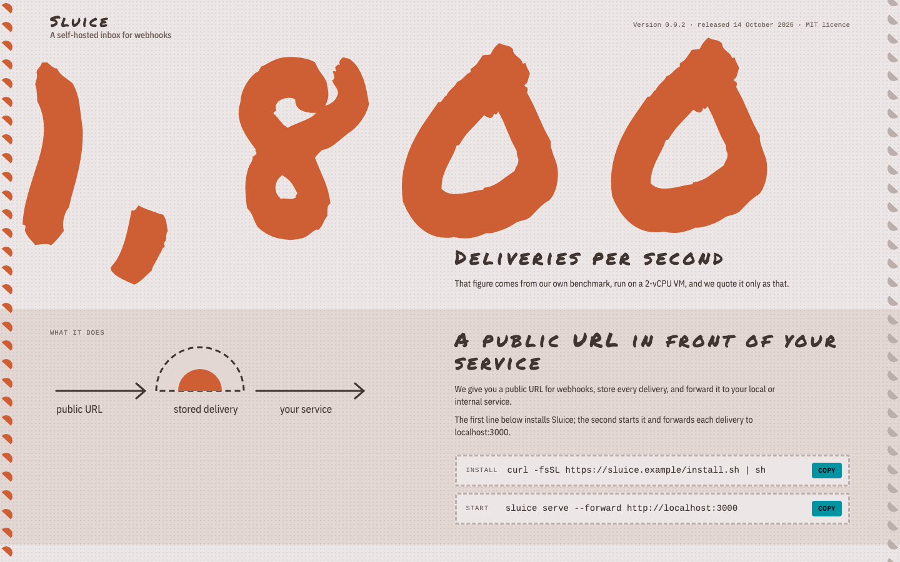</a> 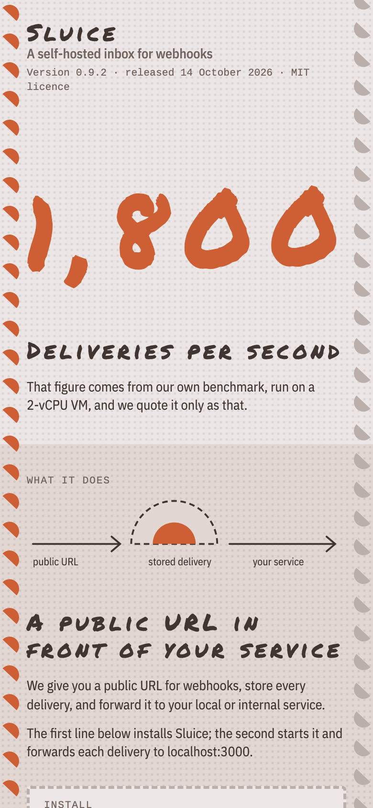

`1cd7911b` · light paper, hue 41° · 10-column grid · anchor: number · twist: The footer: inverted: paper-coloured on ink. · [brief](briefs/03-1cd7911b.md)

“1,800” in orange Permanent Marker fills 90% of the width, tilted −1.5°, with a caption saying it is deliveries per second from the project’s own benchmark on a 2-vCPU VM. Half-circles at 43° run down both edges and mark the platform table; eight sections alternate bands, and the footer is inverted, paper on ink.

### 04 · Cormorant SC / Overpass

<a href="https://qybaihe.github.io/hash-design/sluice/previews/04-6f5edb67.html">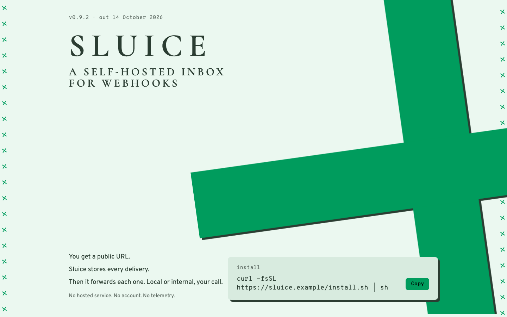</a> 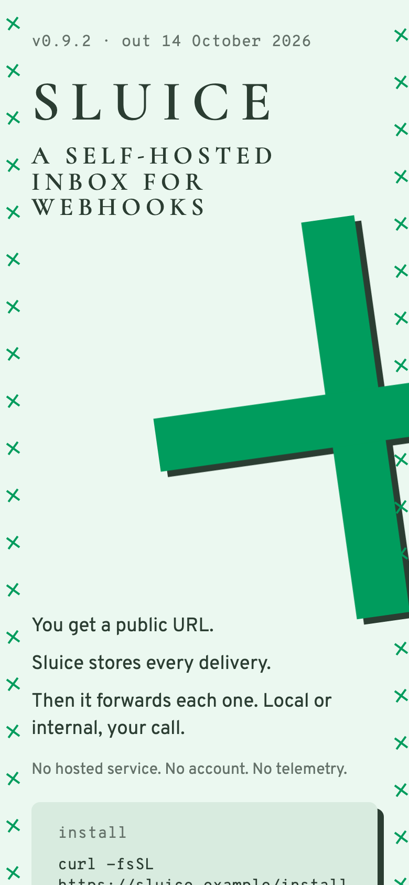

`6f5edb67` · light paper, hue 157° · 9-column grid · anchor: motif · twist: Set the footer at 0.34× the size it would normally get. · [brief](briefs/04-6f5edb67.md)

“SLUICE” and “a self-hosted inbox for webhooks” in Cormorant SC capitals at the top left, short second-person lines and the install box at the bottom. The anchor is one solid green cross with a hard ink shadow, 98% of the width and turned −8°; small crosses at 126° run down both edges. The footer is a small box over 3 of the 9 columns.

### 05 · Bodoni Moda / Literata

<a href="https://qybaihe.github.io/hash-design/sluice/previews/05-08b46918.html">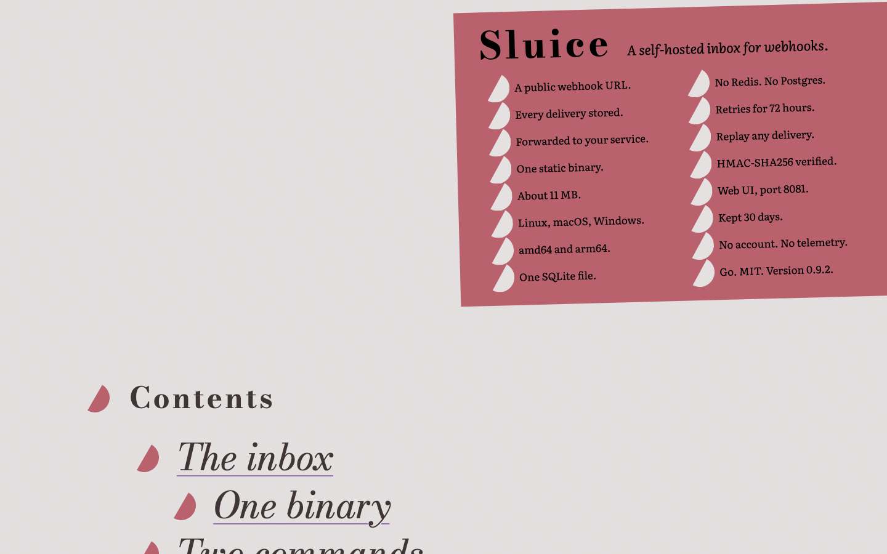</a> 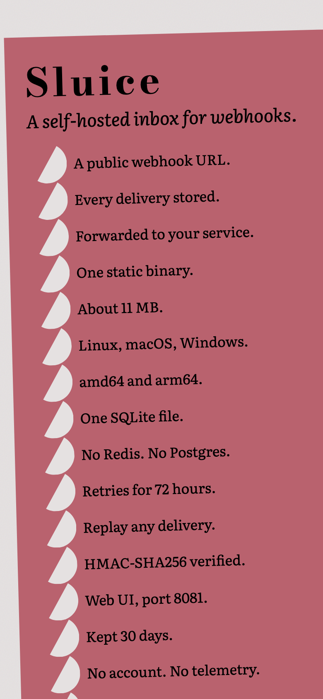

`08b46918` · light paper, hue 12° · 12-column grid · anchor: fact-list · twist: Set the links at 3.6× the size it would normally get. · [brief](briefs/05-08b46918.md)

A dusty-rose block holds the fact list in two columns under “Sluice” in Bodoni, rotated −1.5° so its right edge runs off the page, with paper-coloured half-circle markers. Every link (contents, `install.sh`, `localhost:8081`) is set at 3.6× the body size in Bodoni italic.
